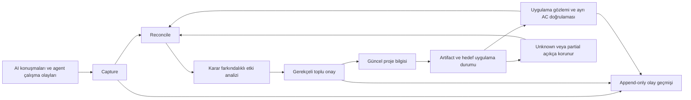

# Decivora

### Living project memory. Decisions, actions, and evidence stay connected.

**Kararlarla evrilen AI-native proje hafızası.** Neyi konuştuk, neyi seçtik, ne gerçekten uygulandı ve hangi işler yeni karardan etkilendi? Decivora bu ayrımları kaynak ve kanıtlarıyla farklı oturumlar boyunca korumayı hedefler.

> **Durum: Discovery / Product Definition.** Bu repository ürün ve mühendislik planıdır. Çalışan uygulama, otomatik capture entegrasyonu veya doğrulanmış performans sonucu henüz yoktur. Decivora geçici çalışma adıdır; marka ve alan adı uygunluğu kesinleşmemiştir.

**Güncel odak — tasarım revizyonu 03:** Claude Projects sonrasında ilk yatırım sorusu, kullanıcı seçimi ile hedefte gerçekleşen işlemin sürekliliğidir. Önce sınırlı prototip + adil native karşılaştırması önerilir; tam vizyon/P1b MVP korunur. Build/extend sonucu ve prototip başlatma henüz karara bağlanmadı. [Güncel yön ve önce/sonra tablosu](docs/product/current-direction.md) · [Tek belge seti, sürüm düzeni](docs/governance/versioning.md).

## Çözdüğümüz problem

AI bir fikir önerir. Bir prompt başka bir agente taşınır. Geliştirme sırasında yeni kararlar alınır. Başlangıçtaki işler kaybolur veya artık gerekmemelerine rağmen açık kalır. Kullanıcı hangi işin unutulduğunu, tamamlandığını ya da karar beklediğini göremez.

Decivora'nın hedefi kullanıcının kart, açıklama ve kabul kriteri yazmasını gerektirmeden şu soruları yanıtlamaktır:

- Ne önerildi ve hangi kaynaktan geldi?
- Ne değerlendirildi, ne onaylandı, ne gerçekten doğrulandı?
- Üretilen dosya gerçekten hedefe uygulandı mı; bunu biliyor muyuz?
- Yeni karar hangi eski işleri değiştirdi; hangileri başka gerekçelerle hâlâ gerekli?
- Sırada hangi küçük iş veya insan kararı var?



## Gösterilecek ilk değer

**Güncel ilk deney; çalışan demo değildir:** AI üç dosya üretir, kullanıcı yeni yaklaşımı seçer; hedefte yükleme kanıtı yoktur. Sonraki oturuma dosyalar yüklenmiş varsayımı yerine onaylı karar, üretilen taslaklar, uygulama bilinmeyeni ve uygun sonraki adım aktarılır. [Sentetik oracle](examples/intent-reality-scenario.json) ve [GAP-01–10](docs/product/intent-to-reality-gap.md) bu ayrımı sınamak için hazırlanmıştır.

**Korunan impact senaryosu:** Proje Markdown depolamadan SQLite'a geçer. Eski senkronizasyon işi gereksizleşme adayı olur. Dosya izleme işi belge importu için de gerektiğinden korunur. Önceden gerçekten tamamlanan iş tarihçede kalır. Kullanıcı öneriyi inceler; onay yeni olay üretir, geçmişi değiştirmez.

| Ürünün odağı | Kullanıcıya değeri |
|---|---|
| Yaşayan karar ve bilgi grafiği | Eski önerileri güncel gerçek sanmaz |
| Karara bağlı görev gerekçeleri | Bir karar değişince ilişkili işleri yeniden değerlendirir |
| Pasif yakalama + hazırlanmış onay | Manuel proje yönetimini azaltır |
| Kanıta dayalı durum | Agent'ın “bitti” demesini test sonucu saymaz |
| Maliyet farkındalığı | Basit işlemleri gereksiz LLM çağrısına dönüştürmez |

Bu yetenekler **tasarım hedefidir**. Rakiplerde bulunmadığı veya Decivora'nın daha iyi olduğu henüz kanıtlanmış değildir.

## Buradan başlayın

| Amaç | Belge |
|---|---|
| Son evrim ve önceki planla fark | [Güncel yön](docs/product/current-direction.md) · [Sürüm/otorite düzeni](docs/governance/versioning.md) |
| Vizyon ve ürün ilkeleri | [Ürün tanımı](docs/product/vision.md) |
| Hiçbir fikri kaybetmeden kapsamı görmek | [Tam kapsam](docs/product/full-scope.md) |
| İlk sürümün sınırlarını anlamak | [MVP](docs/product/mvp.md) |
| Fikrin neden değiştiğini öğrenmek | [Evrim hikâyesi](docs/discovery/evolution.md) · [Karar haritası](docs/product/decision-map.md) |
| Araçlardan ne öğreniyoruz? | [Benchmark](docs/discovery/benchmark.md) · [Kaynaklar](docs/discovery/sources.md) |
| Nasıl inşa edeceğiz? | [Mimari](docs/architecture/overview.md) · [ADR dizini](docs/architecture/adr/README.md) |
| Faz bazında proje ağacı ve takip | [MVP, P2, P3 ve kapılar](docs/delivery/phase-tracker.md) |
| Sıradaki küçük adım | [Güncel durum](docs/delivery/status.md) · [Görevler](docs/delivery/backlog.md) · [Roadmap](ROADMAP.md) |
| Nasıl güveneceğiz? | [Doğrulama](docs/quality/verification.md) · [Ölçüm](docs/quality/measurement.md) |
| Codex ile devam etmek | [AGENTS.md](AGENTS.md) · [Başlangıç talimatı](docs/delivery/start-here.md) |
| Başka bir LLM ne anlamalı? | [Devir ve anlama kontrolü](docs/delivery/llm-handoff.md) |
| Kullanıcı hangi özellikleri görecek? | [17 özellik ve kullanıcı yolculuğu](docs/product/feature-catalog.md) |
| Konuştuğumuz engine'ler nerede? | [10 modül ve kaynak isimleri](docs/architecture/engines.md) |
| Sistem ayrıntıları ve diyagramlar | [13 diyagramlık atlas](docs/architecture/diagrams.md) · [Runtime sözleşmeleri](docs/architecture/runtime-contracts.md) · [Diyagram incelemesi](docs/quality/diagram-review.md) |
| Kim, ne zaman, hangi API/LLM işini tetikler? | [İletişim matrisi, zamanlama ve üç sequence](docs/architecture/execution-and-integrations.md) |
| DB kayıtları ve kanıtlar nasıl ilişkili? | [Üç tamamlayıcı ER, anahtarlar ve bütünlük kuralları](docs/architecture/data-relationships.md) |
| Diğer araçlardan ne fark hedefliyoruz? | [Farklılaşma ve altı hipotez](docs/product/differentiation.md) |
| Proje nasıl yönetilecek? | [Kısa proje yönetim planı](docs/delivery/project-management.md) |
| Eksikler yeniden tarandı mı? | [Mimari/kapsam incelemesi](docs/quality/completeness-review.md) · [Kaynak→özellik→test matrisi](docs/quality/traceability.md) |
| İnsanlar neye takılıyor; biz neyi çözeceğiz? | [Şikâyetler, karşı kanıt ve ters düşünme](docs/discovery/user-research.md) |
| Gerçek benchmark sonucu var mı? | [Mevcut bulgular ve ölçüm sınırı](docs/discovery/benchmark-findings.md) |
| Ekipte insanlar ve agent'lar nasıl yetkilendirilecek? | [Rol, grant ve özel hafıza](docs/architecture/identity-access.md) · [Hedefli benchmark](docs/discovery/collaboration-storage-benchmark.md) |
| Log, DB, kalıcı/geçici hafıza ve kapasite nasıl olacak? | [Log ve audit](docs/architecture/logging-audit.md) · [Depolama ve ölçek planı](docs/architecture/storage-memory-capacity.md) |
| Ekip altyapısını hangi adımlarla yapacağız? | [Fazlı uygulama planı](docs/delivery/team-data-plan.md) · [18 ek kabul senaryosu](docs/quality/collaboration-validation.md) |
| Codex/Claude Code nasıl bağlanacak? | [Kurulum, capture, MCP ve context](docs/architecture/connection-and-context.md) |
| İngilizce dışındaki konuşmalar ve proje çıktıları | [Konuşma dili, locale, P2 otomasyonu ve maliyet](docs/product/language-and-localization.md) |
| Fazla token tüketimi nasıl önlenecek? | [Limitler, cache, bütçe rezervasyonu ve ölçüm](docs/architecture/routing-token-economy.md) |
| Hangi işler fazla token riski için ayrıca onay ister? | [Risk tespiti, sınırlı plan onayı ve 10 kabul senaryosu](docs/product/token-risk-and-approval.md) |
| Farklı chat'ler ve hızlı konuşmalar nasıl işlenir? | [Ortak proje bağlamı, kaynak izleri ve gecikme yönetimi](docs/architecture/multi-chat-and-processing-lag.md) |
| Rate limit, transaction ve kötüye kullanım nasıl yönetilecek? | [Katmanlı sınırlar, admin davranışı ve 10 kabul senaryosu](docs/architecture/resource-limits-and-abuse.md) |
| İlişkiler ve iptaller grafikte nasıl görünecek? | [Görsel sözlük, geçmiş ve örnek diyagramlar](docs/product/graph-experience.md) |
| İşin fikri nasıl olgunlaştı; hangi testler yapıldı? | [Bağlam hikâyesi, AC/DoD ve kanıt matrisi](docs/product/task-context-and-acceptance.md) |
| Konuşmada önerilen dosya gerçekten yüklendi mi; hangi yaklaşım seçildi? | [Niyet, karar, uygulama ve kanıt ayrımı](docs/product/intent-to-reality-gap.md) |
| Yeni Claude Projects ile nerede örtüşüyoruz? | [Güncel rekabet incelemesi](docs/discovery/claude-projects-overlap.md) |
| Yarım kalan işe yeni chat'te nasıl döneriz? | [Devam paketi ve hafıza yeterliliği](docs/product/resume-package-and-memory.md) · [Spike-1 v1 deney planı](docs/delivery/spike-1-v1.md) |
| Hangi kararlar kullanıcıyı bekliyor? | [Owner soruları ve teknik hazırlık](docs/delivery/decision-brief.md) |
| Admin, kullanıcı rolleri, hata takibi ve backoffice | [Yönetim ve işletim sözleşmesi](docs/product/administration-and-operations.md) |
| Açık kaynak mı, private mı, self-host mu? | [Lisans, hosting, erişim ve paket ayrımı](docs/governance/licensing.md#kaynak-kodu-kurulum-erişim-ve-paket-ayrı-kararlar) |

## Repository düzeni

```text
docs/
  product/       Vizyon, tüm kapsam, MVP, kararlar, onay UX
  discovery/     Konuşma izlenebilirliği, benchmark, kaynaklar
  architecture/  Bileşenler, sözleşmeler, event log, ADR
  delivery/      Aşama, küçük görevler, devam etme düzeni
  quality/       Kabul senaryoları, doğrulama ve ölçüm
  governance/    Risk, gizlilik, lisans ve açık kararlar
examples/        Sentetik etki analizi örneği
scripts/         Dokümantasyon tutarlılık kontrolü
```

Dokümantasyon kontrolü: `python3 scripts/check_docs.py`. Bu komut uygulama özelliklerini test etmez.

## Kapsam ve lisans

Tam ürün vizyonu korunur; MVP dışında kalanlar silinmez, [roadmap](ROADMAP.md) üzerinde yer alır. Ürün araştırma projelerini repository olmadan da desteklemeyi hedefler. Claude Code, Codex, ChatGPT Chat ve Claude Chat ayrı entegrasyon yüzeyleridir; tüm sohbetleri otomatik okuyabilme sözü verilmez.

Başlangıç repository'si private olarak tasarlanmıştır. Açık kaynak yayın kararı ve lisans seçimi beklemektedir. AGPLv3 ana aday, Apache-2.0 alternatiftir; henüz lisans verilmemiştir. [Lisans stratejisini](docs/governance/licensing.md) okuyun.
