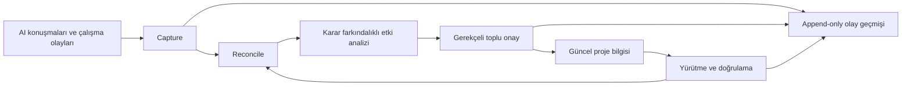

# Decivora

### Living project memory. Decisions evolve; plans stay accountable.

**Kararlarla evrilen AI-native proje hafızası.** Konuşmalardaki fikirleri, bulguları, talimatları ve yarım kalan işleri yakalamayı; yeni kararların mevcut işler üzerindeki etkisini gerekçesiyle göstermeyi hedefler.

> **Durum: Discovery / Product Definition.** Bu repository ürün ve mühendislik planıdır. Çalışan uygulama, otomatik capture entegrasyonu veya doğrulanmış performans sonucu henüz yoktur. Decivora geçici çalışma adıdır; marka ve alan adı uygunluğu kesinleşmemiştir.

## Çözdüğümüz problem

AI bir fikir önerir. Bir prompt başka bir agente taşınır. Geliştirme sırasında yeni kararlar alınır. Başlangıçtaki işler kaybolur veya artık gerekmemelerine rağmen açık kalır. Kullanıcı hangi işin unutulduğunu, tamamlandığını ya da karar beklediğini göremez.

Decivora'nın hedefi kullanıcının kart, açıklama ve kabul kriteri yazmasını gerektirmeden şu soruları yanıtlamaktır:

- Ne önerildi ve hangi kaynaktan geldi?
- Ne değerlendirildi, ne onaylandı, ne gerçekten doğrulandı?
- Yeni karar hangi eski işleri değiştirdi; hangileri başka gerekçelerle hâlâ gerekli?
- Sırada hangi küçük iş veya insan kararı var?



## Gösterilecek ilk değer

**Örnek senaryo; çalışan demo değildir:** Proje Markdown depolamadan SQLite'a geçer. Eski senkronizasyon işi gereksizleşme adayı olur. Dosya izleme işi belge importu için de gerektiğinden korunur. Önceden gerçekten tamamlanan iş tarihçede kalır. Kullanıcı öneriyi inceler; onay yeni olay üretir, geçmişi değiştirmez.

| Ürünün odağı | Kullanıcıya değeri |
|---|---|
| Yaşayan karar ve bilgi grafiği | Eski önerileri güncel gerçek sanmaz |
| Karara bağlı görev gerekçeleri | Bir karar değişince ilişkili işleri yeniden değerlendirir |
| Pasif yakalama + hazırlanmış onay | Manuel proje yönetimini azaltır |
| Kanıta dayalı durum | Agent'ın “bitti” demesini test sonucu saymaz |
| Maliyet farkındalığı | Basit işlemleri gereksiz LLM çağrısına dönüştürmez |

Bu yetenekler **tasarım hedefidir**. Rakiplerde bulunmadığı veya Decivora'nın daha iyi olduğu henüz kanıtlanmış değildir.

## Buradan başlayın

| Amaç | Belge |
|---|---|
| Vizyon ve ürün ilkeleri | [Ürün tanımı](docs/product/vision.md) |
| Hiçbir fikri kaybetmeden kapsamı görmek | [Tam kapsam](docs/product/full-scope.md) |
| İlk sürümün sınırlarını anlamak | [MVP](docs/product/mvp.md) |
| Fikrin neden değiştiğini öğrenmek | [Evrim hikâyesi](docs/discovery/evolution.md) · [Karar haritası](docs/product/decision-map.md) |
| Araçlardan ne öğreniyoruz? | [Benchmark](docs/discovery/benchmark.md) · [Kaynaklar](docs/discovery/sources.md) |
| Nasıl inşa edeceğiz? | [Mimari](docs/architecture/overview.md) · [ADR dizini](docs/architecture/adr/README.md) |
| Sıradaki küçük adım | [Güncel durum](docs/delivery/status.md) · [Görevler](docs/delivery/backlog.md) · [Roadmap](ROADMAP.md) |
| Nasıl güveneceğiz? | [Doğrulama](docs/quality/verification.md) · [Ölçüm](docs/quality/measurement.md) |
| Codex ile devam etmek | [AGENTS.md](AGENTS.md) · [Başlangıç talimatı](docs/delivery/start-here.md) |
| Başka bir LLM ne anlamalı? | [Devir ve anlama kontrolü](docs/delivery/llm-handoff.md) |
| Kullanıcı hangi özellikleri görecek? | [17 özellik ve kullanıcı yolculuğu](docs/product/feature-catalog.md) |
| Konuştuğumuz engine'ler nerede? | [10 modül ve kaynak isimleri](docs/architecture/engines.md) |
| Sistem ayrıntıları ve diyagramlar | [8 diyagramlık atlas](docs/architecture/diagrams.md) · [Runtime sözleşmeleri](docs/architecture/runtime-contracts.md) |
| Diğer araçlardan ne fark hedefliyoruz? | [Farklılaşma ve altı hipotez](docs/product/differentiation.md) |
| Proje nasıl yönetilecek? | [Kısa proje yönetim planı](docs/delivery/project-management.md) |
| Eksikler yeniden tarandı mı? | [Mimari/kapsam incelemesi](docs/quality/completeness-review.md) · [Kaynak→özellik→test matrisi](docs/quality/traceability.md) |
| İnsanlar neye takılıyor; biz neyi çözeceğiz? | [Şikâyetler, karşı kanıt ve ters düşünme](docs/discovery/user-research.md) |
| Gerçek benchmark sonucu var mı? | [Mevcut bulgular ve ölçüm sınırı](docs/discovery/benchmark-findings.md) |
| Ekipte insanlar ve agent'lar nasıl yetkilendirilecek? | [Rol, grant ve özel hafıza](docs/architecture/identity-access.md) · [Hedefli benchmark](docs/discovery/collaboration-storage-benchmark.md) |
| Log, DB, kalıcı/geçici hafıza ve kapasite nasıl olacak? | [Log ve audit](docs/architecture/logging-audit.md) · [Depolama ve ölçek planı](docs/architecture/storage-memory-capacity.md) |
| Ekip altyapısını hangi adımlarla yapacağız? | [Fazlı uygulama planı](docs/delivery/team-data-plan.md) · [18 ek kabul senaryosu](docs/quality/collaboration-validation.md) |
| Hangi kararlar kullanıcıyı bekliyor? | [Owner soruları ve teknik hazırlık](docs/delivery/decision-brief.md) |

## Repository düzeni

```text
docs/
  product/       Vizyon, tüm kapsam, MVP, kararlar, onay UX
  discovery/     Konuşma izlenebilirliği, benchmark, kaynaklar
  architecture/  Bileşenler, sözleşmeler, event log, ADR
  delivery/      Aşama, küçük görevler, devam etme düzeni
  quality/       Kabul senaryoları, doğrulama ve ölçüm
  governance/    Risk, gizlilik, lisans ve açık kararlar
examples/        Sentetik etki analizi örneği
scripts/         Dokümantasyon tutarlılık kontrolü
```

Dokümantasyon kontrolü: `python3 scripts/check_docs.py`. Bu komut uygulama özelliklerini test etmez.

## Kapsam ve lisans

Tam ürün vizyonu korunur; MVP dışında kalanlar silinmez, [roadmap](ROADMAP.md) üzerinde yer alır. Ürün araştırma projelerini repository olmadan da desteklemeyi hedefler. Claude Code, Codex, ChatGPT Chat ve Claude Chat ayrı entegrasyon yüzeyleridir; tüm sohbetleri otomatik okuyabilme sözü verilmez.

Başlangıç repository'si private olarak tasarlanmıştır. Açık kaynak yayın kararı ve lisans seçimi beklemektedir. AGPLv3 ana aday, Apache-2.0 alternatiftir; henüz lisans verilmemiştir. [Lisans stratejisini](docs/governance/licensing.md) okuyun.
