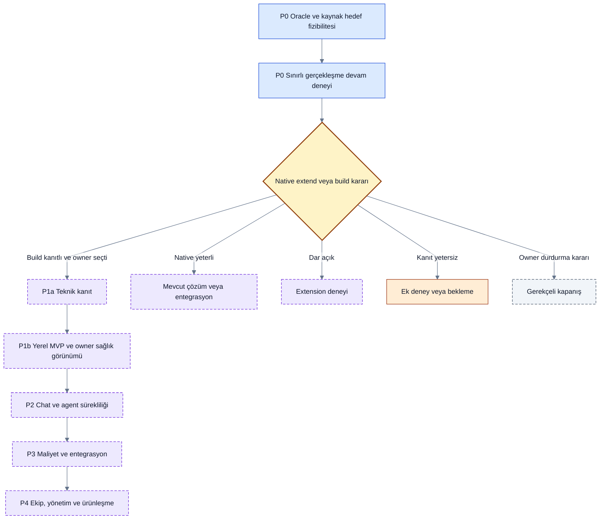
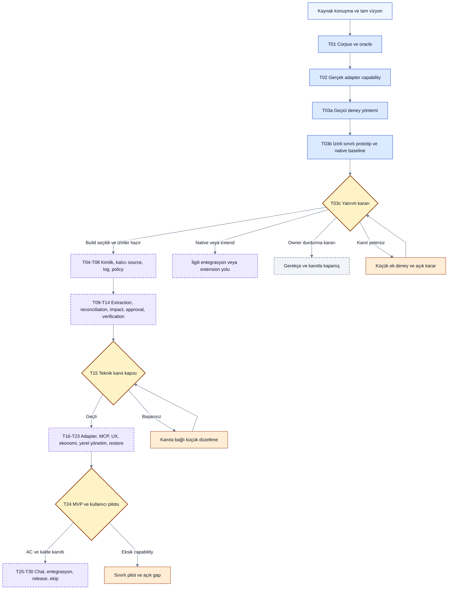

# Roadmap

> [!NOTE]
> **Şema anahtarı:** mavi kaynak/işleme · sarı yetki/onay · turkuaz kalıcı bilgi · yeşil kanıt alanı · turuncu belirsizlik · gri tarihçe · mor öneri/gelecek. Renkler implementasyon veya test başarısı değildir. [Görsel sözlük](docs/quality/visual-documentation.md).

Takvim değil, kanıt kapılarıyla ilerleyen yol haritası. Tüm ürün yetenekleri [tam kapsamda](docs/product/full-scope.md) korunur. Mevcut aşama **P0 keşif + kontrollü çalışan deneyler**; ürün MVP’si geliştirilmedi. [Audit sonrası sonuç/kalan işler](docs/quality/audit-remediation.md).

| Faz | Teslim | Çıkış kapısı |
|---|---|---|
| P0 | T01 oracle, T02 kaynak + tek hedef capability, T03a yöntem, T03b sınırlı prototip/native kıyas, T03c yatırım kararı | GAP/RES kanıtı ve native/extend/build/durdur değerlendirmesi; erişim yoksa not_run, otomatik P1 geçişi yok |
| P1a | Import→reconcile→impact→approval→event→projection teknik dilimi | Synthetic oracle, atomic retry, AND/OR/unknown, replay ve false-done senaryoları geçer |
| P1b | Çok projeli local MVP; iki coding adapter; MCP; Inbox/Board/Graph/Timeline; temel verifier/routing/telemetry | AC-01..14 ve pilot kalite kapıları; destek matrisi dürüst |
| P2 | Aynı sağlayıcı ve cross-provider chat sürekliliği; gelişmiş reconciliation, verification, read-only GitHub evidence; izinli panel/import iyileştirmeleri | Kaynak→prompt→execution trace ve coverage; gerçek yüzeylerde test |
| P3 | Maliyet raporları, model routing, kontrollü GitHub/Linear/Jira yazma, kurulum ve açık kaynak release hazırlığı | Cost/quality kıyası, outbox conflict testleri, lisans/isim kararı |
| P4 | Takımlar, organization, RBAC, cloud sync, enterprise audit, managed service ve open core değerlendirmesi | Talep kanıtı, güvenlik/uyumluluk ve ticari model onayı |

Güncel yön ve önceki plan karşılaştırması [tasarım revizyonu 03](docs/product/current-direction.md) içindedir. Bu P0 deney önerisidir; tam vizyon ve aşağıdaki P1b çıkış kapısı korunur. Native/extension seçilirse T04–T30 bağımsız uygulama yolu otomatik çalıştırılmaz, ilgili yeni teslim planı owner kararıyla hazırlanır.

MVP, P2 ve P3 ana görevleri ayrı tablolarla [faz bazlı proje ağacı ve takip görünümünde](docs/delivery/phase-tracker.md) bulunur. Görev durumları backlog ile eşleştirilir; ayrı sürüm listesi veya ilerleme veritabanı yoktur.

Dil ihtiyacı: P1'de source/Unicode/metadata ve açık pilot dili korunur; P2'de otomatik dil tespiti, mixed fallback, locale katalogları ve çok dilli kalite önerilir. [Dil sözleşmesi](docs/product/language-and-localization.md); Q12-A kabul edildi: proje çıktı dili sabit, dil değişimi yalnız öneri, toplu çeviri varsayılan değil.

Kritik sıra: [T01 → T02 → T03](docs/delivery/backlog.md) → çekirdek veri/olay → reconciliation/impact → approval/verification → görsel MVP. Tek adapter'lı P1a bütün MVP diye adlandırılmaz. Sonraki fazlara geçmek için bütün vizyonu gerçekleştirmiş olmak gerekmez.

Güvenlik/kalıcı işleme/graph race sözleşmeleri ilk çekirdek dilimlerinde doğrulanır; son release'e bırakılmaz. Çalışma ritmi ve roller [kısa proje yönetim planında](docs/delivery/project-management.md).

Başarısız kapıda: neden ve kanıt kaydedilir, küçük düzeltme işi açılır, faz geçişi bekler. Bir yetenek platformca engellenirse full scope kaydında kalır; sınırlı sürüm adı ve fallback açıkça belirtilir.

## Ekip ve veri altyapısı hattı

[Yönetim merkezi](docs/product/administration-and-operations.md) P1b'de yerel owner için sağlık/hata/etkin limitler; P4'te ekip admin ve platform operasyon konsolu olarak ayrılır. T20f/T21c/T23e/T24g mevcut görevlerin küçük dilimleridir. Kaynak lisansı, private veri erişimi, self-host/managed kurulum ve olası paketler ayrı kararlardır; bugün hosted servis veya lisans seçilmedi.

P1'de tenant/agent kimliği, dar izin, kalıcı audit ve retention/recovery temeli kurulur; P4'te davet, rol yönetimi, ortak hafıza, bağımsız review ve merkezi ekip işletimi gelir. [Ekip/veri planı](docs/delivery/team-data-plan.md) küçük P1 alt görevlerini ve C01–C06 kapılarını açıklar. [Kapasite planındaki](docs/architecture/storage-memory-capacity.md) S0–S3 topolojileri bir kullanıcı sayısı garantisi veya takvim değildir; ölçülmüş darboğaz ve operasyon ihtiyacıyla seçilir.

**Restore sırası açıklaması:** P1a T07c çekirdek DB+payload restore’u üretir, T15/T15a sınar; şemadaki P1b restore etiketi T23’ün kapsamlı migration/privacy/export ve operasyon devamıdır. Teknik kalite kapısı P1b’yi beklemez. Mevcut Mermaid/SVG kaynağı değişmedi.
