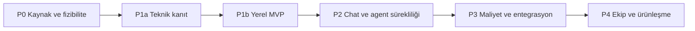
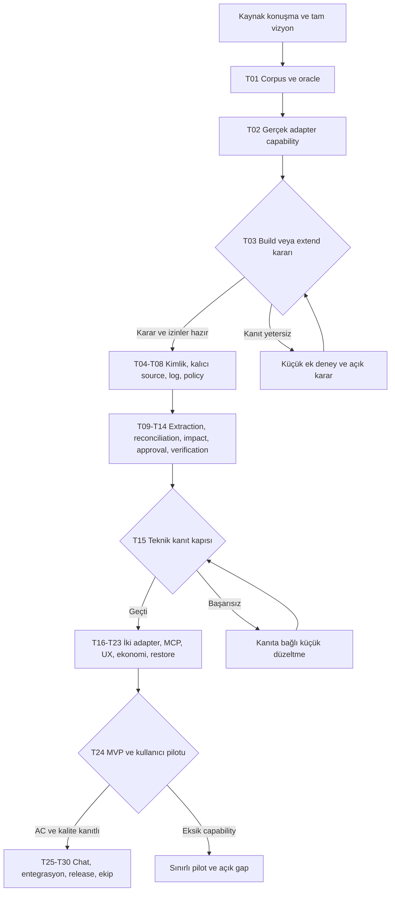

# Roadmap

Takvim değil, kanıt kapılarıyla ilerleyen yol haritası. Tüm ürün yetenekleri [tam kapsamda](docs/product/full-scope.md) korunur. Mevcut aşama **P0 Discovery / Product Definition**; uygulama geliştirilmedi.

| Faz | Teslim | Çıkış kapısı |
|---|---|---|
| P0 | Kaynak haritası, benchmark, platform testleri, build/extend ve stack kararı | Gerçek capability/karşılaştırma raporu; sonraki ADR'ler onaylı |
| P1a | Import→reconcile→impact→approval→event→projection teknik dilimi | Synthetic oracle, atomic retry, AND/OR/unknown, replay ve false-done senaryoları geçer |
| P1b | Çok projeli local MVP; iki coding adapter; MCP; Inbox/Board/Graph/Timeline; temel verifier/routing/telemetry | AC-01..14 ve pilot kalite kapıları; destek matrisi dürüst |
| P2 | Aynı sağlayıcı ve cross-provider chat sürekliliği; gelişmiş reconciliation, verification, read-only GitHub evidence; izinli panel/import iyileştirmeleri | Kaynak→prompt→execution trace ve coverage; gerçek yüzeylerde test |
| P3 | Maliyet raporları, model routing, kontrollü GitHub/Linear/Jira yazma, kurulum ve açık kaynak release hazırlığı | Cost/quality kıyası, outbox conflict testleri, lisans/isim kararı |
| P4 | Takımlar, organization, RBAC, cloud sync, enterprise audit, managed service ve open core değerlendirmesi | Talep kanıtı, güvenlik/uyumluluk ve ticari model onayı |

Kritik sıra: [T01 → T02 → T03](docs/delivery/backlog.md) → çekirdek veri/olay → reconciliation/impact → approval/verification → görsel MVP. Tek adapter'lı P1a bütün MVP diye adlandırılmaz. Sonraki fazlara geçmek için bütün vizyonu gerçekleştirmiş olmak gerekmez.

Güvenlik/kalıcı işleme/graph race sözleşmeleri ilk çekirdek dilimlerinde doğrulanır; son release'e bırakılmaz. Çalışma ritmi ve roller [kısa proje yönetim planında](docs/delivery/project-management.md).

Başarısız kapıda: neden ve kanıt kaydedilir, küçük düzeltme işi açılır, faz geçişi bekler. Bir yetenek platformca engellenirse full scope kaydında kalır; sınırlı sürüm adı ve fallback açıkça belirtilir.
