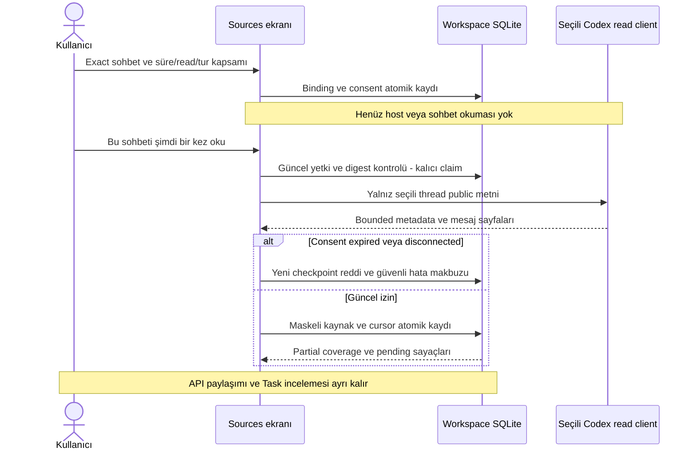
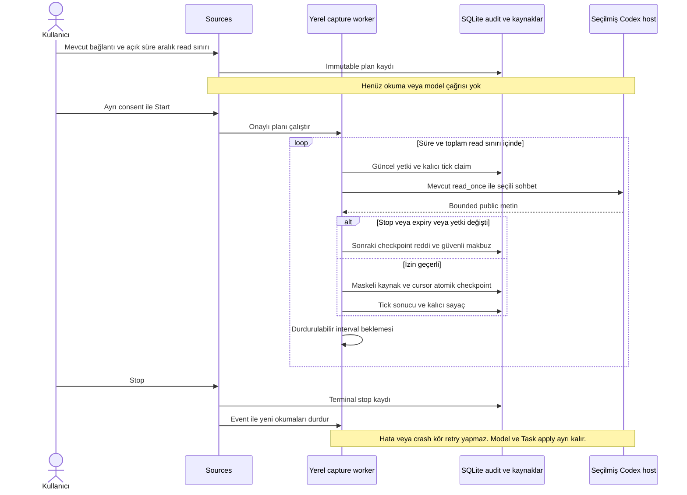

# Codex kaynak kurulumu — yerel kullanıcı akışı

**Gerçek LOCAL UI dar kabulü:** [İki seçili sentetik sohbet](../quality/native-ui-journey-001.md) bu ekran üzerinden birer kez okundu;6kaynak ve ayrı izinlerle2gerçek model isteği, tek Task + bağlı açık kapsam sorusu ve aynı ID için start önerisi elde edildi. Bağlantılar disconnected/aktivasyonlar Paused; sürekli capture veya modelin AC üretim kalitesi kabulü değil. Aşağıdaki ilk teslimin açık UI kabulü bu dar yolla sınandı; genel günlük kullanım kapısı sürer.

**Sonraki20Ekim bağlantısı:** Yeni kaynak için [exact model paylaşım önizlemesi/onayı ve ilk Task kapsam review](source-sharing-and-first-review.md) kodlandı. Aşağıdaki ilk capture tesliminde açık kalan model-egress kurulumunun bu yerel alt yolu artık mevcut; geçerli policy/gerçek provider UI kabulü ayrı.

**20 Ekim 2026 · Sprint1, T17/T19/T22.** Uygulanan: Sources ekranında exact chat ID veya `codex://threads/ID` seçimi, açık süre/okuma/tur sınırı, ayrı yerel okuma ve disconnect. Bu teslim sürekli otomatik yakalama, sohbet keşfi, yeni model paylaşım izni veya Task onayı değildir.

## Kullanıcı ne yapar?

1. Sources → Selected Codex chats bölümünde sohbet kimliğini/bağlantısını girer; mevcut proje hedefini üstte görür.
2. İzin bitişi, açık okuma sayısı ve okuma başına son tur sayısını belirtip yerel public-text kaydını onaylar. Kaydetmek host açmaz, sohbet okumaz.
3. Ayrı checkbox ve Read selected chat once komutuyla tek bounded okuma başlatır. Kaynaklar aynı kalıcı conversation/review yoluna girer; kaynak içindeki talimat çalıştırılmaz.
4. Son makbuzdaki source sayısı, pending turn/assistant ve older-history-omitted görünür. Sayı yeni kaynak farkı değildir; yeniden okuma aynı kaynakları gösterebilir, DB dedup korunur.
5. Disconnect ile yeni okumaları kapatır. Geçmiş ve daha önce alınmış kaynaklar silinmez; purge ayrı işlemdir.

Model egress/bütçe ve kaynak/öneri kabulü ayrıdır. Yeni kaynağın oluşması, mevcut model aktivasyonuna kendiliğinden eklenmesi anlamına gelmez. Kaynaklar ayrı ve güncel paylaşım kapsamı olmadan API'ye gönderilmez. AC/DoD ilk Task review hazırlığı NM-02 halen açık.

## Güvenilir host kurulumu

Native client factory yalnız sunucu başlangıcında yapılandırılır. Browser executable, shell, CODEX_HOME veya provider version gönderemez. `apps.local_ui.server` için `--codex-executable` ve `--codex-provider-version` birlikte verilir; `--codex-home` isteğe bağlıdır. Parametreler host süreci başlatmaz. Default uygulamada yapılandırma yoksa kayıt butonu kapalı ve nedeni görünür. TEST ortamı gerçek native connector kabul etmez.

Trusted executable/profile/version hash'i consent config'e bağlanır; host değişimi eski izni yeniden kullanamaz. Sources ekranı sohbetleri listelemez veya otomatik keşfetmez. İki farklı exact bağlantı aynı projeye kurulabilir; kalıcı kabul edilmiş proje bilgisi paylaşılır, ham yakın geçmiş thread/profile sınırında kalır.

## Yetki, zaman ve eşzamanlılık

- Konfigürasyon immutable; mevcut capture binding ve UI consent aynı SQLite transaction'ında yazılır. Consent yoksa veya limit/expiry geçersizse ikisi de yazılmaz.
- Üst uygulama sınırları:32kalıcı binding; her kurulumda1–300açık read ve1–10son tur. Bunlar performans taahhüdü veya otomatik verilmiş kullanıcı izni değildir.
- İnsan/project/current authority, exact config digest, host identity, expiry, pending read ve tüketilmiş read sayısı dış host açılmadan kontrol edilir.
- Aynı read_id ile bitmiş komut tekrarı makbuzu döndürür; ikinci host okuması/sayaç tüketimi yaratmaz. Bitmemiş aynı kimlik otomatik retry edilmez. Read claim ağdan önce kalıcı yazılır; aynı izne ikinci eşzamanlı read admission verilmez. Crash sonrası bitmemiş claim yeniden okunmaz: Unfinished read ve inceleme gerekir. Bu teslim otomatik recovery UI'sı sunmaz.
- Checkpoint commit sırasında consent/expiry/revoke yeniden kontrol edilir. Önce kabul edilmiş sayfalar korunur; izin sonradan kapanmışsa sonraki içerik yazılmaz. Bağlantı kesilince geçmiş yedeklerden kaynaklar kendiliğinden silinmez.
- Read failed işlem de read tavanından tüketir; otomatik retry yoktur. OSError metni saklanmaz; güvenli kod yazılır. Capture yetkisi model/verifier yetkisi değildir.

## API / veri / Operations

Mevcut session/Origin/CSRF/proje yetkili `POST /api/command` altında exact zarf kullanılır:

| action | Alanlar | Sonuç |
|---|---|---|
| connect_codex_source | capture_id, thread_id, expires_at, max_reads, turn_limit, consent=true | Sadece bağlı kaynak izni; read/model0 |
| read_codex_source | capture_id, configuration_sha256, read_id, consent=true | Tek bounded read; mevcut source/cursor yoluna kaydetme |
| disconnect_codex_source | capture_id | Yeni read ve sonraki checkpoint'leri durdurma |

`state.native_connections` yalnız selected-project/current-actor konfigürasyon ve güvenli read makbuzlarını taşır. Ham transcript, key veya host dosya yolu bu metadata'ya kopyalanmaz. Audit'e `codex_ui_connection`, `codex_ui_read_started`, `codex_ui_read_finished` append-only kayıtları eklenir; yeni DB tablosu yok. Canonical Task/Decision değişimi yok. Operations capture bileşeni command sınırlarını gösterir; her iç checkpoint için ayrı span iddiası yok. Ek `native_host_configured` boolean'ı host hazırlığıdır; `native_capture=false` otomatik background capture'ın açık olmadığı anlamını korur.

Güvenli kodlar: capture_consent_required, capture_permission_expired, capture_read_limit, capture_review_required, capture_binding_mismatch, capture_binding_conflict, codex_host_unavailable. Unknown/pending read otomatik başarılı sayılmaz. Yerel loglar tüm model veya host maliyetini ölçmez.

## Bulgular ve doğrulama

- İlk uygulamada mevcut connect helper'ı içinde ikinci transaction açıldığı için storage_failure oluştu. Helper'ın transaction içi primitive'i ayrıldı; public CLI adapter transaction sınırı korunup binding/consent birlikte atomik kaldı. Rollback testi eklendi.
- İlk browser denemesinde kaynak metni kapalı details içindeydi; test açılır bölümü açmadan görünürlük bekledi. Harness kullanıcı tıklamasını ekledi, ürün davranışı gevşetilmedi.
- Operations'a eklenen host-ready alanı ilk regresyonda yayınlanmış JSON şemasıyla uyuşmadı; şema yeni boolean ile eşleştirildi. Mevcut alanlar silinmedi.
- Sentetik native host testleri: configure≠read, ayrı consent, duplicate prevention, aynı source'un tekrar okumada tek kalması, limit/restart, expiry ve host değişimi, revoke/expiry sırasında commit reddi, pending claim ve authority değişimi, setup rollback ve failure sırasında kalıcı sayaç.
- Gerçek tarayıcı: ID/link→kaydet→ayrı read→conversation kaynağı→Task sayısı0→limit→disconnect→reload;390px taşma/page-error0. Sentetik host kullanıldı; gerçek sohbet veya API çağrısı0.
- Açık: otomatik sohbet keşfi, sürekli capture döngüsü, model-egress yeni kaynak kurulumu, NM-02kapsam hazırlığı ve yeni sınırlı gerçek native kullanıcı kabulü. Önceki Native A/B izinleri bu teslimle yenilenmez.

### Son teslim ve yerel uygulama güncellemesi

669runtime ve49repo/tracker testi geçti;9yeni kaynak kurulumu kontrolü dahildir.60Mermaid bloğu33belgede offline render edildi; yeni sequence tam görüntüsü incelendi. Browser sentetik akışı ve yeniden başlayan gerçek LOCAL ekranının salt okunur form kontrolü geçti; gerçek native chat read0 / model0. EN/TR metinleri var; diğer taslak locale'lerde yeni metinler İngilizce fallback kullanır. Son katalog kontrolünde iki dinamik checkbox anahtarı eksikti; kataloglar tamamlandı, nihai runtime koşusu geçti.

Açık LOCAL53610 ve TEST53611 süreçleri active-worker=false doğrulamasından ve private SQLite backup'tan sonra graceful shutdown ile güncellendi. Aynı veritabanları/portlar kullanıldı; tüm uygulama tablolarının satır fingerprint'leri önce/sonra aynı. LOCAL'de kuruluCLI0.162.0-alpha.17.2yalnız trusted reader olarak hazırlandı; connection0, native read0, model/worker kapalı. TEST'te native/model kapalı.8765geliştirme tracker'ıdır; ürün süreciyle karıştırılmaz. Oturum belirteçleri yenilenir; private bootstrap yeniden açılış yolu içindir, repo/final rapora konmaz.

Tam sayfa browser PNG'sinde tekrarlı görüntü artefaktı görüldü; bunu ürünün düzgün görünümü diye kabul etmedik. Aynı form/connection akışı viewport screenshot ve DOM etkileşimleriyle ayrıca doğrulandı; artefaktın kesin render kök nedeni araştırılmadı. Screenshot'lar sentetik veya salt okunur yerel QA'dır, gerçek native conversation kabulü değildir.

## Düzenli seçili-sohbet yakalama — uygulanan yerel kod

`CaptureLoopService` ve `LocalCaptureWorker` mevcut `UIConnectionService.read_once` üzerinden çalışır. Yeni servis dağıtımı, model erişimi veya kaynak keşfi değildir; tek uygulama sürecinde model işleyicisinden ayrı bir yerel thread'dir. Plan ve tick makbuzları mevcut SQLite append-only audit'inde `codex_capture_loop` altında kalır; migration veya yeni DB gerekmez.

Sources → Scheduled capture: bağlı sohbet için max_ticks, interval_seconds, expires_at ve reason doldurulur. Plan kaydetmek okuma yapmaz. Ayrı consent ve Start komutu düzenli yerel okuma başlatır. Stop kalıcı ve terminaldir; yeni plan eski read sayacını sıfırlamaz. Mevcut Refresh processing state düğmesi durumu yeniden okur; UI kendi başına model veya yeni okuma başlatmaz.

| Kural | Uygulanan sınır |
|---|---|
| Kaynak | Tek existing exact connection, actor/project/authz revision ve trusted host |
| Bütçe | max_ticks 1–300; mevcut iznin kalan read sayısından büyük olamaz; manuel okumalar da aynı capture sayacını tüketir |
| Aralık | 1–3600 saniye; bitmiş okumanın sonundan itibaren; teknik üst/alt sınır, performans veya kullanıcı adına otomatik izin değil |
| Süre | Schedule expiry capture consent expiry'den uzun olamaz; her tick ve checkpoint tekrar kontrol edilir |
| Eşzamanlılık | Yerel uygulamada bir capture worker; kalıcı tick/read claim ikinci process veya manuel okumayla çakışmayı engeller |
| Durdurma | Uyuyan worker event ile uyanır; in-flight host çağrısı anında kesilmiş sayılmaz, sonraki checkpoint stop/cancel guard'ında reddedilir; daha önce kabul edilmiş sayfalar korunur |
| Crash / hata | Pending tick veya unfinished read yeniden çalıştırılmaz. Failed tick terminal review ister; kör retry yok |
| Restart | Plan/sayaç/checkpoint kalıcı; worker otomatik başlamaz. İzinli, tamamlanmamış plan ancak yeni açık Start ile devam edebilir |
| Model / Task | Yeni kaynak kaydedilir; yeni source-sharing grant, model activation, Task veya status apply üretilmez |

Yeni command API: `create_capture_loop` exact loop_id/capture_id/capture_sha256/max_ticks/interval_seconds/expires_at/reason; `start_capture_loop` exact loop_id/configuration_sha256/consent=true; `stop_capture_loop` exact loop_id/configuration_sha256/reason. Human/project/Origin/CSRF kapıları korunur. Tarayıcı executable, host veya API key seçemez. Schedule view current proje/actor ile sınırlıdır.

Operations `capture_tick` eylemini capture bileşeninde süre, outcome ve safe code ile kaydeder. `native_capture` ve `background_worker_active` aktif capture işleyicisini de yansıtır; dormant plan aktif sayılmaz. Ham metin, credential veya host exception body loglanmaz. Yeni safe codes: invalid_capture_loop, capture_loop_unavailable/limit/denied/expired/stopped, capture_worker_busy. Kaynak read kodları aynen korunur.

Sentetik kontrol ve gerçek kabul ayrımı [teslim raporunda](../quality/scheduled-capture-runtime.md). Önceki Native A/B read izinleri tüketildi; bu kod teslimi gerçek periyodik okuma başlatmadı. Yeni düzenli kaynak okuma izni ve yeni mesajların modele paylaşım politikası sonraki ayrı kabul kapılarıdır.
