# Bağlantı kurulumu ve context alışverişi

> [!NOTE]
> **Şema anahtarı:** mavi kaynak/işleme · sarı yetki/onay · turkuaz kalıcı bilgi · yeşil kanıt alanı · turuncu belirsizlik · gri tarihçe · mor öneri/gelecek. Renkler implementasyon veya test başarısı değildir. [Görsel sözlük](../quality/visual-documentation.md).

**Durum: uygulanacak sözleşme; kurulum paketi ve çalışan adapter henüz yok.** Bu belge çalıştırılabilir komut tarif etmez. P0/T02 gerçek sürüm deneyi, T03 stack kararı ve P1 uygulaması sonrasında sürümlü kurulum talimatı üretilecek. [Capture sınırları](capture-adapters.md), [yetki modeli](identity-access.md) ve [token bütçesi](routing-token-economy.md) birlikte geçerlidir.

## Üç ayrı bağlantı

| Yol | Ne taşır? | Ne sağlamaz? |
|---|---|---|
| Capture adapter → yerel servis | İzinli yeni kaynak parçaları ve kaynak/session/proje kimliği | MCP kurulunca bütün geçmişin otomatik okunması |
| Codex/Claude Code ↔ MCP araçları → aynı servis | Proje özeti, hedefli kayıt, değişiklik önerisi ve kanıt | İnsan onayı veya sınırsız transcript/shell yetkisi |
| Kullanıcı → web UI → aynı servis | Review, Graph/Board/Timeline, kimlikli onay ve ayarlar | Ayrı bir ikinci proje veritabanı |

Web UI kendi bilgisayarındaki servisle çalışabilir; local-first için internetten erişilen bir sunucu zorunlu değildir. Codex veya editör içinde açılması host desteğine bağlı ek bir sunumdur. [Resmî OpenAI UI quickstart](https://developers.openai.com/plugins/build/app-quickstart) MCP araçlarını ChatGPT/Codex için, iframe UI örneğini ChatGPT için anlatır; Codex'e kalıcı özel panel yerleştirme bu proje için doğrulanmadı.

```mermaid
%%{init: {"theme":"base","themeVariables":{"fontFamily":"Arial, sans-serif","fontSize":"14px","primaryColor":"#eff6ff","primaryTextColor":"#0f172a","primaryBorderColor":"#1d4ed8","lineColor":"#64748b","secondaryColor":"#ccfbf1","tertiaryColor":"#f1f5f9","background":"#ffffff","mainBkg":"#eff6ff","textColor":"#0f172a","clusterBkg":"#f8fafc","clusterBorder":"#94a3b8","edgeLabelBackground":"#ffffff","actorBkg":"#eff6ff","actorTextColor":"#0f172a","actorBorder":"#1d4ed8","signalColor":"#64748b","signalTextColor":"#0f172a","noteBkgColor":"#fef3c7","noteTextColor":"#0f172a","noteBorderColor":"#92400e"},"flowchart":{"htmlLabels":false,"curve":"linear"},"sequence":{"wrap":true},"themeCSS":"background-color:#ffffff;"}}%%
flowchart LR
    accTitle: Capture, MCP ve insan UI sınırları
    accDescr: Önerilen tasarım veya açıkça belirtilen sentetik örnek. Renkler alan ve kontrol türünü gösterir; implemented veya passed kanıtı değildir. Yetki, revision ve coverage sınırları korunur.
    H[İzinli hook veya import] --> C[Capture ve durable receipt]
    AG[Codex veya Claude Code] <-->|Sınırlı MCP araçları| API[Yetkili servis API]
    U[İnsan web arayüzü] <-->|Okuma ve insan onayı| API
    C --> DB[Ortak kaynak ve proje deposu]
    API --> DB
    DB --> JOB[Delta işleme kuyruğu]
    JOB -->|Yalnız gerekirse ve bütçe varsa| LLM[İzinli model analizi]
    LLM --> P[Kaynaklı proposal]
    P --> DB
    classDef source fill:#eff6ff,stroke:#1d4ed8,color:#0f172a
    classDef process fill:#dbeafe,stroke:#1d4ed8,color:#0f172a
    classDef gate fill:#fef3c7,stroke:#92400e,color:#0f172a,stroke-width:2px
    classDef store fill:#ccfbf1,stroke:#0f766e,color:#0f172a
    classDef future fill:#ede9fe,stroke:#6d28d9,color:#0f172a,stroke-dasharray:5 3
    classDef warning fill:#ffedd5,stroke:#9a3412,color:#0f172a
    class H,AG,U source
    class C,JOB process
    class API gate
    class DB store
    class LLM future
    class P warning
```

## Kullanıcının bir defalık kurulum akışı

1. **Yüzeyi belirle:** Codex desktop/CLI/IDE ve Claude Code ayrı build/sürüm kaydı taşır. Seçili yüzeyde MCP, hook, transcript erişimi ve geçmiş aktarım kapasitesi test edilir. Bu oturumda bize sunulan özel araçlar dağıtılabilir ürün API'si varsayılmaz.
2. **Yerel servisi hazırla:** Loopback üzerinde, ayrı data dizini ve sınırlı process izinleriyle çalıştır. UI oturumu, capture credential ve agent grant ayrı kimliklerdir. Servis başlamadıysa “bağlandı” gösterme.
3. **Proje bağla:** Workspace/project ve kaynak session/repo eşlemesini önizle. Aynı klasörde birden fazla proje varsa açık seçim gerekir. Sadece klasör adından kimlik çıkarılmaz; binding epoch tutulur.
4. **Görünürlüğü seç:** İnsan konuşması personal; takım connector'ı açık ACL ile. Hangi kaynak parçalarının yakalanacağı, hariç tutulan alanlar ve izinli veri çıkışı gösterilir. Yerel capture izni dış modele gönderim izni değildir.
5. **MCP'yi ekle:** Host destekliyorsa yerel stdio bridge veya kimlikli Streamable HTTP; bridge ortak servise bağlanır. Her agent yeni bağımsız truth DB başlatmaz. Credential secret store/env referansı üzerinden alınır, repo/prompt içine konmaz. Remote host'ta `localhost` kullanıcının bilgisayarına ulaşır varsayılmaz; ayrı ağ/kimlik tasarımı gerekir.
6. **Pasif capture'ı ayrıca etkinleştir:** Desteklenen hook/adapter konfigürasyonu, dosya/olay erişimi ve izinleri ayrı önizlenir. MCP bağlı ama capture yoksa UI bunu `tools_only` olarak açıkça gösterir. Bütün kullanıcı config dosyası üzerine yazılmaz; değişiklik yedeği ve yalnız Decivora alanını geri alma yolu olur.
7. **Sentetik smoke test yap:** Bir test önerisi yakala → receipt gör → MCP ile aynı project/revision'ı oku → proposal oluştur → insan UI'sında karar ver. Bu aşama gerçek özel veriye veya ücretli modele gerek duymayan fixture ile yapılabilir.
8. **Health ve kaldırmayı göster:** Son receipt/processing, coverage gap, grant süresi ve pause/disconnect düğmeleri. Disconnect yeni capture/agent erişimini durdurur; depolanan geçmişi silmek ayrı retention/purge işlemidir.

## Proje erişim sözleşmesi ve izin ekranı

**2026-10-10 takip tasarımı; uygulanmadı.** Kullanıcı üyeliği, Decivora servisinin dış kaynağa erişimi ve agent delegasyonu üç ayrı yetkidir. Bağlantı kurulması hesabın bütün kaynaklarını işleme hakkı vermez. Bu bölüm [kimlik sözleşmesini](identity-access.md) tamamlar; belirli bir provider'ın bu ayrıntıda izin desteklediği iddiası değildir.

### Kime, hangi kaynağa, hangi işlem için?

| Alan | Kullanıcıya gösterilecek bilgi ve kontrol |
|---|---|
| Hedef | Decivora workspace/project ID ve adı; hedefte bağlantı kurma yetkisi olan insan |
| Kaynak | Provider/host, hesap veya installation kimliği; seçilen sabit repo/proje/session ID'leri ya da yerel kök dizin; include/exclude kuralları |
| Bağlantının sahibi | Kişisel veya takım bağlantısı; credential sahibi/ref, servis sponsoru, provider yetkisini doğrulama durumu |
| İşlem kapsamı | Kaynak metadata'sını listele, içeriği oku/yakala, yerel öneri üret, dış sisteme yaz, runner çalıştır, veri dışarı aktar ayrı izinler |
| Geçmiş ve süreklilik | Seçilmiş kaynakların geçmiş aralığı, gelecekteki olaylar, 1C arşiv sınıfı; yeni repo/session'ların kapsamı |
| Görünürlük | Personal veya açık proje ACL'si; özet/grafik/kanıtı kimlerin görebileceği |
| Veri çıkışı ve maliyet | İzinli model/hedef, hangi veri sınıfı, redaction, bütçe; dış model ve runner başlangıçta kapalı önerilir |
| Geçerlilik | Başlangıç, sona erme veya açık sürekli-izleme policy'si, yeniden inceleme zamanı, iptal eden yetkiler |

Önerilen başlangıç paketi: yalnız seçilen kaynakları **oku/yakala ve Decivora içinde öneri hazırla**. Bu paket dış issue/PR yazmaz, repo dosyası değiştirmez, test/shell çalıştırmaz, kaynak silmez ve veriyi dış modele göndermez. Yerel proposal da kendi sınırlı command iznini gerektirir; “read-only” ifadesi dış kaynağa göre açıklanır. Diğer işlemler ihtiyaç çıktığında somut hedef/işlem farkıyla ayrıca açılır. Korunan karar/scope/AC değişikliklerinin insan onayı kuralı her pakette geçerlidir.

### İzni kim verebilir?

- **Kaynak tarafı:** Bağlanan hesabın gerçekten sahip olduğu provider/OS yetkisi ve kaynak sahibinin geçerli paylaşım hakkı gerekir. Decivora proje owner'ı başkasının özel kaynağına tek başına izin veremez. Provider'ın ilave organization/admin onayı gerekiyorsa durum `pending_external_authorization`; bağlandı gösterilmez.
- **Hedef tarafı:** Hedef projeye bağlantı ekleme yetkisi ayrıca kontrol edilir. Kaynak sahibi yalnız personal import izni vermişse workspace admin bu izni ortak paylaşım sayamaz. Kaynak sahibiyle hedef yönetici farklıysa iki ayrı yetki kanıtı bağlanır; aynı yetkili insan iki kapsamı karşılayabilir.
- **Agent tarafı:** Agent principal'ın grant'i, sponsorun güncel yetkisi ve run/task kapsamı ayrıca gerekir. Bir agent'ın “kullanıcı izin verdi” mesajı izin kaydı değildir; gözlenen aktör kimliği onay veren kimliği yerine geçmez.
- **Operasyon tarafı:** Kurulum/platform admin'i bağlantıyı güvenlik için durdurabilir; yeniden açmak, içeriği okumak veya scope genişletmek için gerekli kaynak/hedef yetkilerini aşamaz.

Her işlemde etkin erişim = **dış kaynağın güncel yetkisi ∩ connection allowlist'i ∩ hedef proje policy'si ∩ işlemi yapan insan/servis/agent grant'i ∩ kaynak ACL'si**; model/runner/dış yazımda ilgili ek izin ve bütçe de aranır. Gerekli kanıt unknown/expired/revoked ise hassas işlem durur. Provider scope çok geniş olabilir: “provider'ın verdiği” ile “Decivora'nın kullanacağı” izin ayrı gösterilir. Daha dar credential varsa tercih edilir; uygulama allowlist'i geniş credential'ın ele geçirilme riskini ortadan kaldırmaz. Gerekli izolasyon sağlanamıyorsa o bağlantı modu desteklenmez veya açıkça sınırlı sayılır.

### Kurulumda sorulacak sorular

1. **Hangi Decivora projesini hangi hesap, repo, klasör veya konuşmayla bağlıyorsun?** Seçilmemiş kaynaklar dahil değildir; isim benzerliği eşleştirme kanıtı olmaz.
2. **Neleri yapabilsin?** Ayrı işlem anahtarları ve anlaşılır sonuçları; gerekli olmayan izinler önceden seçili değil.
3. **Hangi geçmişi ve bundan sonraki hangi olayları alsın?** 1C yalnız izinli ve erişilebilir kapsam içinde işler; tüm hesaba izin sayılmaz.
4. **Yakalanan içerik ve türevlerini kim görebilsin?** Personal varsayılanı, takım paylaşımı önizlemesi ve kaynak sahibi kontrolü.
5. **Veri dış modele/başka servise çıkabilir mi; hangi sınırla?** Önceki Q03'ün yerine genel kurulum onayı kullanılamaz.
6. **Erişim ne kadar sürsün ve kim iptal edebilsin?** Bağlantı, kısa ömürlü credential, worker lease ve agent grant süresi ayrı gösterilir; kesin süre policy kararıdır.

Gereksiz tekrar yok: aynı kapsam ve geçerli izinle her okuma için soru sorulmaz. Yeni repo/kök dizin, yeni hesap, yeni alıcı/model, private→shared görünürlük, ek write/runner izni, geçmiş aralığı genişlemesi veya yetkisiz kaynak yeniden bağlama **izin farkı önizlemesi** ister. Rutin credential yenilemesi aynı kimlik/kapsamı doğrulayabiliyorsa yeni ürün onayı zorunlu değildir; provider'ın kendi yeniden yetkilendirmesi gerekebilir.

### İzin makbuzu ve bağlantı envanteri

Sürümlü `ConnectionAuthorization` kaydı: connection/binding ID ve epoch; workspace/project; kaynak/provider kimlikleri; requested / externally granted / application allowed actions; include/exclude ve zaman kapsamı; görünürlük/retention/egress policy ref'leri; izni veren doğrulanmış insan(lar), yetki kanıtı ref'i, izin metni/diff digest'i, gerekçe, zaman, expiry/review; policy/authz revision; `last_verified_at`, verification yöntemi ve sonuç. Secret veya token içermez; kanıt ref'i ayrı ACL taşır. Genel sohbetten çıkarılmış rıza bu kaydı imzalamaz.

Önerilen durumlar: `draft`, `pending_approval`, `pending_external_authorization`, `active`, `paused`, `reauthorization_required`, `expired`, `revoked`. Kısmi yetki veya erişilemeyen alan `coverage` ile ayrıca gösterilir; token varlığı active kanıtı değildir. `active` son doğrulama ve desteklenen işlemler açısından açıklanır, gelecekte kesintisiz erişim garantisi değildir.

**Proje → Bağlantılar ve izinler** görünümü “nereden / hangi kimlikle / kim izin verdi / hangi işlemler / hangi alıcılar / son doğrulama / süre / neden kısıtlı?” sorularını tek tabloda yanıtlar. İzinli kullanıcı detayında geçmiş izin sürümleri ve kullanımla bağlantılı audit bulunur. Bağlantı sahibinin kişisel hesabının başka projeleri, credential veya gizli kaynak sayıları açıklanmaz. Kullanıcı hem verilen kapsamı hem son gerçek kullanım zamanını görebilir; “hiç kullanılmadı” ile “kullanım kaydı yok” ayrıdır. [Yönetim merkezi](../product/administration-and-operations.md) aynı veriyi yetkili kapsamda gösterir.

### Kaynak değişimi, geri çekme ve sınırlar

- Yeni kaynak yalnız keşfedildi diye bağlanmaz. Metadata keşfi dahi açık ayrı kapsam ister; Q10-A 2026-10-10'da kabul edildi. Ayrı listeleme izni varsa “Bunu da bağlamak ister misin?” önerisi gösterilir; seçim ve gerekli kaynak/hedef onayları tamamlanmadan içerik okunmaz, capture/takip başlamaz. Listeleme izni yoksa veya provider bunu güvenle ayıramıyorsa manuel seçim kullanılır. Proje eşlemesi belirsiz olay quarantine'a gider. Repo adı/URL/klasör değişimi sabit kimlikle doğrulanır; farklı owner'a transfer yeniden yetki değerlendirmesi ister.
- Yerel adapter izinli kökün dışına symlink/path traversal ile çıkamaz; gerçek path/file identity kontrolü ve okuma anındaki yarış savunması test edilir. Monorepo alt dizin filtresi, tüm repo yetkisi varmış gibi genişlemez. Tek transcript birden fazla projeyi karıştırıyorsa yanlış projeye auto-import yerine review/quarantine; dışarıdan gelen project ID güvenilir değildir.
- Yetki geri çekilince yeni retrieval/capture/dispatch ve ilgili grant zinciri durur; queued işleri yeniden yetkilendir, cache/context'i invalid et. Commit ve dış dispatch öncesi revision kontrolü gerekir. Gönderilmiş dış istek geri alınmış sayılmaz; sonucu belirsizse reconciliation, kör retry yok.
- Disconnect otomatik veri silme değildir. Önceden alınan kaynağın/türevlerin devam eden kullanım hakkı ayrı kontrol edilir; kapsam kaybında erişim askıya alınır. Retention/purge ve açıkça daha önce paylaşılmış kopyalar kendi kayıtlarına göre ele alınır; “bağlantı kapandı, her yerden silindi” denmez.
- Provider revocation bildirimi/yeniden kontrol desteği yüzey testine bağlıdır. Kontrol gecikmesi, son doğrulama ve desteklenmeyen alanlar görünür; erişimi her dış sistemde anında kesme garantisi verilmez. Periyodik inceleme süresi OPEN-14/16'da seçilecek.

### Planlı erişim kabul senaryoları

**Çalıştırılmadı.** Mevcut CON/MU/ADM senaryolarını tamamlar.

| ID | Gözlenebilir kabul |
|---|---|
| ACC-01 | Hedef proje owner'ı kaynak yetkisi olmadan bağlantıyı active yapamaz; kaynak erişimi olan ama hedef yetkisi olmayan insan da yapamaz |
| ACC-02 | Geniş credential ile yalnız A seçilmişse B içeriği alınmaz/model context'ine girmez; metadata keşfi ayrı izin yoksa B listelemesi yapılmaz; izin varsa yalnız bağlama önerisi gösterilir, seçim/onay olmadan B içeriği alınmaz veya takip edilmez |
| ACC-03 | Aynı isimli projeler, kaynak transferi ve karışık transcript yanlış binding oluşturmaz; belirsizlik görünür |
| ACC-04 | Symlink/path traversal ve eşzamanlı hedef değişimi izinli kökün dışından okuma yapamaz; kapsam doğrulanamıyorsa durur |
| ACC-05 | Yeni write/runner/egress veya private→shared talebi yalnız eski read izniyle geçmez; önceki scope yeni onay gelmeden genişlemez |
| ACC-06 | Grant iptaliyle queue/retrieval/cache/commit yeniden kontrol edilir; provider kontrol gecikmesi ve in-flight dış etki doğru gösterilir |
| ACC-07 | Makbuz doğrulanmış grantor, scope diff ve revision taşır; sahte transcript onayı ve eski approval reddedilir; audit arızasında activation olmaz |
| ACC-08 | Bağlantı görünümü gizli kaynak/credential sızdırmaz; disconnect, erişim askısı ve purge ayrı durumlar olarak anlaşılır |

## Sağlayıcıya göre deney kapısı

| Yüzey | Belgelenmiş dayanak | Decivora uygulamasında gereken kanıt |
|---|---|---|
| Codex CLI/IDE | [MCP dokümanı](https://learn.chatgpt.com/docs/extend/mcp?surface=cli) stdio ve HTTP konfigürasyon yollarını açıklar | Seçili host/build'de gerçek bağlantı, tool listesi, auth, scope ve disconnect |
| Codex plugin/hooks | [Paketleme belgesi](https://developers.openai.com/plugins/build/plugins) hook paketleme ve execution ortamını açıklar | Dağıtım/trust uygunluğu, seçilen event payload, script'in gerçek host'ta bulunması; CLI başarısı desktop başarısı değildir |
| Claude Code | [Hooks referansı](https://code.claude.com/docs/en/hooks) session/transcript alanlarını ve event'leri belgeler | Gerekli olaylar, transcript erişimi, rotation/compaction, subagent ve kesinti testleri; her event'i bütün build'lerde varsayma |
| Normal ChatGPT/Claude Chat | Bu projede tüm geçmişe pasif erişim doğrulanmadı | Açık import veya izinli connector; otomasyon düzeyi görünür |

Bu kaynaklar 2026-10-09'da belge düzeyinde incelendi. Hiçbir kurulum, izin genişletme veya gerçek transcript importu bu belge hazırlanırken yapılmadı.

## Her çalışma turunda ne gönderilir?

### 1C — İzinli geçmişin aşamalı alınması

**Ürün tercihi kabul edildi; aşağıdaki uygulama tasarımı henüz çalışmıyor.** [Q07](../delivery/decision-brief.md) uyarınca kurulumda izin verilen ve adapter'ın gerçekten erişebildiği geçmiş için kaynak manifest'i hazırlanır. Kullanıcı kaynakları hariç tutabilir; 1C bütün hesaplara otomatik erişim değildir. Manifest kaynak kimliği/revision/hash, zaman aralığı, ACL, availability, capture ve processing checkpoint'leri, kalan parçalar ve retention sınıfını taşır. Orijinal kaynak, izin verilen güvenli arşivde korunur; secret redaction veya erişim eksikliği açık coverage kaydı üretir.

1. Kaynaklar deterministik alınır, hash/dedup/index yapılır. Güvenli receipt öncesinde “arşivlendi” gösterilmez. Yalnız dış URL tutmak kalıcı kaynak kopyası sayılmaz.
2. Aktif işlerin karar/gerekçe zincirleri önce değerlendirilir. Eski kaynak kuyruğu görünür kalır; sınırlı arka plan payı ve bekleme yaşına göre öncelik artışıyla sürekli ertelenmesi önlenir. Kesin pay baseline deneyinde belirlenir; bütçe yoksa iş açıkça deferred kalır.
3. Çıkarım kaynak sırası ve kararların geçerlilik zamanını gözetir. Geç gelen eski mesaj bugünkü onaylı kararı geçersiz kılamaz. Tarihsel “yapalım” ifadeleri historical/unreviewed adaydır; otomatik aktif task veya doğrulanmış başarı değildir.
4. Aynı kaynak revision ve extractor sürümü tekrarında önceki sonuç kullanılır. Değişen span, düzeltme veya açık yeniden değerlendirme ayrı işlemdir. Kesintiden sonra checkpoint ile sürdürülür; parçalar arası ilişki reconciliation'ı tamamlanmadan bütün kaynak analiz edilmiş sayılmaz.
5. UI `alındı`, `analiz edildi`, `inceleme bekliyor`, `erişilemiyor` ve `bütçe nedeniyle ertelendi` ayrımını gösterir. Kaynak sayısı, analiz kapsamı ve karar doğruluğu aynı yüzde değildir. Eksik geçmiş varken kapsamlı “gerekçe kalmadı” sonucu verilmez.

Arşivin diskte olması onun her model çağrısına girmesini gerektirmez. Aşağıdaki bounded brief ve hedefli retrieval yalnız gerekli parçayı getirir; gerekçe eksikse model tamlık iddiasında bulunmaz. [Retention](storage-memory-capacity.md) ham çalışma payload'ı ile 1C arşivini ayırır. Kaynak korunumu hatırlama garantisi değildir; retrieval hatası ayrıca ölçülür.

**T22b kabul planı:** tekrar import duplicate çıkarım/task üretmez; kesinti devamında parça kaybolmaz; eski karar yeni kararı ezmez; aktif öncelik kalan kuyruğu gizlemez; eksik erişim/bütçe coverage'ı daraltır; okunmamış arşiv varsayılan kısa TTL ile silinmez. Bunlar planlı kontrollerdir.

Agent oturum başlangıcında veya proje değişince kısa brief alır. Brief'e workspace/project, snapshot/knowledge/authz revision, amaç, aktif kararlar, seçili iş, blockers, kaynak pointer'ları ve coverage bilgisi girer. Kullanıcı grafik açtığında tüm grafiği modele göndermek gerekmez; UI servis verisini deterministik çizer.

`get_project_brief` için tasarım girdileri: session scope, project, `since_revision`, seçili task ve budget. Çıktı: snapshot, ilgili değişiklikler, `coverage`, `truncated`, `continuation_cursor`, `estimated_tokens`, gerekirse `resync_required`. İlk çağrı bounded snapshot; sonraki çağrı delta'dır. Geçersiz/eski cursor tam transcript döndürmez; yeniden bounded snapshot ister. Silinmiş/geri çekilmiş kayıtlar delta tombstone taşıyarak eski bağlamı geçersiz kılar.

`query_records` önce küçük ID/title/type/state/revision listesi verir; gerekçe/evidence metni yalnız `get_record` ile gerekli olduğunda gelir. Hedef task için bağlı karar, ilgili AC ve AND/OR gerekçelerinin tamamlık bilgisi taşınır. Token sınırı bir gerekçeyi gizlediyse sonuç complete değildir. Yetki filtresi model context'inden önce uygulanır; erişilmeyen kaydı varmış/yokmuş gibi ifşa etme.

`submit_changeset` kaynak span, base revisions, digest ve idempotency key taşır; dönen cevap kısa receipt + affected IDs'dir. Tam olay geçmişini tekrar döndürmez. `submit_evidence` iddiayı kayıt altına alır; verification veya insan onayını taklit etmez. Gerektiğinde mevcut araçlara opsiyonel alan eklenir; her ekran için yeni bir tool oluşturulmaz.

## Çifte analiz ve geri besleme döngüsü

MCP ile yapılandırılmış kaydedilmiş iddia, aynı kaynak/revision capture edildiğinde deterministik uzlaştırılır; ikinci kez tam extraction çağrısı yapılmaz. Kaynak metnin farklı bir kısmı yeni bilgi taşıyorsa yalnız o bölüm değerlendirilir. Agent'a her mesajı yeniden özetleme veya her tool sonucu sonrası brief isteme zorunluluğu yüklenmez. Decivora kendi receipt/log/özetini yeni kullanıcı fikri diye işlemez; `origin`, `causation` ve run kimliği kullanılır.

Hook yolu dayanıklı receipt sonrası dönmeli; model analizi kullanıcı turunu bekletmemeli. Receipt gelmezse bounded spool ve health uyarısı çalışır. İşleme ve capture checkpoint'leri ayrıdır; “kaydedildi” ile “analiz tamamlandı” farklı etiketlenir.

## Bağlantı kabul senaryoları

| ID | Gözlenebilir beklenti | Görev |
|---|---|---|
| CON-01 | Yanlış host/port/credential tools_connected olamaz; raw hata secret içermez | T02b/T16/T17 |
| CON-02 | MCP başarılı, hook kapalıysa tools_only ve eksik coverage görünür | T02b/T06/T20 |
| CON-03 | Aynı kaynak MCP + hook ile geldiğinde duplicate task/model çağrısı yok; yeni span korunur | T06/T10 |
| CON-04 | Proje değiştirme eski context'i geçersiz kılar; cursor başka projeye taşınamaz | T05/T18c |
| CON-05 | Eski cursor ve silinen kayıt bounded resync/tombstone üretir | T18c |
| CON-06 | Disconnect sonrası capture/dispatch durur; kayıtlar sessiz silinmez | T16/T17/T23 |
| CON-07 | Remote host local makineye bağlıymış gibi healthy gösterilmez | T02b |
| CON-08 | Kurulum/kaldırma başka MCP/hook ayarlarını korur; destek raporu gerçek build taşır | T16/T17 |

Tüm senaryolar planlıdır, çalıştırılmadı. Q02-R1 A ilk pilot yolu olarak seçildi; B Codex + tek repo sonraki hedef. Somut kaynak/hedef ve Codex host/build/OS henüz seçilip denenmedi; [karar kaydı](../delivery/decision-brief.md).

## Kabul edilmiş pilot sırası — Q02-R1

**A önce, B sonra:** Kullanıcı ilk aşamada maliyeti önceledi. A'da açıkça aktarılan kaynak parçası ve ayrı izinli tek hedef gözlemiyle seçim→uygulama→AC ayrımı sınanır. Veri aktarımı bütün hesapları taramaz; hedefte yalnız seçilmiş artifact/ref/path kontrol edilir. Elle etiketli/sentetik ilk fixture ve deterministik read/hash karşılaştırması ek model çağrısı gerektirmeyebilir; serbest metinden anlam çıkarımı ayrıca değerlendirilir. Maliyet üstünlüğü henüz ölçülmedi.

B için iki ayrı kabul adımı vardır:

1. **MCP araç bağlantısı — T18/T17:** Seçili host/build'de hedefli brief/record sorgusu ve kaynaklı öneri alışverişi gerçekten çalışıyor mu? Kurulum, auth, scope, disconnect ve bounded cevap testleri gerekir. Bu adıma kadar kaynak elle aktarılıyorsa durum `tools_only` ve capture coverage'ı açık kalır.
2. **İzinli otomatik capture — T02/T17:** Desteklenen event/log/export yolu session/actor/revision ile yeni parçaları, alt agent coverage'ını ve kesinti/compaction boşluklarını doğru kaydediyor mu? MCP'nin çalışması bu adımın geçtiği anlamına gelmez. Yeterli host desteği yoksa açık aktarım fallback'i ve eksik coverage gösterilir.

B, A'daki aynı onaylı karar/artifact/AC/kanıt modelini kullanır; ikinci bir proje hafızası yaratmaz. Model tarafına kısa brief, revision delta ve gerektiğinde sayfalı kayıt döner; aynı kaynak revision'ını yeniden ayıklamama kuralı sürer. MCP çıktısı alıcı modelde token tüketebilir; Decivora dışındaki host tüketimini bütçe kontrol etmiş saymayız. Gerçek model dispatch'i Q03'e, gerçek kaynak/hedef ve host kurulum işlemleri ayrı somut izne bağlıdır.

## Aynı projeye bağlı farklı chat'ler

[Çoklu chat ve işleme gecikmesi sözleşmesi](multi-chat-and-processing-lag.md) sabit session kimliği/binding, chat içi konu segmenti, mesaj→aday→task/karar provenance'ı ve N:M ilişkileri tanımlar. Proje ortak olsa da kaynak ACL'leri korunur; benzer başlıkla otomatik proje veya task birleştirme yoktur. Q10-A yeni session'ın ayrıca izin kapsamını denetler. Yeni chat sınırlı güncel brief/delta alabilir; host'un bunu gerçekten tükettiği doğrulanmadan otomatik bağlam senkronu iddia edilmez.
