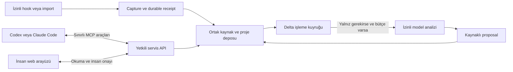

# Bağlantı kurulumu ve context alışverişi

**Durum: uygulanacak sözleşme; kurulum paketi ve çalışan adapter henüz yok.** Bu belge çalıştırılabilir komut tarif etmez. P0/T02 gerçek sürüm deneyi, T03 stack kararı ve P1 uygulaması sonrasında sürümlü kurulum talimatı üretilecek. [Capture sınırları](capture-adapters.md), [yetki modeli](identity-access.md) ve [token bütçesi](routing-token-economy.md) birlikte geçerlidir.

## Üç ayrı bağlantı

| Yol | Ne taşır? | Ne sağlamaz? |
|---|---|---|
| Capture adapter → yerel servis | İzinli yeni kaynak parçaları ve kaynak/session/proje kimliği | MCP kurulunca bütün geçmişin otomatik okunması |
| Codex/Claude Code ↔ MCP araçları → aynı servis | Proje özeti, hedefli kayıt, değişiklik önerisi ve kanıt | İnsan onayı veya sınırsız transcript/shell yetkisi |
| Kullanıcı → web UI → aynı servis | Review, Graph/Board/Timeline, kimlikli onay ve ayarlar | Ayrı bir ikinci proje veritabanı |

Web UI kendi bilgisayarındaki servisle çalışabilir; local-first için internetten erişilen bir sunucu zorunlu değildir. Codex veya editör içinde açılması host desteğine bağlı ek bir sunumdur. [Resmî OpenAI UI quickstart](https://developers.openai.com/plugins/build/app-quickstart) MCP araçlarını ChatGPT/Codex için, iframe UI örneğini ChatGPT için anlatır; Codex'e kalıcı özel panel yerleştirme bu proje için doğrulanmadı.

## Kullanıcının bir defalık kurulum akışı

1. **Yüzeyi belirle:** Codex desktop/CLI/IDE ve Claude Code ayrı build/sürüm kaydı taşır. Seçili yüzeyde MCP, hook, transcript erişimi ve geçmiş aktarım kapasitesi test edilir. Bu oturumda bize sunulan özel araçlar dağıtılabilir ürün API'si varsayılmaz.
2. **Yerel servisi hazırla:** Loopback üzerinde, ayrı data dizini ve sınırlı process izinleriyle çalıştır. UI oturumu, capture credential ve agent grant ayrı kimliklerdir. Servis başlamadıysa “bağlandı” gösterme.
3. **Proje bağla:** Workspace/project ve kaynak session/repo eşlemesini önizle. Aynı klasörde birden fazla proje varsa açık seçim gerekir. Sadece klasör adından kimlik çıkarılmaz; binding epoch tutulur.
4. **Görünürlüğü seç:** İnsan konuşması personal; takım connector'ı açık ACL ile. Hangi kaynak parçalarının yakalanacağı, hariç tutulan alanlar ve izinli veri çıkışı gösterilir. Yerel capture izni dış modele gönderim izni değildir.
5. **MCP'yi ekle:** Host destekliyorsa yerel stdio bridge veya kimlikli Streamable HTTP; bridge ortak servise bağlanır. Her agent yeni bağımsız truth DB başlatmaz. Credential secret store/env referansı üzerinden alınır, repo/prompt içine konmaz. Remote host'ta `localhost` kullanıcının bilgisayarına ulaşır varsayılmaz; ayrı ağ/kimlik tasarımı gerekir.
6. **Pasif capture'ı ayrıca etkinleştir:** Desteklenen hook/adapter konfigürasyonu, dosya/olay erişimi ve izinleri ayrı önizlenir. MCP bağlı ama capture yoksa UI bunu `tools_only` olarak açıkça gösterir. Bütün kullanıcı config dosyası üzerine yazılmaz; değişiklik yedeği ve yalnız Decivora alanını geri alma yolu olur.
7. **Sentetik smoke test yap:** Bir test önerisi yakala → receipt gör → MCP ile aynı project/revision'ı oku → proposal oluştur → insan UI'sında karar ver. Bu aşama gerçek özel veriye veya ücretli modele gerek duymayan fixture ile yapılabilir.
8. **Health ve kaldırmayı göster:** Son receipt/processing, coverage gap, grant süresi ve pause/disconnect düğmeleri. Disconnect yeni capture/agent erişimini durdurur; depolanan geçmişi silmek ayrı retention/purge işlemidir.

## Sağlayıcıya göre deney kapısı

| Yüzey | Belgelenmiş dayanak | Decivora uygulamasında gereken kanıt |
|---|---|---|
| Codex CLI/IDE | [MCP dokümanı](https://learn.chatgpt.com/docs/extend/mcp?surface=cli) stdio ve HTTP konfigürasyon yollarını açıklar | Seçili host/build'de gerçek bağlantı, tool listesi, auth, scope ve disconnect |
| Codex plugin/hooks | [Paketleme belgesi](https://developers.openai.com/plugins/build/plugins) hook paketleme ve execution ortamını açıklar | Dağıtım/trust uygunluğu, seçilen event payload, script'in gerçek host'ta bulunması; CLI başarısı desktop başarısı değildir |
| Claude Code | [Hooks referansı](https://code.claude.com/docs/en/hooks) session/transcript alanlarını ve event'leri belgeler | Gerekli olaylar, transcript erişimi, rotation/compaction, subagent ve kesinti testleri; her event'i bütün build'lerde varsayma |
| Normal ChatGPT/Claude Chat | Bu projede tüm geçmişe pasif erişim doğrulanmadı | Açık import veya izinli connector; otomasyon düzeyi görünür |

Bu kaynaklar 2026-10-09'da belge düzeyinde incelendi. Hiçbir kurulum, izin genişletme veya gerçek transcript importu bu belge hazırlanırken yapılmadı.

## Her çalışma turunda ne gönderilir?

Agent oturum başlangıcında veya proje değişince kısa brief alır. Brief'e workspace/project, snapshot/knowledge/authz revision, amaç, aktif kararlar, seçili iş, blockers, kaynak pointer'ları ve coverage bilgisi girer. Kullanıcı grafik açtığında tüm grafiği modele göndermek gerekmez; UI servis verisini deterministik çizer.

`get_project_brief` için tasarım girdileri: session scope, project, `since_revision`, seçili task ve budget. Çıktı: snapshot, ilgili değişiklikler, `coverage`, `truncated`, `continuation_cursor`, `estimated_tokens`, gerekirse `resync_required`. İlk çağrı bounded snapshot; sonraki çağrı delta'dır. Geçersiz/eski cursor tam transcript döndürmez; yeniden bounded snapshot ister. Silinmiş/geri çekilmiş kayıtlar delta tombstone taşıyarak eski bağlamı geçersiz kılar.

`query_records` önce küçük ID/title/type/state/revision listesi verir; gerekçe/evidence metni yalnız `get_record` ile gerekli olduğunda gelir. Hedef task için bağlı karar, ilgili AC ve AND/OR gerekçelerinin tamamlık bilgisi taşınır. Token sınırı bir gerekçeyi gizlediyse sonuç complete değildir. Yetki filtresi model context'inden önce uygulanır; erişilmeyen kaydı varmış/yokmuş gibi ifşa etme.

`submit_changeset` kaynak span, base revisions, digest ve idempotency key taşır; dönen cevap kısa receipt + affected IDs'dir. Tam olay geçmişini tekrar döndürmez. `submit_evidence` iddiayı kayıt altına alır; verification veya insan onayını taklit etmez. Gerektiğinde mevcut araçlara opsiyonel alan eklenir; her ekran için yeni bir tool oluşturulmaz.

## Çifte analiz ve geri besleme döngüsü

MCP ile yapılandırılmış kaydedilmiş iddia, aynı kaynak/revision capture edildiğinde deterministik uzlaştırılır; ikinci kez tam extraction çağrısı yapılmaz. Kaynak metnin farklı bir kısmı yeni bilgi taşıyorsa yalnız o bölüm değerlendirilir. Agent'a her mesajı yeniden özetleme veya her tool sonucu sonrası brief isteme zorunluluğu yüklenmez. Decivora kendi receipt/log/özetini yeni kullanıcı fikri diye işlemez; `origin`, `causation` ve run kimliği kullanılır.

Hook yolu dayanıklı receipt sonrası dönmeli; model analizi kullanıcı turunu bekletmemeli. Receipt gelmezse bounded spool ve health uyarısı çalışır. İşleme ve capture checkpoint'leri ayrıdır; “kaydedildi” ile “analiz tamamlandı” farklı etiketlenir.

## Bağlantı kabul senaryoları

| ID | Gözlenebilir beklenti | Görev |
|---|---|---|
| CON-01 | Yanlış host/port/credential tools_connected olamaz; raw hata secret içermez | T02b/T16/T17 |
| CON-02 | MCP başarılı, hook kapalıysa tools_only ve eksik coverage görünür | T02b/T06/T20 |
| CON-03 | Aynı kaynak MCP + hook ile geldiğinde duplicate task/model çağrısı yok; yeni span korunur | T06/T10 |
| CON-04 | Proje değiştirme eski context'i geçersiz kılar; cursor başka projeye taşınamaz | T05/T18c |
| CON-05 | Eski cursor ve silinen kayıt bounded resync/tombstone üretir | T18c |
| CON-06 | Disconnect sonrası capture/dispatch durur; kayıtlar sessiz silinmez | T16/T17/T23 |
| CON-07 | Remote host local makineye bağlıymış gibi healthy gösterilmez | T02b |
| CON-08 | Kurulum/kaldırma başka MCP/hook ayarlarını korur; destek raporu gerçek build taşır | T16/T17 |

Tüm senaryolar planlıdır, çalıştırılmadı. Kesin ilk yüzeyler/OS için Q02 yanıtı bekleniyor; [karar kaydı](../delivery/decision-brief.md).
