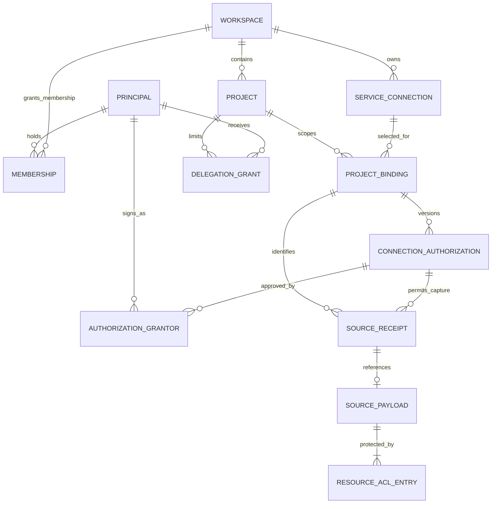
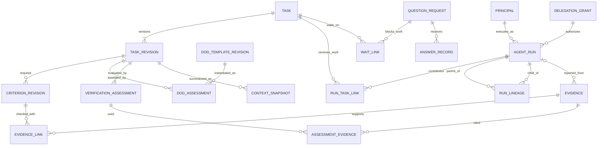

# DB ilişkileri ve bütünlük sınırları

**2026-10-10 — Mantıksal tasarım; migration/DDL veya çalışan DB değildir.** SQLite yerel başlangıç, merkezi PostgreSQL ekip adayı olarak korunur. [Atlas 3](diagrams.md#3-mantıksal-veri-modeli) kaynak→değerlendirme→değişiklik→event ilişkisini gösterir. Bu belge sonradan ayrıntılanan erişim ve task/agent/kanıt ilişkilerini tamamlar; yeni graph DB veya ayrı servis önermez.

ER diyagramı zamanlama göstermez; [tetik ve sequence sözleşmesi](execution-and-integrations.md) işlem sırasını tanımlar. Entity adları mevcut domain kavramlarının mantıksal tablosudur, kesin ORM sınıf adı değildir. Alan listeleri uygulama sırasında versioned schema ile tamamlanır; aşağıda gösterilmeyen FK/ACL/retention alanları kaldırılmış sayılmaz.

## ER-01 — Kaynak bağlantısı ve izin geçmişi

Workspace Membership burada gösterilir; ayrıca ProjectMembership aynı human principal'ı proje rolüne bağlar. ServiceConnection bir workspace içinde birden çok açık proje binding'ine bağlanabilir; aynı kaynak iki projeye aktarılırsa ayrı izin/ACL ve kayıt kimliği gerekir. Aynı credential kullanılması private içerikleri ortaklaştırmaz.

`ConnectionAuthorization` binding'e ait sürümlü izin kaydıdır. Taslakta sıfır grantor olabilir; activation gereken kaynak/hedef yetki kanıtlarını ister. İki farklı onay veren gerektiğinde `AuthorizationGrantor` join'i ikisini korur; aynı kişi iki kapsamı karşılayabilir. Bu join alanları grantor principal, authority_scope, proof_ref, signed_digest, timestamp'tir; secret içermez. Kaynak alımı hangi izin revision'ıyla yapıldığını saklar, ancak eski izin bugünkü retrieval hakkı değildir.

SourceReceipt payload olmadan da yaşamaya devam eder: redaction/purge veya kaynak metadata-only olabilir. SourcePayload burada receipt'e özel mantıksal referanstır; fiziksel blob dedup ayrı bir depolama detayıdır, tenant'lar arası ACL birleşmesi yaratmaz. Import, runner ve MCP kaynakları da uygun source context taşır; her import için harici provider credential şart değildir. Project seçilemeyen giriş quarantine alanında kalır; diagram yalnız bound akışı gösterir.

## ER-02 — Task, run, kabul ölçütü ve kanıt

Task, KnowledgeRecord'ın task türüdür; TASK/TASK_REVISION ikinci canonical task deposu anlamına gelmez. CriterionRevision ve DoD applicability gerçek seçilmiş task/AC/DoD revision setini taşır. EvidenceLink bir evidence'ın birden fazla kriteri desteklemesini, bir kriterin birden fazla kanıt istemesini sağlar. DoD kanıt bağları da ilgili assessment maddesini typed ref ile hedefler; şemada bütün endpoint türleri tekrarlanmadı. Evidence'ın blob'u yoksa availability `unavailable`; geçmiş assessment silinmez.

AgentRun→Task **çoktan çoğa**dır: run hiçbir task'a henüz bağlanmamış olabilir; bir run birçok task'a katkı sunabilir, bir task üzerinde birçok agent/run çalışabilir. RunTaskLink association revision ve provenance taşır; görüntülenen görev ataması grant vermez. RunLineage task `part_of` ilişkisi değildir. Parent unknown ise sahte parent kaydı oluşturulmaz; aynı scope içindeki doğrulanmış soy ağacında cycle reddedilir. Harici/gözlenen kimliği doğrulanamayan run ayrı observation/quarantine kaydıdır; sırf adapter gördü diye çalıştırma grant'i yaratılmaz. Diagram yetkili/kimliği çözümlenmiş run'ları gösterir.

Evidence agent olmadan CI, insan veya izinli test aracından gelebilir; üretici principal, authority, artifact revision ve ortam ayrıca tutulur. QuestionRequest run'a/karara da bağlanabilir; WaitLink burada task beklemesini gösterir, bütün sistemi durdurmaz. Bir soruya birden fazla/çelişkili cevap gelebilir; AnswerRecord insan Approval yerine geçmez. ContextSnapshot türevdir; gerekli revision ve kaynak/ACL setine bağlıdır.

## Kardinalite ve transaction tamamlayıcıları

| İlişki / kural | DB düzeyinde korunacak anlam |
|---|---|
| Project→Record→RecordVersion | Her record tek projede; `(workspace_id, project_id, record_id, revision)` unique; geçmiş revision üzerine sessiz yazma yok |
| Source↔Evaluation inputs | Çoktan çoğa `EvaluationInput` typed refs; bir değerlendirme birçok source/record revision kullanır; tek source birçok değerlendirmeyi besleyebilir |
| Job→Attempt→UsageReservation | Job birçok deneme; her billable outbound attempt ayrı rezervasyon/usage. Retry kaydı eski unknown maliyeti silmez; provider çağrısı olmayan attempt rezervasyonsuz olabilir |
| Evaluation / ImpactRun→ChangeSet | Bir değerlendirme birden çok proposal üretebilir; manuel proposal evaluation'sız olabilir. Input graph/AC/policy snapshot korunur |
| ChangeSet→Approval→DomainEvent | Çoklu reviewer/ret/defer geçmişi; applied digest tek effect. Operation digest, revision seti ve güncel yetki birlikte kontrol edilir |
| DomainEvent→InternalJob / OutboxItem | Tetiklenecek iş intent'i command transaction'ıyla atomik; her event her handler'ı tetiklemez. Replay intent'i tekrar üretmez |
| OutboxItem→DeliveryAttempt | Çok sayıda deneme ve değişmez attempt ID; external receipt/remote ID/correlation. Provider'da exactly-once varsayılmaz |
| Edge→kaynak/hedef RecordVersion | İki endpoint aynı yetkili proje scope'unda; typed relation ve justification. Ended/invalidated revision geçmişte kalır |
| Task→ParentTask | Q08 önerisi: en fazla bir güncel parent; self/cycle reddi; parent completion kendi kriterlerine bağlı |
| ContextSnapshot→Export | Sıfır veya çok export sürümü; Q06 otomatik dosya tercihi açık. Export hatası geçmiş domain event'i geri almaz |

Atlas'ın source→job→evaluation çizgisi genel işlem hattını sadeleştirir; bütün N:M input ilişkilerini tekil gösterimden çıkarmayın. Tasarımın normatif anlamı bu tablo ve [domain sözleşmesidir](domain-model.md). Yeni bir source revision, claim veya evaluation'ın varlığı accepted/active karar yaratmaz.

## Anahtarlar, indeksler ve silme kuralları

- Workspace tabloları tenant, proje tabloları `(workspace_id, project_id)` kapsamı taşır. Composite FK ve unique koşulları istemci filtresine bırakılmaz. Global principal kimliği veri erişimi vermez. Project olmayan quarantine kendi sahiplik/ACL sınırını korur.
- Source dedup: tenant/project + provider/account/session/epoch/source event/revision. Command: tenant/project + idempotency key; key aynı, digest farklıysa conflict. Trigger job: scope + trigger identity + handler/version + input fingerprint. Cross-tenant dedup içerik paylaşmaz.
- Önerilen indeks adayları: scoped record type/current state; edge endpoint/type/current validity; source origin/cursor; job `(scope,status,due_at,priority)` ve lease expiry; outbox status/next_attempt; evidence task/AC/artifact revision; audit actor/action/time. Gerçek index/query planı yük fixture'ıyla seçilir, bütün alanlara otomatik index yok.
- Event append sequence proje stream'i içinde authoritative; occurred_at dış kaynak saati sadece provenance. Current pointer revision'ı atomik değişir; domain event, projection, gereken audit, internal job/outbox birlikte commit olur. Transaction içinde LLM veya dış API beklenmez.
- Immutable domain/audit geçmişine normal `ON DELETE CASCADE` uygulanmaz. Güncel ilişkiler correction/revoke/tombstone ile değişir. Privacy purge ayrı policy, minimal tarihsel kanıt, blob/türev/backup temizliği gerektirir; append-only sonsuz kişisel veri saklama gerekçesi değildir.
- Payload/blob ve DB ayrı dayanıklılık sınırlarıdır: hash/ref ve manifest, orphan cleanup, restore uyumu gerekir. Projection/index yeniden üretilebilir; approval/kanıt geçmişi cache değildir. Kodun DB'ye doğrudan bypass yazması desteklenen ürün API'si olmaz.

## Planlı veri kabul senaryoları

**Çalıştırılmadı.** SQLite transaction/FK fixture'ları P1, Postgres migration eşdeğerliği C02/C06.

| ID | Gözlenebilir kabul |
|---|---|
| DBR-01 | Başka tenant/proje record, grant veya evidence FK'si storage ve API katmanlarında reddedilir |
| DBR-02 | Aynı task'a iki run, aynı run'a iki task bağlanır; lineage child task üretmez; bilinmeyen gözlemciye grant atanmaz |
| DBR-03 | AC/artifact revision değişince eski assessment güncel completion sağlamaz; bir kanıtın çok kriterde kullanılması provenance kaybetmez |
| DBR-04 | Crash event/job/outbox arasında yarım commit bırakmaz; source/command/trigger unique anahtarları duplicate effect'i engeller |
| DBR-05 | İzin geri çekme/purge eski approval veya receipt'i başarıyla yeniden kullanılabilir yapmaz; payload olmadan dedup kimliği korunur |
| DBR-06 | Migration/replay ilişki sayıları, referanslar, sequence ve projection digest'i korur; unknown event/schema sessiz atlanmaz |

Bu ayrıntılar T04/T05/T06/T07/T08/T14 sözleşmelerine dağıtılır; fiziksel migration dosyaları T03 teknoloji kararından sonra oluşturulur. [Uygulama dilimleri](../delivery/backlog.md#tetikleme-zamanlama-ve-veri-ilişkileri-dilimleri).
