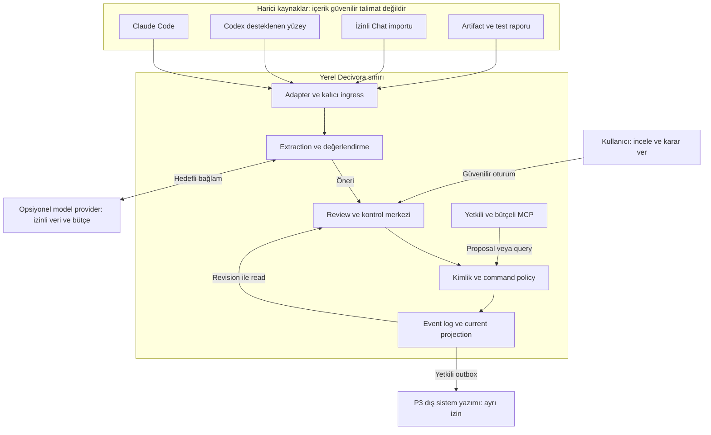
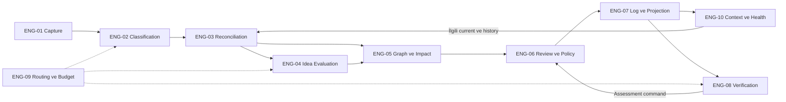
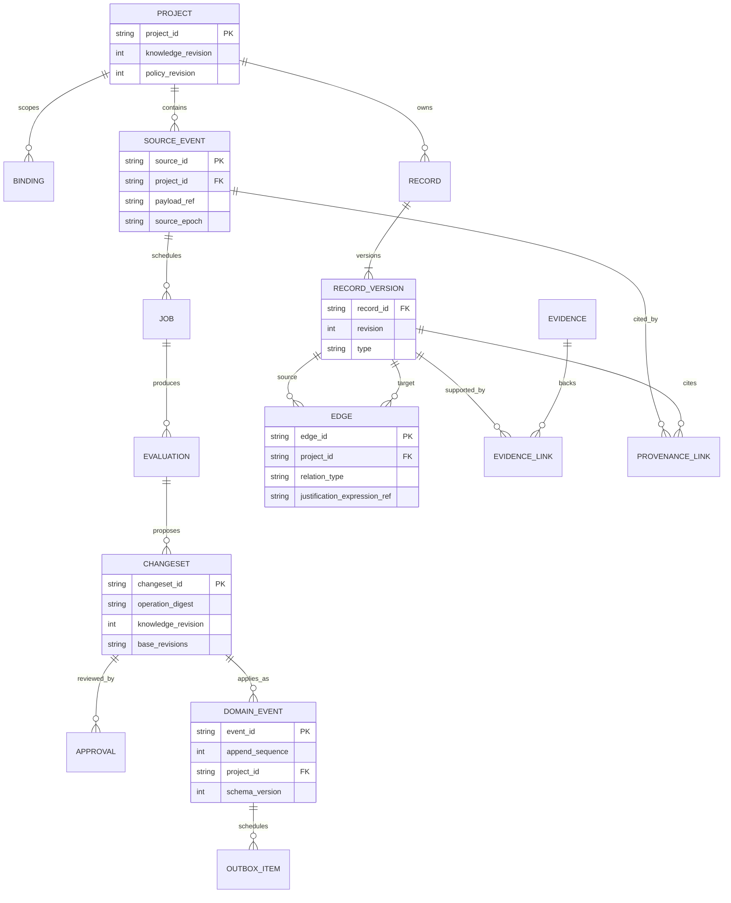
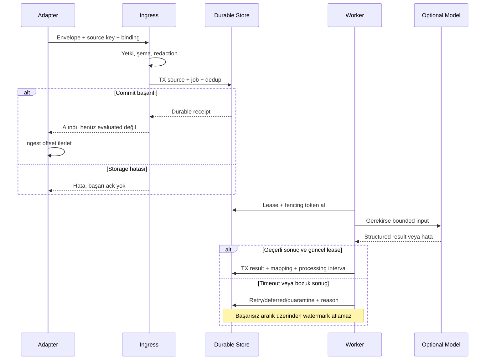
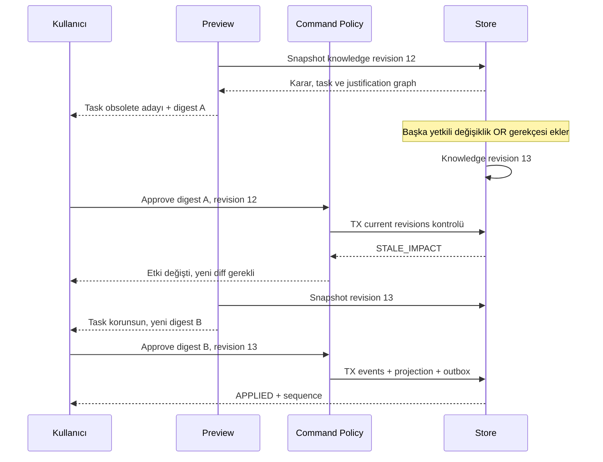
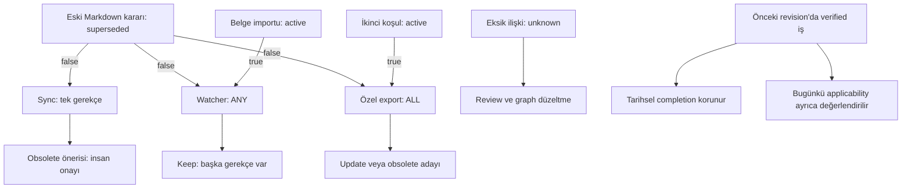
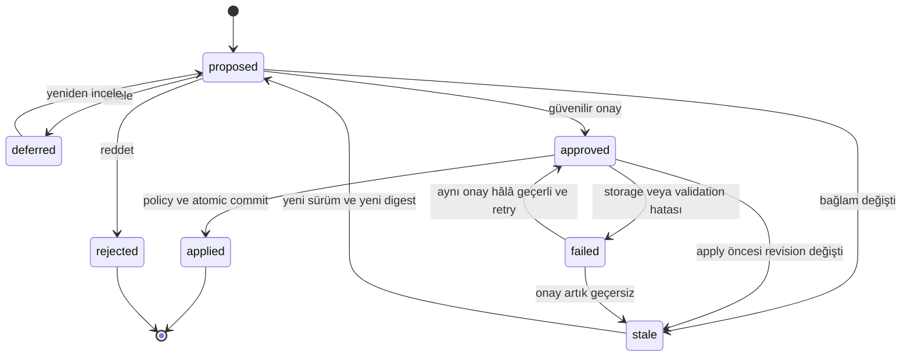
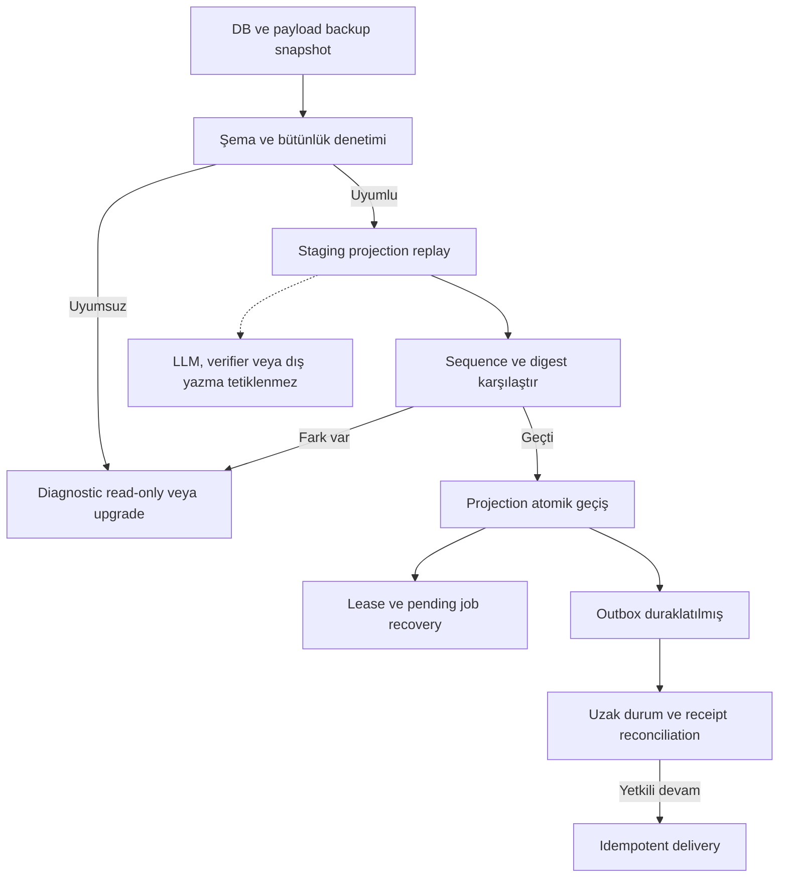

# Mimari ve yaşam döngüsü atlası

**Tüm diyagramlar önerilen tasarımı gösterir; çalışan sistem görüntüsü değildir.** Mermaid kaynakları GitHub'da görüntülenebilir. Oklar yetki aktarımı anlamına gelmez; yazma otoritesi command/policy katmanıdır. Metinsel sözleşmeler [engine haritası](engines.md), [domain](domain-model.md) ve [runtime](runtime-contracts.md) belgelerindedir.

## 1. Sistem bağlamı ve güven sınırları

Yerel depolama dış model kullanımında veri çıkmayacağı anlamına gelmez. Agent'ın MCP kimliği UI insan kimliğine yükseltilemez. P1'de model olmadan deterministik fixture akışı mümkündür.

## 2. Engine zinciri ve karar otoritesi

E4 her aday için zorunlu model çağrısı değildir. Verification okunan kanıtı değerlendirir; bu ok kendiliğinden test komutu veya agent başlatma yetkisi vermez. Knowledge Evolution bu zincirin ortak davranışıdır.

## 3. Mantıksal veri modeli

Şema mantıksaldır; fiziksel DDL değildir. RecordVersion'ın anahtarı `(project_id, record_id, revision)`; edge iki endpoint revision'ına başvurur. Diagram okunabilirliği için tüm foreign key'ler ve Evaluation'ın çoklu input provenance bağlantıları çizilmedi. Source kimliği quarantine'da henüz project'e bağlı olmayabilir. Imported/manual ChangeSet ayrıca evaluation olmadan oluşabilir; normal inferred akış yukarıda gösterilir. Detailed constraints runtime belgesinde korunur.

## 4. Capture: receipt ile değerlendirme farklıdır

## 5. Onay öncesi yeni ilişki yarışı

Eski onay yeni öneriye otomatik taşınmaz. Agent/source metnindeki “onayladım” cümlesi bu güvenilir approval akışının yerine geçmez.

## 6. Çoklu gerekçe ve tarihsel başarı

Boolean false gerekçenin sağlanmadığını söyler; tek başına task'ı cancelled/done yapmaz. Semantik alternatif ve kullanıcı tercihi için review gerekir.

## 7. ChangeSet durumları

Stale→proposed yeni proposal revision oluşturur; eski onay/history silinmez. Undo ayrı compensating ChangeSet'tir. Bu state machine task execution veya knowledge validity state machine'i değildir; onların değerleri [domain modelinde](domain-model.md) ayrı eksenlerdir.

## 8. Geri yükleme ve yan etkisiz replay

Yedekten dönmek uzak GitHub/Linear durumunu geriye almaz. Dış etkiler local replay'den ayrı denetlenir.
