# Mimari ve yaşam döngüsü atlası

**Tüm diyagramlar önerilen tasarımı gösterir; çalışan sistem görüntüsü değildir.** Mermaid kaynakları GitHub'da görüntülenebilir. Oklar yetki aktarımı anlamına gelmez; yazma otoritesi command/policy katmanıdır. Metinsel sözleşmeler [engine haritası](engines.md), [domain](domain-model.md) ve [runtime](runtime-contracts.md) belgelerindedir.

## 1. Sistem bağlamı ve güven sınırları

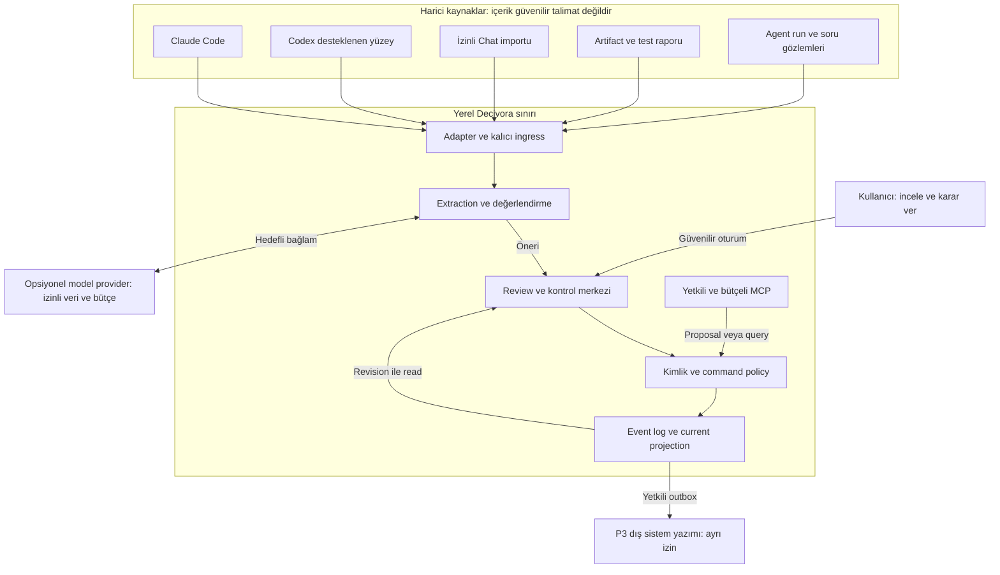

Yerel depolama dış model kullanımında veri çıkmayacağı anlamına gelmez. Agent'ın MCP kimliği UI insan kimliğine yükseltilemez. P1'de model olmadan deterministik fixture akışı mümkündür.

## 2. Engine zinciri ve karar otoritesi

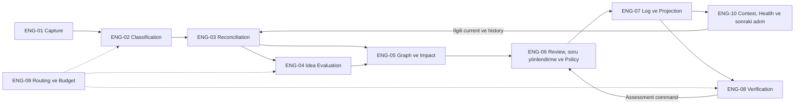

E4 her aday için zorunlu model çağrısı değildir. Verification okunan kanıtı değerlendirir; bu ok kendiliğinden test komutu veya agent başlatma yetkisi vermez. Knowledge Evolution bu zincirin ortak davranışıdır.

## 3. Mantıksal veri modeli

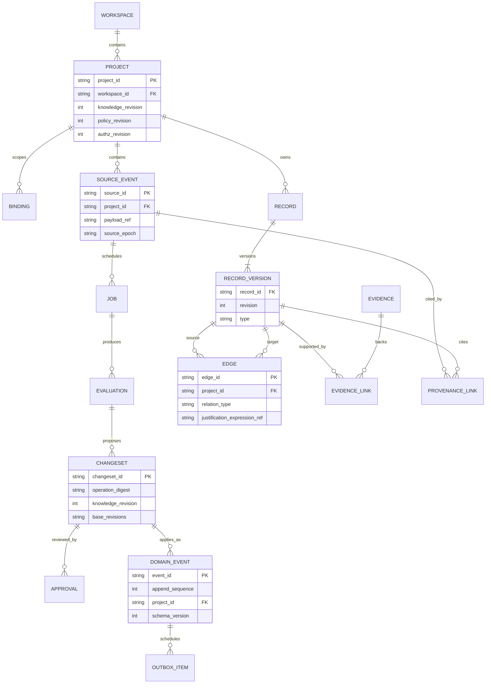

Şema mantıksaldır; fiziksel DDL değildir. RecordVersion'ın anahtarı `(workspace_id, project_id, record_id, revision)`; tüm proje kayıt/FK/unique sınırları tenant kapsamını korur. Edge iki endpoint revision'ına başvurur. Diagram okunabilirliği için her tabloda tenant/FK alanları, üyelik/ACL ve Evaluation'ın çoklu input provenance bağlantıları tekrarlanmadı; [yetki sözleşmesi](identity-access.md) normatiftir. Source kimliği quarantine'da henüz project'e bağlı olmayabilir; izolasyon kalkmaz. Imported/manual ChangeSet ayrıca evaluation olmadan oluşabilir. Run ve soru ilişkileri aşağıdaki ayrı diyagramlarda; bunlar task hiyerarşisi değildir.

## 4. Capture: receipt ile değerlendirme farklıdır

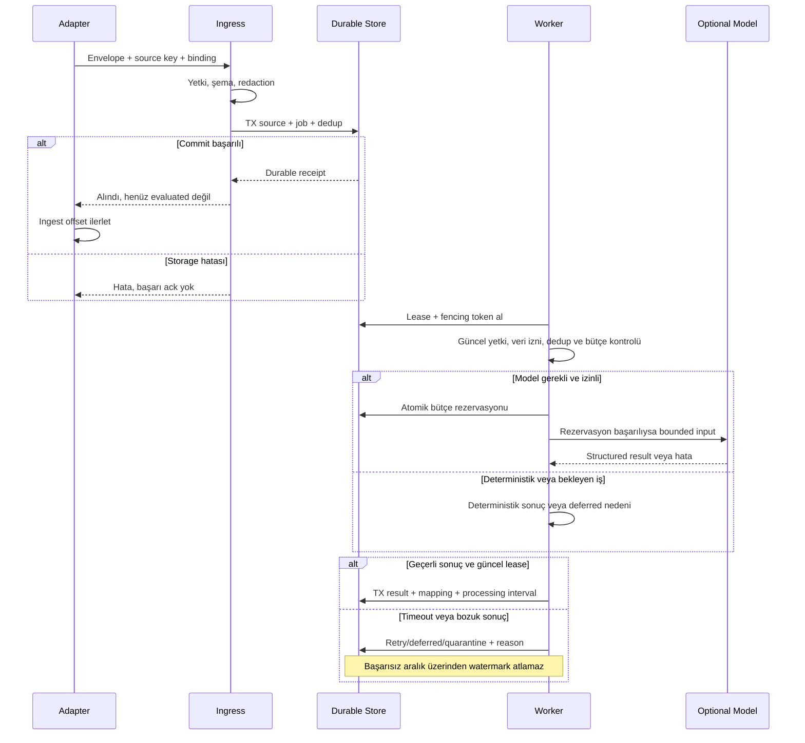

## 5. Onay öncesi yeni ilişki yarışı

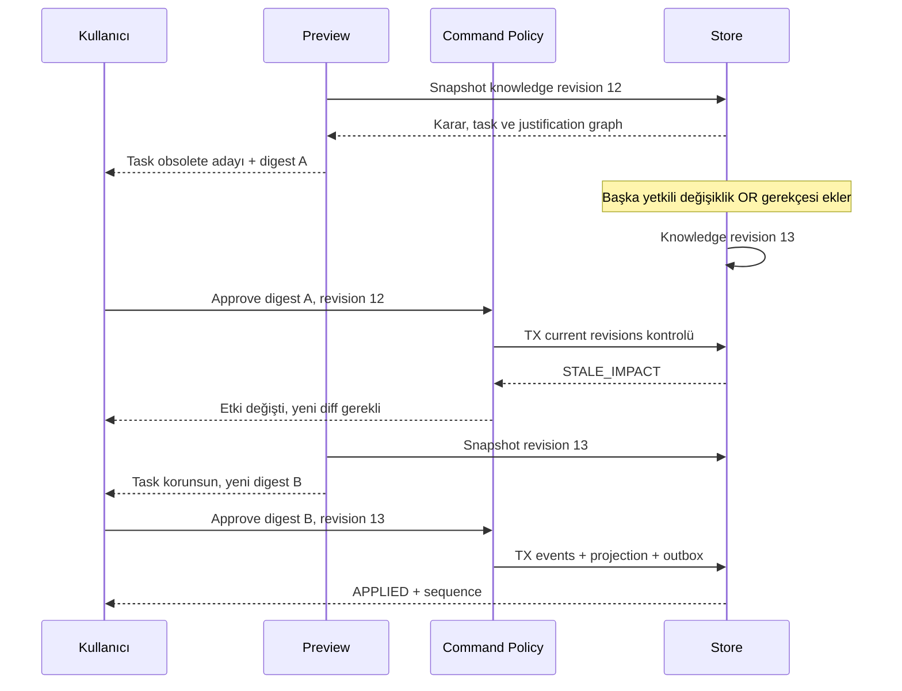

Eski onay yeni öneriye otomatik taşınmaz. Agent/source metnindeki “onayladım” cümlesi bu güvenilir approval akışının yerine geçmez.

## 6. Çoklu gerekçe ve tarihsel başarı

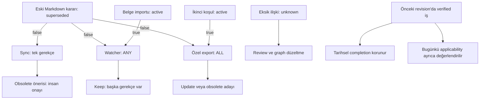

Boolean false gerekçenin sağlanmadığını söyler; tek başına task'ı cancelled/done yapmaz. Semantik alternatif ve kullanıcı tercihi için review gerekir.

## 7. ChangeSet durumları

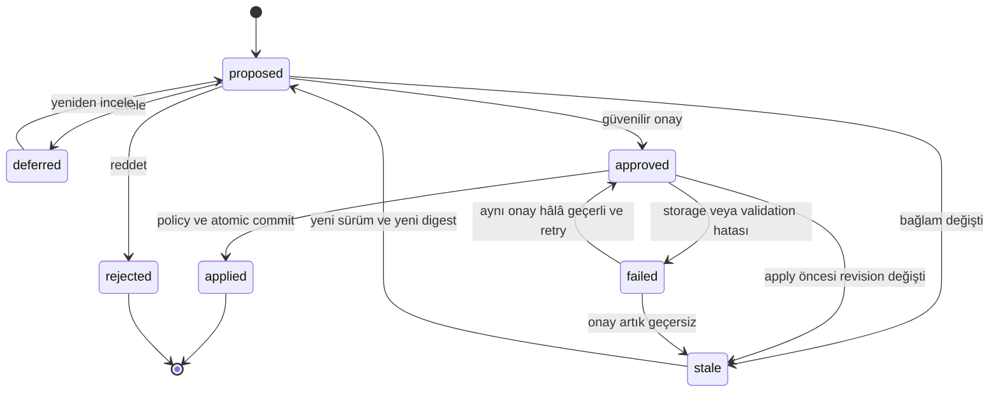

Stale→proposed yeni proposal revision oluşturur; eski onay/history silinmez. Undo ayrı compensating ChangeSet'tir. Bu state machine task execution veya knowledge validity state machine'i değildir; onların değerleri [domain modelinde](domain-model.md) ayrı eksenlerdir.

## 8. Geri yükleme ve yan etkisiz replay

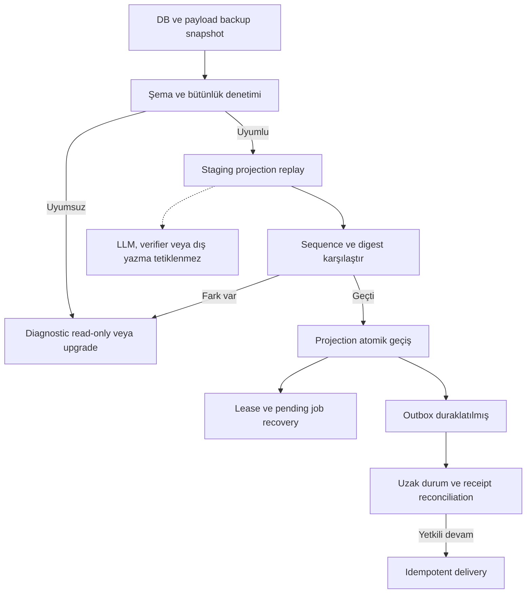

Yedekten dönmek uzak GitHub/Linear durumunu geriye almaz. Dış etkiler local replay'den ayrı denetlenir.

## 9. Task, agent ve run farklı kimliklerdir

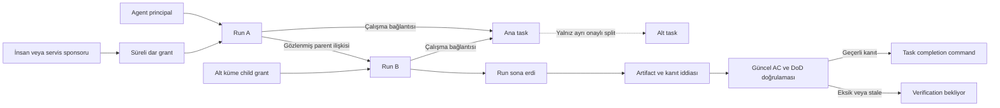

Parent kimliği bulunamıyorsa unknown kalır; gizli muhakeme çıkarılmaz. Run soy ağacı otomatik alt görev yaratmaz. Tüm child'ların geçmesi parent AC/DoD doğrulamasını kaldırmaz. [Agent işletimi](agent-and-team-operation.md), [split ve acceptance](../product/task-context-and-acceptance.md).

## 10. Soru, cevap, onay ve teslim ayrımı

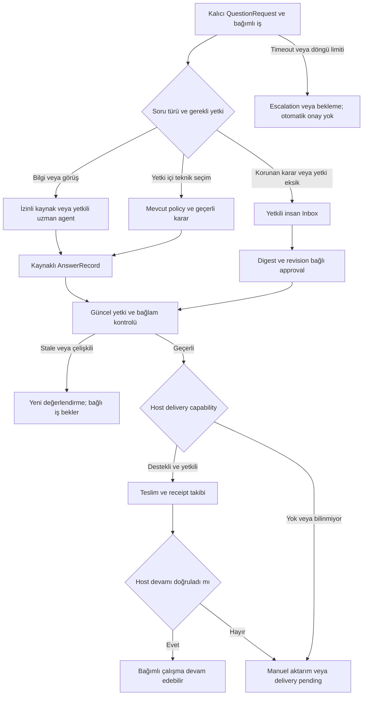

Bilgi cevabı approval değildir; protected karara dönüşürse insan koluna gider. Uzman/parent agent insanın yerini alamaz. Yetkili ve değişmemiş önceki karar tekrar sorulmadan kullanılabilir. Yalnız bağlı iş bekler; harici agent'ın durduğu veya yeniden başladığı capability/receipt olmadan iddia edilmez. [ASK sözleşmesi](agent-and-team-operation.md#5-subagent-soru-sorunca-karar-kime-gider).

## 11. Blocker çözüm sırası ve görev önceliği

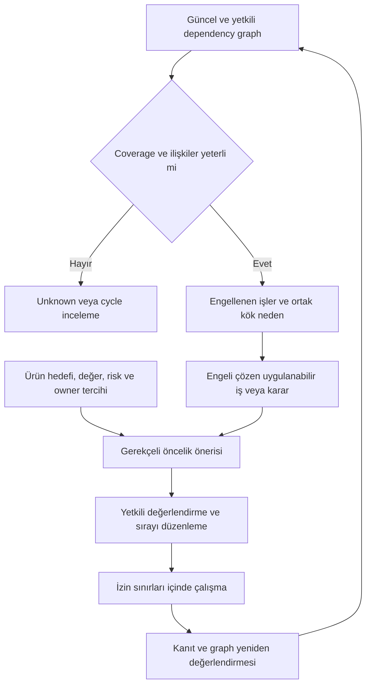

Blocked task ile engeli çözen ready iş farklıdır. Etki sayısı tek başına öncelik değildir; gizli kayıtları açıklamaz. Dependency ve blocker yöntemden bağımsızdır; Scrum/PMBOK uygunluğu veya kritik yol hesabı iddiası yok. [Öncelik sözleşmesi](../product/priority-and-flow.md).

## 12. Yönetim yüzeyleri ve veri sınırları

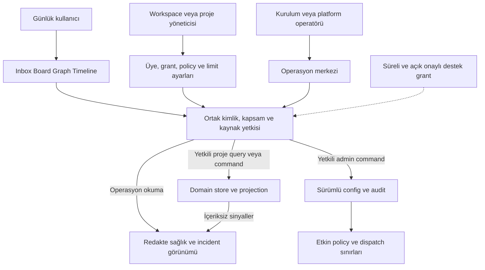

Operatör kimliği domain içeriğine otomatik izin değildir. Aynı servis önerilir; ayrı backoffice DB veya mikroservis zorunlu değil. P1b yerel owner sağlık/ayar görünümü, P4 ekip ve hosted operasyon konsolu. [Yönetim sözleşmesi](../product/administration-and-operations.md).

## 13. Hata müdahalesi ve config değişimi

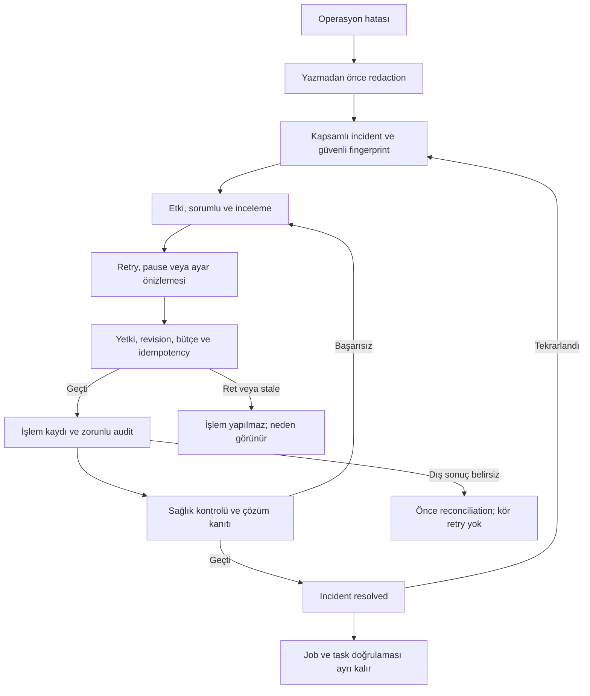

Config apply beklenen revision ile atomiktir; rollback yeni revision olur. Dış istek yerel transaction'a alınamaz. Telemetry veya DB arızası kayıtsız başarı iddiası üretmez. [ADM kabul senaryoları](../product/administration-and-operations.md#planlı-kabul-senaryoları).
