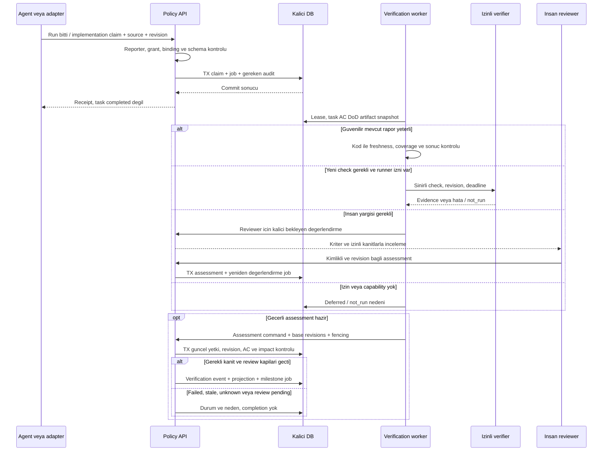
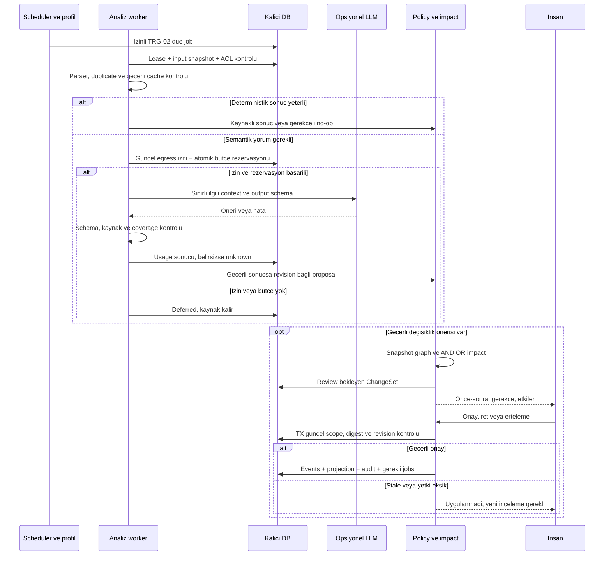
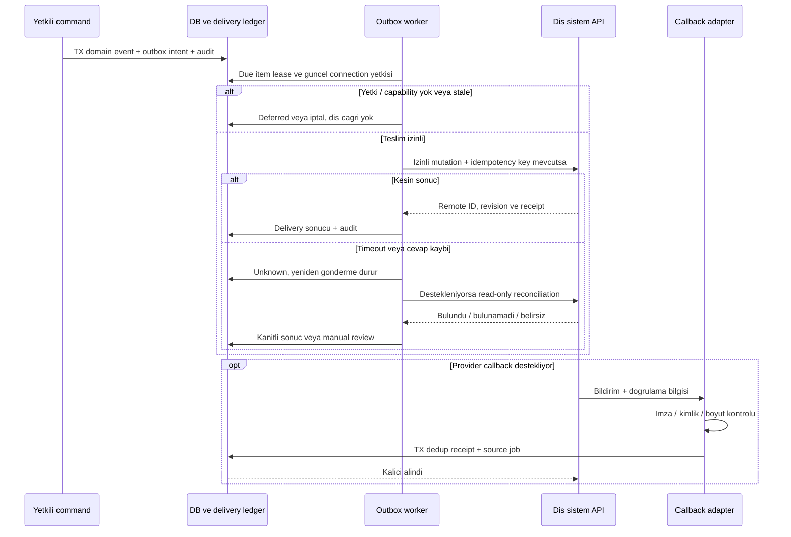

# Tetikleyiciler, API iletişimi ve sequence sözleşmeleri

**2026-10-10 — Önerilen tasarım; çalışan endpoint, scheduler veya entegrasyon değildir.** Kullanıcı sorusu: sistemler ne zaman/hangi aralıkla konuşacak, task sonucunu kim işleyecek? Bu belge [engine sorumluluklarını](engines.md), [dayanıklı runtime kurallarını](runtime-contracts.md), [izinleri](connection-and-context.md) ve [token ekonomisini](routing-token-economy.md) zamana ve aktörlere bağlar. Süreler deney adayıdır; onaylanmış SLA veya provider limiti değildir.

## Hangi şema hangi soruyu cevaplar?

| Gösterim | Yanıtladığı soru | Referans |
|---|---|---|
| Bileşen / güven sınırı | Hangi sistemlerle bağlantı var? | [Atlas 1/12](diagrams.md) |
| ER ve bütünlük sözleşmesi | Hangi kayıt hangisine kaç ilişkiyle bağlı; hangi revision saklanıyor? | [Veri ilişkileri](data-relationships.md), atlas 3 |
| Sequence | Kim başlatır, hangi sırada ne çağrılır, nerede beklenir ve sonuç kime döner? | Aşağıdaki SEQ-01–03; atlas 4/5 ve log/audit |
| Durum makinesi | Pending, failed, stale ve completed neden farklı? | [Domain](domain-model.md), [runtime](runtime-contracts.md), atlas 7 |
| Tetikleme / zamanlama tablosu | Aynı akış hangi olayla ve ne sıklıkta çalışır? | Bu belge; sequence tek başına bir scheduler tanımı değildir |

## 1. Tetikleme kaydı

Kod içindeki event dispatcher/worker mevcut modüllerin parçasıdır; yeni bir LLM, orchestration ürünü veya mikroservis eklenmez. **Bir olayın kaydı, bir işin kuyruğa alınması, yürütülmesi ve tamamlanması ayrı aşamalardır.** Sadece izinli event→handler eşleşmesi iş açabilir. LLM cevabı kendi başına yeni araç çalıştırma yetkisi oluşturmaz.

| ID / tetikleyici | Kim üretir? | İlk işleyici ve sonraki iş | LLM / insan / tekrar kuralı |
|---|---|---|---|
| TRG-01 Yeni kaynak parçası | İzinli adapter veya import | ENG-01 kalıcı receipt/job; ENG-02 parser/dedup | Parser yetmezse TRG-02; aynı source/revision yeniden çıkarılmaz |
| TRG-02 Semantik analiz zamanı geldi | Seçili profil, explicit kullanıcı isteği veya izinli milestone | ENG-09 izin/bütçe; ENG-02/03/04 sınırlı context ile değerlendirme | LLM opsiyonel; sonuç proposal. Timeout başarı/no-op değildir |
| TRG-03 Yapılandırılmış MCP önerisi | Yetkili insan/agent | ENG-06 şema/kaynak/revision; ENG-03 duplicate/conflict kontrolü | Aynı span'a tekrar extraction yok; gerekli semantik kontrol ayrıca bütçeli |
| TRG-04 Decision/requirement/edge/AC değişikliği | Yetkili command commit | ENG-05 impact/kanıt stale değerlendirmesi; ENG-10 ready görünümü | Graph/AND/OR kodla; anlamsal belirsizlik proposal/insan review. Kabul edilmiş bilgi otomatik iptal edilmez |
| TRG-05 Agent/run durdu veya uygulama iddiası geldi | Adapter/MCP; gözlenen aktör ve reporter ayrı | ENG-01 run/claim kaydı; bağlı task için ENG-08 değerlendirme işi | Run bitişi task completion değildir; task link'i unknown ise uydurma |
| TRG-06 Artifact/test/insan değerlendirmesi geldi | Yetkili evidence adapter, runner veya reviewer | ENG-08 güncel AC/DoD/artifact eşlemesi; ENG-06/07 assessment command | Test sonucu deterministik; nitel kriteri yetkili insan değerlendirir. LLM yorumu trusted test raporu değildir |
| TRG-07 Task doğrulandı, iptal edildi, değişti veya yeniden açıldı | Policy kontrollü domain commit | ENG-10 context milestone ve ilgili downstream ready hesabı | Şablon kodla; isteğe bağlı anlatı modeli ayrı izin/bütçe. Sonraki agent kendiliğinden başlatılmaz |
| TRG-08 Soru/yanıt/approval geldi | Agent, insan veya yetkili API | ENG-06 kalıcı soru/cevap, wait links, stale kontrolü | [ASK akışı](agent-and-team-operation.md); geçerli insan onayı gereken yerde parent agent karar veremez |
| TRG-09 Yetki/bağlantı/policy/bütçe değişti | Yetkili admin/owner veya doğrulanmış provider sinyali | Dispatch'i yeniden değerlendir; cache/cursor invalidation; engeli kalkmış işi tekrar uygunluk kontrolüne al | Tek başına model çağırma izni değildir; eski revision sonucu uygulanmaz |
| TRG-10 Deadline/retry/lease süresi geldi | Deterministik scheduler | Yalnız vadesi gelmiş job; fencing, attempt ve güncel policy kontrolü | Yeni attempt bütçe ister; timeout insan onayı üretmez; failed iş sonsuz tekrar etmez |
| TRG-11 Connector teslimi veya callback | Outbox worker / doğrulanmış dış bildirim | Delivery ledger, correlation ve reconciliation | Aynı dış sonuç iki domain etkisi üretmez; P3 write ayrı izin |
| TRG-12 Health/audit/backup bakımı | Versioned bakım takvimi veya admin | ENG-07/10: health, bounded orphan audit, backup | Varsayılan LLM yok; eksik ilişki review adayıdır, otomatik obsolete değil |

Trigger kaydı: scope, event/source/command ref, causation/correlation, handler ve sürümü, input revision seti, policy/authz revision, due_at/deadline, dedup key, priority nedeni ve sonuç job ref'i. Görev/routing etiketi bu handler'a yetki vermez.

Domain değişimiyle gerekli internal job veya outbox intent **aynı transaction** içinde kalıcıdır. Commit sonrası uyandırma yalnız hızlandırıcıdır; süreç o anda ölürse due-job taraması işi bulur. Worker yalnız kendi engine yetkisiyle command gönderir. Aynı trigger+handler+input snapshot retry'ı yeni iş etkisi üretmez; yeni revision yeni değerlendirmedir. Child/cascade sınırları parent/proje bütçesini aşamaz. Replay, bu trigger'ları yeniden üretmeden projection kurar; normal restart mevcut job ledger'ını kontrollü sürdürür.

## 2. Sistemler arası iletişim matrisi

Aşağıdaki işlem isimleri **mantıksal sözleşmedir**; HTTP URL, SDK metodu veya çalışan OpenAPI değildir. Dış sistemlerin webhook/MCP/poll desteği yüzey/build bazında T02/T27/T28'de doğrulanır; destek yoksa otomasyon iddia edilmez.

| Başlatan → hedef / veri | Ne zaman, nasıl? | Yanıt ve hata | Faz |
|---|---|---|---|
| Coding adapter → Decivora ingress / source envelope | Desteklenen olay geldiğinde kimlikli local transport; manuel import explicit | Kalıcı receipt; commit yoksa ack yok, bounded spool/gap | P1 |
| Agent host ↔ MCP bridge → servis / brief, query, proposal, evidence | Host tool çağırdığında; oturum/proje değişimi veya gerekli delta; periyodik tüm geçmiş gönderme yok | Bounded cevap, cursor/coverage/revision; host'un ne zaman tool çağırdığını garanti edemeyiz | P1b |
| İnsan web UI ↔ servis / query, approval, ayar | Kullanıcı eylemi ve görünür sayfa yenilemesi; update stream aday, polling fallback | Revision bağlı sonuç; UI disconnected/stale açık. Reconnect cursor/resync yetkili | P1b |
| Worker ↔ DB / lease, job, result, projection | Olayla uyandırma + kontrollü due taraması; aynı yerel süreçte modül/DB çağrısı | Kısa transaction; lease/fencing. İç modüller zorunlu HTTP ile konuşmaz | P1 |
| Analiz worker → model provider / redakte sınırlı context | Yalnız TRG-02 gerekli, policy izinli ve rezervasyon başarılıysa request | Şema kontrollü proposal; timeout/unknown usage, bounded retry/defer | P1 koşullu; Q03 kapısı |
| Verifier → izinli runner / onaylı check ve artifact revision | Kanıt yetersiz ve ilgili check'i çalıştırma grant'i varsa | Sonuç + runner/environment + hash. Gözlem-only modda not_run/insan işi | P1 koşullu |
| Evidence adapter → GitHub benzeri hedef / commit-test-PR kanıtı | Talep/değişim sinyali; destek varsa webhook, yoksa opt-in polling | Kaynak revision'ıyla evidence; sadece PR varlığı başarı sayılmaz | P2 read |
| Outbox → GitHub/Linear/Jira / onaylı dış değişiklik | Yerel commit sonrasında yetkili due delivery; P3 | External ID/receipt veya unknown; önce reconciliation, kör retry yok | P3 write |
| Dış callback → adapter / değişim bildirimi | Provider destekliyorsa kimliği/imzası doğrulanan callback | Durable receipt + dedup; gerekirse source refetch. Bildirim onay yetkisi değildir | P2/P3 |
| Answer delivery → agent host / dar kapsamlı karar referansı | Geçerli cevap/onay ve gerçek delivery capability varsa | Teslim/ack/run devamı ayrı; unsupported ise manuel aktarım | P1b gözlem; aktif execution ayrı kapı |
| Health/audit/backup → yerel depo, ileride izinli harici hedef | Seçilmiş bakım takvimi, saklama ve export yetkisi | Son başarı, hata, drop/gap görünür; dış log servisi varsayılan yok | P1; managed P4 |

Bir provider'a aynı anda webhook ve polling açılırsa ortak source key/revision ile duplicate bastırılır. Webhook kaybını düzeltme poll'u da izin ve rate limit sınırındadır. Gizli kaynağın varlığını açığa çıkaran kontrol yapılmaz. Genel public incoming endpoint veya port açma kararı bu belgeyle alınmış değildir.

## 3. Aralıklar ve takvim

**Tercih olay odaklıdır.** Aynı işi her N saniyede LLM'e yeniden sormayız. Aşağıdaki değerler sadece sentetik fixture için başlangıç adaylarıdır; OPEN-12 ve Q05 profil deneyiyle seçilecek. Prod varsayılanı diye kullanılmaz; gerçek provider timeout/rate/lease sınırları ayrıca ölçülür.

| İş | Önerilen deney / tetikleme | Limit ve özel durum |
|---|---|---|
| Kalıcı ingress ve yetki iptali | Olay alınınca; semantik batch beklemez | Ağ kopukken anında global revocation garantisi yok; bilinen yerel iptal commit/dispatch'te geçerli |
| `responsive` semantik profil | 2 sn idle veya en eski parça 10 sn olduğunda batch adayı | Deadline enqueue zamanıdır, modelin tamamlanma garantisi değil |
| `balanced` semantik profil | 15 sn idle veya en eski parça 60 sn olduğunda batch adayı | Onaylı milestone ilgili işi öne alabilir; bütçe/izin değişmez |
| `manual_semantic` | Kullanıcının “analiz et” isteği | Süre dolması gizli model çağrısı başlatmaz; capture ve deterministik health sürer |
| Worker due-job taraması | Commit sonrası wake-up; kaçan wake-up için 1 sn dolu / en çok 5 sn boşta aday | Ready kuyruğu, fairness ve storage backpressure; aktif bekleme döngüsü yok |
| UI yenilemesi | Change notification adayı; fallback görünürken 5 sn, gizliyken polling yok | Tekrar açılışta bounded resync; veri okunması LLM çağrısı değildir |
| İzinli source polling fallback | Seçilmiş aktif kaynakta 30 sn, idle'da 5 dk aday | Provider limitleri daha seyrek kontrol gerektirirse onları uygula; disabled/unsupported ise poll yok |
| Geçici API hatası retry | 2 sn taban, exponential backoff+jitter; örnek üst bekleme 60 sn | Retry-After varsa en erken ona uy; deadline'i aşıyorsa defer. Model için mevcut ilk+1 retry / run 3 çağrı adayı korunur |
| Model timeout / runner timeout | Ayrı adapter/check config; T02/T14 ölçümüyle | Tek global süre uydurulmaz; bilinmeyen billable çağrı reservation'ı düşürmez |
| Health örnekleme / orphan audit | Örnek health 60 sn; orphan audit günde bir bounded tur | Audit checkpoint/frontier tutar; varsayılan LLM yok, eski task otomatik kapatılmaz |
| Backup | [Mevcut günlük yerel aday](storage-memory-capacity.md); ayrıca manuel | RPO/RTO ölçülmedi; restore testi ve retention ayrı |
| Yetki/grant süresi | Her kullanım/commit'te yerel güncel kontrol; harici revalidation adapter policy'si | Periodik kontrol tek savunma değildir; sıklık OPEN-14/16, Q10 keşif tercihi açık |

Idle debounce sürekli yeni olayla sonsuza uzamaz; ilk bekleyen parçadan max-wait ölçülür. Byte/token/batch limiti erken bölme yapabilir, kalanı manifest'te bırakır. Blocker önceliği yalnız uygulanabilir işler arasında sırayı etkiler; düşük öncelikli geçmiş için aging/fairness korunur. Q05 task override üst tavanı aşamaz.

Zamanlayıcı kayıtlarında UTC `due_at`, policy timezone'u ve revision tutulur; çalışma süresindeki timeout monotonic saatle ölçülür. Saat değişimi, process restart ve DST fixture'ları gerekir. Restart sonrası süresi geçen periyodik health/poll işleri tek catch-up'a birleştirilebilir; **benzersiz source/domain olayları birleştirilerek kaybedilemez**. Bakım pause/resume ve retry attempt takvimi kalıcıdır. Duraklama deadline'i sessizce başarıya dönüştürmez.

## 4. SEQ-01 — Task sonucu nasıl doğrulanır?

İnsan cevabı farklı zamanda gelebilir; uzun DB transaction veya worker lease'i açık tutulmaz. Cevap yeni işi uyandırır. Uygulanamaz kriter kararı policy/onay ister. LLM kanıtın yorumuna yardımcı olsa da check'i koşmuş veya insan review'su vermiş sayılmaz. Task completion sonrası başka task **ready adayı** olabilir; executor başlatmak ayrı izin/gelecek capability'dir. Completion yalnız gerekli güncel AC/DoD + review + impact kapılarıyla türetilir.

## 5. SEQ-02 — Model ne zaman çağrılır, karar kimde kalır?

Model çağrısı açık DB transaction'ı içinde değildir. Başarısız/bozuk model cevabı proposal olarak ilerlemez; mevcut runtime retry/defer kuralları uygulanır. Deterministik metadata işlemlerinin izinli auto-apply yolu mevcut policy'de ayrıdır; bu şema korunan karar değişikliği review'unu gösterir. “LLM karar verdi ve DB'yi değiştirdi” yolu yoktur.

## 6. SEQ-03 — Dış API teslimi, tekrar ve belirsizlik

P3 write tasarımıdır; bugünkü üründe dış yazma API'si yok. Uzak sistemde idempotency veya sorgulanabilir correlation yoksa timeout sonrası “bulunamadı” yeniden yazmanın güvenli olduğunu kanıtlamayabilir; manual review gerekir. Echo callback aynı değişikliği ikinci kez uygulamaz; yeni gerçek dış değişiklik kaybolmaz. Retry auth, rate, deadline ve bütçe sınırlarını tekrar kontrol eder. Restore/replay dış teslim başlatmaz.

## 7. API sözleşmesinin uygulamada tamamlanacak alanları

T04/T16/T18/T28 her transport için şunları tanımlar: versioned input/output schema; principal ve kaynak/hedef scope; idempotency ve correlation; sync receipt ile async result ayrımı; result lookup/cursor; timeout/cancel; retryable/nonretryable/unknown hataları; rate/concurrency/payload sınırları; last_verified capability; log redaction ve contract fixtures. Payload `actor=human` alanı kimlik değildir. Servis API'si, provider API'si ve host MCP tool döngüsü farklıdır; hepsini kontrol ediyoruz denmez.

Kesin endpoint/HTTP kodu ve SDK sürümü teknoloji/capability deneyinden sonra üretilecek. Kullanıcı profili ve izinleri değişince queued iş yeniden değerlendirilir; in-flight dış çağrı geri alınmış sayılmaz. UI projection revision'ını gösterir; komut başarısı ekran güncellendi garantisi değildir.

## 8. Planlı kabul — SEQ testleri

**Henüz çalıştırılmadı.** Fake clock/provider/runner ile deterministik test; gerçek provider kanıtı ayrı.

| ID | Gözlenebilir kabul |
|---|---|
| SEQ-01 | Run completed olayı task'ı tamamlamaz; güncel kanıt/AC/DoD/impact kapıları yalnız geçerli command ile sonucu değiştirir |
| SEQ-02 | Her task olayı LLM açmaz; no-op, duplicate, read, graph, context şablonu ve replay sıfır model çağrısı |
| SEQ-03 | Sürekli olayda max-wait çalışır; manual_semantic kendiliğinden çağrı yapmaz; profil değişimi eski job'ı yeniden kontrol eder |
| SEQ-04 | Commit sonrası wake-up kaybında job bulunur; lease bitişinde eski worker sonucu yazamaz; restart domain trigger'ını çoğaltmaz |
| SEQ-05 | Deadline/429/retry/unknown usage bütçe ve deneme limitlerini aşmaz; ertelenmiş iş başarı sayılmaz |
| SEQ-06 | Stale/revoked onay uygulanmaz; modelden sahte human veya yeni tool isteği yetki yaratmaz |
| SEQ-07 | Webhook+poll+outbox echo duplicate üretmez; timeout ve eksik remote idempotency manual/unknown kalır |
| SEQ-08 | Saat değişimi ve restart catch-up fırtınası yaratmaz; benzersiz source olayları kaybolmaz; düşük öncelikli geçmiş aç bırakılmaz |

DB ilişkilerinin ayrı kabulü [veri ilişkileri belgesinde](data-relationships.md). Uygulama sırası [backlog](../delivery/backlog.md#tetikleme-zamanlama-ve-veri-ilişkileri-dilimleri); kesin sayısal değerler OPEN-12/16'da ölçümle karara bağlanacak. Q02/Q03/Q06/Q08/Q10 açık seçimleri bu belgeyle kapanmaz.

## 9. Ranking önerisi ile plan uygulama sınırı

**2026-10-10 — önerilen sözleşme; uygulanmadı.** [DEC-17 ranking devamı](../product/priority-and-flow.md), mevcut ENG-05/06/09/10 üzerinde çalışır; ayrı otonom scheduler/agent servisi kararı değildir.

TRG-04/07/09 ilgili graph, goal, task, context veya authz değişiminde öneriyi stale işaretleyip deterministik yeniden değerlendirme adayı üretir. Aging için TRG-10 yalnız sürümlü eşik vadesini ve kayıtlı assessment zamanını değerlendirir; sürekli polling/LLM çağrısı gerekmez. Graph gezme, board refresh ve rank sıralama LLM çağırmaz. P2'de semantik context gerektiğinde TRG-02'nin izin/bütçe kapısı geçerlidir; model çıktısı öneridir.

Akış: yetkili snapshot → gate/blocker/coverage kontrolü → benzersiz downstream yolları → rank + ilerlememe nedenleri + next actionable → board önizlemesi. Burada işlem biter; canonical priority, execution order, task status veya dış dispatch otomatik değişmez. Commit'in bulunması, run bitişi veya yüksek rank verification yerine geçmez; TRG-05/06/07 completion kuralları korunur.

Sıra apply ayrı command'dır: authenticated actor, proje/task kapsamı, amaçlanan değişiklik, gerekçe, base plan/graph/goal/context/policy/authz revisions ve idempotency kimliği taşır. İnsan PO canonical priority/value/scope kararını verir; üst agent yalnız mevcut grant içindeki teknik execution order'ı düzenler. Apply anında grant/revocation ve snapshot yeniden kontrol edilir; stale/conflict yeniden preview ister. Yetkili değişiklik atomik domain event + audit üretir; retry tek etki, replay sıfır LLM/dış delivery. Yeni execution veya dış yazma ayrıca kendi izin kapısından geçer.

[Identity/access](identity-access.md), [agent soru/karar akışı](agent-and-team-operation.md) ve [impact sözleşmesi](reconciliation-impact.md) değişmez: AND/OR/unknown korunur; depends_on, required_by ve part_of karıştırılmaz; pending impact ready değildir. FLOW-09–15 MVP, FLOW-16–17 P2 planlı kabul testleridir; SEQ testleri yerine geçmez.
