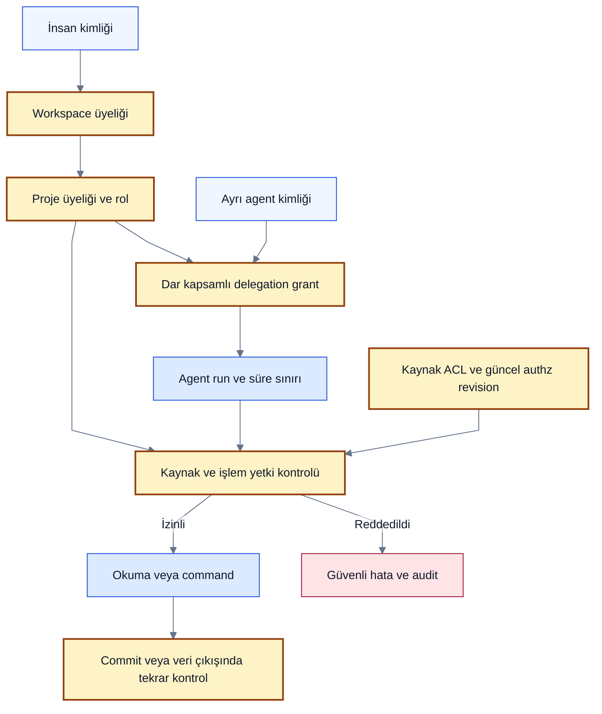

# İnsan, agent ve proje yetkileri

> [!NOTE]
> **Şema anahtarı:** mavi kaynak/işleme · sarı yetki/onay · turkuaz kalıcı bilgi · yeşil kanıt alanı · turuncu belirsizlik · gri tarihçe · mor öneri/gelecek. Renkler implementasyon veya test başarısı değildir. [Görsel sözlük](../quality/visual-documentation.md).

**Statü: tam kimlik/ekip sözleşmesi öneri.** [T05h yerel authority alt kümesi](../quality/local-authority.md) persisted human/agent grant revision, owner-only management ve scoped transaction deny ile uygulanmıştır; login/token/resource ACL/ekip rolleri henüz yok. Aşağıdaki diagram tam tasarım önerisini gösterir. İlk pilot tek insanla yapılacak. Aşağıdaki veri sınırları P1 çekirdeğine, davet/ekip yönetimi ise P4'e aittir. [Benchmark](../discovery/collaboration-storage-benchmark.md), [ADR-0009](adr/0009-scoped-principals.md), [uygulama dilimleri](../delivery/team-data-plan.md) ve [MU doğrulama senaryoları](../quality/collaboration-validation.md) birlikte okunmalı.

## Kimlik ve sahiplik

`Workspace` veri kiracısıdır: ilk kurulumda bir kişisel workspace, ileride ekip workspace'i. Organization ileride ticari/organizasyonel metadata olabilir; ikinci bir belirsiz yetki sınırı değildir. Her Project tam bir workspace'e aittir. Bir insan farklı workspace'lere ayrı üyeliklerle katılabilir; üyelikler birbirine taşınmaz.

| Nesne | Zorunlu anlam / alanlar |
|---|---|
| Principal | Değişmez ID; human / agent / system; active / suspended / removed. Görünen ad kimlik değildir |
| Membership | workspace, human, role, status, revision; project membership ayrı satır |
| AgentPrincipal | Tekil servis kimliği; owner/sponsor; izinli proje listesi; insan hesabının paylaşılan token'ı değildir |
| DelegationGrant | grantor, agent, workspace/project/resource kapsamı, actions, expires_at, revoked_at, revision; isteğe bağlı task/run sınırı |
| AgentRun | agent, grant, on_behalf_of veya service grant, task, runner, policy/authz revision, başlangıç/bitiş |
| ServiceConnection | Workspace ve izinli projeler, provider hesabı, credential_ref, resource allowlist; yetki verilmiş olması bağlantıyı herkese açmaz |
| ConnectionAuthorization | ServiceConnection'ın sürümlü izin makbuzu; kaynak ve hedef yetkisi, doğrulanmış grantor, kapsam/diff digest, zaman ve policy/authz revisions. Agent grant'inden ayrı |
| ResourceACL | Personal / project-shared / explicitly restricted; sahibi ve kaynak erişim ilişkileri |
| Approval | Doğrulanmış human ID, digest, resource/knowledge/policy/authz revisions; görev mesajındaki isim kabul edilmez |

Projeye ait FK ve unique sınırları `(workspace_id, project_id, id)` kapsamını korur. Global principal ID bilinmesi projeye erişim sağlamaz. Membership değişiklikleri `authz_revision` artırır; bilgi değişikliklerinin `knowledge_revision` sayacından ayrıdır. Kaynak, artifact, evidence, cache ve blob referansı aynı tenant kontrolünden geçer. Tenant/proje kimliği istemci metninden güvenilerek alınmaz; oturum ve binding ile çözülür.

## Varsayılan rol matrisi

RBAC başlangıç paketidir; uygulama `can_approve(resource)` gibi permission kontrolü yapar. Özel rol editörü ilk sürümde gerekmez. Aşağıdaki roller proje kapsamındadır. `E` rolün verdiği izin, `—` varsayılan yok, `Ayrı` ek açık grant/policy gerektirir. Kaynak ACL ve sistem invariant'ları her hücrenin üstündedir.

| İşlem | Owner | Maintainer | Contributor | Reviewer | Viewer | Agent |
|---|---|---|---|---|---|---|
| İzinli proje bilgisini oku | E | E | E | E | E | Grant |
| Öneri/yorum üret | E | E | E | E | — | Grant |
| İşi üstlen, ilerleme/kanıt iddiası ekle | E | E | E | — | — | Grant |
| Karar/scope/AC/obsolete değişimini onayla | E | Ayrı | — | E | — | Asla |
| Üye ve rol yönet | E | Ayrı; owner atayamaz | — | — | — | Asla |
| Proje policy, sahiplik transferi | E | — | — | — | — | Asla |
| Connector kullan / dış sisteme yaz | Ayrı | Ayrı | Ayrı | Ayrı | — | Grant + connector kapsamı |
| Kod/test runner başlat | Ayrı | Ayrı | Ayrı | — | — | Ayrı runner grant |
| Toplu export / audit oku | Ayrı | Ayrı | — | Ayrı | — | Varsayılan yok |
| Ham özel konuşmayı oku | Kaynak ACL | Kaynak ACL | Kaynak ACL | Kaynak ACL | Kaynak ACL | Grant + kaynak ACL |
| Privacy purge / proje silme | Ayrı yüksek risk akışı | — | — | — | — | Asla |

Reviewer onayı doğrudan serbest veri yazma hakkı değildir; yalnız görülebildiği kaynaklarla doğrulanabilir, hazırlanmış change set'i değerlendirir. Güvenilir verifier servisinin kanıt sonucu kaydetmesi insan scope onayı sayılmaz. Bir role ait olmayan ek izinler adlandırılmış, kapsamlı ve audit'li grant olur; arayüzde gizli yetki birikmesi olmaz.

Workspace Owner üyelik/kurulum ve proje oluşturmayı yönetir. Workspace Admin davet ve operasyon yönetebilir; private projenin içeriğini sessizce okuyamaz. Owner'ın olağanüstü proje erişimi ayrı, gerekçeli, süreli ve görünür yükseltme akışıdır; başka kişinin personal kaynaklarına otomatik hak vermez. Son aktif owner silinemez; sahiplik transferi kabul ve atomik üyelik güncellemesi gerektirir. Platform destek personeli varsayılan içerik okuyamaz; gelecek hosted sürümde süreli destek erişimi ayrı kayıt/onay gerektirir.

## İnsan adına çalışan agent

Etkin izin = **insanın güncel izni ∩ agent grant'i ∩ run/task kapsamı ∩ kaynak ACL ∩ proje policy'si ∩ dış provider kapsamı**. İlgisiz dış provider çarpanı yalnız connector işleminde uygulanır. İnsan izni agent'a otomatik devredilmez. Görev başlığı, tool açıklaması, LLM yanıtı veya bir başka agent mesajı bu kesişimi genişletemez.

Bağımsız bakım agent'ı human impersonation kullanmaz; ayrı service grant, sponsor ve izinli iş sınıfıyla çalışır. Alt agent grant'i ancak açık delegation yetkisiyle, üst grant'in alt kümesi olarak yaratılabilir; üst grant iptalinde zincirin tamamı durur. İnsan onayı, rol yönetimi ve purge yetkisi hiçbir agent zincirine devredilmez.

Grant süresi sınırlı ve yenileme açık policy'ye bağlıdır; token ömrü ile worker lease süresi ayrı kavramlardır. İlk izin kontrolüne ek olarak queue dispatch, içerik retrieval, model/verifier/dış connector çağrısı ve sonuç commit'inde güncel yetki doğrulanır. Revocation transaction'ı authz revision'ı artırır; command commit aynı kapsamın revision'ını kilit/check ile seri hale getirir. Eski yetkiyle hazırlanmış approval yeniden review ister. Yetki servisi erişilemiyorsa hassas işlem fail-closed olur; eski cache bir izin kanıtı değildir.

İptalden önce gönderilmiş dış istek geri alınmış sayılamaz. Sonradan gelen sonuç canonical kayda uygulanmaz; erişimi sınırlı quarantine ve audit'e alınır. Gerçekte tamamlanmış dış etki `unknown` veya doğrulanmış sonucu ile gösterilir; idempotency/reconciliation olmadan tekrar gönderilmez.

## Özel hafızadan ortak proje bilgisine

Kişisel sohbet otomatik olarak takımın malı değildir. İnsan oturumundan varsayılan capture görünürlüğü personal'dır. Takım servis bağlantısı için kaynak görünürlüğü kurulumda açık resource ACL ile seçilir; agent'ın görebildiği her şeyin ortak olduğu çıkarılmaz. Projeye katkı için kullanıcı bir excerpt veya redakte edilmiş öneriyi paylaşır; hedef proje, içeriği görecek üyeler ve eklenecek provenance önizlenir. Ortak bilgi için gerekli gerekçe paylaşılmamışsa review `insufficient_access` durumunda kalır.

Bir özetin varsayılan okuyucuları tüm kaynaklarının okuyucu kümelerinin **kesişimidir**; kaynaklara erişimlerin birleşimi sızıntı yaratır. Arama, autocomplete, ilişki grafiği, sayılar, bildirim, citation, export, cache ve model context aynı kuralı uygular. Kaynak erişimi daralınca bağlı özet/index/model context stale olur, yeniden yetkilendirilmeden servis edilmez. Modelden sonra metni maskelemek yeterli değildir: izinsiz içerik modele hiç girmemeli.

Impact analizi yalnız görünen alt grafiği bütün proje sanamaz. Erişilemeyen gerekçe varsa “gerekçe kalmadı” sonucu üretmek yerine coverage/authorization yetersizliğiyle review bloke edilir; gizli kaydın başlığı veya sayısı açıklanmaz. İç servis bütün grafiği işleyebilse de daha geniş yetkili sonucu düşük yetkili kullanıcıya aktaramaz. Gerekçenin güvenli ortak sürümü ayrıca paylaşılıp yeniden analiz edilir.

İnsan onaylı redakte edilmiş paylaşım, yeni ve ayrı ACL'li bir kayıt üretir; bu bilinçli yayın işlemi audit'lenir. Kaynak linkine erişim ortak kayıttan miras alınmaz. Sonradan personal kaynağı kaldırmak daha önce açıkça yayımlanmış bilgiyi veya başka kişinin indirdiği kopyayı otomatik geri çekmez. Paylaşılmış türevin geri çekilmesi ayrı impact/purge değerlendirmesidir. Workspace'ler arası canlı ilişki varsayılan kapalıdır; açık export/import aynı kaydı iki tenant arasında ortak mutable nesne yapmaz.

## Bir projede birden fazla insan/agent

[Çok-agent ve ekip işletimi](agent-and-team-operation.md) tek insanın birçok agent'ı ile çok insanlı ekip kurulumunu ayırır. AgentPrincipal, AgentRun ve Task ayrı kimliklerdir; collector'ın gözlediği aktör ile kimliği doğrulanmış reporter farklı olabilir. Run soy ağacı task hiyerarşisine otomatik dönüşmez; gözlenen agent'a command yetkisi verilmez. Private muhakeme erişimi varsayılmaz; kaynaklı beyan/araç/kanıt takibi yeterli temel olarak tasarlanır.

Task claim bir koordinasyon mekanizmasıdır, izin değildir. Assignee/claim değişimi izlenir; worker lease ve fencing eski worker sonucunu engeller. Kod çalışma izolasyonu için ayrı worktree/sandbox gerekir; claim dosya kilidi sağlamaz. İki proposal aynı kaydı değiştirirse base revision kontrolü ikinciyi stale yapar; sessiz last-write-wins uygulanmaz.

Tek kişilik pilotta owner kendi önerisini onaylayabilir; bu açık `single_owner` policy'sidir. Ekipte korumalı karar/scope değişimleri için `independent_human_review` önerilir: önerinin sorumlu insanı ile onaylayan farklı doğrulanmış insan olmalı. Aynı kişinin iki token'ı, iki agent'ı veya iki oturumu bağımsız reviewer değildir. Gerekli reviewer yoksa işlem pending kalır; policy sessiz düşürülmez. Kaç onay gerektiği ve korunan işlemler ekip pilotu öncesi karara bağlanır. Aynı insanın farklı hesaplarını otomatik tespit ettiğimiz iddia edilmez: ekip identity provider bağlantısı ve yönetilen canonical human ID gerekir. Bağlantısı bilinmeyen sahte/ikinci hesapların bağımsız kişi olup olmadığını uygulama tek başına kanıtlayamaz; bu risk ekip identity policy'sinde açıklanır.

## Kullanıcı yönetimi ve UX

[Proje erişim sözleşmesi](connection-and-context.md#proje-erişim-sözleşmesi-ve-izin-ekranı) dış kaynak izni, hedef projeye bağlama izni ve agent yetkisini ayırır. “Bağlantılar ve izinler” ekranı verilen ve fiilen kullanılabilen scope'u, kimin izin verdiğini, son doğrulamayı ve revocation durumunu gösterir. ACC-01–08 kaynak/hedef yetki çatışması, scope artışı, path kaçışı ve izin makbuzu testleridir; uygulanmadı.

[Yönetim/operasyon merkezi](../product/administration-and-operations.md) bu matrisi installation administrator, platform operator ve workspace/proje ayarlarıyla tamamlar. Sayısal kullanıcı level'ı, L1 destek rolü ve ticari paket birbirine karıştırılmaz. Platform admin'i kaynak ACL'sini aşamaz; P1b minimal owner görünümü, P4 ekip/backoffice. ADM-01/02/03 negatif testleri planlıdır.

Ekip self-host/managed kurulumunda üyeler ayrı oturumlarla merkezi API'ye bağlanır; aynı owner hesabı veya ortak SQLite dosyası dağıtılmaz. Bootstrap, login/recovery, davet, kaynak paylaşımı ve kişisel→ekip geçişi [işletim sözleşmesinde](agent-and-team-operation.md) somutlaştırılır. Tek insanın çok-agent pilotu P1b'de denenebilir; çok insanlı ekip dağıtımı C01–C06 kapılarını gerektirir.

1. Doğrulanmış alıcı kimliğine bağlı, süreli ve tek kullanımlı davet: workspace, proje, rol ve görünürlük önizlemesi. Daveti kabul etmek diğer projelere katılım değildir.
2. Üye listesi insanları, agent'ları ve bağlantıları ayrı gösterir; her agent için kimin adına, hangi projede, hangi işlemler ve ne zamana kadar bilgisi görünür.
3. `Erişimi iptal et` aktif grant/session/queue işlerini kapsar; yeniden başlamayı engeller. Geçmiş aktör ID'si audit'te tutulur, gerekli kişisel alanlar ayrı purge policy'sine tabidir.
4. Ayrılan kişinin açık işleri yeni üyeye açık atamayla devredilir; kişisel credential paylaşılmaz. Kişisel connector durur; takım bağlantısı sponsor ve servis hesabı policy'sine göre devam edebilir.
5. Onay ekranı değişiklik, etki, kaynak görünürlüğü, öneren insan/agent ve gereken reviewer'ı birlikte gösterir. Yetki değişince düğme kapanır, eski onay kabul edilmez.

**Sınır:** Aynı OS hesabıyla DB dosyasını okuyabilen veya tam shell yetkisi olan agent'a karşı API rol kontrolü fiziksel izolasyon değildir. Güçlü ekip sınırı ayrı servis hesabı/sunucu, dar adapter yetkileri ve erişim denetimli depolama gerektirir. Lokal modun bu sınırı kurulumda açık gösterilir.
