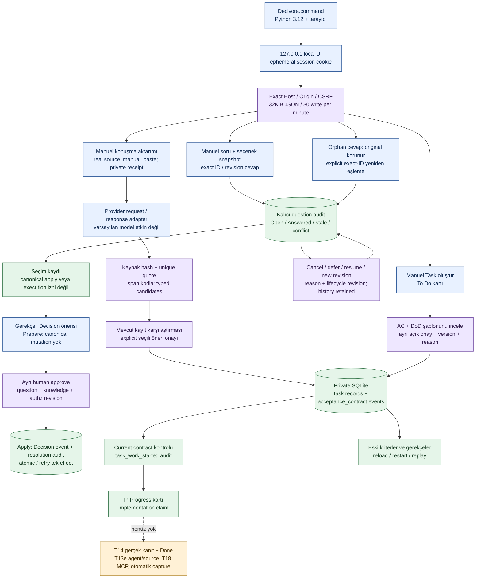

# Çalışan yerel program ve AC/DoD dilimi

**Current code: T13c Done; T19/T20 In Progress.** Kullanıcı tıklayıp çalıştırabileceği yerel yazılıma ilerlememizi istedi. Manuel tek proje arayüzü, otomatik capture/MCP bitmeden bağımsız UI dilimi olarak öne alındı; full MVP kapsamı/14AC değişmedi. [Başlatıcı](../../Decivora.command), [kullanım](../../README_LOCAL.md), [server](../../apps/local_ui/server.py), [contract kodu](../../packages/domain/acceptance.py), [test/kanıt](../quality/local-preview.md).

## Depolama ve onay

`acceptance_contract` mevcut events tablosunda task için ayrı stream/version taşır; SQL FORMAT/schema1 aynı. Payload task/task_version/base_contract/criteria/dod/reason/acknowledged_changes alanlarıyla bind edilir. AC1.. ve DOD1.. gibi ID'ler unique, statement/method/required/applicable/applicability_reason exact typed. Not-applicable ancak açık reason ile hazırlanabilir; runtime API destekler, basit UI şu an yalnız required+applicable human_review şablonlarını düzenler. Empty AC/DoD ret.

Açık local human approval değişiklik planının digest/base knowledge/authz/key bağını taşır. Önceki kriteri değiştirme/kaldırma için diff ID acknowledgment ve reason gerekir; eski event silinmez. Başlatmadan önce current Task version'a ait onaylı contract gerekir. Metadata revision değiştiyse contract stale; çalışmaya başlatılmaz. Work-start audit'i uygulama beyanıdır; verification/completion değildir. Sonuçlar not_run, completed=false; T14 genuine evidence açık kalır. Project DoD template editor yok; UI düzenlenebilir basit başlangıç şablonu verir, AI extraction değildir.

Replay acceptance payload/stream/contract version ve o andaki Task version'ını kontrol eder; yeni apply/approval/notification/model çalıştırmaz. Backuprestore kontratı event history'den tutar. Eski runtime yeni event kind'ını sessiz atlayamaz; yeni event yazılan profil güncel runtime ister.

## Yerel arayüz ve erişim

Single-user/single-project preview: LocalApp browser session trusted local_owner issuer'a bağlanır. Gerçek OAuth/login/ekip yetkisi değildir. Server sadece IPv4 loopback'e bind olur; kullanıcı dışa dinleme seçeneği yok. Generated bootstrap nonce URL fragment'tadır, query/log'a yazılmaz; JS history'den çıkarır. HttpOnly/SameSite=Strict session, CSRF token, exact Host/Origin, no CORS, CSP/frame denial ve bounded body uygulanır. Scriptler yalnız localdir; dış font/model/CDN yok. Authenticated write cap30/minute; retry politikası API ücret bütçesi değildir. Scope personal dışında query/mutation yok; filesystem/SQL/shell API açılmaz. Body extra/actionunknown ret; HTTP log private payload yazmaz.

Browser reload session cookie ile devam eder; program restart yeni session üretir, launcher doğru nonce ile açar. SQLite veri sources reposunun yanında private local-data klasöründedir; user data/source transcript/keys ZIP veya GitHub'a otomatik eklenmez. Standalone package yalnız launcher, kullanım belgesi ve gerekli app/packages source'ları içerir. Python3.12 gerekir; dependency install/model/account bağlantısı yok. Kaynağın public release/lisans/installer gate'i bu preview ile kapatılmaz.

## Açık kalan UI ve sınırlar

T19 project selector/PendingDecision/Review Inbox, T20 graph/timeline/active-history full UI açık; ilk board+AC card dilimi çalışır. İlk100 record scoped liste sınırı, tek proje; multiuser/cloud/autocapture/native/MCP ve token dispatcher yok. Done disabled; cancelled state storage'da varsa görünür, advanced lifecycle preview UI henüz eklenmedi. Kullanım dosyasının sınırları programın banner'ında da görünür. Bu program geliştirme tracker8765 değildir; ayrı port/DB ile çalışır.

## Manuel soru dilimi

[QuestionService](../../packages/domain/questions.py) mevcut audit tablosunda question_presented/question_answered append-only kayıtlarını saklar; events/graph canonical kararları değiştirmez. SQL schema1 aynı. Her read/write current project ACL, yazma local human owner + active project ister. Exact revision, stable option ID ve request-ID retry korunur; aynı ID farklı cevapta reddedilir. Stale/unknown/conflicting cevap saklanır fakat seçimi değiştirmez.100 soru/512 toplam question-history kaydı geliştirme profilinin sınırıdır; kapasite aşımı yeni yazımı reddeder, geçmişi silmez. Soru sunumu sürüm kontrollüdür; retry ve [cancel/defer/resume/revise/orphan reassociation](../quality/question-lifecycle-runtime.md) manuel profile eklendi; canonical binding ayrı human prepare/approve/apply ile [uygulandı](../quality/question-decision-runtime.md); bu sınırlar [raporda](../quality/pending-question-runtime.md) izlenir. UI manual source olduğundan external message/span uydurulmaz.

Decision bridge mevcut create event ve question_decision_* audit kullanır; plan/approval question snapshot bağını taşır, core generic apply bu guard atlanırsa reddeder. Soru cevabının tek başına canonical mutation üretmemesi korunur; ayrı apply sadece Decision oluşturur. Task/edge etki uygulaması ayrı T12/T13 review yoludur.

Question state_revision onay dayanağına bağlanır; defer→resume eski approval'ı canlandırmaz. Yeni question revision seçimi sıfırlar, eski snapshot Superseded olarak history'de kalır. question_answer_associated orijinal cevabı silmez/değiştirmez, yeni assessment ekler. Bu yeniden eşleme kimlik/sürüm/option ile deterministiktir; serbest metin semantic matching veya dış host receipt değildir.

## Ana konuşma/öneri arayüzü

[ConversationService](../../packages/capture/conversations.py) manuel gerçek kaynak için ayrı bounded receipt saklar; eski synthetic SourceEvent'e gerçek metin diye synthetic=True basmaz. [Responses adapter](../../packages/capture/responses_extractor.py) request schema ve response parser sağlar; actual network transport, account/grant/price/token cap aktivasyonu henüz yok. DefaultUI providerNone ile Waiting for model. Testte trusted injected fixture kullanılır; semantic kalite kabulü değildir. Candidate accept yalnız typed create/source attachment, current human scope/base revision ve atomic audit kullanır; Task Done veya impact cancellation üretmez. [Teslim ve sınırlar](../quality/conversation-review-runtime.md).

## UI locale sunum sınırı

UI düğümü yerel `locales.js` + `i18n.js` ile EN-default/TR/ES/PT-BR/AR sunar. Dil tercihi browser-local; Arabic `dir=rtl`. Dil değiştirmek domain command, DB/event/schema değişimi, approval, model veya dış servis çağrısı değildir. Taslak/kaynak/seçim korunur; task statü kodları İngilizce kalır. [Karar, kaynak ve doğrulama](../product/language-and-localization.md). Mevcut Mermaid akışı/domain şeması bu değişiklikte aynı; yeni engine veya servis eklenmedi.
