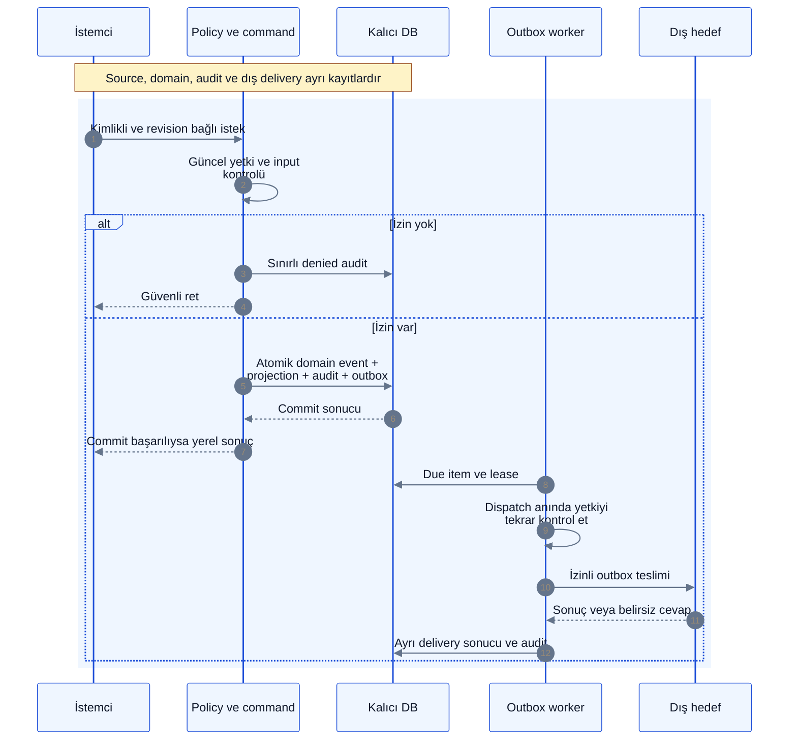

# Log, audit ve gözlemlenebilirlik

> [!NOTE]
> **Şema anahtarı:** mavi kaynak/işleme · sarı yetki/onay · turkuaz kalıcı bilgi · yeşil kanıt alanı · turuncu belirsizlik · gri tarihçe · mor öneri/gelecek. Renkler implementasyon veya test başarısı değildir. [Görsel sözlük](../quality/visual-documentation.md).

**19 Ekim2026 — mevcut kod ve önerilen tam işletim tasarımı ayrıdır.** Kalıcı domain/audit çekirdeği ve ayrı bounded operasyon tanısı uygulanmıştır. Komut izleri ve güvenli HTTP hata grupları Operations ekranında bulunur; her engine'in içi veya bütün source→job→model→review→evidence zinciri henüz izlenmez. Aşağıdaki geniş güvenlik/telemetry sözleşmelerinin tamamını uygulanmış sayma. [Çalışan kod, şema, diagram ve kanıt](../quality/operations-runtime.md), [güvenlik durum kaydı](../quality/security-current-status.md), [erişim sınırı](identity-access.md) ve [veri yaşam döngüsü](storage-memory-capacity.md).

[Diagram ve fiziksel/API şema okuma rehberi](logging-diagrams-and-schema.md), mevcut çizimlerin oklarını, gerçek diagnostics ER ilişkilerini, alanların güven anlamını ve sentetik log örneğini açıklar.

[Log erişimi/kimlik/saklama boşluk incelemesi](../quality/log-access-retention-gap-review.md) mevcut belgelerin nerede olduğunu, multiuser için eksik actor/visibility/retention kontrollerini ve ilk kullanım kapılarını ayırır. İnceleme yeni erişim veya süre kararı değildir.

## Nerede ne tutuluyor ve build hangi aşamada?

| Kayıt / soru | Bugünkü uygulama | Nereden kontrol edilir? | Açık kalan |
|---|---|---|---|
| Projede gerçekten ne değişti? | `workspace.sqlite` içinde `events`, `records`, `edges` | Görev History, proje Timeline ve izinli domain query | İşlem trace'iyle event sequence arasında genel bağ |
| Kim hangi değişikliği onayladı/uyguladı? | Aynı workspace DB'sindeki sürümlü `audit`, `approvals`, command makbuzları | İlgili review kartı ve izinli audit incelemesi | Tam security-event/operator konsolu |
| Hangi uygulama bileşenine hangi komut girdi? | Ayrı `workspace.operations.sqlite`: `op_runs` + `op_spans` | Operations → Command traces | Engine içi adımlar, CLI/MCP/worker instrumentation |
| HTTP sınırında hangi hata tekrarlandı? | Aynı diagnostics DB'sinde `op_errors`; endpoint/kod bazında gruplama | Operations → Persistent safe errors | Incident sahibi/durumu/resolve/reopen ve uyarılar |
| Kayıt kaçırılıyor veya sınır doluyor mu? | `op_meta` eviction sayacı; süreç belleğinde lost-write sayacı ve available durumu | Operations özetindeki uyarılar | Süreçler arası kayıp sürekliliği ve merkezi retention yönetimi |
| Konuşma içeriği/araç çıktısı nerede? | İzinli kaynak deposu ve domain referansları | Gerekirse ayrıca yetkili Sources görünümü | Operational log bu içeriğin ikinci kopyası olmaz |

`workspace.operations.sqlite` adı varsayılan `workspace.sqlite` için geçerlidir; özel DB adında kod `.operations.sqlite` suffix'i kullanır. NORMAL ve TEST veri klasörleri/diagnostics DB'leri ayrıdır. Workspace yedeği bugün diagnostics sidecar'ını içermez. Dosya varlığı, içinde aranan olayın bulunduğunu veya kaydın eksiksiz olduğunu kanıtlamaz. Normal engine sayısı on mantıksal sorumluluktur; logdaki component adı ayrı mikroservis çalıştığı anlamına gelmez.

## İşlem kimliği ve logun neyi kanıtladığı

Yetkilendirilmiş yeni bir LocalApp command `op_…` kimliği alır. HTTP command yanıtında `X-Decivora-Operation-ID` bulunabilir. Kimliği Operations aramasına yapıştır; başlangıç/bitiş, ölçülen süre, action/component ve iki gerçek sınırı incele: `authorize_project`, `execute_command`. Bazı hatalar project authorization veya JSON/HTTP kontrolünde trace başlamadan reddedilir; bu durumda command trace veya operation header bekleme, güvenli HTTP hata grubunu kontrol et.

- `succeeded`: bu komut dönmüş; bütün task/AC, model anlamı veya dış hedef tamamlandı demek değildir. Canonical makbuz ve kabul kanıtı ayrıca okunur.
- `failed`: bu izlenen sınır hata dönmüş; hata bir beklenen policy reddi de olabilir. Örneğin `acceptance_required` veya `verification_required` doğru bir koruma sonucu olabilir; doğrudan ürün bug'ı veya servis çökmesi diye sınıflandırma.
- `started`: bitişi henüz kaydedilmemiş; işin kesin çalışıyor veya kesin başarısız olduğu bilinmez.
- `unknown`: yeni logger oturumu/süreci önceki bitmemiş kaydı kesinleştirememiş. Crash kök nedeni veya yeniden yürütme izni değildir.

Eksik span, boş panel, `application_error` ya da düşen tanı yazımı başarı kanıtı değildir. Sabit güvenli hata allowlist'i dışındaki kodlar `application_error` olarak genellenir; ham exception/stack veya source metni bu yoldan elde edilmez. Teşhis için gerekirse TEST'te kontrollü tekrar üretim gerekir. Aynı conversation/task üzerinde farklı command'lar **bugün farklı operation ID'leri taşır**; genel pipeline correlation, source/job/changeset/event/evidence join'i açık geliştirmedir. Geçmiş işlemlerin süreleri/trace'leri sonradan uydurulmaz.

## Teşhis ve geliştirme çalışma rehberi

Bu bölüm agent ve geliştirici için uygulanacak inceleme yöntemidir; otomatik arka plan izleyicisi veya uygulanmış alert motoru değildir. Her mesajda bütün logları okuma. Kullanıcı runtime sorunu bildirdiğinde, davranış testi başarısız olduğunda, entegrasyon değiştiğinde veya ilgili teslimi doğrularken hedefli uygula:

1. **Ortam ve kapsamı doğrula:** LOCAL/TEST etiketi, seçili proje, çalıştırılan kaynak sürümü, olay zamanı ve varsa operation ID. Eski tarayıcı görüntüsünü çalışan yeni backend kanıtı sayma. Normal/test cookie ve veri ayrımını koru.
2. **Önce izinli, içeriksiz tanıyı oku:** UI veya authenticated `/api/operations?project_id=…` üzerinden ilgili trace ve HTTP grubunu incele. Geçerli yerel session ve güncel insan proje izni gerekir; bir URL bilmek erişim izni değildir. Tek trace için bütün kaynak/audit DB'sini dump etme.
3. **Kapsama bak:** kayıt erişilebilir mi, lost/evicted var mı, aranan dönem hâlâ tutuluyor mu? Bugünkü sınır200installation run/100error group; görünüm50project run/25error group. Eski kayıt düşmüşse veya logger yeniden başlamışsa bunu açıkça not et. Bütün geçmiş incelendi deme.
4. **Olgu ile yorumu ayır:** action/component, outcome, süre ve güvenli kod gözlemdir. Yetki reddi, eksik AC, timeout, storage arızası ve model yanlışı aynı kök neden değildir. İlk hatanın oluştuğu sınırla kullanıcının gördüğü son belirtiyi ayır.
5. **İş sonucunu ayrı doğrula:** task/decision revision, command/review makbuzu, event ve AC/verification sonucunu izinli kaynakta karşılaştır. Trace `succeeded` veya HTTP200, Done/başarılı yükleme/deploy kanıtı değildir. Log yazımı kaybında domain sonucu hâlâ uygulanmış olabilir.
6. **Gerekeni TEST'te yeniden üret:** minimum sentetik örnek ve ilgili negatif/regresyon testi kullan. Gerçek transcript, credential, hedef dosya kökü veya ücretli model izni taşınmaz. Belirsiz dış etkiyi yeni key ile kör retry etme; mevcut idempotency/result yolunu kontrol et.
7. **Yetkili kapsamda düzelt ve yeniden doğrula:** ilgili test/trace/domain makbuzunu karşılaştır. Otomatik bakabileceğin teknik kontrolü kullanıcıya yükleme. Kanıt yoksa unknown/açık engel olarak bırak; sırf kontrol geçsin diye guard veya kabul kriterini gevşetme.
8. **Kapanışta kısa kayıt bırak:** ortam, source revision, operation/ref veya sentetik case, gözlenen bulgu, etkilenen mevcut task, uygulanan düzeltme, geçen kontroller ve kalan kullanıcı kararı. Secret/raw log veya tekrar yeni backlog otoritesi oluşturma. Kayıt retention ile düşebilecekse yalnız gereken güvenli bulguyu mevcut QA/teslim kaydına geçir; kanıt kimliğini koru.

Agent'ın belirli bir kurulumun tanı erişimi yoksa varmış gibi davranması veya yetkiyi sessizce genişletmesi yasaktır. Salt okunur inceleme/düzeltme mevcut yetki sınırlarında yapılır. Bu yönerge otomatik polling/hatırlatma, sürekli model çağrısı veya üçüncü tarafa log gönderimi yetkisi değildir.

## Manuel kontrol ne zaman gerçekten gerekli?

| Durum | Önce geliştirici/agent ne yapar? | İnsan katkısı / sınır |
|---|---|---|
| Eksik AC yüzünden start/Done reddi | Kriter ve mevcut kanıtı kontrol eder; kalan otomatik doğrulamayı tamamlar | Yalnız gerçek insan incelemesi gerektiren kriter veya scope kararı için sorar; bütün task'ı tamamlandı saymaz |
| İzlenen komutta hata veya sıra dışı süre | İlgili trace, error group, güncel domain sonucu ve sentetik reproducer'ı inceler | Kök neden bilinmeden kullanıcıdan “devam edelim mi?” onayı istemez; erişemediği gerçek senaryo gerekiyorsa neyi kontrol edeceğini söyler |
| Belirsiz/çelişkili ürün kararı veya geç cevap | Mevcut soru ID/revision'ını ve seçimi kontrol eder | Gerçek karar sahibine kaynak, seçenek ve etkiyle tek odaklı soru; eski soruyu kopyalayıp kaybettirmez |
| Yeni ücret, veri paylaşımı, izin genişlemesi veya gerçek hedef | Ücretsiz/izinsiz bağımsız hazırlığı ve kapsam/tahmin riskini tamamlar | Model/veri/harcama/target yetkisi somut kapsamla ayrıca alınır; bir log retry yetkisi değildir |
| Öznel UX/pilot veya yalnız insanın görebildiği dış sonuç | Teknik kontrolleri ve incelenebilir ekran/örneği hazırlar | Ortam, beklenen sonuç, kontrol adımı ve kayıt yeriyle insan değerlendirmesi ister |
| Unknown dış sonuç veya eksik telemetry | Makbuz/idempotency ve izinli gerçek hedeften read-back arar | Belirsizliği otomatik başarı/başarısızlık saymaz; yeniden maliyet veya dış etki doğuracak adımı ayrı onaya bağlar |

Kalıcı manuel sorular için üründe mevcut QuestionRequest ID/revision ve task bağlantısı kullanılabilir; insan seçimi, kararın uygulanması ve completion ayrı kalır. **Logdan otomatik incident/task/manuel soru üretimi, owner'a otomatik bildirim ve answer→incident çözümleme bugün kodlanmadı.** Bunları yalnız doküman yazıldığı için var sayma. Şimdilik ilgili talep mevcut task/QA kaydında ve gerekiyorsa açık soru akışında izlenir. İnsan kontrol talebi; neden gerekli, ne denendi, tam kontrol adımı, beklenen sonuç, ortam/revision, ilgili soru/task/ref ve işi durdurup durdurmadığını içermelidir. İnsan doğrulamadan passed veya Done yazılmaz.

## Log geliştirmesinde sıradaki teknik parçalar

Bu bir ikinci backlog değildir; mevcut işlerin eksik kabul bağlantılarını gösterir:

| Mevcut sahiplik | Kalan somut geliştirme | Kabulde aranacak kanıt |
|---|---|---|
| T20f / T21c | Source receipt/job/model/review/event/evidence arasında scope-safe correlation ve engine içi span'ler | İzinli aynı zincir bulunur; unobserved aşama success sayılmaz; başka proje/private source sızmaz |
| T20f / T23e | Incident lifecycle, owner, kontrollü yeniden açılma ve manuel kontrol talebi | Tekrarlanan olay gerekçeli izlenir; incident resolve task/job completion üretmez; soru/cevap kalıcı ID'ye bağlı |
| T21c / T23c | Süreçler arası loss/retention/alert politikası ve ölçülmüş eşikler | Kayıp ve eviction görünür; politika sahibi onayı ve değer revision'ı korunur; spam/sürekli model tüketimi yok |
| T23d / T23e | Diagnostics recovery/backup kapsamı, disk/uzun yük, atomik audit ile telemetry arıza ayrımı | Domain/audit kaybı gizlenmez; offline restore/replay dış çağrı doğurmaz; sidecar eksikliği açık |
| T24 / T20f | Operatörün izden teşhis ve gerekli insan incelemesini tamamlaması | Sentetik hata→teşhis→gerekli review→ayrı doğrulama; gerçek model/host/target acceptance kendi kapısında |

## Dört kayıt sınıfı

| Sınıf | Amaç / örnek | Kalıcılık ve erişim |
|---|---|---|
| Source capture | Konuşma, import, tool gözlemi | Korumalı payload; gözlem onay/gerçek değildir. Kaynak ACL |
| Domain event log | Karar değişti, task yeniden açıldı, onay/verification | Canonical tarihçe; proje sequence ve revision; normal API append-only |
| Security audit | Davet, rol/grant değişimi, denied erişim, export, runner izni, veri çıkışı, purge | Ayrı güvenlik görünümü; sınırlı audit izni; domain içeriği/raw sohbet içermez |
| Operational telemetry | Hata, latency, queue lag, retry, adapter sağlığı, kullanım ölçümü | Redakte yapılandırılmış log/metric/trace; kısa retention; ürün doğruluğunun kaynağı değildir |

DB'nin WAL dosyası crash recovery içindir; insanın “kim, hangi yetkiyle ne yaptı?” sorusuna audit yanıtı değildir. Model prompt/completion kayıtları otomatik debug log olmaz. Gerekliyse ayrı kaynak deposu ve açık veri policy'si kullanılır.

## Yapılandırılmış alanlar

Her güvenlik kaydı: `audit_id`, schema, occurred/observed timestamp, server sequence, workspace/project, actor_type/id, on_behalf_of, grant/run/connection ID, action, resource_type/id, outcome (`attempted/succeeded/denied/failed/unknown`), güvenli reason_code, policy/authz revisions, request/correlation/trace ID. Kaynak/proposal digest referansı taşınabilir; serbest metin ve kişisel içerik taşınmaz. Wall-clock sırası domain append sequence'in yerine geçmez.

Operational log severity, component/version, trace/span, safe error code, duration ve retry count taşır. OpenTelemetry alan uyumu adaydır; collector/sağlayıcı seçilmiş değildir. [OTel veri modeli](https://opentelemetry.io/docs/specs/otel/logs/data-model/) telemetry'nin ortak biçimine referanstır; kendi başına audit deposu veya bütünlük garantisi değildir.

Credential, API key, authorization header, cookie, ham prompt, belge gövdesi ve hassas URL/query loglanmaz. Redaction export öncesine bırakılmaz; ilk yazımdan önce uygulanır. Kullanıcı girdisi escape/normalize edilir; log injection engellenir. Actor ID pseudonymous olabilir, anonim olduğu iddia edilmez. Metrics label'larına user/task ID koymak yerine düşük cardinality kategoriler kullanılır; trace'e erişim ayrıca sınırlandırılır.

## Transaction ve arıza davranışı

Yüksek etkili başarılı permission/approval/export/purge işlemlerinin audit kaydı aynı yerel transaction'da kalıcı olmalıdır; yazılamıyorsa işlem de commit olmaz. Export/veri çıkışı için dispatch intent önce kalıcıdır; dış servis yerel transaction'a alınamaz. Sonuç kaydı başarısızsa intent reconciliation ile `unknown` olarak izlenir; teslim edildiği varsayılmaz. Domain olayları ile audit farklı tablolar olsa da aynı correlation üzerinden bulunur.

Denied istek zaten durum değiştirmez. Audit diski dolsa bile erişim açılmaz. Tekrarlanan saldırı istekleri rate-limit ve sınırlı aggregate kayıtla tutulur; aggregate sayacı/dropped-count görünür, eksiksiz olay tutma iddiası yapılmaz. Operational telemetry arızasında bounded buffer ve drop counter kullanılabilir; domain/audit gerektiren başarı sessizce düşürülemez. Audit exporter kesintisi yerel kalıcı audit'i kaybetmez; outbox tekrar dener, disk high-watermark yeni pahalı işler için backpressure üretir.

## Bütünlük ve inceleme

[Operasyon sözleşmesi](../product/administration-and-operations.md) incident alanlarını, open/mitigated/resolved/reopened ayrımını, güvenli retry/pause ve config audit'ini tanımlar. Incident kapanması domain task'ını veya failed job'ı tamamlamaz. Ortak fingerprint farklı tenant içeriğini birleştiremez. DB arızasında kalıcı hata yazılamayacağı durum ayrı degraded health ve kayıt boşluğuyla görünür olur; logger çalışıyor varsayılmaz. ADM-05–09 doğrulaması planlıdır.

Normal insan/agent API'si event/audit satırı UPDATE/DELETE etmez. Authorized privacy purge ayrı rol, gerekçe, policy ve silinen veri sınıflarının minimal tombstone kaydını gerektirir. Hash zinciri ve bağımsız saklanan imzalı/checkpoint kopyaları değişiklik tespitine yardımcıdır; DB, anahtar ve checkpoint'leri yöneten kişinin tüm müdahalelerini engellediği iddia edilmez. Harici immutable storage ve anahtar ayrımı ekip/hosted aşamasında maliyet ve tehdit modeline göre değerlendirilecek.

Proje timeline'ı tüm security audit'i göstermez. Project reviewer yalnız izinli karar zincirini; ayrı workspace auditor yetkisi üyelik/erişim hareketlerini görür. Audit izni ham özel sohbeti okuma hakkı vermez. Download/export işlemi de audit'lenir. Platform operasyon ekibi tenant içeriğini sıradan hata logundan görememeli.

İlk operasyon paneli için gereken sinyaller: capture coverage ve son receipt; pending/failed/quarantine iş sayısı/yaşı; writer wait ve transaction latency; stale approval oranı; rejected auth; model token/usage unknown oranı; WAL/disk/backup yaşı; audit export lag. Uyarı bütçesi ve eşikleri pilot baseline sonrası belirlenir. Health endpoint hata detayı/tenant adını halka açmaz. Doğrulama: MU08, MU09, MU15 ve mevcut V17/V19/V26/V27.
