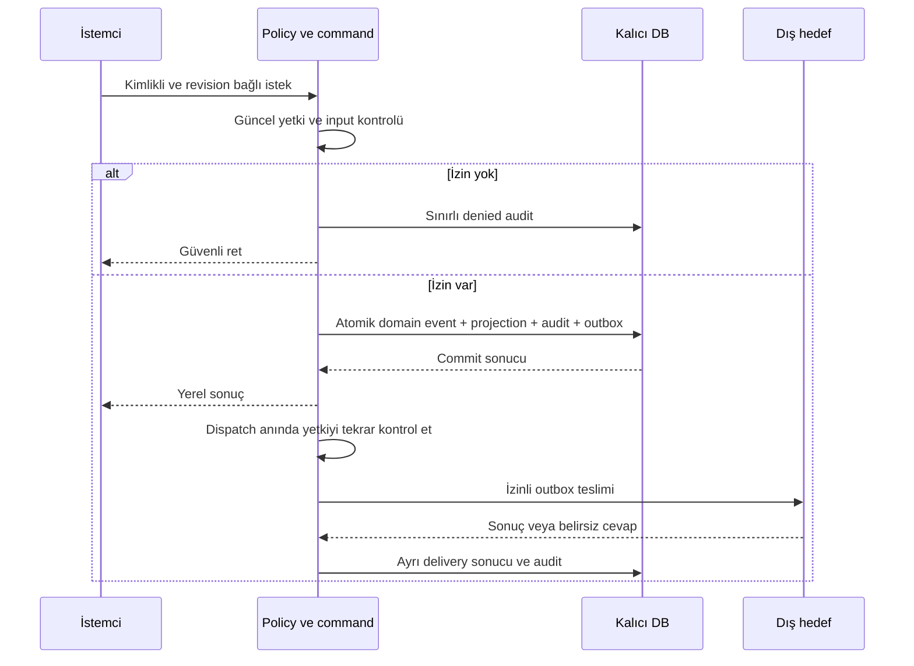

# Log, audit ve gözlemlenebilirlik

**Öneri; logger, dashboard veya audit servisi henüz uygulanmadı.** Saklama sürelerinin tek referansı [veri yaşam döngüsü](storage-memory-capacity.md); erişim kuralları [kimlik/yetki modelidir](identity-access.md).

## Dört kayıt sınıfı

| Sınıf | Amaç / örnek | Kalıcılık ve erişim |
|---|---|---|
| Source capture | Konuşma, import, tool gözlemi | Korumalı payload; gözlem onay/gerçek değildir. Kaynak ACL |
| Domain event log | Karar değişti, task yeniden açıldı, onay/verification | Canonical tarihçe; proje sequence ve revision; normal API append-only |
| Security audit | Davet, rol/grant değişimi, denied erişim, export, runner izni, veri çıkışı, purge | Ayrı güvenlik görünümü; sınırlı audit izni; domain içeriği/raw sohbet içermez |
| Operational telemetry | Hata, latency, queue lag, retry, adapter sağlığı, kullanım ölçümü | Redakte yapılandırılmış log/metric/trace; kısa retention; ürün doğruluğunun kaynağı değildir |

DB'nin WAL dosyası crash recovery içindir; insanın “kim, hangi yetkiyle ne yaptı?” sorusuna audit yanıtı değildir. Model prompt/completion kayıtları otomatik debug log olmaz. Gerekliyse ayrı kaynak deposu ve açık veri policy'si kullanılır.

## Yapılandırılmış alanlar

Her güvenlik kaydı: `audit_id`, schema, occurred/observed timestamp, server sequence, workspace/project, actor_type/id, on_behalf_of, grant/run/connection ID, action, resource_type/id, outcome (`attempted/succeeded/denied/failed/unknown`), güvenli reason_code, policy/authz revisions, request/correlation/trace ID. Kaynak/proposal digest referansı taşınabilir; serbest metin ve kişisel içerik taşınmaz. Wall-clock sırası domain append sequence'in yerine geçmez.

Operational log severity, component/version, trace/span, safe error code, duration ve retry count taşır. OpenTelemetry alan uyumu adaydır; collector/sağlayıcı seçilmiş değildir. [OTel veri modeli](https://opentelemetry.io/docs/specs/otel/logs/data-model/) telemetry'nin ortak biçimine referanstır; kendi başına audit deposu veya bütünlük garantisi değildir.

Credential, API key, authorization header, cookie, ham prompt, belge gövdesi ve hassas URL/query loglanmaz. Redaction export öncesine bırakılmaz; ilk yazımdan önce uygulanır. Kullanıcı girdisi escape/normalize edilir; log injection engellenir. Actor ID pseudonymous olabilir, anonim olduğu iddia edilmez. Metrics label'larına user/task ID koymak yerine düşük cardinality kategoriler kullanılır; trace'e erişim ayrıca sınırlandırılır.

## Transaction ve arıza davranışı

Yüksek etkili başarılı permission/approval/export/purge işlemlerinin audit kaydı aynı yerel transaction'da kalıcı olmalıdır; yazılamıyorsa işlem de commit olmaz. Export/veri çıkışı için dispatch intent önce kalıcıdır; dış servis yerel transaction'a alınamaz. Sonuç kaydı başarısızsa intent reconciliation ile `unknown` olarak izlenir; teslim edildiği varsayılmaz. Domain olayları ile audit farklı tablolar olsa da aynı correlation üzerinden bulunur.

Denied istek zaten durum değiştirmez. Audit diski dolsa bile erişim açılmaz. Tekrarlanan saldırı istekleri rate-limit ve sınırlı aggregate kayıtla tutulur; aggregate sayacı/dropped-count görünür, eksiksiz olay tutma iddiası yapılmaz. Operational telemetry arızasında bounded buffer ve drop counter kullanılabilir; domain/audit gerektiren başarı sessizce düşürülemez. Audit exporter kesintisi yerel kalıcı audit'i kaybetmez; outbox tekrar dener, disk high-watermark yeni pahalı işler için backpressure üretir.

## Bütünlük ve inceleme

Normal insan/agent API'si event/audit satırı UPDATE/DELETE etmez. Authorized privacy purge ayrı rol, gerekçe, policy ve silinen veri sınıflarının minimal tombstone kaydını gerektirir. Hash zinciri ve bağımsız saklanan imzalı/checkpoint kopyaları değişiklik tespitine yardımcıdır; DB, anahtar ve checkpoint'leri yöneten kişinin tüm müdahalelerini engellediği iddia edilmez. Harici immutable storage ve anahtar ayrımı ekip/hosted aşamasında maliyet ve tehdit modeline göre değerlendirilecek.

Proje timeline'ı tüm security audit'i göstermez. Project reviewer yalnız izinli karar zincirini; ayrı workspace auditor yetkisi üyelik/erişim hareketlerini görür. Audit izni ham özel sohbeti okuma hakkı vermez. Download/export işlemi de audit'lenir. Platform operasyon ekibi tenant içeriğini sıradan hata logundan görememeli.

İlk operasyon paneli için gereken sinyaller: capture coverage ve son receipt; pending/failed/quarantine iş sayısı/yaşı; writer wait ve transaction latency; stale approval oranı; rejected auth; model token/usage unknown oranı; WAL/disk/backup yaşı; audit export lag. Uyarı bütçesi ve eşikleri pilot baseline sonrası belirlenir. Health endpoint hata detayı/tenant adını halka açmaz. Doğrulama: MU08, MU09, MU15 ve mevcut V17/V19/V26/V27.
