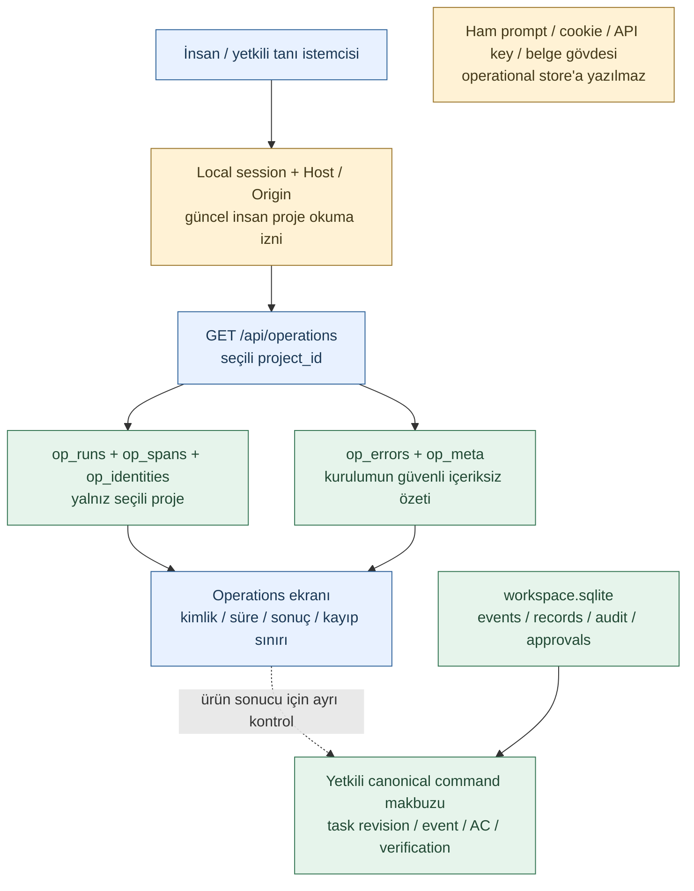
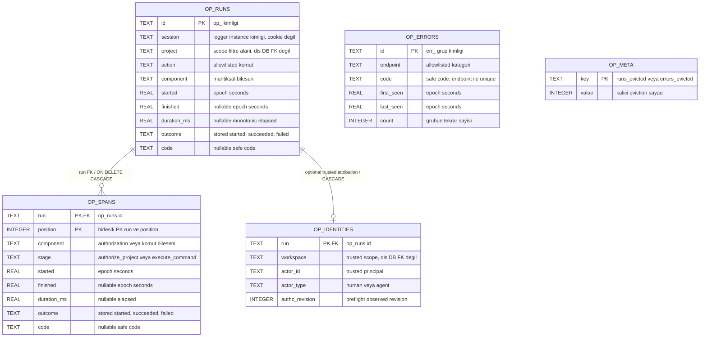
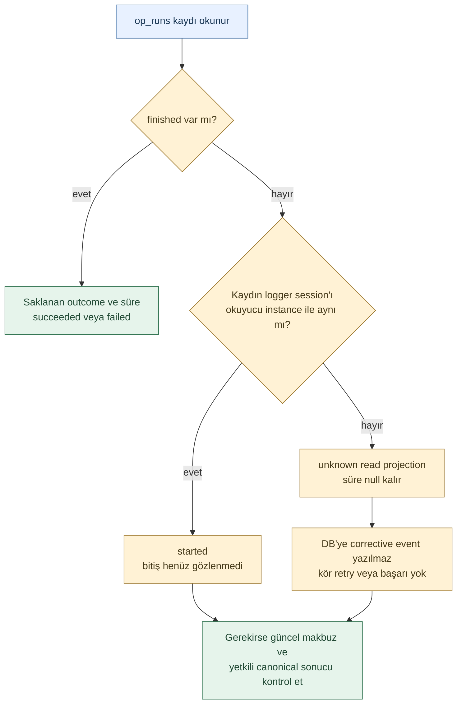

# Log sisteminin diagram ve şema okuma rehberi

**19 Ekim2026 — çalışan yerel kodun açıklaması.** Bu rehber mevcut Operations alt kümesini anlatır; yeni bir servis, alan, incident motoru veya otomatik onay akışı eklemez. [Tasarım ve teşhis rehberi](logging-audit.md), [çalışan kod/sequence diagramları](../quality/operations-runtime.md), [ADR-0014](adr/0014-local-operations-and-test-environment.md) ve [yayımlanan JSON sözleşmesi](../../manifests/local-operations.schema.json) birlikte okunur.

## 1. Hangi çizim hangi soruyu cevaplıyor?

| Çizim | Cevapladığı soru | Uygulama durumu / sınır |
|---|---|---|
| [Operations: Local operations and separate test data](../quality/operations-runtime.md) | NORMAL/TEST nerede ayrılır, kanonik DB ile tanı DB'si nasıl ayrılır? | Yerel implementasyon; ayrı veri, cookie ve environment marker. OS/container izolasyonu değildir |
| [Operations: A local command and its independent operational trace](../quality/operations-runtime.md) | Yetkili komut hangi sırayla domain işlemine ve tanı yazımına gider? | Mevcut command sınırı; her engine içi veya bütün pipeline yok |
| Bu rehber: kapsam ve güven sınırları | Operations ekranı hangi veriyi gösterir, neyi göstermez? | Gerçek okuma yolu ve ayrı kanonik kanıt |
| Bu rehber: fiziksel diagnostics ER | Hangi tablolar gerçekten var, gerçek FK/PK nedir? | `packages/operations/local.py` SQL'i; dış DB'ye hayalî FK yok |
| Bu rehber: bitmemiş kayıt okuması | `started` neden bazen `unknown` görünür? | Read projection kuralı; otomatik crash tespiti veya corrective event değildir |
| [Log tasarımı: Atomik audit ve ayrı dış teslim](logging-audit.md#transaction-ve-arıza-davranışı) | Tam audit/outbox/dış teslim mimarisi nasıl olmalı? | Önerilen geniş sözleşme; her kutu bugün uygulanmış değildir |

Oklar aksi yazılmadıkça veri/çağrı yönünü gösterir; başarı garantisi veya izin devri değildir. Bir engine kutusu ayrı process/agent anlamına gelmez. Renk metni destekler: mavi arayüz/uygulama, sarı kontrol/belirsizlik, yeşil kayıt. Renk tek başına implemented/passed anlamı taşımaz. Genel gösterim [görsel sözlükte](../quality/visual-documentation.md) açıklanır.

## 2. Operations ile kanıt arasındaki sınır



**Nasıl okunur?** Soldaki sorgu yeni domain işi veya model çağrısı başlatmaz. `op_runs.project` filtrelemesi başka projenin komutlarını listelemez. HTTP hata grupları ise seçili task'ın günlüğü değil, yerel kurulumun içeriksiz endpoint/kod özetidir. Örneğin `other/not_found`, hangi URL'nin veya hangi task'ın sebep olduğunu göstermez. İzinli canonical kontrolün ayrı çizilmesi bilinçlidir: `succeeded` veya HTTP200 task'ın Done olması ya da dosyanın gerçekten hedefe yüklendiği anlamına gelmez.

Bu ekran yeni platform-operator rol sistemi sağlamaz. Mevcut yerel HTTP kimliği local owner'dır; sunucu güncel insan proje kapsamını kontrol eder. Ekip/hosted erişim matrisi ve tam security audit konsolu ayrı açık işlerdir. Menü görünürlüğü yetki kontrolünün yerine geçmez.

## 3. Gerçek fiziksel diagnostics veri modeli

Varsayılan dosyalar: `workspace.sqlite` kanonik kayıtları; **ayrı** `workspace.operations.sqlite` operational tanıyı tutar. Özel DB adında tanı dosyası aynı `.operations.sqlite` suffix kuralını kullanır. NORMAL ve TEST ayrı veri dizinlerindedir. Aşağıdaki ER yalnız gerçekten oluşturulan diagnostics tablolarını gösterir.



**İlişkileri yanlış yorumlamama:**

- `op_spans` birincil anahtarı `(run, position)` birleşimidir. `run` gerçek FK'dir. Silinen eski tanı run'ının span'leri de kaldırılır. Bu operasyonel saklama temizliği, canonical event/audit silme yetkisi değildir.
- `op_errors` için `(endpoint, code)` gerçek unique kuralıdır. Tek grup birçok HTTP olayını birleştirir. Run FK veya genel trace→error join'i **yoktur**; zaman yakınlığından kesin ilişki çıkarılmaz.
- `op_runs.project`, kanonik DB'deki projeye fiziksel cross-database FK değildir. Uygulama katmanı yetkiyi ve proje kimliğini doğrular.
- `session`, logger instance kimliğidir; browser session cookie/bootstrap secret değildir. API run nesnesinden çıkarılır ve kullanıcıya credential olarak sunulmaz.
- `lost_this_process`, SQL tablosu değil logger'ın süreç belleğindeki sayaçtır. Yeniden başlatmada sıfırlanır. Bu ayrım bilinmeden eksiksiz kayıp muhasebesi iddia edilmez.
- Güncel yazım yolu en fazla iki span oluşturur. Bu, mevcut komut instrumentation'ı ve JSON read sözleşmesidir; SQL'de iki satırlık CHECK constraint bulunduğu anlamına gelmez.

`op_identities` additive CREATE IF NOT EXISTS ile eklenir; eski runlar yeniden yazılmaz. Run ile kimlik tek transaction içinde yazılır, eviction FK cascade uygular. Null kimlik sonradan varsayımla doldurulmaz. Kaynak: [gerçek SQL ve okuma kodu](../../packages/operations/local.py), [server yetki/komut sınırı](../../apps/local_ui/server.py).

## 4. API şeması: alanlar nasıl yorumlanır?

[local-operations.schema.json](../../manifests/local-operations.schema.json) **JSON read çıktısını** tanımlar; SQLite CREATE TABLE veya bir command/yazma yetkisi değildir. Endpoint authenticated GET'tir. Root nesnesi ve run/span/error nesneleri `additionalProperties:false` taşır. Örnek alan varlığı model anlam doğruluğunu veya tüm sistem kabulünü doğrulamaz.

| Alan / alan grubu | Kaynak ve anlam | Yanlış çıkarım |
|---|---|---|
| `environment`, `project` | Sunucunun bağlandığı LOCAL/TEST ve seçili izinli proje | İstemci etiketi ile yeni yetki kazanılmaz |
| `available` | Diagnostics erişimi/yazımı için mevcut logger durumu | Bütün servisler ve kaynaklar sağlıklı demek değildir |
| `persistent` | Kalıcı sidecar konfigürasyonu vardır | Her olay hatasız diske yazıldı garantisi değildir |
| `lost_this_process`, `evicted` | Bu sürecin kaydedemediği yazımlar ve kalıcı temizlenen kayıt sayaçları | İkisi aynı sayaç veya tam tarihsel istek toplamı değildir |
| `coverage` | `local_command_boundaries_only` veya erişim sorunu halinde `unavailable` | Tüm engine veya distributed tracing değildir |
| `runs[].id` | HTTP command başlığındaki operation ID ile aranabilir | Conversation/task için genel pipeline ID değildir |
| `runs[].identity` | Trusted preflight workspace/actor_id/actor_type/authz_revision; eski izlerde null | Ayrı login, log-role izni veya apply revision kanıtı değildir |
| `runs[].action/component` | Allowlist'ten komut ve mantıksal işleme sorumluluğu | Ayrı mikroservis/PID veya kesin LLM çalışması değildir |
| `runs[].stages[]` | Ölçülen iki gerçek komut sınırı | Capture/extraction/impact/verification zincirinin bütün iç adımları değildir |
| `started/finished` | Epoch saniyesi; UI tarayıcı yerel tarih biçiminde gösterir | Domain sequence veya kesin nedensel sıra yerine geçmez |
| `duration_ms` | Monotonic clock ile ölçülen süre, henüz yoksa null | Null,0ms değildir; tek ölçüm performans SLO'su değildir |
| `outcome/code` | Gerçek sınır sonucu ve güvenli/genellenmiş kod | Failed her zaman bug, succeeded her zaman ürün başarısı değildir |
| `errors[].count` | Aynı endpoint/kod grubunun sayacı | Unique kullanıcı/task/incident sayısı değildir |
| `limits` | Normal erişimdeki geliştirme saklama/görünüm sınırları | Production retention policy değildir; degraded çıktıda alan bulunmayabilir |
| `queue` | Seçili proje için kaynak job durum sayıları | Bağımsız bütün agent veya tüm pending işler değildir |
| `application_processes`, worker/model/file/native/MCP alanları | Bu yerel uygulamanın konfigürasyonu/bilinen sınırları | İşletim sistemindeki bütün süreçlerin discovery/heartbeat kanıtı değildir |

Bugünkü sınırlar: installation genelinde200run/100error group saklanır; cevapta en fazla50project run/25installation error group gösterilir. Sayılar daha önce düşmüş kayıtları yeniden üretmez. `application_error`, allowlist dışı ayrıntının güvenli genelleştirilmesi olabilir; ham exception mesajı buraya konmaz. Şemanın izin verdiği bir alanın actual güven/authority anlamı bu kod ve erişim sözleşmesinden gelir.

### Sentetik okuma örneği

Aşağıdaki JSON yalnız `runs` dizisindeki **tek bir sentetik elemandır**; tam endpoint cevabı veya gerçek kullanıcı logu değildir. Süreler açıklama içindir, ölçüm/benchmark sonucu değildir. Gerekli kriter olmadan Start komutu reddedilmiş; dolayısıyla domain koruması çalışmış olabilir. `failed` görüp otomatik bug veya incident üretmeyiz.

```json
{
  "id": "op_synthetic_example",
  "identity": null,
  "action": "start",
  "component": "verification",
  "started": 1700000000.0,
  "finished": 1700000000.004,
  "duration_ms": 4.0,
  "outcome": "failed",
  "code": "acceptance_required",
  "stages": [
    {
      "position": 1,
      "component": "authorization",
      "stage": "authorize_project",
      "started": 1700000000.0,
      "finished": 1700000000.001,
      "duration_ms": 1.0,
      "outcome": "succeeded",
      "code": null
    },
    {
      "position": 2,
      "component": "verification",
      "stage": "execute_command",
      "started": 1700000000.001,
      "finished": 1700000000.004,
      "duration_ms": 3.0,
      "outcome": "failed",
      "code": "acceptance_required"
    }
  ]
}
```

Bu örnek raw prompt/task title/reference/URL/cookie içermediği için öğretici log örneği olarak güvenlidir. Yine de gerçek kurulumdan alınan kayıtlar otomatik public/üçüncü taraf paylaşımına açık sayılmaz; mevcut erişim ve redaksiyon kuralları geçerlidir.

## 5. Bitmemiş kayıt neden unknown görünebilir?



**Nasıl okunur?** Aynı logger instance'ındaki `started` bile kesin worker liveness kanıtı değildir. Başka instance/restart sonrası `unknown` gösterimi de kesin crash nedeni bulmuş olmaz. Başarılı domain commit sonrasında telemetry finish yazımı kaybolmuş olabilir. Gerçek sonucu makbuz/revision/kanıt üzerinden kontrol etmeden dış etkiyi veya ücretli çağrıyı tekrarlama. İncelenen cevap için read projection uygulanır; stored history düzeltildi diye anlatılmaz.

## 6. Ekran öğelerinin kaynağı

| Operations öğesi | Veri kaynağı | Kullanım |
|---|---|---|
| LOCAL/TEST etiketi | Server environment + DB marker sınırı | Önce doğru ortamı doğrula |
| Command traces | `runs` ve alt `stages` | Kimliği aç, sınırı ve sonucu incele |
| Outcome filtresi / Operation ID araması | Getirilmiş bounded `runs` üzerinde UI filtresi | Son50kayıt dışında arşiv taraması yapıldığı sanılmasın |
| Persistent safe errors | `errors` grupları | Tekrarlama ve güvenli kodu kontrol et; run'a kesin bağ uydurma |
| Kayıp/eviction uyarıları | `available/lost_this_process/evicted/limits` | Kanıtın kapsamadığı dönemi veya tanı kaybını belirt |
| Refresh diagnostics | İzinli GET okuma | Yeni model/run/retry başlatmaz |

## 7. Belge ve kod birlikte nasıl doğrulanır?

- ER alanları ve gerçek FK/unique kuralları `LocalOperations` SQL'iyle karşılaştırılır; dış DB FK'leri varsayılmaz.
- DTO alanları/schema enumları ve örnek `runs` elemanı JSON sözleşmesiyle eşleştirilir. [Mevcut alan sözleşmesi testi](../../tests/runtime/test_operations.py), tam generic JSON Schema sertifikası veya yeni model testi değildir.
- Mermaid kaynakları yerel renderer ile gerçekten render edilir. Syntax/title/description/source hash sonucu [render kaydına](../quality/diagram-render-results.json) eklenir; ürün runtime kabulü yerine geçmez.
- Yetki/redaksiyon/eviction/degraded/restart ve TEST cookie ayrımı için mevcut [runtime ve browser kanıtı](../quality/operations-runtime.md#verification-record) kullanılır. Bu açıklayıcı belge tek başına yeni bir runtime özelliği teslim etmez.
- Bir gerçek hata için sonraki adımlar [teşhis çalışma rehberinde](logging-audit.md#teşhis-ve-geliştirme-çalışma-rehberi), insan katkısı gereken durumlar [manuel kontrol ayrımındadır](logging-audit.md#manuel-kontrol-ne-zaman-gerçekten-gerekli).

### Bu açıklamanın doğrulaması — 19 Ekim2026

Üç yeni diagram dahil50Mermaid kaynağı/25belge yerel renderer ile render edildi; başarısızlık0. Yeni ER ve bitmemiş kayıt yorumu görsel incelendi. Gerçek SQL kolonları, span `(run,position)` PK, run FK/cascade ve error `(endpoint,code)` unique indeksi geçici DB'de kontrol edildi. Sentetik örneğin required run/span alan setleri yayımlanan şemayla eşleşti. `jsonschema` paketi bulunmadığı için tam JSON Schema validation çalıştırılmadı; yeni dependency yüklenmedi. Bu teslim runtime veya fiziksel/API şema değişikliği değildir.

## Güncel kimlik alanının sınırı

Yeni kimlik alanı ve fiziksel ER, [yerel attribution teslimini](../quality/operations-runtime.md#yerel-actor-attribution--19-ekim2026) yansıtır. Yukarıdaki ilk açıklama tesliminin runtime değişikliği yapmadığına ilişkin tarihsel sonuç, bu sonraki additive kod teslimiyle karıştırılmamalı. Ekip erişim kapıları açıktır.

## Konuşma işleme görünümü ve native collect sınırı

Operations DTO'suna `conversation_queue` eklendi: selected-project source metadata, waiting/review-ready/failed/unknown sayıları, applied-source sayısı ve preview kapasitesi. Kaynak metni taşımaz; state/operations okumaları worker/model tetiklemez. Mevcut sidecar ER tabloları değişmedi. Native CLI `native_capture` run ve bir `capture/execute_command` span'i yazar; her item için ayrı trace yoktur. [Çalışan sözleşme ve açıklar](../quality/conversation-processing-runtime.md).

Source kapasitesi follow-up: `conversation_queue.items`25ile sınırlı, `items_truncated` açık; total/counts1000kurulum sınırındaki kayıtlı kaynakları kapsar. [İndeksler ve HTTP source page sözleşmesi](../quality/source-capacity-pagination.md); tanı sidecar tabloları değişmedi.

Model aktivasyonu follow-up: `create_model_activation` ve `change_model_activation` extraction command trace olarak izlenir. Kalıcı yaşam döngüsü Workspace audit tablosunda, içeriksiz operation süre/hata izi ayrı Operations DBdedir; yeni sidecar tablosu yok. [Durum, transaction yarışı ve API alanları](model-activation-runtime.md).

Bounded worker eklentisi: `processing_tick` run/span ve start/stop komutları aynı sidecar tablolarına yazılır; processing loop limit/claim/finish/stop eventleri Workspace audit tablosundadır. Model/HTTP attempt başına ayrı span yoktur. DTOdaki worker/automatic_dispatch flagleri boolean canlı thread durumudur; varsayılanfalse kalır. [Claim, API ve recovery sınırı](model-activation-runtime.md#kalıcı-sınırlı-işleme-döngüsü--sonraki-backend-teslimi).
