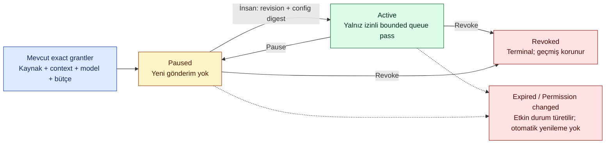
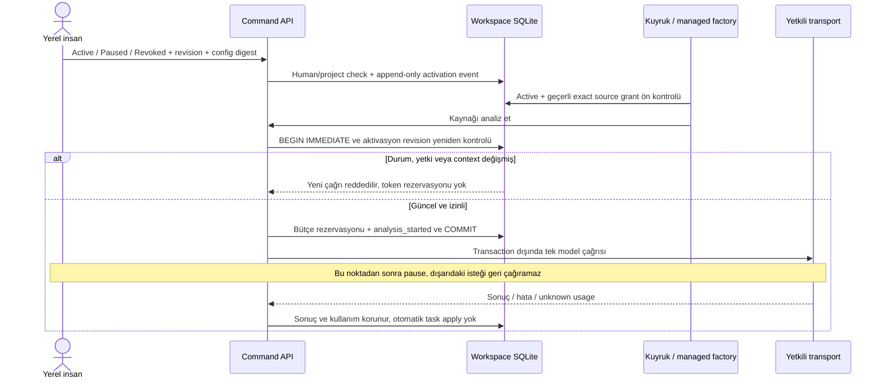
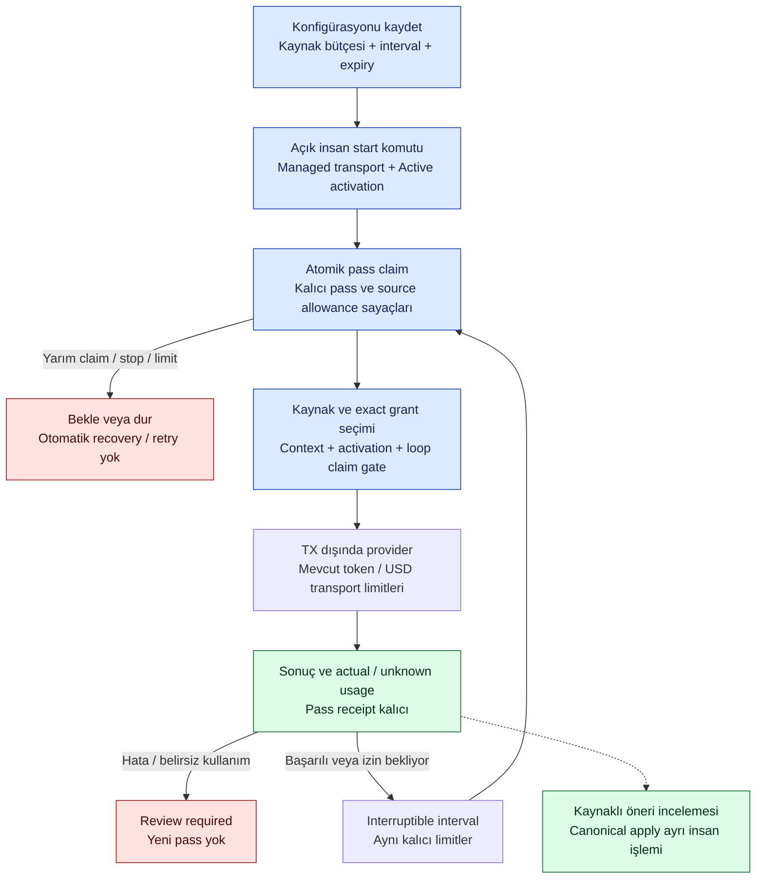

# Kalıcı model aktivasyonu — çalışan backend

**20 Ekim güncel teslim:** Mevcut izinleri seçme, Paused aktivasyon oluşturma ve activate/pause/revoke; bounded worker planı/start/stop artık Sources ekranına bağlı. Yeni Codex kaynak izni/sohbet seçimi ve credential/transport kurulumu halen açık. [Güncel UI kapsamı](#20-ekim--sources-ekranında-aktivasyon-ve-worker-kontrolleri). Aşağıdaki19Ekim notları tarihsel backend teslimini anlatır.

**19 Ekim 2026 · T09/T17/T19/T21. Uygulanan yerel alt kapsam.** [Kod](../../packages/capture/model_activation.py), [test](../../tests/runtime/test_model_activation.py). Yeni kaynak okuma, API harcama veya sürekli izleme izni vermez. Kullanıcıya dönük kurulum ekranı henüz bağlı değildir; aşağıdaki bounded worker backend API ile açıkça başlatılabilir; varsayılan LOCAL/TEST uygulaması model kapalı kalır.

## İş kuralı ve durumlar

Yalnız zaten verilmiş exact source/context/model/run grant'leri bir aktivasyonda toplanabilir. Oluşturma **Paused** durumundadır; ayrı insan komutu Active yapar. Kapsam10grant, history512event ile bounded; bunlar yerel uygulama tavanlarıdır, ölçülmüş kapasite/ürün SLA'sı değildir. Profil mevcut grant'lerden uzun yaşayamaz; yeni grant, root bütçe, token veya credential oluşturmaz. Aynı grant'in bir aktivasyona bağlandığı kalıcı olarak görüldükten sonra eski kontrolsüz extractor yolu da dispatch yapamaz.

Renkler tek başına anlam taşımaz; state labelleri metin olarak bulunur. Revoked profil eski kimliğiyle yeniden açılamaz. Yeni profil oluşturmak ayrı, açık insan işlemi ve mevcut geçerli source grant'leri gerektirir; eski iptal kaydı silinmez. Expired/Permission changed event geçmişinin değiştirilmesi değil, salt okunur etkin durumdur. Paused/Revoked komutu, yeni çağrıları kesmek için izin/expiry değişmiş olsa bile profil sahibince uygulanabilir.

## İşleme anı ve yarışlar

Factory'nin seçtiği extractor aktivasyon ID/revision taşır; `ConversationService.analyze` bunu rezervasyonla **aynı transaction** içinde tekrar kontrol eder. Pause→resume sonrasında eski extractor da stale kalır. Duraklatma önce commit olduysa gönderim başlamaz. `analysis_started` önce commit olduysa in-flight sonuç/maliyet makbuzu korunur; sonraki kaynak bekler. HTTP200, Active durumu veya hazır öneri Task Done değildir.

## Backend API ve depolama

Mevcut session/Host/Origin/CSRF ve proje yetkili `POST /api/command` zarfı kullanılır; yeni anonim endpoint yok.

| action | Alanlar (`action` dışında) | Etki |
|---|---|---|
| `create_model_activation` | `activation_id`, `grant_ids`, `expires_at`, `reason` | Exact configuration/hash ile Paused kayıt |
| `change_model_activation` | `activation_id`, `base_revision`, `configuration_sha256`, `state`, `reason` | İnsan/proje/current revision kontrolüyle yeni event |

Kaynak grant'leri bu uçlardan oluşturulamaz. Görünüm `/api/state.model_activations` içinde selected-project metadata olarak okunur; grant_count, actor/authz revision, config digest, expiry, state/effective_state taşır; metin/anahtar taşımaz. `model_ready` yalnız transport yapılandırmasını anlatır, Active izni veya çalışmakta olan worker demek değildir.

Aynı Workspace DB `audit` tablosunda `conversation_model_activation` event'leri kullanılır; yeni tablo, migration veya event schema version artışı yok. Profil history ve exact grant referanslarının digest'leri kalıcıdır; credential/ham mesaj kopyalanmaz. Proje query/command yetkisi, backup/restore ve append-only rollback kuralları korunur. Audit512event kapasitesinde yeni değişim reddedilir; aktif görünse bile yeni dispatch dondurulur ve effective_state History capacity reached gösterilir. Böylece pause kaydı eklenemiyor diye model gönderimi açık kalmaz. Önceki kabul edilmiş kayıt silinmez; bakım kendi onaylı kapsamıyla ele alınmalıdır.

## Log ve geliştirme sınırları

Operations iki komutu extraction bileşeninde normal command span olarak izler. Safe reason code örnekleri: `activation_inactive`, `activation_required`, `stale_activation`, `activation_denied`, `activation_transition_denied`; raw reason/transcript/key loga yazılmaz. Queue kaynağı model/provider başlamadan bekletirse bu hata değil beklemedir. Activation görünümü nedenini gösterir; bütün pipeline için ayrı span varmış gibi sunulmaz.

13hedefli test: pause/active/resume/revoke, factory→admission yarışının engellenmesi, eski extractor, expiry/yetki değişimi, grant/expiry genişletme reddi, insan/agent/proje sınırı, idempotent create, restart+restore, audit rollback, eksik profil, in-flight yanıtın korunması ve legacy bypass engeli. Bütün provider çıktıları sentetik; gerçek API0. Arayüz butonları, background timer, sürekli izinli source/model onboarding ve günlük kullanıcı kabulü mevcut T09/T17/T19/T21 işlerinde açık kalır.

Nihai doğrulama:556runtime ve49kök/tracker testi geçti.13yeni hedefli test bunlara dahildir.52Mermaid blok offline render edildi; yeni iki diyagram görsel olarak incelendi. İlk sequence renderındaki metin ayraç hatası düzeltildi; başarısız koşular başarı diye kaydedilmedi. Bu tur gerçek provider çağrısı0, kaynak okuması0.

## Kalıcı sınırlı işleme döngüsü — sonraki backend teslimi

[ProcessingLoopService](../../packages/capture/processing_loop.py) ve [LocalProcessingWorker](../../packages/capture/processing_worker.py), mevcut aktivasyona bağlı **açıkça başlatılan** yerel bir döngü sağlar. [Regresyonlar](../../tests/runtime/test_processing_loop.py). Default startup, GET/state/Operations okuması veya source import worker başlatmaz. TEST model bağlantısı yasağı değişmedi. Gerçek veri paylaşımı veya ücretli çalışma bu kod teslimiyle etkinleştirilmedi.

İnsan seçimi gereken konfigürasyon: exact activation/config digest, pass sayısı, her pass kaynak sayısı, toplam kaynak denemesi, interval ve expiry. Uygulama tavanları300pass,10kaynak/pass,10toplam kaynak ve0.25–60sinterval'dir; gerçek kullanıma otomatik seçilmiş/onaylanmış politika değildir. Activation expiry uzatılamaz. Yeni kaynak/grant/payload veya bütçe üretilmez. Bu finite whitelist döngüsü gelecek bütün mesajlar için sürekli paylaşım izni değildir; yeni kaynak onboarding/consent yolu ayrı kalır.

| API action | Alanlar (`action` dışında) | Davranış |
|---|---|---|
| `create_processing_loop` | `loop_id`, `activation_id`, `activation_sha256`, `max_passes`, `max_sources_per_pass`, `max_total_sources`, `interval_seconds`, `expires_at`, `reason` | Sadece immutable konfigürasyon; başlatmaz |
| `run_processing_pass` | `loop_id`, `configuration_sha256` | Tek kalıcı bounded pass |
| `start_processing_loop` | `loop_id`, `configuration_sha256` | Matching managed transport ve Active izin varsa bir yerel thread başlatır |
| `stop_processing_loop` | `loop_id`, `configuration_sha256`, `reason` | Terminal stop event ve interruptible wait; in-flight yanıt silinmez |

Mevcut human/project/session/Origin/CSRF korumalı `/api/command` kullanılır. Source/grant olmadan provider eklenemez; model kapalıyken worker başlamaz. `/api/state.processing_loops` kalıcı sayaç/durumları, `processing_worker` yalnız bu süreçteki thread durumunu gösterir. Operations `background_worker_active` ile queue `automatic_dispatch/background_worker_active` alanları artık boolean çalışma gözlemidir; schema'da sabitfalse değildir. Bütün alanlar varsayılan uygulamadafalse kalır. Processflag çağrı yapıldığı veya capture çalıştığı anlamına gelmez.

### Claim, limit ve restart

Aynı Workspace `audit` tablosunda `conversation_processing_loop` event'leri kullanılır: configured, pass_started, pass_finished, stopped. Yeni fiziksel tablo yoktur. Pass başlarken allowance atomik reserve edilir; finished receipt bilinen attempted sayısıyla yerleşir. `max_total_sources` **kaynak denemesi tavanıdır**, token/USD/HTTP sayacı değildir. Model token reservation ve trusted transport'un ortak para/istek tavanı ayrıca geçerlidir. Yeni loop veya server restart bu root bütçeyi sıfırlamaz.

Factory seçimi yeterli değildir: `ConversationService.analyze` loop/pass ve grant'in aynı activation kapsamında olduğunu rezervasyonla aynı transactionda tekrar kontrol eder. Stop commit'i önceyse yeni çağrı yoktur. Daha önce admit edilmiş çağrı bitince receipt/maliyet korunur. Unknown usage, başarısız cevap veya eksik pass claim'i otomatik retry üretmez.

İkinci worker unfinished claim gördüğünde işlemez; crash sonrası para harcanmadığını varsayıp allowance iade etmez. Aynı loop kimliğiyle farklı limit kaydı idempotency conflict olur. Restart worker'ı otomatik açmaz. Şimdiki uygulama unfinished pass için otomatik reconciliation sağlamaz; insan/kanıtlı kurtarma yolu ayrıca gereklidir. Queue boş veya grant yoksa yeni model çağrısı olmaz; yerel boş pass sayısı yine finite max_passes'e dahildir. Shared-budget transport freeze kontrolü ayrıca korunur.

Kontrol geçmişi2048event ile bounded; dolunca yeni dispatch ve değişiklik fail-closed durur. Önceki kaynaklar ve receipt'ler silinmez. Bekleme sırasında stop Event ile kesilir; activation pause ise admission'ı hemen keser ve worker sonraki tick'te durur. Graceful shutdown beklemeyi keser, thread için en fazla2sjoin dener; process force-close sırasında bitmemiş dış çağrının sonucu unknown kalabilir. Yeni açılış otomatik retry yapmaz.

### Tanı ve doğrulama sınırı

`processing_tick` extraction run/span'i; açık create/start/run/stop komutları mevcut Operations command trace'idir. Her HTTP/model çağrısı için ayrı span iddiası yoktur. Scope preflight reddi trace başlamadan oluşabilir; worker'ın safe code alanı tanıyı tamamlar. Ham source, credential, provider hata gövdesi ve exception metni loga konmaz.

Sınırlı gerçek kaynak pilotu bu teslimde tekrar edilmedi. Sahte sağlayıcıyla gerçek thread ve HTTP testleri; pause/stop yarışları, unknown usage durması, aynı DB üzerinde iki worker, limit/interval, restart/restore ve öneri→ayrı review sınırını doğrular. Kaynak/model kurulum ekranı, yeni mesajlara kaynak paylaşım policy'si, gerçek izinli live-capture + model günlük kabulü mevcut T09/T17/T19/T21'de açık kalır.

Son bounded-worker doğrulaması:571runtime,49kök/tracker testi,15worker testi (runtime setine dahil), Operations browser ve53Mermaid render geçti. Worker testleri gerçek yerel thread/HTTP, sahte provider ile çalıştı. Bir negatif kontrolde farklı activationın kaynak grantine rastlanması pass istisnası üretiyordu; kapsam dışı grant gönderilmeden atlanacak şekilde düzeltildi. Grant/activation/admission doğrulaması kaldırılmadı. [Kod hashleri ve makine sonucu](../quality/processing-loop-results.json).

## 20 Ekim — Sources ekranında aktivasyon ve worker kontrolleri

**Sprint1alt teslimi; T09/T17/T19/T21.** Yeni bir adapter, izin, para bütçesi veya ana task oluşturulmadı. Sources ekranı mevcut session/CSRF/proje yetkili komutları kullanır. Mevcut durum diyagramları değişmez: insan komutlarının yeni istemcisi UI'dır; worker/capture/grant yetkileri aynı sınırları korur.

| Kullanıcı adımı | Gerçek davranış / sınır |
|---|---|
| Mevcut izinleri seç | Yalnız actor/project/current authority/source hash/expiry/context-bound grant metadata; source ID, provider/model, run budget ID, ayrılan token, output tavanı ve expiry. İlk50görünür; kırpılma açık. Metin, paylaşım gerekçesi, credential veya prepared context taşınmaz. |
| Paused aktivasyon hazırla |1–10seçim, açık expiry, gerekçe ve kapsam acknowledgment; otomatik varsayılan bütçe/süre yok. Expiry kaynak iznini aşamaz. Yeni grant/bütçe/transport yok. |
| Activate / Pause / Revoke | Current revision/config hash sunucuya gider. Active worker başlatmaz. Revoke terminaldir; geçmiş silinmez. |
| Worker planı kaydet | Geçiş/source-per-pass/toplam-source/interval/expiry ve gerekçe kullanıcı girer; boş alan çalışmaz. Backend tavanları uygulanır; plan oluşturmak işlemeyi başlatmaz. |
| Start / Stop | Ayrı açık acknowledgment ve başlat komutu; yalnız exact managed activation transport + Active izin + uygun loop durumu. Stop terminal; in-flight istek geri çağrılmaz. |
| Yenile / restart | Salt okunur; worker otomatik başlamaz. Durum manuel yenilenir, arka plan capture/model polling başlatılmaz. |

Token rezervasyonu parasal tavan diye sunulmaz. Root USD tavanı bu ekranda değiştirilmez; eşleşen transport ayrı onaylı para kontrolünü korumalıdır. Grant model metadata'sı gerçek model kalitesi veya native capture varlığı değildir. Envanter tek geçişte okunur; kaynak başına aynı audit listesini tekrar yükleyen kuadratik sorgu eklenmedi.

Default uygulamada geçerli grant/model yoksa boş durum ve kapalı start görünür. Bu teslim yeni izin hazırlama, key saklama veya trusted transport kurulum ekranı değildir. Yeni profil managed transport ile eşleşmiyorsa start kapalı ve nedeni görünür. Kaynak onboarding/egress kapsamı T17/T19/T21'de açık; gerçek çağrı başlatılmadı. EN/TR yeni metinleri mevcut; ES/PT-BR/AR yeni alanlarda İngilizce fallback taşır, tamamlanmış çeviri iddiası yok.

### Doğrulama, bulgular ve kalan aksiyon

- Gerçek tarayıcı + geçici SQLite + sentetik transport: grant seçimi, yapılandırma sırasında sıfır dispatch, Paused→Active→Paused→Active, açık tek kaynak/tek pass limiti, stop/revoke, reload sonrası terminal durum, EN/TR taslak korunumu ve390px taşma kontrolü geçti; page error0. Model/provider HTTP ve gerçek host okuması0. Test `tests/ui-activation.cjs`; CI smoke listesine eklendi.
- Metadata regresyonu source/credential/gerekçe taşımama, expiry ve authz değişiminde eligible liste boşalması, read-only state'in dispatch yapmamasını kontrol eder. Önceki grant/revision/transaction testleri korunur.
- İlk sandbox runtime koşusunda loopback bind izin engeli görüldü; ürün hatası olarak etiketlenmedi. İzinli yerel sunucu kapsamıyla yeniden çalıştırıldı. UI fixture provider/response sözleşmesi gerçek test registry'sine uygun hazırlandı; harici servis taklidi ürün kanıtı sayılmaz.
- Kalan: Codex sohbet seçimi ve yeni scope izin kurulumu; kaynak/context ve parasal policy'yi kullanıcıya inceletme; ilk Task review AC/DoD hazırlığı (NM-02); gerçek sınırlı izinli günlük kabul. Bu teslim bunları Done yapmaz.

Bu teslimin son doğrulaması: **660 runtime +49repo/tracker testi geçti**. Aktivasyon browser akışı ve mevcut5locale/RTL/persistence/draft regresyonları geçti. İlk repo koşusundaki3HTTP kontrolü de sandbox bind engeliydi; geçici loopback izniyle49/49geçti.59Mermaid kaynak bloğu değişmedi; önceki render kanıtı korunur, yeni render yapılmış sayılmaz. Doküman/anchor/task closure/progress kontrolleri geçti. GitHub ve CI durumu ayrıca commit/readback ile doğrulanır.
