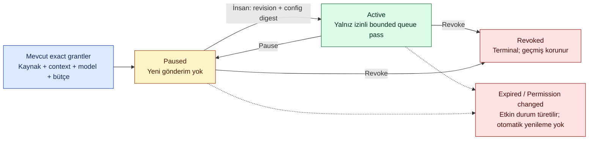
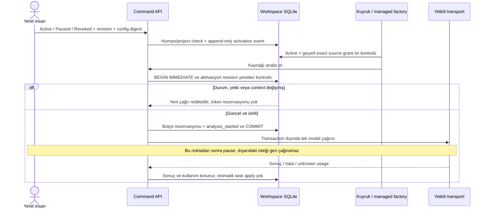

# Kalıcı model aktivasyonu — çalışan backend

**19 Ekim 2026 · T09/T17/T19/T21. Uygulanan yerel alt kapsam.** [Kod](../../packages/capture/model_activation.py), [test](../../tests/runtime/test_model_activation.py). Yeni kaynak okuma, API harcama veya sürekli izleme izni vermez. Kullanıcıya dönük kurulum ekranı ve zamanlayıcı henüz bağlı değildir; varsayılan LOCAL/TEST uygulaması model kapalı kalır.

## İş kuralı ve durumlar

Yalnız zaten verilmiş exact source/context/model/run grant'leri bir aktivasyonda toplanabilir. Oluşturma **Paused** durumundadır; ayrı insan komutu Active yapar. Kapsam10grant, history512event ile bounded; bunlar yerel uygulama tavanlarıdır, ölçülmüş kapasite/ürün SLA'sı değildir. Profil mevcut grant'lerden uzun yaşayamaz; yeni grant, root bütçe, token veya credential oluşturmaz. Aynı grant'in bir aktivasyona bağlandığı kalıcı olarak görüldükten sonra eski kontrolsüz extractor yolu da dispatch yapamaz.

Renkler tek başına anlam taşımaz; state labelleri metin olarak bulunur. Revoked profil eski kimliğiyle yeniden açılamaz. Yeni profil oluşturmak ayrı, açık insan işlemi ve mevcut geçerli source grant'leri gerektirir; eski iptal kaydı silinmez. Expired/Permission changed event geçmişinin değiştirilmesi değil, salt okunur etkin durumdur. Paused/Revoked komutu, yeni çağrıları kesmek için izin/expiry değişmiş olsa bile profil sahibince uygulanabilir.

## İşleme anı ve yarışlar

Factory'nin seçtiği extractor aktivasyon ID/revision taşır; `ConversationService.analyze` bunu rezervasyonla **aynı transaction** içinde tekrar kontrol eder. Pause→resume sonrasında eski extractor da stale kalır. Duraklatma önce commit olduysa gönderim başlamaz. `analysis_started` önce commit olduysa in-flight sonuç/maliyet makbuzu korunur; sonraki kaynak bekler. HTTP200, Active durumu veya hazır öneri Task Done değildir.

## Backend API ve depolama

Mevcut session/Host/Origin/CSRF ve proje yetkili `POST /api/command` zarfı kullanılır; yeni anonim endpoint yok.

| action | Alanlar (`action` dışında) | Etki |
|---|---|---|
| `create_model_activation` | `activation_id`, `grant_ids`, `expires_at`, `reason` | Exact configuration/hash ile Paused kayıt |
| `change_model_activation` | `activation_id`, `base_revision`, `configuration_sha256`, `state`, `reason` | İnsan/proje/current revision kontrolüyle yeni event |

Kaynak grant'leri bu uçlardan oluşturulamaz. Görünüm `/api/state.model_activations` içinde selected-project metadata olarak okunur; grant_count, actor/authz revision, config digest, expiry, state/effective_state taşır; metin/anahtar taşımaz. `model_ready` yalnız transport yapılandırmasını anlatır, Active izni veya çalışmakta olan worker demek değildir.

Aynı Workspace DB `audit` tablosunda `conversation_model_activation` event'leri kullanılır; yeni tablo, migration veya event schema version artışı yok. Profil history ve exact grant referanslarının digest'leri kalıcıdır; credential/ham mesaj kopyalanmaz. Proje query/command yetkisi, backup/restore ve append-only rollback kuralları korunur. Audit512event kapasitesinde yeni değişim reddedilir; aktif görünse bile yeni dispatch dondurulur ve effective_state History capacity reached gösterilir. Böylece pause kaydı eklenemiyor diye model gönderimi açık kalmaz. Önceki kabul edilmiş kayıt silinmez; bakım kendi onaylı kapsamıyla ele alınmalıdır.

## Log ve geliştirme sınırları

Operations iki komutu extraction bileşeninde normal command span olarak izler. Safe reason code örnekleri: `activation_inactive`, `activation_required`, `stale_activation`, `activation_denied`, `activation_transition_denied`; raw reason/transcript/key loga yazılmaz. Queue kaynağı model/provider başlamadan bekletirse bu hata değil beklemedir. Activation görünümü nedenini gösterir; bütün pipeline için ayrı span varmış gibi sunulmaz.

13hedefli test: pause/active/resume/revoke, factory→admission yarışının engellenmesi, eski extractor, expiry/yetki değişimi, grant/expiry genişletme reddi, insan/agent/proje sınırı, idempotent create, restart+restore, audit rollback, eksik profil, in-flight yanıtın korunması ve legacy bypass engeli. Bütün provider çıktıları sentetik; gerçek API0. Arayüz butonları, background timer, sürekli izinli source/model onboarding ve günlük kullanıcı kabulü mevcut T09/T17/T19/T21 işlerinde açık kalır.

Nihai doğrulama:556runtime ve49kök/tracker testi geçti.13yeni hedefli test bunlara dahildir.52Mermaid blok offline render edildi; yeni iki diyagram görsel olarak incelendi. İlk sequence renderındaki metin ayraç hatası düzeltildi; başarısız koşular başarı diye kaydedilmedi. Bu tur gerçek provider çağrısı0, kaynak okuması0.
