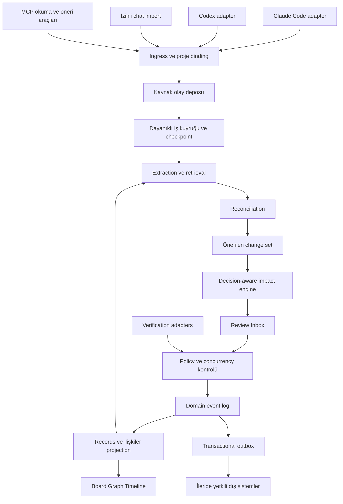

# Mimari öneri

**Statü: tasarım; uygulanmadı.** Tek yerel servis, SQLite ve açık modül sınırları başlangıç önerisidir. Mikroservis, graph database veya ayrı vector database ilk gün gerekli kabul edilmez. [ADR'ler](adr/README.md) seçenekleri ve doğrulama koşullarını kaydeder.

## Bileşen sınırları

| Modül | Sorumluluk | Yapmaması gereken |
|---|---|---|
| Capture adapters | Provider olayını normalize etme, yetki/coverage bildirimi | Konuşma geçmişine varsayımsal erişim |
| Ingress | Boyut, şema, kimlik, redaction ve idempotency | Kaynak metnini talimat kabul etmek |
| Extractor | Kaynak span'lı tipli adaylar; model çıktısını şemayla denetleme | Doğrudan canonical store yazmak |
| Reconciler | Duplicate/refinement/conflict/supersession önerileri | Benzerlikten doğruluk çıkarmak |
| Impact engine | Gerekçeleri ve etkilenen alt grafiği çözmek | Bağımlı her şeyi otomatik iptal etmek |
| Command/policy | Rol, proje, yetki, onay sürümü ve invariant kontrolü | Agent'a genel SQL/dosya silme aracı vermek |
| Event store/projector | Domain olaylarını ve türetilmiş görünümü atomik işlemek | LLM çağrısını transaction açıkken yapmak |
| Verifier | AC sürümü ve artifact revision'a bağlı kanıt değerlendirme | Dosya varlığını işlevin doğruluğu saymak |
| UI/MCP | Aynı read model'i tüketmek; proposal/approval işlemi | Kendi ikinci truth store'unu tutmak |

## Önerilen teknoloji ve paket sınırları

TypeScript + Node LTS, SQLite; React web UI, graph için React Flow adayı; board için dnd-kit adayı; MCP SDK ve SSE adayları. **Sürüm pinleri ve bağımlılık lisansları P0/P1a görevinde seçilecek.** Next.js ile hafif React/Vite seçimi açık; SSR zorunluluğu yok. SQLite transaction/recovery prototipi teknoloji kararını test eder. PostgreSQL yalnız çok cihaz/çok kullanıcı gereksinimi kanıtlandığında değerlendirilir.

İleride önerilen dizinler: `apps/hub`, `apps/web`, `packages/domain`, `packages/storage`, `packages/capture`, `packages/reconciliation`, `packages/impact`, `packages/verification`, `packages/mcp`. Bu dizinler bugün boş iskelet olarak yaratılmadı; ilgili görev sırasında oluşacak.

## Yerel güven sınırı ve recovery

Servis varsayılan olarak loopback'e bind olur; dashboard yazma uçlarında oturum doğrulama, origin kontrolü ve CSRF savunması gerekir. Hook secret'ı transcript'e veya repoya yazılmaz. Model çağrısına aktarılacak veri proje policy'siyle sınırlıdır; local-first saklama, dış model kullanırken “hiç veri çıkmaz” demek değildir.

Single writer kuyruğu ve kısa transaction'lar önerilir. Başlangıçta schema migration, yedekleme/restore, disk dolması ve yarım işlem testleri gerekir. Projection bozulursa log replay edilir; kaynak tekrar okunamıyorsa coverage incomplete kalır. Backup ve hash zinciri ayrı kontrol katmanlarıdır; DB yöneticisinin değişiklik yapmasını fiziksel olarak engellemez.

## Build / extend değerlendirme kapısı

P0'da Cortex, Claude Task Tracker ve mai-mcp aynı sentetik senaryoyla; Beads çekirdeği alternatif store olarak değerlendirilir. Öneri: domain/impact/policy sınırlarını Decivora'da özgün kurmak, uygun bileşenleri yalnız lisans ve veri modeli testinden sonra kullanmak. Karar verilmeden üç ayrı görev motorunu senkronize eden mimariye başlanmaz. Mevcut projelere kurulum veya migration bu dokümantasyon görevinin parçası değildir.
