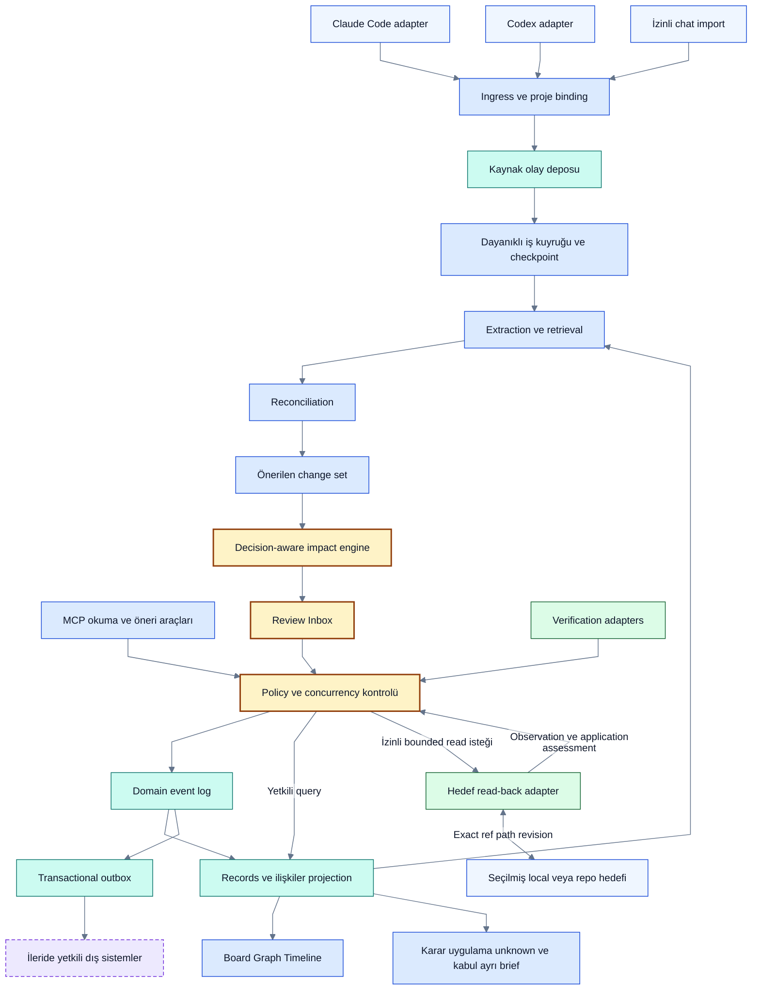

# Mimari öneri

> [!NOTE]
> **Şema anahtarı:** mavi kaynak/işleme · sarı yetki/onay · turkuaz kalıcı bilgi · yeşil kanıt alanı · turuncu belirsizlik · gri tarihçe · mor öneri/gelecek. Renkler implementasyon veya test başarısı değildir. [Görsel sözlük](../quality/visual-documentation.md).

**Statü: tasarım; uygulanmadı.** Tek yerel servis, SQLite ve açık modül sınırları başlangıç önerisidir. Mikroservis, graph database veya ayrı vector database ilk gün gerekli kabul edilmez. [ADR'ler](adr/README.md) seçenekleri ve doğrulama koşullarını kaydeder.

[Güncel P0 odağı](../product/current-direction.md), aşağıdaki **tam ürün** tasarımının sınırlı gerçekleşme/devam halkasını önce sınamayı önerir. İlk prototype'te bütün paket/adapter/ekip altyapısını kurmak gerekmez; runtime henüz yok. [ADR-0011](adr/0011-target-application-evidence.md) mevcut verifier/context modüllerini tamamlar, yeni servis değildir.

Devamı: [Engine ve alias kataloğu](engines.md) sorumlulukları; [runtime sözleşmeleri](runtime-contracts.md) ack, concurrency, auth ve recovery'yi; [diyagram atlası](diagrams.md) bağlam, ER ve yaşam döngülerini açıklar. [Mimari inceleme](../quality/completeness-review.md) açık risk ve uygulama kapılarını kaydeder.

[Tetikleme/API/zamanlama sözleşmesi](execution-and-integrations.md) hangi olayın kod, LLM veya insan işi başlattığını ve async sonuçlarını; [DB ilişkileri](data-relationships.md) bağlantı izinleri, run-task çoktan çoğa ilişkisi ve revision bağlı AC/evidence bütünlüğünü tamamlar. İç engine çağrıları aynı süreçte olabilir; her ok için yeni HTTP servisi tasarlanmaz.

## Bileşen sınırları

| Modül | Sorumluluk | Yapmaması gereken |
|---|---|---|
| Capture adapters | Provider olayını normalize etme, yetki/coverage bildirimi | Konuşma geçmişine varsayımsal erişim |
| Ingress | Boyut, şema, kimlik, redaction ve idempotency | Kaynak metnini talimat kabul etmek |
| Extractor | Kaynak span'lı tipli adaylar; model çıktısını şemayla denetleme | Doğrudan canonical store yazmak |
| Reconciler | Duplicate/refinement/conflict/supersession önerileri | Benzerlikten doğruluk çıkarmak |
| Impact engine | Gerekçeleri ve etkilenen alt grafiği çözmek | Bağımlı her şeyi otomatik iptal etmek |
| Command/policy | Rol, proje, yetki, onay sürümü ve invariant kontrolü | Agent'a genel SQL/dosya silme aracı vermek |
| Event store/projector | Domain olaylarını ve türetilmiş görünümü atomik işlemek | LLM çağrısını transaction açıkken yapmak |
| Verifier | AC sürümü ve artifact revision'a bağlı kanıt değerlendirme | Dosya varlığını işlevin doğruluğu saymak |
| UI/MCP | Aynı read model'i tüketmek; proposal/approval işlemi | Kendi ikinci truth store'unu tutmak |

## Önerilen teknoloji ve paket sınırları

[Q15-A/ADR-0012](adr/0012-conditional-python-runtime.md): ilk backend Python3.12 + stdlib SQLite. Önceki TypeScript/Node backend adayı bu ilk çekirdek için seçilmedi; React UI/React Flow/dnd-kit/MCP SDK/SSE adayları henüz kabul edilmedi. **Sürüm pinleri ve bağımlılık lisansları P0/P1a görevinde seçilecek.** Next.js ile hafif React/Vite seçimi açık; SSR zorunluluğu yok. SQLite transaction/recovery prototipi teknoloji kararını test eder. PostgreSQL yalnız çok cihaz/çok kullanıcı gereksinimi kanıtlandığında değerlendirilir.

İleride önerilen dizinler: `apps/hub`, `apps/web`, `packages/domain`, `packages/storage`, `packages/capture`, `packages/reconciliation`, `packages/impact`, `packages/verification`, `packages/mcp`. Bu dizinler bugün boş iskelet olarak yaratılmadı; ilgili görev sırasında oluşacak.

## Yerel güven sınırı ve recovery

Servis varsayılan olarak loopback'e bind olur; dashboard yazma uçlarında oturum doğrulama, origin kontrolü ve CSRF savunması gerekir. Hook secret'ı transcript'e veya repoya yazılmaz. Model çağrısına aktarılacak veri proje policy'siyle sınırlıdır; local-first saklama, dış model kullanırken “hiç veri çıkmaz” demek değildir.

Single writer kuyruğu ve kısa transaction'lar önerilir. Başlangıçta schema migration, yedekleme/restore, disk dolması ve yarım işlem testleri gerekir. Projection bozulursa log replay edilir; kaynak tekrar okunamıyorsa coverage incomplete kalır. Backup ve hash zinciri ayrı kontrol katmanlarıdır; DB yöneticisinin değişiklik yapmasını fiziksel olarak engellemez.

## Build / extend değerlendirme kapısı

P0'da Cortex, Claude Task Tracker ve mai-mcp aynı sentetik senaryoyla; Beads çekirdeği alternatif store olarak değerlendirilir. Öneri: domain/impact/policy sınırlarını Decivora'da özgün kurmak, uygun bileşenleri yalnız lisans ve veri modeli testinden sonra kullanmak. Karar verilmeden üç ayrı görev motorunu senkronize eden mimariye başlanmaz. Mevcut projelere kurulum veya migration bu dokümantasyon görevinin parçası değildir.

## Ekip ve veri altyapısı ayrıntıları

[Kimlik/yetki modeli](identity-access.md) workspace tenant, proje üyeliği, insan/agent principal ve süreli grant'i; [log/audit](logging-audit.md) kayıt sınıflarını; [depolama/hafıza](storage-memory-capacity.md) retention, DB/blob/secret ayrımını ve ölçüme bağlı ölçeği tanımlar. [ADR-0009](adr/0009-scoped-principals.md) ve [ADR-0010](adr/0010-storage-lifecycle.md) öneridir. Birincil pilot bireyseldir; tenant/agent sınırları P1, davet ve çok insanlı yönetim P4'tedir. Merkezi ekip servisi için PostgreSQL adayına geçiş yeni işletim kararı ve migration kanıtı gerektirir.

## Bağlantı ve görsel tüketim

[Yönetim merkezi](../product/administration-and-operations.md) günlük kullanıcı, workspace ayarları ve kurulum/platform operasyonunu ayrı yetkilerle aynı API'ye bağlar. Hata takibi ve versioned config ENG-06/07/10 sınırlarındadır; yeni bir engine/servis kararı değildir. Atlas 9–13 run, soru, blocker ve admin akışlarını tamamlar. Query command policy'den geçer ama domain mutation üretmez; capture ingestion ayrı yoldur.

[Kurulum/context sözleşmesi](connection-and-context.md) capture, MCP ve insan UI yollarını aynı servise bağlar. [Token sözleşmesi](routing-token-economy.md) host model tüketimini kendi arka plan modellerimizden ayırır; bounded context, metered retry ve atomik budget reservation önerir. [Graph UX](../product/graph-experience.md) aktif/geçmiş ilişkileri ve iptali açıklar. UI'nın normal graph/filtre işlemleri model çağrısı gerektirmez; anlamsal açıklama ayrı işlemdir.
