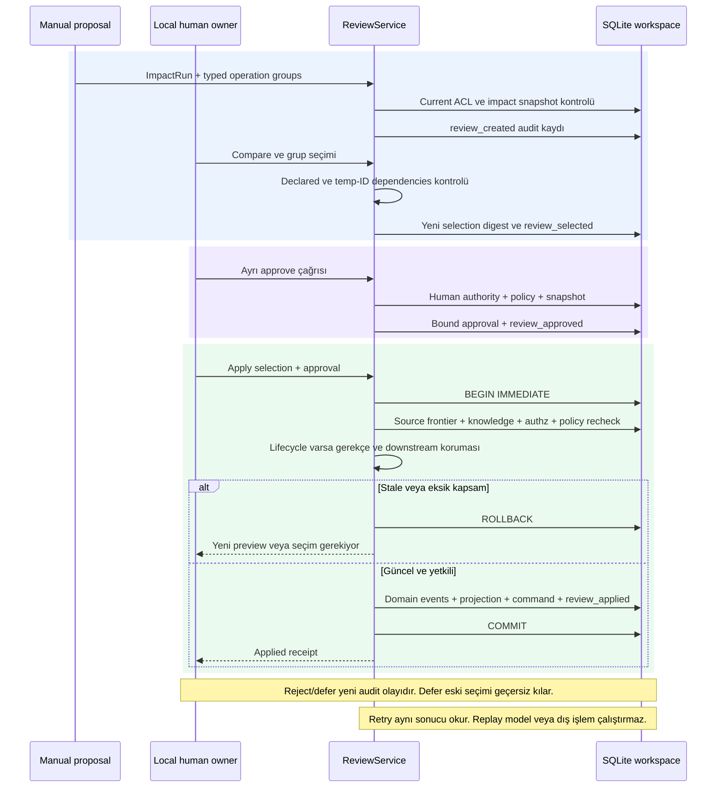
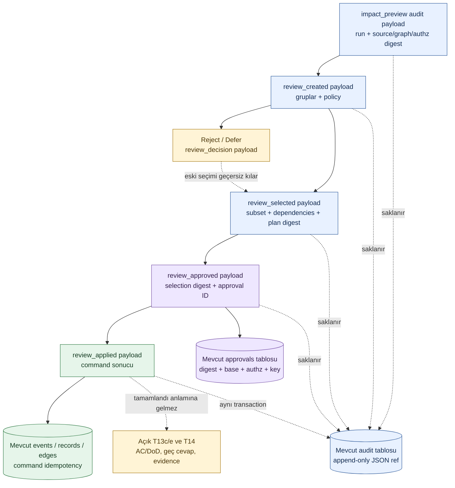

# Yerel review çekirdeği: mevcut kod ve kalan işler

**Uygulanmış dilim: T13a + ana T13 In Progress.** `ReviewService` local/manual operation group önerisini kalıcı saklar; compare → selection → ayrı human approval → atomik apply sağlar. İnsan rolü LocalAuthorityStore'un trusted local issuer'ıdır; gerçek login/UI değildir. [Kod](../../packages/domain/review.py), [input şeması](../../manifests/review-groups.schema.json), [test/teslim](../quality/review-kernel.md). SQL core FORMAT/schema1 değişmedi; aşağıdaki payload varlıkları fiziksel yeni tablo değil, append-only `audit.ref` JSON kayıtlarıdır.

## Uygulanan sıra ve güvenlik kapıları

## Mevcut fiziksel saklama ve mantıksal bağlar

Ana mimari ve README şemaları ürün vizyonunu anlatır; bu iki çizim uygulanan local dilimi açıkça ayırır. Yeni tablo/migration/HTTP endpoint veya otomatik görev iptali çizilmez. [T13b lifecycle](task-lifecycle.md) uygulandı; T13c versioned AC/DoD, T13e pending question + late answer ve T14 completion/evidence hâlâ açık; bu yüzden ana T13 Done değildir.
