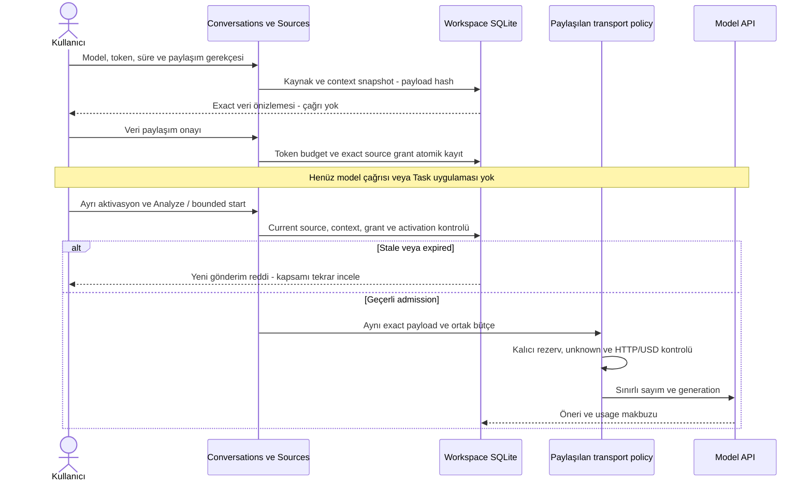
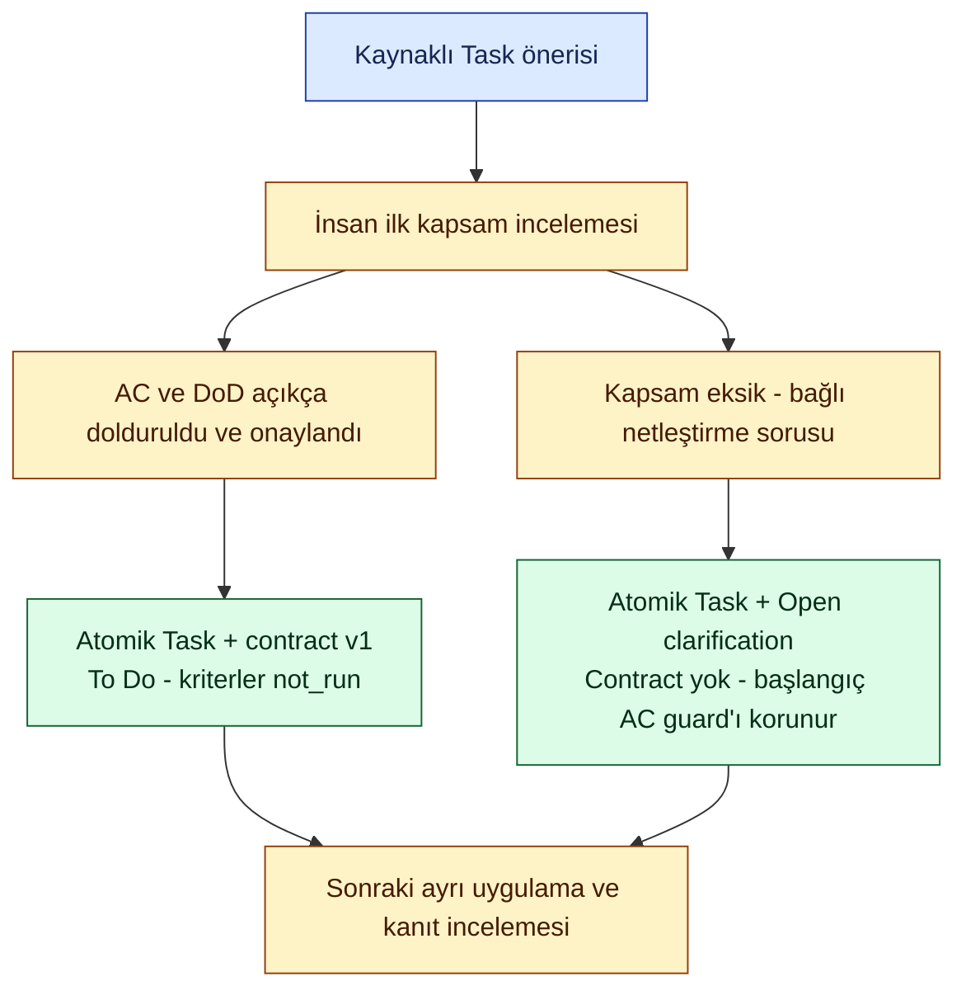

# Yeni kaynak paylaşımı ve ilk görev kapsamı

**20 Ekim 2026 · Sprint1 · T09/T13/T17/T19/T21/T22.** İki yerel ürün bağlantısı kodlandı: yeni kaynağın exact model paylaşım onayı ve ilk Task review'ında AC/DoD veya bağlı kapsam sorusu. Bu, yeni ücret/erişim izni veya MVP release kabulü değildir.

## Kullanıcı yolculuğu

1. Capture veya paste ile kaydedilmiş, henüz analiz edilmemiş kaynağı Conversations'ta aç.
2. Model, çıktı token tavanı, izin bitişi ve paylaşım gerekçesini seç. Provider/model seçenekleri ve para/HTTP/input tavanları güvenilir startup profilinden gelir; browser para tavanı, key, ledger veya endpoint değiştiremez.
3. Preview exact source and context ile maskeli kaynak, aynı thread'in sınırlı önceki metni ve ilgili canonical proje context'ini incele. Bu adım yerel; provider çağrısı yok.
4. Ayrı checkbox ve onayla exact source/context/payload hash'ine bağlı grant oluştur. Bu onay aktivasyon veya dispatch değildir.
5. Sources ekranında bu grant ile Paused aktivasyon oluştur; ayrı Active işlemi ve gerekirse bounded worker planı/start uygula. Tek Analyze komutu da aynı activation ve budget kontrollerini kullanır.
6. Modelin Task önerisini ilk kez kaydederken iki açık seçenek vardır: insanın yazıp onayladığı AC/DoD ile kaydet veya kapsam eksikse aynı Task'a bağlı bir netleştirme sorusuyla kaydet.

Varsayılan seçim kapsamı netleştirmektir; başlık veya “başladım” cümlesi kriter diye doldurulmaz. Sistem soru metni **önerilen insan review taslağıdır**, kaynakta zaten sorulmuş soru veya model alıntısı diye sunulmaz. Task+contract ya da Task+clarification tek transaction'dır. AC/DoD onayı sonuç/evidence üretmez: kriterler not_run, Task To Do kalır. Kapsam sorusu ikinci Task, otomatik Blocked veya otomatik karar değildir.

## Paylaşım ve harcama sınırı

- Profile yalnız startup'ta `--model-policy`, `--model-ledger`, `--model-key-file` üçlüsüyle veya güvenilir injected fixture ile sağlanır. Başlangıç policy metadata'sını okur; key veya provider okunmaz/çağrılmaz. TEST gerçek bağlantıyı kabul etmez.
- Mevcut entegrasyon shared development PilotTransport sözleşmesini kullanır: exact payload whitelist, sabit provider, tools=[], store=false, shared dispatch/HTTP/USD ledger, unknown rezervinin korunması ve retry yasağı aynen kalır. Genel account billing veya yeni bir ücretli plan yönetimi değildir.
- Root politika değiştirilemez/yenilenemez; kullanıcı browser'dan yeni para tavanı ya da yeni ledger gönderemez. Expired profil yalnız görünür; yeni sharing approval/dispatch reddedilir. Önceki $3 limiti **kalan bakiye değildir**; eski kullanım ve unknown rezervleri korunur.
- Her grant actor/project/source hash, current authz, context hash, model/output/reservation ve expiry'ye bağlıdır. Proje/karar/soru/AC değişirse paylaşım önizlemesi stale olur; yeniden gözden geçirmek gerekir.
- Yerel token budget aynı policy hash'i altında idempotent oluşturulur; startup yapmaz, approval yapar.100.000token implementation güvenlik tavanıdır; para onayı yerine geçmez. Her dispatch profile input tavanı + seçilen output kadar ihtiyatlı token rezervasyonu taşır; sayım/generation ve USD enforcement transport'ta ayrıca kalır.
- Paylaşım approval audit'i başarısızsa token budget ve source grant birlikte rollback olur. Existing budget cap büyütülmez/sıfırlanmaz. Yeni policy digest eski source consent'i yeniden kullanamaz.
- Factory artık seçilen activation'a bağlanabilir; dynamic activation desteği worker için de aynı current revision/admission kapısını kullanır. Diğer eski fixed registry'lerin sözleşmesi değişmez.

## İlk görev review'ı ve NM-02

[Native A/B raporundaki](../quality/native-two-model-001.md) NM-02: ilk görev review'ı AC hazırlamadığı için başlangıçta ekstra kapsam adımı gerekiyordu. UI artık görev kaydından önce kapsam seçimini görünür kılar. İnsan tarafından doldurulmuş kriterler onaylanabilir; eksik kapsam açık bir soru olarak korunur. Bu kod değişikliği modelin kendiliğinden doğru, test edilebilir kriter ürettiği anlamına gelmez; otomatik kriter çıkarımı bu teslimde eklenmedi.

Kriterler boşsa approved modu reddedilir; kısmi contract uydurulmaz. Kapsam seçimi her yeni seçili Task için zorunludur. Mevcut göreve source attachment eski AC'yi değiştirmez. Aynı command key farklı kapsamla tekrarlanamaz. Scope receipt nihai knowledge revision ve hem create hem contract event sequence'lerini taşır. Son audit başarısızsa Task, contract ve question birlikte geri alınır.

Geriye uyumluluk: eski `accept_candidates` çağrıları scope_reviews olmadan desteklenir; yeni UI her yeni Task için explicit kapsam seçimi gönderir. Eski istemcilerin contract'sız Task'ı başlatması/Done yapması mevcut guard'larla engellenir; bu teslim bütün eski API istemcilerine otomatik kriter üretimi eklemez.

## API / depolama / Operations

Mevcut session/CSRF/Origin ve human/project yetkili command API:

| Action | Alanlar | Etki |
|---|---|---|
| prepare_source_sharing | source_id, model, max_output_tokens, reserved_tokens, expires_at, reason | Yerel exact preview; grant veya dispatch yok |
| approve_source_sharing | plan_id, consent=true | Current profile/context ile grant+token budget+approval atomik |
| accept_candidates | Önceki alanlar + isteğe bağlı scope_reviews | Yeni UI'da Task ile approved contract veya clarification birlikte |

`scope_reviews` her candidate için mode, criteria, dod, clarification ve reason taşır. Approved iki nonempty liste ister; clarify iki listeyi boş ve soruyu dolu ister. Yeni source-sharing event'leri mevcut audit tablosunda append-only tutulur. İlk human scope sorusu origin=first_task_human_scope_review ve quote/span=null taşır; source-literal alıntı diye sunulmaz. Canonical AC event store'dadır. Key, endpoint, ledger yolu veya ham provider hata metni API/loga konmaz. Prepared context aynı workspace'de private kalır; operasyon logları yalnız komut sınırı/kod içerir.

## Doğrulama ve kalan sınır

11yeni runtime kontrolü: preview≠consent≠activation≠dispatch; restart, stale context/expiry/policy; audit rollback; fake model→ilk scope; soru yolunda tek Task; AC not_run; scope replay çelişkisi; dynamic bounded worker; UI'dan cap/model yükseltme reddi. Gerçek tarayıcıda exact preview→onay→ayrı activation→fake model→AC/DoD ile ilk Task akışı geçti. Mevcut çok turlu diyalog/false-Done/mobil akış regresyonu da geçti. External API/native source read0.

Sonraki kabul ayrı: yeni sınırlı gerçek kaynak paylaşımı ve geçerli ücretli policy dönemiyle bu UI akışını gerçek provider'da çalıştırmak. Önceki capture/model deneme izinleri tüketilmiştir; mevcut süreyi, fiyat revision'ını veya kaynak scope'unu sessizce yenilemedik. Sürekli native capture, generic provider/billing yönetimi ve modelin kriter çıkarım kalitesi bu teslimin tamamlanmış yetenekleri değildir.

Kod incelemesinde Task oluşturma sonrasında contract event'lerinin eklenmesiyle combined receipt'in nihai knowledge revision'ı ve event listesi de güncellenmesi gerektiği görüldü. Receipt düzeltildi; current snapshot eşitliği regresyona eklendi. Önceki source-only kabul veya geçmiş gerçek model raporu yeniden yazılmadı.

Son teyit: **680runtime +49repo testi geçti**; mevcut dialogue/false-Done ve yeni source-sharing browser akışı pass.62Mermaid/34belge render edildi ve yeni iki çizim incelendi. LOCAL53610 ve TEST53611aynı verilerle yeniden başlatıldı; tüm uygulama tablo fingerprint'leri aynı, worker/native read/model dispatch0. LOCAL mevcut policy metadata'sını gösterir; profilExpired, model_ready=false. Başlangıç credential içeriğini veya ledger'ı açmaz/değiştirmez.

İlk gerçek kullanım için açık dış yetki: mevcut development API döneminin süresi dolmuştur. Yerel koddan bağımsız bu izin sessizce uzatılmadı. Yenileme önerisi aynı$3/100generation/200HTTP/10kinput/2koutput sınırlarını,52önceki dispatch/104HTTP bütçe payını ve$0.067286taahhüdü (3unknown için$0.006750korunan rezerv dahil) taşımak; eski policy/ledger'ı koruyup yeniden onaylanmış24saatlik dönem için cumulative prior-usage kaydı kullanmaktır. Bu öneri henüz onay değildir, bakiye veya actual fatura doğrulaması değildir. Source consent ve ayrı activation yine gerekir; onay yokken API kapalı kalır.
