# Veritabanı, hafıza yaşam döngüsü ve kapasite

> [!NOTE]
> **Şema anahtarı:** mavi kaynak/işleme · sarı yetki/onay · turkuaz kalıcı bilgi · yeşil kanıt alanı · turuncu belirsizlik · gri tarihçe · mor öneri/gelecek. Renkler implementasyon veya test başarısı değildir. [Görsel sözlük](../quality/visual-documentation.md).

**14Ekim2026 — Yerel SQLite/domain/audit ve minimal private backup/temporary restore kodlandı; tam veri yaşam döngüsü/ekip kapasitesi öneridir.** Restart/replay/rollback ve tutarlı snapshot yedek/restore kontrolleri ile [kısa sentetik yük](../quality/mixed-load.md) çalıştırıldı; gerçek model/capture yükü, uzun soak/RPO/RTO ve tam erasure/recovery işletimi doğrulanmadı. Yedek tüm izinli workspace verisini taşır ve şifrelenmez; public/redakte export değildir. Önceki14Ekim2026 durum kontrolü delete idi; sonraki kullanıcı yetkili503düzeltmesiyle LocalApp startupWALseçer/doğrular. Restart sonrası canlıDBsalt okunur journal_mode=wal olarak doğrulandı. [Düzeltme/kanıt ve sınırlar](../quality/concurrency-impact-delivery.md); multiwriter/networkDB garantisi değildir. [Güncel güvenlik/kanıt/açık iş matrisi](../quality/security-current-status.md). “Kalıcı” yeniden başlatmada korunur demektir; sonsuza kadar tutulması gerektiği anlamına gelmez. Kalıcılık, canonical yetki, erişim ve retention birbirinden ayrı eksenlerdir.

## Nerede ne tutulacak?

Yerel P1 için SQLite, aynı host üzerinde tek servis ve kısa write transaction'larıyla önerilir. WAL okuyucu/yazıcı eşzamanlılığı sağlar; aynı DB'de tek writer sınırı sürer. Aktif DB bir network drive/senkron klasörden çok makineye açılmaz. Ekip üyeleri DB dosyasına değil kimlik doğrulanan servis API'sine bağlanır. Bunlar [SQLite kullanım](https://www.sqlite.org/whentouse.html) ve [WAL](https://www.sqlite.org/wal.html) belgelerine dayanan sınırlar; ürün kapasite sonucu değildir.

| Depo | Yerel başlangıç | Ekip büyümesi |
|---|---|---|
| Canonical domain events, memberships, grants, approvals, audit | SQLite transactional tablolar | PostgreSQL; tenant/project compound keys ve ek RLS savunması |
| Current projections, ilişkiler, durable jobs, outbox, receipts | Aynı DB, index ve foreign key'ler | Aynı transaction sınırı; bağımsız worker'lar lease/fencing ile |
| Ham kaynak / büyük evidence artifact | DB'de ACL/hash/ref; içerik ayrı korumalı blob dizini | Yetkili API arkasında object storage; kısa süreli indirme linkleri |
| Arama, özet, embedding | Önce DB index/FTS ve versioned summary; embedding ancak deney gerekçelendirirse | Ayrı search/vector altyapısı yalnız ölçülen ihtiyaçla |
| Credential | OS secret store adayı, DB yalnız credential_ref | Yönetilen secret store adayı, servis kimliği/rotation |
| Aktif model context ve response cache | Sınırlı RAM; kaynak/policy revision etiketli | Tenant bütçeli cache; shared key cache kullanma |

Blob önce staging'e yazılır ve hash doğrulanır; DB commit yalnız dayanıklı blob referansını yayımlar. Başarısız transaction orphan bırakabilir; yaş eşiği ve referans kontrolüyle GC temizler. Silme ters sırada tombstone→erişim engeli→blob/cache temizliği olarak ilerler. Blob/DB arasında dağıtık atomiklik varmış gibi davranılmaz. Yerel dosya izinleri ve disk şifrelemesi gereksinimdir; standart SQLite'ın otomatik uygulama düzeyi şifreleme sağladığı varsayılmaz. Şifreleme/key recovery yöntemi gerçek veri öncesi seçilir.

```mermaid
%%{init: {"theme":"base","themeVariables":{"fontFamily":"Arial, sans-serif","fontSize":"14px","primaryColor":"#eff6ff","primaryTextColor":"#0f172a","primaryBorderColor":"#1d4ed8","lineColor":"#64748b","secondaryColor":"#ccfbf1","tertiaryColor":"#f1f5f9","background":"#ffffff","mainBkg":"#eff6ff","textColor":"#0f172a","clusterBkg":"#f8fafc","clusterBorder":"#94a3b8","edgeLabelBackground":"#ffffff","actorBkg":"#eff6ff","actorTextColor":"#0f172a","actorBorder":"#1d4ed8","signalColor":"#64748b","signalTextColor":"#0f172a","noteBkgColor":"#fef3c7","noteTextColor":"#0f172a","noteBorderColor":"#92400e"},"flowchart":{"htmlLabels":false,"curve":"linear"},"sequence":{"wrap":true},"themeCSS":"background-color:#ffffff;"}}%%
flowchart LR
    accTitle: Kalıcı kaynak, geçici context ve purge
    accDescr: Önerilen tasarım veya açıkça belirtilen sentetik örnek. Renkler alan ve kontrol türünü gösterir; implemented veya passed kanıtı değildir. Yetki, revision ve coverage sınırları korunur.
    SRC[İzinli kaynak] --> IN[Durable ingress ve receipt]
    IN --> CLASS{Onaylı veri sınıfı}
    CLASS --> TMP[Geçici ham payload]
    CLASS --> ARCH[1C izinli kaynak arşivi]
    IN --> JOB[Kalıcı iş kuyruğu]
    JOB --> CTX[Geçici izinli context]
    CTX --> PROP[Kalıcı aday ve review]
    PROP -->|Yetkili onay| EV[Canonical event geçmişi]
    EV --> VIEW[Yeniden üretilebilir görünüm ve index]
    VIEW --> CTX
    TMP -->|Sınıfa özgü TTL veya purge| DEL[Tombstone ve coverage kaydı]
    ARCH -->|Ayrı onaylı retention veya erase| DEL
    ARCH -->|Aktif işler önce, aşamalı| JOB
    ARCH -.-> LIMIT[Kapasite sınırında intake durur; sessiz silme yok]
    EV --> BK[Tutarlı DB ve blob yedeği]
    ARCH --> BK
    classDef source fill:#eff6ff,stroke:#1d4ed8,color:#0f172a
    classDef process fill:#dbeafe,stroke:#1d4ed8,color:#0f172a
    classDef gate fill:#fef3c7,stroke:#92400e,color:#0f172a,stroke-width:2px
    classDef store fill:#ccfbf1,stroke:#0f766e,color:#0f172a
    classDef history fill:#f1f5f9,stroke:#475569,color:#0f172a,stroke-dasharray:5 3
    classDef warning fill:#ffedd5,stroke:#9a3412,color:#0f172a
    class SRC source
    class IN,JOB,CTX,PROP,VIEW process
    class CLASS gate
    class EV,BK,ARCH store
    class TMP,DEL history
    class LIMIT warning
```

## Retention başlangıç önerisi

Aşağıdaki süreler **onaylanmamış pilot varsayımlarıdır**; bugün çalışan bir otomatik silme işi yoktur. OPEN-08/T23'te gerçek veriden önce konfigürasyon ve kullanıcı açıklaması kesinleşmeli. Workspace policy daha kısa/uzun süre seçebilir; sonradan sınırsız büyüyen istisna üretilemez. `expires_at`, policy_version, cleanup sonucu ve pin gerekçesi görünür olmalı.

| Veri sınıfı | Dayanıklılık / önerilen süre | Silinince sonuç ve kontrol |
|---|---|---|
| Modelin çalışma context'i / geçici hesap | RAM, run bitişinde temizle; boşta en çok 1 saat | Kalıcı karar kaybı olmamalı; yeniden retrieval gerekir |
| Response/retrieval cache | En çok 15 dakika; ACL/revision değişiminde derhal kullanılamaz | TTL yetki kontrolünün yerine geçmez; yeniden hesaplanır |
| Adapter crash spool | Şifreli sınırlı disk; receipt sonrası temizle; ack alınmamış veri için 24 saatte uyarı ve capture durdurma | Ack öncesi yaş doldu diye sessiz drop yok; export/retention kararı gerekir |
| Geçici ham conversation/tool payload | Önceki genel 30 gün önerisi yalnız açıkça geçici sınıflanan payload için; onaylı nihai süre değil | 1C kaynak arşivi bu sınıfa otomatik girmez; canonical bilgi ve source availability korunur |
| 1C izinli tarihsel kaynak arşivi | Q07 ile kaynak korunarak aşamalı işleme seçildi; kısa otomatik TTL yok. Kesin süre/kapasite/purge politikası OPEN-08'de gerçek veri öncesi kararlaştırılır | İşlenmemiş kaynağı yaş nedeniyle sessiz silme. Kapasite dolarsa yeni intake pause/uyarı; yetkili erase talebi retention'dan bağımsız uygulanır, coverage eksilir. Sonsuz saklama taahhüdü yok |
| Pending/decision-pending adaylar | Durum çözülene kadar dayanıklı; 30 günde hatırlatma, otomatik accepted/obsolete yok | Ham kaynak expiry review öncesi uyarılır; kaynak kaybında karar bloke veya gerekçeli değerlendirme |
| Accepted karar, gerekçe, task/event geçmişi | Proje yaşam süresi + açık arşiv/purge policy'si | Kalıcı hafıza budur; correction append-only, privacy purge yönetilen istisna |
| Rejected/merged adaylar | Minimal ret/merge gerekçesi ve kimlik proje yaşamı boyunca; ham metin kendi kaynak sınıfının retention'ına tabi | Ret kararı tek başına 1C kaynak arşivini geçici payload yapmaz; redaction gerekebilir |
| Source dedup receipts / approval idempotency kimlikleri | Kompakt kimlik+sonuç/tombstone proje yaşamı boyunca | Payload TTL ile birlikte silinmez; eski import/onay tekrarının effect üretmesini engeller |
| Job attempt ayrıntısı | Tamamlanma sonrası 30 gün; source mapping/nihai checkpoint kalıcı | Başarısız/quarantine işi yaş nedeniyle başarıya dönüştürme |
| Evidence özeti ve revision bağları | İlgili karar/AC geçmişiyle kalıcı | Evidence blob silinirse doğrulama yeniden incelenebilirliği `unavailable`; geçmiş doğrulama iddiası gizlenmez |
| Evidence blob | Pilot 90 gün; önemli release kanıtı açık süreli pin | Kanıt gereksinimi retention'dan uzunsa saklama süresi açıkça artırılır |
| Summary/index/embedding | Fiziksel olarak kalıcı olabilir; kaynak+ACL+model/version değişiminde invalid | Canonical otorite değildir; purge türevleri de kapsar |
| Operational/debug log | Operasyon 30 gün, geçici debug 7 gün; debug varsayılan sınırlı | Secret/raw transcript içermez; incident pin süreli ve yetkili |
| Security audit | Pilot 90 gün; domain karar provenance'ı domain retention'a tabi | Hukuki saklama süresi iddiası değildir; ekip gereksinimi ayrıca seçilir |
| Yedek | Günlük son 7 + haftalık son 4; en eski kopya en çok 28 gün | Şifreli, erişimi ayrı; purge eski backup'ta süre sonuna kadar kalabilir |

Saklama kotası dolduğunda karar geçmişi otomatik budanmaz. Önce türev cache/expired log ve referanssız blob temizlenir; sonra capture/backpressure ve kullanıcı uyarısı. Zorunlu durable receipt verilemiyorsa kaynak kabul edilmiş sayılmaz.

## Erişim, unutma ve replay

Kişisel ve proje ortak hafızası farklı ACL taşır; [identity-access](identity-access.md) türetilmiş bilginin erişimini tanımlar. Her retrieval grant/authz kontrolünden sonra yalnız yetkili, ilgili, sınırlı context üretir. Model bağlamı küçültme kalıcı silme değildir. Kalıcı özet yalnız iddia/kanıt/provenance ile adaydır; modelin hatırladığı ifade yeni otorite olmaz.

Erasure önce canlı erişimi ve türev servis etmeyi engeller; cleanup kaynak, blob, embedding, cache, export manifest ve log kopyalarına yayılır. Eski backup'lar için tombstone manifest ayrı korunur; restore sonrasında servis açılmadan yeniden purge uygulanır. Tam silme mevcut immutable backup süreleri bitmeden tamamlandı denmez. Dış model/provider veya önceden indirilmiş kopyaların geri çağrılması garanti edilmez.

Event payload'ları ham kişisel metin yerine replay için gerekli minimal domain delta/ref tutmalı. Domain alanı da hassas olabilir; “append-only” privacy purge'u imkânsızlaştıran vaat değildir. Purge sonrası korunabilen event/tombstone'lardan projection kurulmalı; bilinçli kaldırılan ayrıntılar `redacted` kalır. Uyumsuz event/schema hiçbir zaman sessiz atlanmaz.

## Kapasite hesabı ve geçiş kapıları

Kapasiteyi kullanıcı sayısı tek başına belirlemez: event boyutu/frekansı, attachment, read/write karışımı, açık transaction, impact graph ve model kuyruğu belirler. Aşağıdaki yalnız **sentetik ham event hesabıdır**, SQLite veya Decivora benchmark'ı değildir.

| Event adedi | Ortalama 2 KiB/event varsayımıyla ham alan |
|---|---|
| 100.000 | Yaklaşık 195 MiB |
| 1.000.000 | Yaklaşık 1,91 GiB |
| 10.000.000 | Yaklaşık 19,07 GiB |

Toplam disk ≈ event alanı + projection/index + payload/evidence + WAL/transaction payı + cache + yedekler + migration çalışma alanı. Örneğin event başına ayrıca 10 KiB kaynak tutulması, event alanına beş katı kadar payload ekler; retention bunu değiştirir. Alanın otomatik küçülmesi veya sıkıştırma oranı garanti edilmez. Kapasite planında örnek veriyle ölçülen gerçek alan katsayıları kullanılacak.

| Aşama | Topoloji | Geçiş ve kanıt |
|---|---|---|
| S0 / P1 | Tek kişisel workspace; local SQLite servis; birden fazla sınırlı worker/agent olabilir | 100k/1m event sentetik profil; writer wait, queue lag, replay/restore ölçülsün |
| S1 / P4 ekip pilotu | Merkezi API, kimlik sağlayıcı adayı, PostgreSQL ve erişim kontrollü blob deposu | İkinci gerçek insan/uzak cihaz gereksinimi; MU erişim/offboarding testleri; backup/key yönetimi hazır |
| S2 / ekip büyümesi | Birden fazla stateless API/worker; PostgreSQL lease/outbox; workspace quotas | Tek servis CPU/queue/SLO sınırı ölçülmüş; concurrency/fencing/tenant isolation geçer |
| S3 / ölçülmüş ihtiyaç | Partition, dedicated search/vector/queue veya tenant izolasyonu aday | Query planı ve maliyet sorunu kanıtlı; operasyon yüküne değdiği gösterilmiş |

Tek host arkasında SQLite küçük ortak deneyde teknik olarak kullanılabilir; “birden fazla kullanıcıda çalışmaz” iddiası yoktur. Ürün için önerimiz ekip pilotunda merkezi Postgres işletimini değerlendirmektir; P1'de dış DB servisi kurulmaz. 10 milyon event testi yalnız ölçek kapısında gerekirse yapılır. Erken mikroservis/Redis/Kafka/vector DB zorunlu bağımlılık değildir.

Ekip kotaları workspace başına source boyutu/adedi, depolama, eşzamanlı run, queue bekleme alanı, model token/bütçe ve export hacmini ayrı sınırlar. Bir tenant diğerinin worker havuzunu tüketmemeli; adil dispatch ve tenant başına concurrency limiti C06'da test edilir. Model bütçesi dolması kalıcı source receipt'ini sahte başarıya çeviremez; capture depolama kotasıyla, semantik işleme model bütçesiyle ayrı yönetilir.

Ölçüm başlangıç hedefleri: yerel read p95 ≤300 ms, kısa canonical command commit p95 ≤250 ms (LLM hariç), sürdürülen yükte queue'nun sınırsız büyümemesi. Bunlar ürün garantisi değil kalibrasyon hedefidir. Cihaz/CPU/RAM/disk, DB sürümü, eşzamanlılık, event/graph dağılımı, cache sıcaklığı, test süresi ve başarısız işlem oranı raporlanmadan sonuç karşılaştırılmaz. 1/5/20 eşzamanlı istemci profili aynı fixture ile karşılaştırılır; darboğaz model gecikmesiyse DB migration çözüm diye sunulmaz.

Postgres RLS defense-in-depth'tir; API yetkisini kaldırmaz. Uygulama DB rolü tablo sahibi/superuser/BYPASSRLS olmaz; gerekli owner tablolarında FORCE RLS değerlendirilir. Pool bağlantısındaki tenant context server tarafından transaction-local atanıp sıfırlanır; background jobs, export, backup ve admin yolları ayrıca test edilir. [PostgreSQL RLS belgesi](https://www.postgresql.org/docs/current/ddl-rowsecurity.html) bypass sınırlarını açıklar.

## Migration, backup ve kurtarma

SQLite→Postgres migration: sürüm eşleşmesini denetle → yazıları durdur ve receipt sınırını kaydet → tutarlı DB/blob manifest export → tenant/FK/ACL/sequence/ID korunarak yükle → sayım, referans, projection digest ve yetki oracle karşılaştır → read-only smoke test → tek hedefi writable aç. Hedefte yeni yazı başladıktan sonra eski DB'ye dönüş veri kaybı yaratabilir; geri dönüş reverse reconciliation/export gerektirir. İki tarafı aynı anda authoritative yapma. Offline çok cihazlı sync ayrı gelecek protokolüdür; DB dosyalarını kopyalamak veya sync conflict'te last-write-wins kullanmak değildir.

Aktif SQLite dosyasını sıradan kopyalamak yerine [online backup API](https://www.sqlite.org/backup.html) ile tutarlı snapshot; snapshot'a ait blob manifest ve schema/projector sürümü birlikte alınır. Önerilen yerel disaster hedefi günlük backup ile RPO ≤24 saat, restore RTO ≤1 saat; henüz ölçülmedi. Commit dayanıklılığı ayrı crash testidir, bu RPO geçmiş onayların günlük olarak kaybolmasının normal olduğu anlamına gelmez.

Ekip aşamasında [Postgres base backup + WAL arşivleme/PITR](https://www.postgresql.org/docs/current/continuous-archiving.html) değerlendirilir; daha sık yedek hedefi maliyet/iş ihtiyacıyla seçilir. DB PITR object storage'ı geri sarmaz; blob manifest/version tutarlılığı doğrulanır. Restore sonrasında grant/session/secret durumu güncel olarak uzlaştırılır, dış delivery durur, purge tombstone'ları uygulanır. Anahtar yokken backup'ın kullanılabilirliği kanıtlanmış sayılmaz. Tatbikat: disk dolması, process crash, WAL/checkpoint baskısı, DB corruption, kayıp blob, stale permission ve expired backup.

## 14 October 2026 — private backup UI

[Current bounded backup download](../quality/private-backup-runtime.md): Sources view, explicit private-data acknowledgment, ZIP + manifest and temporary offline restore validation. Unencrypted source-preserving backup; not a shareable redacted export. Active restore/purge/migration/encryption remain open; no model call or new SQL schema.

## Yerel credential koruması — 19 Ekim

Yeni konuşmalar sanitized source olarak yazılır; POSIX canonical/diagnostics ve SQLite sidecar izinleri600. Eski private backup şifresiz ve eski sırları içerebilir. Automatic purge/encryption/migration yapılmadı. [Çalışan sınırlar ve sonraki recovery işleri](../quality/credential-redaction-runtime.md).
