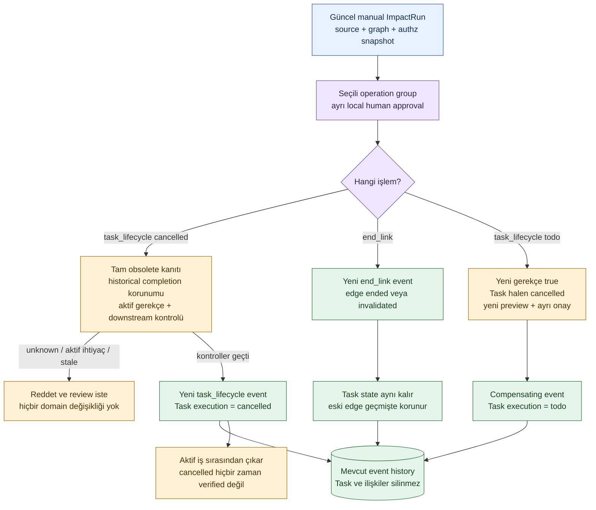

# Uygulanan Task lifecycle ve ilişki ayrımı

**T13b: local/manual çekirdek uygulanmıştır.** [Operation/guard](../../packages/domain/task_lifecycle.py), [şema](../../manifests/task-lifecycle-event.schema.json), [kabul ve test](../quality/task-lifecycle.md). SQL core FORMAT/schema1 korunur; yeni tablo/migration yok. Yeni `task_lifecycle` event payload'ı mevcut record stream'inde record version'ını ilerletir. Task read projection'da optional `execution: todo|cancelled` vardır; önceki üç alanlı Task body'nin durumu varsayılan todo'dur. Bunlar completed/verified statüsü değildir.

## Current implementation sözleşmesi

- `task_lifecycle` exact fields: op/id/base_version/state/reason/impact_run. State yalnız todo→cancelled veya cancelled→todo; reason nonblank≤1024, ID ve positive int64 base revision. Create/update metadata body ile execution alanı yazılamaz; projector lifecycle state'ini metadata update sırasında korur. Lifecycle kazanmış Task başka record type'a çevrilerek koruma aşılamaz.
- Lifecycle normal bare approval ile uygulanamaz. ReviewService'in güncel source/knowledge/authz/policy guard'ı ve onun approval'ı gerekir. Op'un impact_run'ı aynı review basis'ine bağlıdır; record version ve proposal eşleşir. Historical completion taşıyan proposal iptal edilmez; gerçek completion/evidence guard T14'te tamamlanacak.
- Cancellation için complete preview'da obsolete_candidate ve after=false gerekir. Yeni `justification_facts` karşılaştırması, asserted required_by/implements edge'lerinin tümünü kapsamalı ve false göstermelidir. Aktif/unknown gerekçe iptali durdurur. AND scope update'i ve missing rationale cancellation değildir.
- Canlı downstream depends_on veya part_of parent varsa ret; bu işler sessiz kapanmaz. Birden fazla independently obsolete task aynı explicit onaylı batch'te iptal edilebilir; kendiliğinden cascade yoktur. Guard tüm batch'i ve aynı command'da eklenecek gerekçe/downstream ilişkilerini commit öncesi denetler.
- İptal ilişkileri sona erdirmez. End_link task state değiştirmez; ayrı seçili review operation'dır. Eski T11 lower-level human-approved edge API'si korunur; ürünün lifecycle yolu protected review üzerinden gider. Bir edge değişimi eski cancellation preview'sunu stale yapar.
- Geri dönüş için Task cancelled olmalı, yeni complete rationale true olmalı, yeni preview/seçim/onay alınmalıdır. Eski cancellation event'i silinmez; yeni Task version yazılır. İptal edilmiş iş eligibility/verification'dan bağımsız ready değildir; aktif ranking'den çıkar, dependency blocker olarak bilinçsizce passed sayılmaz.
- Replay yalnız saklı event'in alan/stream/version/state geçişini doğrular, bugünün gerekçesiyle eski onayı tekrar değerlendirmez. Backuprestore current projection ve history'yi korur. Eski runtime sürümü yeni event kind'ını replay edemez: sessiz atlama yerine eski fail-closed davranışı geçerlidir; yeni lifecycle event'i yazılmış DB için güncel runtime gerekir.

## Açık sınırlar

Force-cancel/override ve aktif gereksinimi başka işe aktarma politikası bu dilimde yoktur; desteklenmeyen durumda ret/review korunur. Facts/rationale manual hypothetical input'tur; gerçek semantik doğruluk T09/T10 ve ürün pilotunda ölçülecek. UI strike-through/icon, AC/DoD, QuestionRequest ve completion evidence uygulanmış sayılmaz. Aynı Task'ın metadata update'i ile lifecycle'ı ayrı revision isteyen aynı plan'a koymak stale/version conflict olarak tümüyle geri alınabilir; bu çekirdek tek Task için aynı command'da tek transition hedefler. Tek güncel plan/revision hazırlanır, kalite kapısı gevşetilmez.
