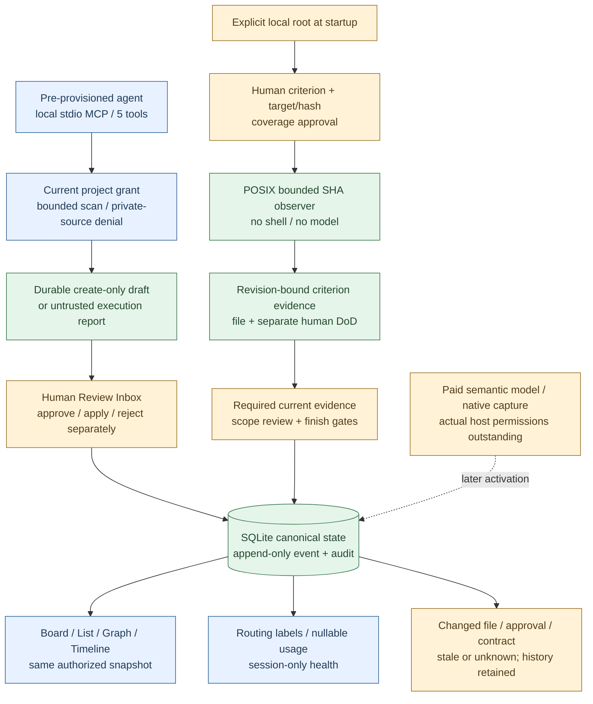

# API-independent development: implementation, findings and follow-up gates

**14 October 2026 — current local implementation; final validation below.** User authorized all feasible work without API usage, a findings report and mandatory later checks. This report is the continuation index; [backlog](backlog.md) remains the task authority. No paid inference, real transcript import, automatic host registration, new grant, external execution or public release was authorized by this work.

## Delivered code and boundaries

| Existing task | Working delivery | Evidence / remaining boundary |
|---|---|---|
| T14a/b/d | Opt-in POSIX exact-file SHA observer; explicit criterion method and approved target/hash/coverage binding; current task/AC/authority/root revisions; human DoD remains separate | File/HTTP/browser tests. Missing, inaccessible, oversized, symlink, replacement, changed content and stale binding cannot become passed. No shell or arbitrary tests/deploy/GitHub verifier. Real target root is not configured by default. |
| T15a | One source→fixture candidate→human acceptance→file criteria→Done→changed-file correction→backup/restore technical chain | Fixture extractor only; independent file bytes and restore assertions. This does not certify semantic extraction, all adversarial/host/OS scenarios or MVP. |
| T18/a/b/c | Five narrow MCP tools and pinned2025-06-18 stdio; process initialization/EOF; selected existing DB + pre-provisioned agent; signed scope/filter/revision cursor; output limits | Real local subprocess + two agent identities tested. No human-owner impersonation, admin SQL, shell, sampling or approval tool. Native Codex/Claude client activation/interop not tested. Brief is bounded preview, not complete context/delta resync. |
| T13/T18 | Durable create-only agent proposal→human review→separate approval→separate apply/reject; typed agent execution report is unverified | Draft survives independently of a model response. Retry/rollback/stale authority guards. Edits/cancellation/relations still require full impact-review integration and are rejected here. Typed agent-question delivery/pause/resume is not implemented by these five tools. |
| T19 | Existing authorized project selector, explicit per-request project envelope, independent tab selection and per-project unsent drafts | Two-project/HTTP/browser fixtures; no automatic project creation, permission expansion or multi-user login. |
| T20b | Same authorized SQL state snapshot feeds Board/List and bounded Graph/Timeline. Focus record, typed directed relation labels, ended×/dashed history, keyboard Task detail, separate domain/audit sequences | Actual browser interaction. Grid layout25nodes/100visible edges;500relation cap. AND/OR expression groups, historical time travel, dense graph UX and large-project pagination remain open. No invented global date/order between independent ledgers. |
| T20f | Owner-scoped local health/configuration indicators and last25 sanitized endpoint/error-code incidents | Session memory only, reset on restart. No request bodies, arbitrary paths, keys or raw errors. Full durable incident/backoffice policy not implemented. |
| T21 | Separate work_class/executor/human_suitable labels with human revision-bound audit; no automatic execution. Managed run reservation view: known/held/nullable actual/remaining; external chat tokens/money unknown | Budget/unknown and actor negative tests. Provider billing classes/prices/actual counters, period/config UI and orchestrated dispatch still need their integrations/decisions. No savings claim. |
| T23 | Existing private backup download/temporary restore validation continues to work with new audit payloads | Private, unencrypted backup; no redacted public export or destructive purge/active overwrite. |

## Findings and actions

| Finding | Evidence and consequence | Action / status |
|---|---|---|
| F01 — plan was not durable | Workspace.plan returns a preview, it does not persist it. A lost agent response could lose a proposal. | Added agent_changeset_submitted audit and separate review receipts; tested reload/retry/rollback. Fixed in this bridge. |
| F02 — project permission is insufficient for private derivatives | Manual conversation receipts carry private source text; merely giving an agent project-read must not widen its derivative visibility. | MCP withholds source-linked/private-import-derived records and connected context; fails closed beyond the500-edge visibility bound. Negative direct/query tests. Explicit fine-grained sharing remains a human policy/UX integration. |
| F03 — unknown usage can be mistaken for zero | A reservation can end without provider usage. | Actual total and money remain null; unresolved reservation remains held and blocks excess allocation. Tested. External membership consumption stays unknown. |
| F04 — path checks must cover races and symlinks | A path can point outside a selected directory or be replaced during observation. | Relative targets, POSIX no-follow directory descriptors, pinned root identity, regular file/byte caps, before/after file identity checks. Metadata spoofing/security testing beyond these cases remains follow-up. |
| F05 — old success is not current proof | Artifact, contract, binding, permissions or root can change after passing. | New observation history preserved; current file criteria stale/unknown/failed, Done derives Awaiting Verification. Historical success retained. No future correctness guarantee from one snapshot. |
| F06 — query/file resource ceilings affect coverage | Bounded scans or16unique file reads per SQL snapshot can leave facts unchecked. | Visible limits/unknown states; no empty result→no-work or unknown→passed inference. Limits are local development ceilings, not measured capacity guarantees. |
| F07 — separate ledgers have separate sequences | Domain events and audit entries do not share a global sequence. | Timeline labels both independently; no invented timestamps or total ordering. Full time-based timeline remains later work. |
| F08 — UI test actions must await state transitions | A click can return before asynchronous command/refresh completion; hidden duplicate cards also matched broad selectors. | Tests wait on the resulting lane/result and scope selectors. Negative stale-command guards remain. Full rapid interaction UX/latency testing is still required. |
| F09 — native interoperability is not proven by a subprocess | A standards-shaped stdio process can pass local tests while a particular host rejects configuration/version/schema. | Host/version/config/revoke/consent check mandatory before first real client use. No host configured in this delivery. |
| F10 — translation coverage is incomplete for new labels | New EN/TR labels were added; some ES/PT-BR/AR entries use explicit English fallback. | Existing catalogs/RTL regressions maintained. Native translation review and multilingual semantic quality still pending; no complete new-label localization claim. |
| F12 — duplicate attachment identity mismatch | Reconciliation matches expose record_id, while an earlier UI state projection read id. A second source could cause state failure. | Fixed projection and MCP private-source attachment mapping; duplicate-source HTTP/privacy regressions. |
| F13 — linked architecture changes affect current scope | A file can still match while its required_by decision is superseded or changed. | Completion basis follows upstream asserted relations and superseding replacements. Related changes invalidate; unrelated/downstream work does not. Bounded unknown context blocks Done. |
| F14 — schema upgrades must not reopen everything | New completion-basis fields would change every old digest without a real product change. | New TaskStage v2 audit/schema; v1 receipts compare old basis and immutable later apply ordering. History preserved, no bulk rewrite. Upgrade regression tested. |
| F11 — local diagnostics are not durable operations | Current healthy state exposes bounded memory incidents; DB failure/restart can prevent/reduce history. | Marked session-only. Durable secure error persistence, failed-storage recovery/retention remain T20f/T23e. |

Test-harness issues (wrong local runtime path, an overridden unittest.run helper, duplicate imported test class and broad locator) were corrected; they are not counted as product inference failures. Record final test counts only after current suite passes.

## Mandatory follow-up checklist

| ID | Gate / exact check | Requires | Blocks |
|---|---|---|---|
| M01 | Real extractor: source-bound output, delayed/ambiguous answers, false closure, sealed holdout and correction cost | Model/data authorization + API access/budget | T09/T10, semantic quality, MVP |
| M02 | MCP launch in chosen native client/version; five schemas, Unicode, restart, EOF, current grants, cursor resync and consumption | Selected host/configuration permission; not necessarily paid API | T18 first use/native integration |
| M03 | Real Claude Code/Codex capture: actual supported format/event/version, consent/revoke, gap/checkpoint and delivery/late writes | Selected sessions/resources and explicit read/capture grants | T02/T16/T17 |
| M04 | Real local file pilot: selected root, exact relative path, expected hash and criterion coverage; current access and races | Human target approval | T14 real-target use |
| M05 | Automatic test runner: selected trusted repository, explicit execution recipe, isolation/time/resource/environment/redaction policy and artifact coverage | Separate execution authorization/design | automatic_test method, T14 full acceptance |
| M06 | Private source/derivative sharing: explicit per-record/source audience, change/revoke/offboarding and citations/index protection | Human privacy/sharing choice + integration | T18b/C04 real shared sources |
| M07 | Provider usage input/output/cache/reasoning classes; retry/unknown/overrun, price snapshot/currency, project/period cap and same-quality baseline | Provider access and bounded paid test | T21/T28 actual cost/savings |
| M08 | Large corpus/graph/storage and concurrent clients: output/window ceilings, scan pagination, dense layout, timeout and no false readiness | Controlled load fixtures + later pilot | Performance/release claims |
| M09 | Crash/replay/restore across old/new schemas, source purge/tombstone and backup retention; lost authority cannot restore stale access | Retention/deletion policy + operational fixtures | T15/T23 release |
| M10 | macOS clean installation and supported Python; Linux POSIX check and explicit Windows unsupported behavior; native packaging/signing | Selected target platforms | Distributable release |
| M11 | New labels ES/PT-BR/AR and RTL/keyboard/mobile rapid-action behavior; source text/output language unchanged | Native review/UX pilot | Global localization claim |
| M12 | Fine-grained history/AND-OR graph, semantic reconciliation, agent questions and unsupported pause/resume | Host capability evidence + dedicated integration | T13/T20/T26 broader acceptance |
| M13 | Redacted shareable export, encryption, purge/retention and recovery UI; no private backup published | Human privacy/secret/policy choices | T23 public export/full acceptance |
| M14 | Role invitations/cloud/tenant isolation, reviewer policy, admin access, licensing/trademark/public release | Product/hosting/license decisions | T29/T30/C01–C06 |

No API key alone resolves M02–M06 or M08–M14. No Paid API dispatch or real host/target grant is inferred from a general continue message. Safe local implementation/test preparation can continue; destructive/paid/access-expanding activation waits for its own concrete decision.

**T18a standalone cursor/byte-limit acceptance:** closed after exact scope/principal/project/filter/revision/limit negative tests and real stdio query. T18 parent/native first-use, private sharing and full brief-delta integration remain open. No new main task closed.

## Current feasibility map (all main tasks)

- **T04/T05/T06/T07/T08/T11/T12:** accepted local core Done; integrate/verify at first use, do not reopen merely for later host work.
- **T01/T02/T03:** fixture/code preparations exist; human gold, actual host/native comparison/ROI remain M01/M03. Do not manufacture acceptance by further synthetic runs.
- **T09/T10:** request/parser/structured comparison/code ready slices; real semantic extraction is M01. Advanced ambiguous meaning cannot be validated by lexical fixtures.
- **T13/T14/T15:** current review/file/human evidence and technical chain implemented slices; agent question routing, sandbox test runner and complete release recovery still M05/M09/M12.
- **T16/T17:** capture spike code exists; production adapters cannot be advertised without actual selected-host capabilities, formats and permissions (M03). Do not guess hooks or import every session.
- **T18:** local stdio bridge exists; host activation/private sharing/full brief-delta resync are M02/M06/M08.
- **T19/T20:** current authorized multi-project UI with Board/List/Graph/Timeline/Inbox; project creation/grant editing, full graph semantics/history and durable backoffice remain real implementation/integration work (M08/M11/M12).
- **T21/T22/T23/T24:** routing/import/private backup slices exist; lineage, actual provider usage, privacy/recovery and mandatory two-adapter/semantic pilot remain M01/M03/M07/M09/M13.
- **T25/T26/T27:** next-phase surface discovery, advanced reconciliation and real GitHub target evidence require selected resources/policies; no autonomous account-wide scan. Offline fixture preparation alone is not feature completion.
- **T28/T29/T30:** actual cost/release/license/cloud/team choices remain M07/M14; no public repository, paid subscription or deployment from this scope.

This is not a claim that every API-free feature is complete. Independent code for later UI/project/policy integrations still exists as backlog work; this bounded delivery focuses on the existing MVP path and explicit unmet gates. Do not relabel a missing implementation as API-blocked. Next independent backlog: full source-aware proposal/impact UI, since-revision resync and structured local policy editor. Project creation/grant editor require an explicit UI scope/policy decision; no new project/grant activated here. These need additional focused implementation, not new general benchmark research.

## Architecture of this delivery

## References and reproducibility

[MCP stdio transport](https://modelcontextprotocol.io/specification/2025-06-18/basic/transports), [lifecycle](https://modelcontextprotocol.io/specification/2025-06-18/basic/lifecycle), [tools](https://modelcontextprotocol.io/specification/2025-06-18/server/tools), checked14October2026. This bridge pins2025-06-18; no claim that it is the newest version or supports every optional capability. Implementation is original Python/stdlibrary code; no third-party runtime/library or UI assets copied.

Final code hashes, test/fixture counts and byte measurements: [machine results](../quality/api-independent-results.json). [MCP setup and limits](../architecture/local-mcp.md). Native activation uses a human-pre-provisioned agent grant; the executable never grants owner access or registers itself in another client.

## Completion basis and deployment compatibility

TaskStage v2 is a payload format, not a product v2/v3 branch. SQL schema1 and old v1 audit/schema remain. Upstream asserted relations and superseding reasons are relevant; newly added downstream dependents do not invalidate an already completed prerequisite. Ended relation history is retained without continuing to treat its old target changes as current prerequisites. Assessment graph limits1000edges/2000records fail closed; per-snapshot caching avoids repeated hashing. Actual large-project latency/throughput is not measured.

MCP call admission60/minute is per local process, not a global provider/account cost cap; restarting a process does not make managed budget reservations disappear. Native host quota remains outside these tools. Workspaces can be selected only from existing read grants. Commands are explicitly project-bound; old flat local commands default personal for compatibility. Private backup always covers the whole authorized workspace, not only the selected project.

## Final local validation

309 runtime tests and46 tracking/evaluation tests passed on14October2026. Six real headless Chromium fixture flows passed: localization, workflow, private backup, routing/graph/timeline, agent-review/file verification, and project isolation/draft preservation. No paid/external model was called; fixture extraction is explicitly synthetic. This is technical regression evidence, not semantic-quality or native-host certification.

44 Mermaid source blocks/23documents are inventoried; the two changed/new diagrams were rendered and visually checked. The remaining render records were checked against current sources, not all rerendered. New schemas match actual audit payload fields and exported tool definitions in tests; full external JSON Schema conformance/host validation remains a later gate.

Source package: Decivora-local-api-free.zip,42files, no user database/key/transcript. Installation on a clean machine remains M10. During local development, editing served static files before restarting Python can temporarily mix versions; stage changes and restart before assessing the live UI. A stale/partially loaded browser view is not proof of a backend or model failure.
