# Ekip ve veri altyapısı uygulama planı

> [!NOTE]
> **Şema anahtarı:** mavi kaynak/işleme · sarı yetki/onay · turkuaz kalıcı bilgi · yeşil kanıt alanı · turuncu belirsizlik · gri tarihçe · mor öneri/gelecek. Renkler implementasyon veya test başarısı değildir. [Görsel sözlük](../quality/visual-documentation.md).

**Durum: tam ekip/veri planı öneri; yerel alt küme kodlandı.** T05f/g/h project/binding/SQLite/local grant-revocation testleri geçti; compound tenant FK/tam role/ACL/audit/ekip henüz yok. [Kapanış denetimi](../quality/task-closure-audit.md) downstream gate ve metadata eksiklerini gösterir. İlk kullanıcı owner, sonra benzer bireysel kullanıcılar. Ekip özellikleri tam vizyonda korunur; bu plan ilk pilotu sessizce SaaS'a dönüştürmez. Temel kimlik/veri sınırları erken; davet ve çok insanlı yönetim daha sonra gelir.

## Şimdi tasarlanan kararlar

- [Tek insan + çok agent / ekip kurulumu](../architecture/agent-and-team-operation.md): görünür işlem kayıtları, parent/run/task ayrımı, capability tablosu, merkezi servis ve hesap yaşam döngüsü. Çok-agent gözlemi çok insanlı ekip sürümünden bağımsız pilotlanır.

- [İnsan/agent kimliği ve rol matrisi](../architecture/identity-access.md): kimin hangi kaynakta ne yapabildiği.
- [Dört kayıt sınıfı](../architecture/logging-audit.md): gözlem, domain geçmişi, güvenlik audit'i ve operasyon logu.
- [Kalıcı/geçici hafıza, retention ve kapasite](../architecture/storage-memory-capacity.md): ne saklanır, ne yeniden üretilir, ne zaman ölçeklenir.
- [Hedefli benchmark](../discovery/collaboration-storage-benchmark.md): hangi belgelenen örüntüyü neden benimsiyoruz.
- [MU01–MU18 kabul planı](../quality/collaboration-validation.md): gözlenebilir hata ve yarış senaryoları.

## P1'de küçük uygulanabilir dilimler

Ana görevler [T01–T30](backlog.md) korunur. Bu mevcut alt dilimler [Q16-A manifestinde](task-closure.md) task-local veya sahibi/first-use gate belirli entegrasyon olarak sınıflanır; tamamlanmış sayılmaz. Her dilim bir review edilebilir değişiklik; süre taahhüdü yok.

| Dilim / bağımlılık | Somut çıktı | Kabul / kapı |
|---|---|---|
| T05b / T04a,T05a | DONE / P1a: Kişisel workspace, human/agent ID, compound tenant FK, session binding şeması | Tek owner modu ve cross-project negatif test; MU01 |
| T08b / T05b,T08a | DONE / P1a: `authorize(action,resource,context)` sınırı, dar grant, authz revision/commit kontrolü | Spoof/revoke/stale run reddi; MU02–MU04/MU06 |
| T06d / T06a,T05b | DONE / P1a: Receipt/dedup ömrünü raw payload'dan ayır; bounded spool/backpressure | Ack olmayan veri TTL ile kaybolmaz; MU11 |
| T07b / T07a,T08b | DONE / P1a: Domain command + güvenlik audit atomikliği; güvenli structured logger | Audit arızası mutation'ı durdurur; log secret içermez; MU08/MU09 |
| T18b / T18a,T08b | IN_PROGRESS: ACL-aware retrieval/context; personal→project paylaşım proposal'ı | Private özet/citation sızmaz; MU05/MU10 |
| T23c / T23a,T23b | TODO: Versioned retention, expiry preview, türev invalidation, purge/restore manifest | TTL ve restore drill; MU11/MU12; OPEN-08 gerçek veri öncesi |
| T23d / T23c | IN_PROGRESS: Tutarlı DB+blob snapshot; disk/WAL/backup health; sentetik load harness | Hata ve capacity raporu, ölçülmüş RPO/RTO; MU15/MU16 |
| T24b / T23d,T18b | TODO: Bireysel pilot erişim/retention anlaşılabilirliği ve kaynak kaybı ölçümü | Kullanıcı “kim görür/ne silinir?” yanıtını doğru verebilir; kalan sınırlar raporlu |
| T28b / T28,T08b | TODO: Dış delivery öncesi güncel connector/actor scope kontrolü | MU18; belirsiz dış sonuç doğru gösterilir; P3'e kadar uygulanmaz |

## Çok-agent ve ekip teslim kapıları

### P1b çok-agent pilotu — ekip hesabı gerektirmez

| Dilim / bağımlılık | Somut çıktı | Kabul |
|---|---|---|
| T02c / T02 | TODO: İki izinli oturum/run için kimlik, parent, input, tool, output, usage ve stop capability raporu | AGT-01–03; gerçek host/build; erişilemeyen alan unknown. Q02 yüzey seçimi, gerçek veri/ücret için Q03 |
| T18d / T05b,T08b,T18b,T18c,T02c | IN_PROGRESS: Aynı kişisel projede iki agent'ın kaynaklı kaydı, run/task bağları ve sınırlandırılmış context'i | AGT-01–06; duplicate/race/revoke/usage; agent başlatma zorunlu değil |
| T24e / T18d,T24b | TODO: Tek owner + iki agent pilotu; sentetik başlangıç, coverage ve kanıt incelemesi | AGT-01–06; false completed yok, görünmeyen input/muhakeme uydurulmaz |

SDK/orchestrator ile aktif execution daha sonraki ROU-02 kapsamıdır. Görevleri takip etmek ve agent'ı başlatmak aynı teslim değildir.

### Soru ve karar aktarımı alt dilimleri

| Dilim / bağımlılık | Somut çıktı / faz | Kabul |
|---|---|---|
| T13e / T08b,T13 | IN_PROGRESS: P1a sözleşme, P1b inbox: kalıcı QuestionRequest/AnswerRecord; tür, karar capability'si, dedup, stale ve wait links | [ASK-01–06/08](../architecture/agent-and-team-operation.md); soru/yanıt/approval/task completion ayrı |
| T18e / T02c,T13e,T18d | IN_PROGRESS: P1b: read/report + question/answer delivery capability raporu, delivery_pending/unsupported görünümü | ASK-03/05/07; gözlem-only host'ta pause/resume iddiası yok. Aktif bridge/auto-resume ROU-02 execution kapısında |
| T24f / T13e,T18e | IN_PROGRESS: P1b: bilgi sorusu, insan kararı, timeout, stale, conflict, döngü, revocation ve unsupported delivery fixture'ları | ASK-01–08; timeout veya parent mesajı insan approval'ı üretemez |

Bu dilimlerin tam kabulü açık. T13e/T18e/T24f için kısmi soru/capture/fixture kodu mevcut; güncel durumları backlog otoritesi ve görev durumu teyidinde ayrılır. Sayısal danışma/hop/retry limitleri engineering fixture'ında hazırlanır; bu belge soru yönlendirmek adına yeni model/agent çalıştırma izni vermez. Ayrı yetkili insan gerekmesi ve erişim/coverage eksikliği sessizce düşük review policy'sine çevrilemez.

### P4 ekip kurulum ve erişim kapıları

T30 discovery çıktısı bu C-dilimlerinin ihtiyaç/öncelik ve deployment kararını kesinleştirir. P4 uygulaması owner kapsam/işletim kararı ardından gelir; bugünkü dokümantasyon kararı hosted servis satın alma yetkisi değildir.

| Sıra | Teslim | Bağımlılık ve kabul |
|---|---|---|
| C01 | Ekip pilot profili: aynı proje kaç insan/agent, private kaynak, tek/çok workspace, self-host/managed ve identity provider seçimi | T30; açık sorular karara bağlanmış; tehdit/operasyon sınırı belgeli |
| C02 | Merkezi API/Postgres migration ve tenant veri erişim katmanı | C01 + T23d; MU13/MU14; TLS, secret/backup işletimi, nonowner DB rolü |
| C03 | Davet/kabul, rol değişikliği, son owner transferi, offboarding ekranları | C02; MU01/MU17; işlem audit'i ve session/grant revocation |
| C04 | Çok insanlı review policy'si, agent listesi/grant editörü, shared memory UX | C03 + T18b; MU03–MU07/MU10; bağımsız reviewer ve değişiklik önizlemesi |
| C05 | Ekip audit/export, support erişimi, connector sponsor/egress ve purge/restore | C04; MU08/MU09/MU12/MU18; dış etki/belirsizlik doğru |
| C06 | Kotalar, noisy-neighbour testi, çok worker, kapasite ve kurtarma tatbikatı | C05; MU15/MU16; maliyet/operasyon raporu ve ekip release kararı |

C01–C03 ayrıca doğrulanabilir ilk owner bootstrap, ayrı kullanıcı oturumu/giriş/çıkış, hesap kurtarma ve self-host işletim sorumluluklarını içerir. C03/C04 kişisel→ekip aktarım önizlemesi ve rol değişimi/revocation için AGT-07/08'i MU kontrolleriyle birlikte doğrular. Workspace membership, ürünün ticari lisansı ve harici model aboneliği ayrı kavramlardır; paket/SSO/koltuk fiyatı kararı henüz yoktur.

```mermaid
%%{init: {"theme":"base","themeVariables":{"fontFamily":"Arial, sans-serif","fontSize":"14px","primaryColor":"#eff6ff","primaryTextColor":"#0f172a","primaryBorderColor":"#1d4ed8","lineColor":"#64748b","secondaryColor":"#ccfbf1","tertiaryColor":"#f1f5f9","background":"#ffffff","mainBkg":"#eff6ff","textColor":"#0f172a","clusterBkg":"#f8fafc","clusterBorder":"#94a3b8","edgeLabelBackground":"#ffffff","actorBkg":"#eff6ff","actorTextColor":"#0f172a","actorBorder":"#1d4ed8","signalColor":"#64748b","signalTextColor":"#0f172a","noteBkgColor":"#fef3c7","noteTextColor":"#0f172a","noteBorderColor":"#92400e"},"flowchart":{"htmlLabels":false,"curve":"linear"},"sequence":{"wrap":true},"themeCSS":"background-color:#ffffff;"}}%%
flowchart LR
    accTitle: Tek owner pilotundan koşullu ekip fazına
    accDescr: Önerilen tasarım veya açıkça belirtilen sentetik örnek. Renkler alan ve kontrol türünü gösterir; implemented veya passed kanıtı değildir. Yetki, revision ve coverage sınırları korunur.
    P1[P1 Kimlik, veri ve yerel yönetim] --> SOLO[Tek insan ve çok-agent pilot kanıtı]
    SOLO --> NEED[T30 Ekip gereksinimi ve işletim kararı]
    NEED --> C2[C02 Merkezi veri ve izolasyon]
    C2 --> C3[C03 Üyelik yaşam döngüsü]
    C3 --> C4[C04 İnsan ve agent işbirliği]
    C4 --> C5[C05 Operasyon konsolu, audit ve recovery]
    C5 --> C6[C06 Kotalar, ölçek ve ekip pilotu]
    classDef process fill:#dbeafe,stroke:#1d4ed8,color:#0f172a
    classDef gate fill:#fef3c7,stroke:#92400e,color:#0f172a,stroke-width:2px
    classDef future fill:#ede9fe,stroke:#6d28d9,color:#0f172a,stroke-dasharray:5 3
    class P1,SOLO process
    class NEED gate
    class C2,C3,C4,C5,C6 future
```

## Karar gerektirenler

[Yönetim sözleşmesi](../product/administration-and-operations.md) C03'e admin kapsamlarını, C05'e redakte incident/süreli support erişimini, C06'ya parametre tavanı ve operational release kanıtını ekler. ADM-01–10 mevcut MU/AGT kontrollerini tamamlar. Günlük kullanıcı rolü, L1 destek preset'i ve ticari paket farklıdır. P1b minimal görünüm işleri [backlog](backlog.md#yönetim-merkezi-ve-hata-takibi-alt-dilimleri) içindedir; tam backoffice P4'tedir.

Bugün yeni kullanıcı sorusu zorunlu değil: bireysel pilot tercihi mevcut. Ekip aşamasında deployment ve private veri sahipliği; korumalı kararlar için gereken reviewer sayısı; kesin retention/key recovery; hedef kapasite ve işletim bütçesi somut pilot profiliyle seçilecek. Bunlar [OPEN-14–OPEN-16](../governance/open-decisions.md) altında kayıtlıdır. Daha önce sorulan coding/chat yüzeyi ve harici model/veri/bütçe yanıtı bu planla cevaplanmış sayılmaz.
