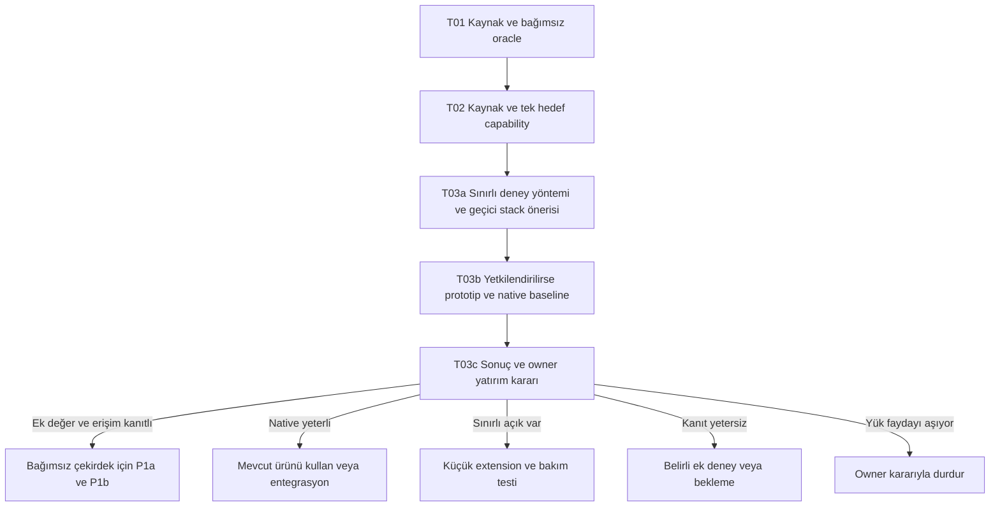

# Güncel ürün yönü — tasarım revizyonu 03

**2026-10-11 / P0 Discovery / runtime yok.** Kullanıcı son evrimin bütün belgelere yansıtılmasını ve eski/güncel yaklaşımın karşılaştırılmasını istedi. Bu kayıt güncel araştırma odağını toplar; bağımsız ürün geliştirme, teknoloji seçimi, ücret veya gerçek hesap erişiminin kabulü değildir. Tam kapsam [full-scope](full-scope.md), P1b kabulü [MVP](mvp.md), gerçekleşmiş ilerleme [status](../delivery/status.md) otoritesindedir.

## Şimdi hangi problemi sınayacağız?

**AI ile konuşulan plan, kullanıcının gerçek seçimi ve hedefte gerçekleşen işlem aynı proje bağlamında ayrılabiliyor mu?** Kullanıcının örneği: dosyalar üretildi ve yükleme önerildi; sonraki sohbet bunu gerçekleşmiş sayabilir, kullanıcı başka yaklaşımı seçmiş olabilir.

Yaşayan karar farkındalıklı hafıza ve otomatik impact tam ürünün merkezinde kalır. Güncel ilk değer testi bu geniş hedefin gözlenebilir bir halkasını sınar: **öneri → somut insan seçimi → artifact → hedef uygulama kanıtı → yeni karara uygunluk → başka oturumda doğru devam**. [GAP sözleşmesi](intent-to-reality-gap.md) ve [Projects karşılaştırması](../discovery/claude-projects-overlap.md) mevcut ürün ilkelerinin açılımıdır.

## Önceki plan ile güncel ilk odak

| Boyut | Önceki geniş geliştirme planı | Güncel ilk doğrulama odağı |
|---|---|---|
| Ana ihtiyaç | Konuşmalardan bilgi/task hafızası ve karar değişince planın etkisi | Hangi öneri seçildi, hangi çıktı gerçekten uygulandı, yeni sohbet hangi gerçek durumdan devam ediyor? |
| Farklılaşma | Karar-aware impact ve otomatik hafıza birlikte | Aynı yeteneklerin kullanıcı seçimi/gerçek uygulama ayrımında ölçülebilir faydası; genel memory özgünlük sayılmaz |
| İlk teslim | P1a çekirdek ardından iki adapter'lı P1b MVP | P0 içinde sınırlı karşılaştırma prototipi önerisi; mevcut P1a/P1b kabulü yerine geçmez |
| Kaynak kapsamı | Çok proje, iki coding yüzeyi, chat import ve MCP | T01 sentetik iki chat; T02 kaynak ve tek hedef fizibilitesi; gerçek erişim yalnız açık izinle |
| Hedef kontrolü | Genel artifact/test/commit/PR kanıtı | Exact hedef/ref/path ve artifact revision; reported/observed/partial/unknown ayrımı |
| Karar takibi | İnsan approval ve versioned canonical karar | Aynı kural; sessizlik/yeni soru/agent özeti insan seçimi sayılmaz |
| Görsel deneyim | Inbox/Board/Graph/Timeline ve sağlık/ayarlar | Kararlar, çıktılar, hedef durumu/bilinmeyenler ve devam önizlemesi; minimal ekran adayı |
| Mimari | Local service, SQLite, modüller ve geniş ADR planı | Aynı sınırlar korunur; bütün modülleri/ekip altyapısını ilk prototipte uygulama zorunluluğu yok |
| LLM/token | Delta/cache, routing, bütçe ve risk approval | Şablon/state/read-back deterministik; gerçek semantik başarı ayrıca izinli model deneyinde |
| Rakip değerlendirmesi | Beads/Cortex/mai-mcp/Tracker/OpenSpec vb. | Havuz korunur; yeni Claude Projects en yakın baseline'lardan biri |
| Başarı | MVP 14 AC, capture/impact/verification ve UX ölçümleri | Yanlış seçildi/yüklendi varsayımı, stale plan, kullanıcı düzeltme/soru/kurulum yükü |
| Devam kararı | Build/extend kapısı vardı; bağımsız çekirdek adaydı | Native kullanım / extension / bağımsız ürün / durdurma sonuçları eşit görünür |
| Gelecek | Ekip, admin, maliyet, sync, entegrasyon ve OSS | Tam kapsamda korunur; kanıt oluşmadan ilk geliştirmeye çekilmez |
| Gerçek durum | Dokümantasyon; runtime yok | Dokümantasyon; runtime hâlâ yok, üstünlük ve talep ölçülmedi |

Bu bir ürün iptali veya bütünüyle farklı ürün kararı değildir. Önceki memory/impact çalışmasının değeri tutulur; rakip örtüşmesi ilk yatırım sorusunu daha somut hale getirir.

## Bağımlılık döngüsü yaratmadan deney sırası

T03a geçici prototype yöntemini seçer; production stack ADR'sini accepted yapmaz. Böylece T03'ü bitirmek için gereken prototipin önce bitmiş T03 istemesi önlenir. Prototip önerisi [mevcut Spike-1 planında](../delivery/spike-1-v1.md) tutulur; ikinci bir v2/v3 plan kopyası yok. T03b henüz yetkilendirilmiş/başlatılmış değildir. Gerçek veri/hesap/model/runner kapıları ayrıca geçerlidir.

## İlk deneyin sınırı ve çıkış kararı

İlk deneyde ayrı typed giriş/fixture, seçimin güvenilir kaynağı, artifact beklenen etkisi, tek hedef read-back, unknown/partial/freshness ve deterministic devam paketi yeterli çekirdek adaylarıdır. Adapter yokken manual import otomatik diye etiketlenmez. Mock adapter geçmesi gerçek provider erişimini kanıtlamaz; bütün bağımsız işleri belirsiz upload yüzünden bloke etme.

Minimum kanıt: GAP-01–10 oracle, yanlış kabul/uygulama/verified ataması yok; kritik karar/unknown aktarımı doğru; same-task native baseline ve kullanıcı düzeltme/soru/setup süresi. Fresh-session gerçek LLM deneyi yapılmazsa yalnız paket sözleşmesi test edilmiş olur; hafıza başarısı not_run. Örneklem veya hesap erişimi yoksa superiority sonucu yok.

- **Build:** Gözlem mümkün, kritik ayrımlar doğru ve native/extension'a göre ek fayda yönetim/bakım yükünü karşılıyor. Nihai trade-off owner'a gider.
- **Extend:** Native ürün temel ihtiyacı çözüyor; dar tamamlayıcının teknik/lisans/bakım yolu uygulanabilir.
- **Native kullan:** Mevcut ürün yeterli; ayrı uygulama yönetim yükü ekliyor.
- **Ek deney / bekle:** Erişim veya karşılaştırma eksik; başarısız ürün veya başarı diye sonuçlandırma.
- **Durdur:** Ölçülen kullanıcı faydası maliyet/yükü karşılamıyor ve uygulanabilir başka yön bulunamıyor; gerekçe ve owner kararı kaydedilir.

Projenin bırakılması, yeni MVP veya prototip execution talimatı bu belgeyle kendiliğinden oluşmaz. Sayısal ROI ve takvim hedefi seçilmedi. Öneri “daha çok doküman” üretmek değil, sonraki yetkili uygulama talebinde T01'den başlayarak bu kanıtı elde etmektir.

## Sürümün anlamı

**Tasarım revizyonu 03, ürün v3 değildir.** Tek güncel belge seti main'de; önceki içerik commit geçmişinde. [Sürüm ve otorite düzeni](../governance/versioning.md) ürün release'i, DB migration'ı, event şeması ve task snapshot'ını ayırır.
