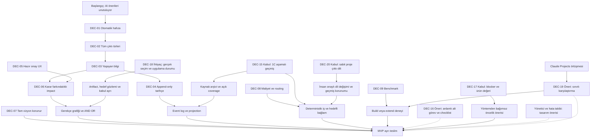

# Karar haritası

**Accepted intent:** Kullanıcının açık yönlendirmesi. **Proposed:** Bu derlemedeki teknik çözüm; kabul edilmiş teknoloji kararı değildir. **Historical:** Önceki düşünce, bugünkü talimat değil. Kaynak evreleri [evrim kaydında](../discovery/evolution.md).

| ID | Karar / statü | Gerekçe ve etkisi |
|---|---|---|
| DEC-01 | Accepted intent: doğal konuşmadan otomatik proje hafızası | Elle task/DoD yazma yükünü azaltır; CAP/APR gerektirir |
| DEC-02 | Accepted intent: fikir, prompt ve belge talimatları da kapsamda | Yalnız task tablosu yetersiz; tipli kayıt gerekir |
| DEC-03 | Accepted intent: yaşayan aktif bilgi + erişilebilir tarihçe | Eski fikir kalabalığı ve unutmayı birlikte çözer |
| DEC-04 | Accepted intent: geçmişi silmeden yeni olayla düzeltme | AUD-01; önceki “undo” ifadesi history rewrite anlamına gelmez |
| DEC-05 | Accepted intent: onay kabul; elle kart yazma zorunluluğu yok | Hazır çoktan seçmeli ve toplu review |
| DEC-06 | Accepted intent: değişen kararın görev etkisini yönet | Gerekçe grafiği, AND/OR ve impact triggers |
| DEC-07 | Accepted intent: tam kapsam korunsun, MVP ayrı yazılsın | Son daraltma ürün vizyonunu değiştirmez |
| DEC-08 | Accepted intent: basit işlere insan/otomasyon etiketi | Work class ve executor ayrı eksenler |
| DEC-09 | Accepted intent: benchmark ve yasal esinlenme | Kod alımı otomatik karar değildir |
| DEC-10 | Accepted intent: yeni ad, ayrı private repo ve profesyonel devir | Decivora çalışma adı; public ve lisans ayrı karar |
| DEC-11 | Proposed: SQLite canonical state + event projection | Markdown çalışma planı bootstrap; runtime store değil |
| DEC-12 | Proposed: kendi domain/impact çekirdeği, adapter üzerinden yeniden kullanım | Build/extend deneyi sonrası ADR kesinleşir |
| DEC-13 | Proposed: yerel tek servis + TypeScript/React | Runtime sürümleri ve UI framework seçimi açık |
| DEC-14 | Proposed: AGPLv3 adayı; Apache-2.0 alternatif | Public release öncesi lisans/katkı hakları kontrolü |
| DEC-15 | Accepted intent: 1C, izinli/erişilebilir geçmişi aşamalı işle; aktif işleri öne al | Kaynak korunur, hedefli context kullanılır; 1A/1B alternatifleri ve gerekçe [Q07 kaydında](../delivery/decision-brief.md). Egress/harcama veya sınırsız saklama onayı değildir |
| DEC-16 | Proposed: anlamlı alt görevler + checklist; isteğe bağlı bölme önizlemesi | Kullanıcının Q08 fikrinin tasarımı; ayrı AC/kanıt ve parent takibi. Varsayılan otomatik bölme henüz kabul edilmedi |
| DEC-17 | Accepted intent: blocker ve downstream gecikmesini önce ele al; Product Owner bakışıyla çevik ilerle | Q09 yanıtı; değer/hedef/riskle açıklanan çözüm sırası, Scrum kaynaklı inceleme/uyarlama. [Akış sözleşmesi](priority-and-flow.md) teknik öneri; bildirim kanalı ve Sprint takvimi ayrı |
| DEC-18 | Accepted problem intent: gerçek insan seçimi ve dosyanın hedefe uygulanması kaybolmasın | 2026-10-11 kullanıcı örneği; generated/sessizlik yükleme veya kabul kanıtı değildir. [GAP sözleşmesi](intent-to-reality-gap.md); mekanizma teknik öneri |
| DEC-19 | Proposed investment path: ilk sınırlı gerçekleşme/devam deneyi + native karşılaştırması | [Güncel yön](current-direction.md); build/extend/native/durdur sonuçları açık. Son belge güncelleme isteği runtime yatırımını kabul etmiş sayılmaz |
| DEC-20 | Accepted intent: Q12-A, proje çıktı dili sabit; dil değişimi insan seçimiyle | 2026-10-11 doğrudan “a ile devam et” yanıtı; başka session dili yalnız öneri, eski notlar otomatik çevrilmez. [Seçenek/gerekçe ve kabul](language-and-localization.md#q12--karma-projede-çıktı-dili-değişimi); detector/faz ayrıntıları öneri |

## Kararların neden ve nasıl alındığını bulma

**DEC-17 atıf açıklaması (2026-10-10):** Blocker/dependency takibi yöntemden bağımsızdır. Scrum Alliance, seçilmiş uygulama kaynağıdır; PMI tek bir alternatif yöntem değildir. Kullanıcının ürün değeri/blocker önceliği kararı korunur. [Yönetim planındaki karşılaştırma](../delivery/project-management.md) ürün çekirdeği, bizim çalışma yöntemimiz ve müşterinin sürecini ayırır. Farklı yaklaşımlara uyarlanabilir ürün konumlandırması öneridir; Scrum/PMBOK uyum denetimi veya ek yöntem modları kabul edilmiş sayılmaz.

| Karar türü | Ayrıntılı gerekçe kaydı |
|---|---|
| Ürün fikrinin değişimi | [Evrim hikâyesi](../discovery/evolution.md): önceki yaklaşım ve kullanıcı düzeltmeleri |
| Kullanıcının seçtiği alternatifler | [Karar hazırlığı](../delivery/decision-brief.md): örneğin Q07/1A–1B–1C, tercih ve bedel |
| Teknik mimari önerileri | [ADR dizini](../architecture/adr/README.md): bağlam, alternatif, karar statüsü ve kabul kapısı |
| Scrum/ürün önceliği | [DEC-17 gerekçe eşlemesi](../delivery/project-management.md#dec-17--kaynak-yaklaşımı--tercih--gerekçe): doğrudan kaynak bölümü, bizim tercihimiz, neden, sınır ve doğrulama |
| Yönetim/operasyon ve lisans ayrımı | [Yönetim gerekçesi](administration-and-operations.md#neden-bu-tasarım) ve [dört ayrı karar](../governance/licensing.md#kaynak-kodu-kurulum-erişim-ve-paket-ayrı-kararlar); ayrıntılı roller ve ticari model öneri, seçilmiş lisans değil |

Gerekçe standardı: tetikleyen ihtiyaç/kaynak → tarih ve karar sahibi → gerçekten değerlendirilen alternatifler → tercih ve neden → bedel/risk → etkilenen belge/görev → doğrulama ve yeniden değerlendirme koşulu. Kaynak yaklaşımı, bizim çıkarımımız ve kullanıcının kabulü ayrı tutulur. Önceki bir kararda bu bilgi kayıtlı değilse sonradan gerekçe uydurulmaz; eksiklik veya sonradan yapılan değerlendirme açık etiketlenir. Bütün tarihsel kararların aynı ayrıntı düzeyinde olduğu iddia edilmez.

## Geçmişte değişen yaklaşımlar

İlk manuel Markdown takip yaklaşımı kullanıcıya her oturumda dosya okutma/güncelletme yükü getirdiği için runtime yönü değişti. Markdown bu repo için geçici ürün planı olarak kullanılır. Yalnız Beads UI kurma fikri tüm vizyonun yerine geçmez; benchmark/pilot seçeneğidir. Az sayıda özellik üzerinden ürün kapsamını daraltma önerisi kullanıcı tarafından düzeltilmiştir; dar akış artık P1a/MVP sınırıdır. İlk “az onay” vurgusu, kullanıcının “hazır onay olur, elle yazmak istemiyorum” düzeltmesiyle güncellenmiştir.

## DEC-17 takip kaydı — 2026-10-10

**Accepted intent:** kullanıcı biriken/ilerlemeyen 40+ task için açıklanabilir ranking, downstream etki açıklaması, next actionable ve insan/önceden yetkili üst agent kontrolündeki board yaklaşımının dokümanlara kaydedilmesini istedi. Bu takip, DEC-17'nin 2026-10-09 kabul tarihini değiştirmez; kodlama veya otonom plan değişikliği onayı değildir.

**Proposed:** [ranking sözleşmesindeki](priority-and-flow.md) faktörler ve teknik tasarım; MVP deterministik öneri/board, P2 context-aware scoring/simülasyon/UX ayrımı feasibility ile kesinleşecek. Ağırlıklar, aging eşikleri ve kritik yol tahmin yöntemi henüz seçilmedi. Rank önerisi canonical priority'den ayrı; scope/value ve korunan kararlar insan Product Owner'da. Seçenekler, bedeller ve yeniden değerlendirme kapısı aynı sözleşmede; görevler T11c/T20e/T24d ve önerilen T26b. Kaynak, bu tarihli doğrudan kullanıcı talebidir; önceki konuşmanın eksik önizlemesinden ek kabul çıkarılmadı.
