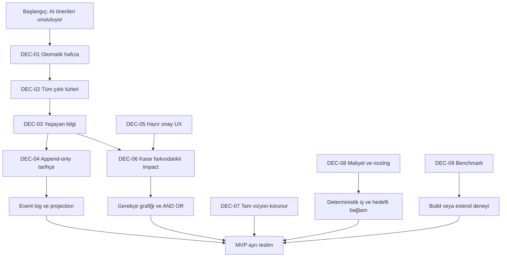

# Karar haritası

**Accepted intent:** Kullanıcının açık yönlendirmesi. **Proposed:** Bu derlemedeki teknik çözüm; kabul edilmiş teknoloji kararı değildir. **Historical:** Önceki düşünce, bugünkü talimat değil. Kaynak evreleri [evrim kaydında](../discovery/evolution.md).

| ID | Karar / statü | Gerekçe ve etkisi |
|---|---|---|
| DEC-01 | Accepted intent: doğal konuşmadan otomatik proje hafızası | Elle task/DoD yazma yükünü azaltır; CAP/APR gerektirir |
| DEC-02 | Accepted intent: fikir, prompt ve belge talimatları da kapsamda | Yalnız task tablosu yetersiz; tipli kayıt gerekir |
| DEC-03 | Accepted intent: yaşayan aktif bilgi + erişilebilir tarihçe | Eski fikir kalabalığı ve unutmayı birlikte çözer |
| DEC-04 | Accepted intent: geçmişi silmeden yeni olayla düzeltme | AUD-01; önceki “undo” ifadesi history rewrite anlamına gelmez |
| DEC-05 | Accepted intent: onay kabul; elle kart yazma zorunluluğu yok | Hazır çoktan seçmeli ve toplu review |
| DEC-06 | Accepted intent: değişen kararın görev etkisini yönet | Gerekçe grafiği, AND/OR ve impact triggers |
| DEC-07 | Accepted intent: tam kapsam korunsun, MVP ayrı yazılsın | Son daraltma ürün vizyonunu değiştirmez |
| DEC-08 | Accepted intent: basit işlere insan/otomasyon etiketi | Work class ve executor ayrı eksenler |
| DEC-09 | Accepted intent: benchmark ve yasal esinlenme | Kod alımı otomatik karar değildir |
| DEC-10 | Accepted intent: yeni ad, ayrı private repo ve profesyonel devir | Decivora çalışma adı; public ve lisans ayrı karar |
| DEC-11 | Proposed: SQLite canonical state + event projection | Markdown çalışma planı bootstrap; runtime store değil |
| DEC-12 | Proposed: kendi domain/impact çekirdeği, adapter üzerinden yeniden kullanım | Build/extend deneyi sonrası ADR kesinleşir |
| DEC-13 | Proposed: yerel tek servis + TypeScript/React | Runtime sürümleri ve UI framework seçimi açık |
| DEC-14 | Proposed: AGPLv3 adayı; Apache-2.0 alternatif | Public release öncesi lisans/katkı hakları kontrolü |
| DEC-15 | Accepted intent: 1C, izinli/erişilebilir geçmişi aşamalı işle; aktif işleri öne al | Kaynak korunur, hedefli context kullanılır; 1A/1B alternatifleri ve gerekçe [Q07 kaydında](../delivery/decision-brief.md). Egress/harcama veya sınırsız saklama onayı değildir |
| DEC-16 | Proposed: anlamlı alt görevler + checklist; isteğe bağlı bölme önizlemesi | Kullanıcının Q08 fikrinin tasarımı; ayrı AC/kanıt ve parent takibi. Varsayılan otomatik bölme henüz kabul edilmedi |

## Geçersizleşen önerilerin kaydı

İlk manuel Markdown takip yaklaşımı kullanıcıya her oturumda dosya okutma/güncelletme yükü getirdiği için runtime yönü değişti. Markdown bu repo için geçici ürün planı olarak kullanılır. Yalnız Beads UI kurma fikri tüm vizyonun yerine geçmez; benchmark/pilot seçeneğidir. Az sayıda özellik üzerinden ürün kapsamını daraltma önerisi kullanıcı tarafından düzeltilmiştir; dar akış artık P1a/MVP sınırıdır. İlk “az onay” vurgusu, kullanıcının “hazır onay olur, elle yazmak istemiyorum” düzeltmesiyle güncellenmiştir.
