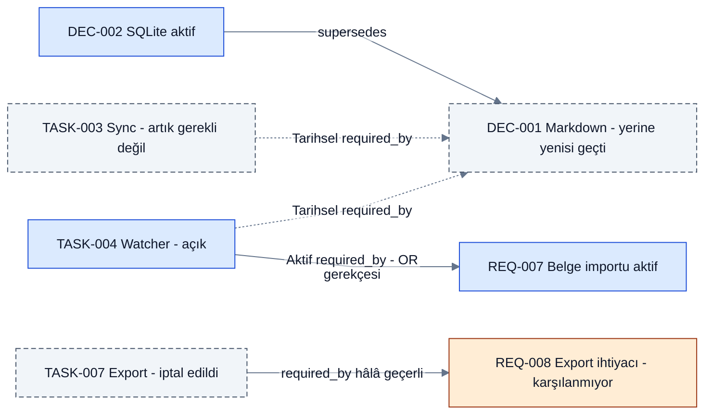
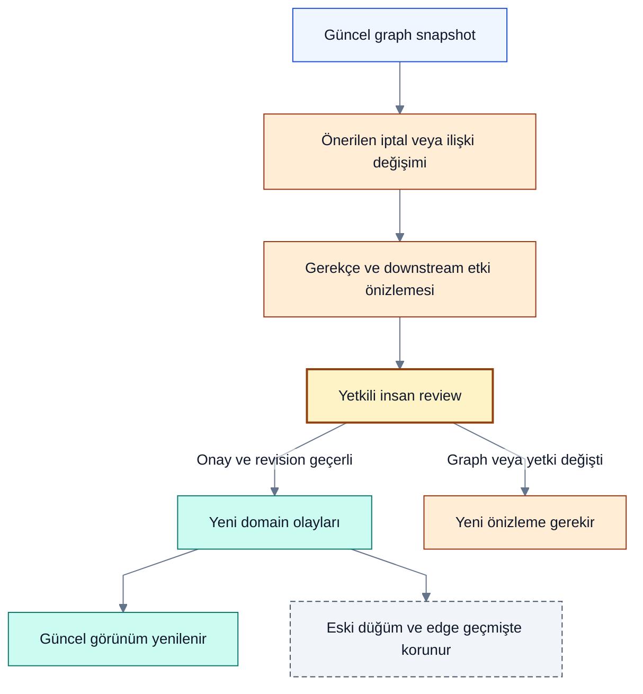

# Görev bağlamı, ilişkiler ve iptalin görsel anlatımı

> [!NOTE]
> **Şema anahtarı:** mavi kaynak/işleme · sarı yetki/onay · turkuaz kalıcı bilgi · yeşil kanıt alanı · turuncu belirsizlik · gri tarihçe · mor öneri/gelecek. Renkler implementasyon veya test başarısı değildir. [Görsel sözlük](../quality/visual-documentation.md).

**Statü: UI davranış tasarımı; canlı ekran veya test edilmiş prototip değil.** Graph, Board, Inbox ve Timeline aynı record/revision'dan beslenir. [Domain semantiği](../architecture/domain-model.md) ve [impact kuralları](../architecture/reconciliation-impact.md) görsel tercihlerden üstündür. Q04 yanıtı alındı: varsayılan güncel işler ve seçili işin bağlamıdır. Kullanıcı ayrıca fikirlerin olgunlaşma hikâyesi ile iş başına AC/DoD/test görünürlüğünü istedi; [bağlam ve kabul dosyası](task-context-and-acceptance.md) bunu detaylandırır.

## Bir görevi seçince ne görünür?

Merkezde seçili görev; çevresinde onu gerekli kılan karar/gereksinimler, başlamasını engelleyen işler, ürettiği artifact'ler, kanıtlar ve kaynaklar. Sağ ayrıntı alanı başlık, durumların ayrı eksenleri, gerekçe, kaynak span'ı, AC, son değişiklik ve onaylayan bilgisi taşır. “Bu iş neden var?”, “İptal edilirse ne etkilenir?” ve “Neden hâlâ gerekli?” hazır görünümler olabilir.

Bir çizgi yalnız dekor değildir: ilişki türü, yön, revision, kaynak, geçerlilik ve onay statüsü incelenebilir. `required_by` işin gerekçesini; `depends_on` yürütme önkoşulunu anlatır. Aynı çizgi tarzı veya aynı “bağlı” etiketi altında birleştirilmez. Çoklu gerekçe AND/OR grubu olarak görünür; tek tek okların bütün mantığı anlattığı varsayılmaz.

| Görünüm | Kullanım / önerilen davranış |
|---|---|
| Güncel | Aktif proje işlerini öne çıkar; seçili işin açıklayıcı geçmişini aç; gizlenmiş ama erişilebilir eski kayıtları filtre kontrolünden getir |
| Geçmiş dahil | İptal, obsolete ve superseded kayıtları aynı bağlamda statüleriyle göster |
| Etki önizlemesi | Mevcut ve önerilen durum yan yana; öneri ayrı görsel katman; onaylanana kadar gerçek state değişmez |
| Belirli an | Seçilen domain sequence/snapshot'taki durum; salt okunur. Tarih seçimi eski yetkileri geri vermez |

Kabul edilen başlangıç görünümü güncel odak + seçili görevin açıklayıcı bağlamıdır. Kullanıcı isterse tüm erişilebilir geçmişi sürekli açabilir. Tam grafiği ilk anda yüklemek gerekmez: seçili task çevresi, kademeli genişletme, tür/ilişki filtresi ve açık `daha fazla` kontrolü. Kırpılmış veya yetki nedeniyle eksik graph'tan “etki yok” sonucu çıkarılmaz. Yetkisiz kayıt adedi/başlığı filtre özetinde de gösterilmez.

## Görev durumlarının görsel sözlüğü

Renk yardımcıdır; **ikon + metin etiketi + ayrıntı** birlikte kullanılır. Çarpı tek başına anlam taşımaz; hatalı test ile iptali karıştırmamalı. Tamamlanma ve bugün kullanılabilirlik ayrı rozetlerdir.

| Domain anlamı | Düğümde gösterim önerisi | Bağlantıların davranışı |
|---|---|---|
| Aktif/açık görev | Normal kart, `Açık` veya `Çalışılıyor` | Geçerli ilişkiler etiketli düz çizgi |
| Cancelled | Durdurma ikonu + `İptal edildi`; gerekçe ve aktör/tarih | İlişkiler kendiliğinden silinmez veya invalid yapılmaz; komşu işlerin etkisi ayrıca incelenir |
| Obsolete | Arşiv/uygulanamaz ikonu + `Artık gerekli değil` | Hangi gerekçenin değiştiği gösterilir; geçmiş görünür kalır |
| Superseded karar/kayıt | `Yerine yenisi geçti` + yeni kayıt bağlantısı | Yeni → eski `supersedes` oku; eski gerekçe yolları tarihsel olarak görülebilir |
| Implemented iddiası | `Uygulandı deniyor — doğrulama bekliyor` | Kanıt yokken yeşil tamamlandı göstergesi yok |
| Verified tamamlanma | Onay işareti + `Doğrulandı`; AC/artifact revision | Sonradan obsolete olsa bile geçmiş başarı korunur; güncel uygunluk ayrıca gösterilir |
| Failed / stale evidence | Uyarı ikonu + `Doğrulama başarısız` / `Kanıt eskidi` | Kayıt iptal edilmiş sayılmaz; yeni kanıt veya yeniden çalışma gerekir |
| Proposed değişiklik | Çerçeveli proposal rozeti ve `Onay bekliyor` | Önerilen edge/state ayrı katmanda; canonical graph'a karışmaz |

Görev başlığının üstünü çizmek zorunlu değil: uzun başlığın okunabilirliğini bozabilir. Kompakt listede strike-through kullanılacaksa yanında durum metni kalır. Grafikte ilk öneri okunur başlık + statü rozeti + hafif soluk karttır. Erişilebilir kontrast korunur; klavye ile aynı bilgi liste/tablo alternatifinden okunur.

## Görev iptali, ilişki kaldırma ve silme farklıdır

**Görev iptali:** `task.cancelled` yeni domain olayıdır; görev ID'si, geçmiş onaylar, kanıt ve ilişkiler korunur. “A görevi iptal edildi” demek A'yı gerektiren kararın geri çekildiği anlamına gelmez. Geçerli gereksinim hâlâ karşılanmıyorsa bu açık risk/blocker olarak görünür; sistem görevi başka şekilde yerine getirme veya gereksinimi değiştirme kararı ister.

**İlişkinin sona ermesi:** Kullanıcı “bu iş artık bu karara bağlı değil” dediğinde versioned `relationship.ended` önerisi oluşur. Onaydan sonra current projection o edge'i aktif ilişki olarak kullanmaz; geçmiş edge silinmez. Geçmiş/etki görünümünde kesikli çizgi + `İlişki sona erdi` etiketi, gerekçe ve kapanış olayı görünür. Çizgi üzerinde küçük çapraz işaret isteğe bağlı görsel yardımcı olabilir; tek anlam taşıyıcısı olamaz. Yeni ilişki varsa eski ve yeni edge ID/revision bağı korunur.

**Hatalı eski ilişkiyi düzeltme:** `relationship.invalidated` eski iddianın yanlış bulunduğunu kaydeder. “Önceden doğruydu, artık uygulanmıyor” ile “yanlıştı” aynı olay değildir. Her iki durumda da normal agent eski event'i fiziksel silmez. Geri alma, güncel şartlar ve etkiler kontrol edilerek yeni ilişki revision'ı/compensating event oluşturur; eski bitiş zamanı silinmez.

**Görünüm filtresi:** Ekrandan gizlemek domain'i değiştirmez. **Privacy purge:** ayrı yetkili veri silme akışıdır; iptal düğmesi bunu yapmaz. Eksik/redakte kaynak minimal tombstone ile açıklanır; özel içerik korunmaz diye tarihçenin kusursuz yeniden üretilebilir olduğu iddia edilmez.

## Sentetik örnek: bir karar değişirken iki işin ayrılması

Aşağıdaki bütün işlemler, örnekte insan onayından geçmiş varsayılır. Bu diyagram bir uygulama ekranı değildir. Oklar domain yönünü korur: task → gerekçe; yeni karar → superseded karar.

Diyagramdaki tarihsel required_by etiketi eski kararın artık geçerli olmadığını anlatır; tek başına relationship.ended olayı üretildiğini göstermez. İlişki kaydı hâlâ asserted iken hedef karar superseded olabilir; edge detayında ilişki durumu ile hedefin durumu ayrı gösterilir.

Örnek özellikle iptal ile gerekçe geçersizliğini ayırır. TASK-007 iptal edilse de gereksinim açık kalabilir. TASK-004'ün eski karar bağlantısı tarihsel görünürken alternatif OR gerekçesi devam ettiği için iş açık kalır. TASK-003'ün obsolete olması “başarıyla tamamlandı” şeklinde gösterilmez.

## Etkileşim ve kabul senaryoları

Q09 için `Engelleniyor` ve `Başka işleri engelliyor` ayrı rozetler önerilir. Güncel depends_on yolunda başlangıç/bitiş koşulu, kanıt ve çözüm adımı görünür. Aynı downstream bir kez sayılır; ek gate açıkken bütün işlerin hemen hazır olacağı söylenmez. part_of/required_by veya plan sırası blocker oku değildir. Tarihsel iptal ilişkileri bugünkü engel sayısını şişiremez. ACL ve coverage korunur; board/inbox/graph aynı revision'ı kullanır, bilgi klavye/liste yoluyla da erişilebilir. [FLOW-01–08](priority-and-flow.md) T11c/T20e/T24d'de planlıdır; henüz test edilmedi.

Kart seçimi tüm görünümlerde aynı revision'ı açar. Edge seçimi neden/tür/kaynak/geçerlilik panelini açar; dokunmatik ve klavye alternatifi bulunur. Graph sürüklemek yalnız layout'u değiştirir; iş durumunu veya ilişkiyi değiştirmez. “İlişkiyi kaldır” ve “İşi iptal et” farklı, gerekçeli preview açar. Tarihsel görünümden doğrudan güncel veriye yazılmaz; önce mevcut sürüme geçilir.

| ID | Kabul kriteri | İş |
|---|---|---|
| GUX-01 | Task seçilince gerekçe, bağımlılık, kaynak ve kanıt ayrıdır; AND/OR grubu okunur | T20b |
| GUX-02 | Task iptali edge silmez; geçerli gereksinim karşılanmıyorsa açık gösterir | T13b/T20b |
| GUX-03 | Ended ve invalidated edge ayrı etiket/gerekçe taşır; current traversal kullanmaz; history replay korur | T11b/T20b |
| GUX-04 | Obsolete/cancelled/verified ve başarısız test renk olmadan ayırt edilir | T20b |
| GUX-05 | Önizleme onaydan önce current state'i değiştirmez; stale graph/izin eski onayı reddeder | T13b |
| GUX-06 | Filtre/kısmi graph/ACL saklı kayıtları silinmiş saymaz; count veya başlık sızdırmaz | T18b/T20b |
| GUX-07 | Klavye/liste alternatifi aynı ilişki bilgisine erişir; drag domain değişimi yapmaz | T20b |
| GUX-08 | Undo yeni event üretir; history filtresi eski revision'ı korur; Board/Graph/Timeline aynı sonucu gösterir | T13b/T20b |

Henüz test edilmedi. Q04 görünüm tercihi alındı; T19/T20'de sentetik etkileşimli prototip ve gerçek tıklama/klavye kontrolü gerekir. Kaynak: [owner karar kuyruğu](../delivery/decision-brief.md).

## Artifact ve hedefte gerçekleşme görünümü

[Domain uygulama kaydı](../architecture/domain-model.md#artifact-ve-hedef-uygulama-gözlemi) generated artifact'i, uygulama expectation'ını, hedef gözlemini ve AC assessment'ını ayrı bağlar. İlk prototip liste/ayrıntı olabilir; bütün graph UI uygulaması ön koşul değildir.

Tam graph'ta önerilen görsel ayrım: artifact node'u **üretildi**, target assessment **bildirildi / gözlendi / kısmi / bilinmiyor / stale**; acceptance ayrı rozet. Observation edge'i exact ref/snapshot ve kaynak kapsamını gösterir, karar approved edge'iyle aynı semantik değildir. Aynı artifact çok hedefe uygulanabilir; bir hedefin başarı rengi diğerlerine taşınmaz. Eski artifact uygulaması tarihçede durur, yeni karara uygun değilse current uyarısı alır. Renk yanında metin/ikon gerekir; bilinmeyene iptal çarpısı konmaz. Mevcut iptal ve ended/invalidated kuralları değişmez; GAP-04/05/06/10 bu görünümün planlı oracle'ıdır.
