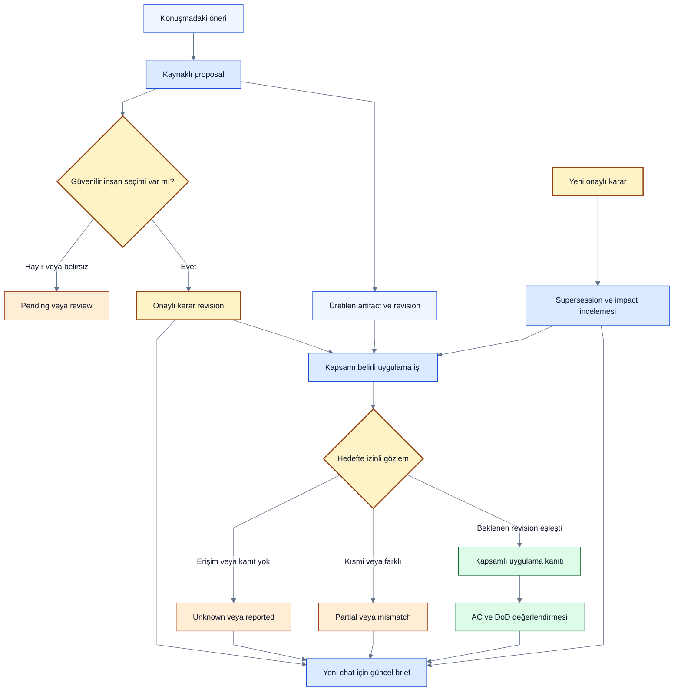
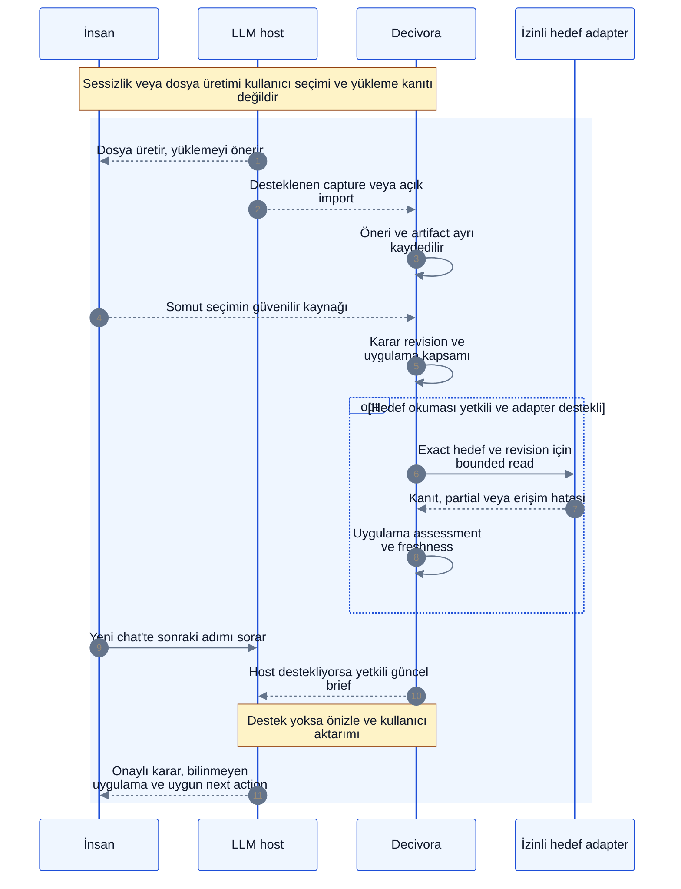

# Konuşulan plan ile gerçekleşen iş arasındaki boşluk

> [!NOTE]
> **Şema anahtarı:** mavi kaynak/işleme · sarı yetki/onay · turkuaz kalıcı bilgi · yeşil kanıt alanı · turuncu belirsizlik · gri tarihçe · mor öneri/gelecek. Renkler implementasyon veya test başarısı değildir. [Görsel sözlük](../quality/visual-documentation.md).

**2026-10-11 — Kullanıcının doğrudan bildirdiği problem; önerilen ürün sözleşmesi. Uygulama ve bağımsız reproduction yok.** Kullanıcı Claude ile konuşurken üretilen dosyaları GitHub'a veya lokale yüklemesi isteniyor. Konuşma sürüyor, fakat yükleme ve yaklaşım seçimi gözlenmeden sonraki öneriler bunlar gerçekleşmiş gibi ilerleyebiliyor. Bu, tüm Claude sürümlerinde kanıtlanmış kusur veya yaygınlık ölçümü değildir.

Mevcut capture/commitment/verification ayrımının somut açılımıdır; yeni engine veya ana scope eklemez. [ENG-03/06/07/08/10](../architecture/engines.md), [onay UX](approval-ux.md) ve [devam paketi](resume-package-and-memory.md) birlikte uygular.

## 1. Kullanıcının ihtiyacı ve güven kuralı

Kullanıcı “Ne konuşmuştuk?” yanında **“Neyi seçtim; bunun ne kadarı gerçekten yapıldı; hangi kanıtla biliyoruz?”** sorularının cevabını ister. Yalnız transcript özeti, konuşmada önerilen gelecek zamanı gerçekleşmiş geçmişe dönüştürebilir. Daha fazla reasoning bu eksik gözlemin yerini tutmaz.

Dört ayrı eksen tutulur; aşağıdaki terimler yeni bir tekil task state enum'u değildir:

| Eksen | Örnek durumlar | Geçiş için gereken |
|---|---|---|
| Öneri / kullanıcı kararı | proposed, pending, accepted, rejected, superseded | İnsan kaynağı/kimliği, seçilen somut kapsam ve revision; belirsiz cevap review |
| Üretilmiş artifact | expected, generated, inaccessible, superseded | Artifact kimliği/sürümü, erişilebilir kaynak; yalnız başlık içerik kanıtı değil |
| Hedefe uygulama / teslim | not_observed, reported, pending, observed, failed, partial, unknown | Tam hedef ve beklenen revision'a bağlı gözlem veya açık insan beyanı |
| Kabul / uygunluk | not_run, verified, failed, stale, blocked | Versioned AC/DoD ve kapsadığı artifact/karara bağlı kanıt |

“Devam edelim” her önerinin kabulü değildir. “Yükle” yükleme emri olabilir; gerçekleşmiş işlem değildir. Kullanıcının gerçek “B'yi seçiyorum” ifadesi doğru kimlik/kapsam ile karar kanıtıdır; agent'ın bunu kullanıcı seçmiş gibi özetlemesi değildir. Doğrudan güvenilir insan eylemi mevcut onay policy'sine göre kaydedilir; belirsiz veya ithal kaynakta aday/review gerekir. Her açık insan seçimini tekrar sorarak gereksiz onay üretme.

“Dosyayı oluşturdum” mesajının artifact'i yoksa generation claim'dir. Gerçek downloadable artifact üretildiyse generated gözlemi olabilir; bu yine GitHub/local kurulum değildir. Kullanıcı “Yükledim” derse reported tutulabilir; otomatik read-back ile aynı kanıt sınıfı değildir. Manuel acceptance policy'si bunu yeterli sayıyorsa kabul dayanağı açıkça human_attestation olur; otomatik verified etiketi uydurulmaz.

## 2. Örnek proje akışı

1. Claude bir mimari önerir ve üç Markdown dosyası üretir. Öneri ve dosyalar kaynaklarıyla kaydedilir. GitHub'a yükleme ayrı takip adaydır; kullanıcının seçimi/taahhüdü bilinmiyorsa committed backlog'a kendiliğinden dönüşmez.
2. Kullanıcı konuşmaya devam eder. Yükleme sinyali gelmediği için durum **“Hedefte gözlenmedi; yüklenmediği de kanıtlanmadı.”** kalır. Sessizlik, yeni soru, indirme veya clipboard yükleme kanıtı değildir.
3. Kullanıcı başka depolama yaklaşımını seçer. Kabul edilmiş yeni karar eski öneri/artifact ilişkisine supersession/impact adayı üretir. Henüz yüklenmemiş eski dosyalar yeni mimari için kurulmuş kabul edilmez; tarihsel artifact silinmez.
4. Yeni chat'te “Sırada ne var?” denir. İzinli güncel brief, seçilen kararı, yükleme bilinmeyenini, değişen gereksinimleri ve hazır next action'ı birlikte verir.
5. Sonraki iş bu dosyaların hedefte bulunmasına gerçekten bağımlıysa önce güvenli gözlem veya odaklı insan sorusu gerekir. Bağımsız işler bu belirsizlik yüzünden durdurulmaz.

Örnek kısa brief:

> SQLite yaklaşımı seçildi. Önceki Markdown taslakları üretildi; hedef repository'ye uygulandıkları gözlenmedi. Senkronizasyon taslağı yeni karar için geçerli değil. Mevcut repository doğrulanmadan migration hazır varsayılmamalı. İzinli hedef kontrolü veya dosya durumunun kullanıcı tarafından belirtilmesi gerekiyor.

Bu metin sentetik örnektir; gerçek kullanıcının repository durumuna ilişkin iddia değildir.

## 3. Uygulama kanıtı ve hedef kimliği

Önerilen takip kaydı task/proposal/decision/artifact/source revision'larını, expected effect'i, hedef türü ve kimliğini, sponsor/executor'ı, izin/policy revision'ını ve kapsamı taşır. Kanıt en az observer türü, gözlem zamanı, yöntem, hedef ref/snapshot, sonuç ve coverage içerir. Secret veya raw transcript operational log'a yazılmaz.

| Hedef | Anlamlı gözlem | Kanıtlamadığı |
|---|---|---|
| Local dosya | İzinli exact path'te read/stat, beklenen içerik/hash ve gözlem zamanı | Başka makinede bulunma, git commit veya çalışır entegrasyon |
| GitHub | İzinli owner/repo + branch/ref + path + commit SHA üzerinden içerik karşılaştırma | PR merge, default branch'e uygulama veya deploy; başka branch aynı değildir |
| PR / branch | PR head ve ilgili diff/snapshot | Hedef branch'e merge; merge ayrı gözlemdir |
| Deploy / config | İzinli ortam ve release/config kimliğine bağlı read-back | Her acceptance criterion'ın geçmesi |

Exact eşleşme uygun değilse semantic/content validation ayrı tanımlı verifier gerekir. İsim benzerliği veya embedding uygulama kanıtı değildir. Üç dosyanın ikisi eşleşirse partial; eski revision eşleşirse current verified değil. İşlem response'u kaybolduğunda unknown tutulur; yeniden kör yazmak yerine idempotency/read-back kullanılır. Bir defa mevcut olduğu gözlenen dosya sonsuza kadar güncel sayılmaz; branch/path/decision/AC değişimi ve coverage kesintisi freshness yeniden değerlendirmesi ister. Permission denied veya erişilemeyen hedef missing demek değildir.

Tasarımdaki verification, izin verilmiş **okuma** ile başlayabilir; dosyaları otomatik yükleme/yazma, verifier komutu çalıştırma veya yeni hesabı bağlama yetkisi çıkarmaz. Host'tan bütün transcript/artefact'lere erişim varsayılmaz; capability raporu desteklenmeyeni unknown/manual fallback olarak gösterir.

## 4. Kapalı geri bildirim döngüsü

Diyagramlar önerilen akışı anlatır; çalışan capture/delivery/verification entegrasyonu değildir. Context teslimi, alıcı LLM'nin bunu doğru kullanmasını garanti etmez; fresh-session deneyinde ayrıca ölçülür.

## 5. Sorular, token ve yönetim yükü

Soruyu her mesajda sormak yerine unresolved takip kaydı korunur; yeni sinyal veya ilgili işin ön koşulu olduğunda tekrar değerlendirilir. “Bu adım üç dosyanın hedefte bulunmasına bağlı; yükleme durumunu doğrulayalım mı?” somut sorudur. Önerilen eylemler: **İzinli kontrol / Yükledim, kanıt ekle / Henüz uygulamadım / Bu öneriyi seçmedim / Ertele**. Sayısal hatırlatma aralığı, bildirim policy'si ve varsayılan auto-check henüz seçilmedi; sessiz otomasyon onayı yok.

Hash/ref karşılaştırması, idempotency, state geçişi ve güncel brief şablonu deterministik yapılabilir. Yeni anlam çıkarımı yalnız gerekli bounded delta için model adayıdır; her chat'te tam geçmiş reasoning yok. Recheck event-driven ve ihtiyaç anında, cache snapshot/freshness ile; dış API rate/read/byte limitleri de geçerli. Periyodik polling sıklığı provider capability ve ölçümden sonra seçilir.

[Riskli token plan onayı](token-risk-and-approval.md) yeniden analiz/fan-out için koruma sağlar; **yüklemenin gerçekleşip gerçekleşmediğine kanıt sağlamaz**. Decivora'nın kontrol ettiği çağrı bütçesi ile bağımsız Claude/Codex oturumunun tüketimi ayrıdır. İlk hedef az tokenla daha fazla doğrulanmış bağlam; düşük maliyet adına unknown'ı done'a çevirmek değildir.

## 6. Planlı kabul ve karşılaştırma

Bütün senaryolar **not_run**. T01 oracle'a, T14/T18/T20 çekirdeğe ve T24 pilotuna bağlanır. Yeni ana task, servis veya faz değişikliği değildir.

| ID | Senaryo | Beklenen gözlenebilir sonuç |
|---|---|---|
| GAP-01 | Dosya önerisi/üretimi var, upload sinyali yok | Generated/claim ve target not_observed ayrı; sonraki brief uploaded demez |
| GAP-02 | Kullanıcı yeni soruya geçer, yaklaşımı seçmez | Kabul uydurulmaz; yalnız soru nedeniyle commitment oluşmaz |
| GAP-03 | Kullanıcı “yükledim” der, hedef okunamaz | Human reported/attestation görünür; read-back verified veya missing sayılmaz |
| GAP-04 | Yanlış branch/path veya eski içerik bulunur; üç dosyanın ikisi eşleşir | Hedef/revision mismatch veya partial; toplu completion yok |
| GAP-05 | Yükleme öncesi yeni karar; eski dosya sonradan yüklenir | Tarihsel olay korunur; yeni kararın current uygulanması sayılmaz; impact/review |
| GAP-06 | Yeni chat aynı işten devam eder | Karar/uygulama/kanıt/unknown ve coverage ayrımı; stale öneriyi kurulmuş varsaymaz |
| GAP-07 | Receipt kaybolur, erişim iptal olur veya kaynak değişir | Unknown/stale ve ACL kontrolü; kör tekrar yazma veya yetkisiz read yok |
| GAP-08 | Çok konuşma/no-op, unresolved upload ve bağımsız görevler | Her mesajda tekrar soru/model çağrısı yok; gerçek prerequisite gate korunur |
| GAP-09 | Kullanıcı gerçek seçimi ile agent'ın uydurduğu seçim aynı metni taşır | Actor/provenance ayrımı; agent özeti insan onayı yerine geçmez |
| GAP-10 | Repo gözlemi başarı, test veya deploy çalıştırılmadı | Upload observed ile AC/test/deploy not_run ayrı; yanlış verified yok |

Ölçüm: yanlış “seçilmiş/uygulanmış” ataması, kaçan karar/teslim belirsizliği, eski önerinin yeniden uygulanması, düzeltme ve kontrol süresi, soru sayısı, model tokenı ve adapter istekleri. Sentetik zorunlu sette yanlış kabul/uygulama ataması olmaması hedef kabul koşuludur; genel doğruluk garantisi değildir. Aynı fixture Claude Chat mevcut Projects, yeni Code Projects ve diğer adaylarda desteklenen yüzeye göre denenir. Sonuçlar native/configuration/custom_extension/unknown + pass/fail/not_run ile kaydedilir; account/izin yokluğu unavailable diye yazılmaz.

Ana farklılaşma hipotezi: **konuşmada geçen niyet, güvenilir kullanıcı kararı ve dışarıda gerçekleşen işin kanıtlı durumunu farklı araçlar boyunca birleştirmek**. Claude bunu desteklenen bağlı ortamlarda zaten yapabiliyor olabilir; rakip yetersizliği veya Decivora üstünlüğü ancak karşılaştırmayla gösterilebilir.
