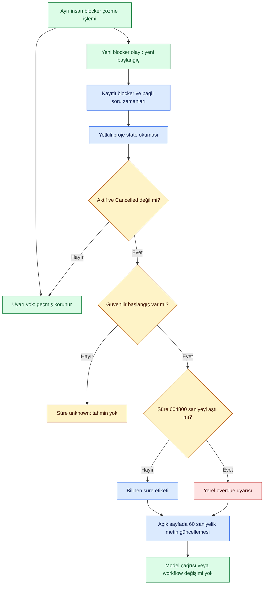

# Blocked bekleme süresi ve yedi gün uyarısı

**20 Ekim 2026 — yerel uygulamada çalışan alt kapsam.** Kullanıcı 48 çok turlu senaryo ve7günden uzun blocked bekleme için timer/uyarı istedi. Blocked canonical workflow stage değildir: To Do/In Progress/In Review gibi aşamaların üzerindeki impediment bilgisidir. Timer bu modeli değiştirmez.

## Uygulanan davranış

- Eşik **7×24saat=604800saniye**. Tam eşikte uyarı yok; süre bu değeri **aşınca** overdue. İş günü veya sprint hesabı değil.
- Başlangıç DB'deki manual blocker `recorded_at` veya taska bağlı bekleyen sorunun `presented_at` zamanıdır. Soru seçilmiş ama karar uygulanmamışsa bekleme sürer. Yorum, sohbet veya sayfa yenileme süreyi sıfırlamaz.
- Görev kartı, liste, blocker/attention alanı ve task detayındaki waiting etiketleri yanında bilinen süre gösterilir. Overdue olduğunda belirgin uyarı etiketi görünür. En eski **başlangıcı bilinen aktif** blocker temel alınır.
- Çözülme uyarıyı kaldırır; yeni manual blocker yeni bölüm/zaman başlatır. History silinmez. Cancelled görev aktif uyarı üretmez. Restart, DB zamanını sıfırlamaz.
- Backend state sorgusu süreyi yeniden hesaplar. Açık sayfa metinleri60saniyede bir, ek HTTP/model çağrısı yapmadan günceller. Dolayısıyla aktif sekmede eşik uyarısı sonraki timer tick'inde görülür; tarayıcı arka plan timer'ı yavaşlatabilir. Yenileme her zaman tekrar hesaplar.
- UI timer'ı sayfa açıldıktan sonra monotonic süre kullanır; yeni okumada sunucu saatine döner. Gelecekte görünen/bozuk başlangıç zamanı için negatif süre değil unknown gösterilir.
- Uyarı taskı iptal etmez, aşama değiştirmez, model/retry başlatmaz ve ek bütçe harcamaz. Bir e-posta/OS push/scheduler servisi değildir; uygulama kapalıyken bildirim teslim etmez. Aynı uyarı kartı güncellenir; her tick'te yeni incident/audit/notification yaratılmaz.

## Bilinen sınırlar

Bağımlılık ve context-limit blocker'larında güvenilir **unsatisfied başlangıç zamanı** her zaman kayıtlı değil. Bağımlılığın oluşturulduğu tarih ile o işin en son tekrar engellenmeye başladığı tarih farklıdır. Bu nedenle kayıtsız zamanı link tarihinden veya task yaşından uydurmuyoruz: `unknown_since_count` ve “Blocker duration unknown” görünür. Bazı nedenlerin başlangıcı biliniyorsa known-age uyarısı ve eksik-zaman tooltip'i birlikte gösterilir. Bu teslim **bütün otomatik blocker türlerinin eksiksiz süre takibi değildir**.

Bu açık kapsam için ileride ayrı blocker episode olayları gerekir: dependency unsatisfied/satisfied/reopened, linked question cancelled/reopened ve clock kaynakları. Query sırasında audit yazmak veya geçerli onay digest'ine değişen süre eklemek yerine, yetkili domain değişiminde episode başlangıç/bitiş olayı üretme yolu tasarlanmalı. Eski kayıtlara geçmiş başlangıç tarihi tahmin edilmemeli. Ekip notification kanalları, snooze/escalation ve özelleştirilebilir eşik ayrıca ürün kararıdır; bu teslim7gün için kullanıcı talebini uygular.

## Kod ve onay tutarlılığı

`packages/domain/blocker_age.py` salt okunur hesap; `apps/local_ui/server.py` taskın dış görünümüne `blocker_age` ekler. Değişen elapsed/evaluated-at alanı canonical record, workflow/context/approval digest'lerine **girmez**. Yoksa bir saniye geçmesi bile hazırlanmış önerileri stale yapardı. Bağlı soru için eklenen `since` ise mevcut sabit presented_at kaynağıdır. İnaktif/başlangıcı bilinmeyen durumda gereksiz değişen değerlendirme zamanı üretilmez.

`apps/local_ui/app.js` var olan waiting etiketleriyle birlikte süre/uyarı gösterir. Beş UI diline çeviri eklendi. Yeni dependency, servis, ağ bağlantısı veya model kurulmadı. UI dili proje içeriğini çevirmiyor.

## Kabul ve doğrulama

- Unit/integration: tam7gün/7gün+1saniye, future/nonfinite/unknown timestamp, birden çok blocker, Cancelled/çözülme, restart ve yeniden-block reset; context digest'in zaman geçişiyle değişmemesi.
- Gerçek tarayıcı: izole DB'ye kontrollü8ve2günlük blockerlar; yalnız eski iş uyarılır, blocker çözülünce uyarı kalkar, stage To Do kalır; Türkçe ve mobil görünüm.
- Senaryo J25–J36 sanal saatle bekleme yollarını tarif eder; bunların hepsi gerçek model deneyi yapılmış sayılmaz. [48senaryo](dialogue-journeys.md).
- İlk regresyonda inaktif taska gereksiz evaluated_at eklenmesi backup/readback eşitliğini bozdu. İnaktif/unknown durumda bu alan null yapıldı; canonical durumu değiştirerek test geçirilmedi.

**Gerçek doğrulama sonucu:**636runtime ve49repo/tracker testi geçti. İzole tarayıcıda8gün uyarısı/2gün normal yaş, çözülme sonrası uyarının kalkması, stage'in To Do kalması ve Türkçe etiket geçti; page error0. Desktop/mobil screenshot ve yeni diagram görsel incelendi.57Mermaid render başarılı. İlk tarayıcı harness'i başlangıç overview ekranında gizli board etiketini bekledi; testi gerçek Board navigasyonuna bağlayarak düzelttik. Bu kontrollü saat testleri fiziksel7gün bekleme veya kapalı-uygulama bildirim teslimi değildir.
