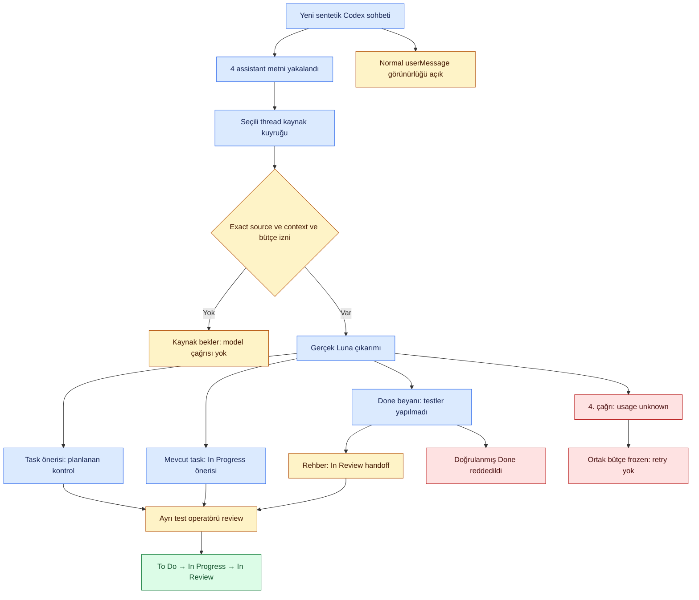

# Codex yeni sohbet → görev → durum: gerçek bağlantı deneyi

**19 Ekim2026 — kısmi başarı, MVP kabulü değil.** Kullanıcı önce Codex'in gerçek ana zincirini doğrulamamızı istedi. Başka ürün/adapter yatırımına geçilmedi. Yeni ve yalnız sentetik Atlas Demo sohbeti açıldı; normal proje ve önceki TEST DB değiştirilmedi. Ana konuşma bu projede kalır; açılan sohbet yalnız deney kaynağıdır.

## Gerçekte çalıştırılan zincir

| Aşama | Gerçek giriş / işlem | Gözlenen sonuç |
|---|---|---|
| Yeni Codex sohbeti | Ayrı projectless sohbet; araç/dosya kullanmadan Atlas Demo işini konuşması istendi | Dört kısa assistant yanıtı, kurulu CLI0.162.0-alpha.17.2 üzerinden seçilmiş thread'den okundu |
| İlk çıkarım | “Görevimiz… kontrol eklemek” mesajı, gerçek Luna çağrısı | Task+proposed Decision adayları. Test operatörü yalnız Task'ı kaydetti; Decision uygulanmadı |
| Başlangıç güncellemesi | “işine başladın, uygulama sürüyor” mesajı, mevcut Task context'i | Yeni Task açılmadı; aynıID için In Progress önerildi. Ayrı sentetik operatör review'u ile uygulandı |
| Bitirme beyanı | “işi bitti… testleri henüz çalıştırılmadı” mesajı | Aynı Task için reported Done önerisi. Doğrudan Done uygulama girişimi reddedildi; AC/DoD not_run kaldı |
| Workflow rehberliği | Mevcut In Progress+reported Done, deterministik kurallar | Suggested review stage In Review. Arayüzden görev workflow'una giden bağlantı eklendi. Pilot operatörü ayrı handoff yaptı, görev In Review |
| Dördüncü çıkarım | Yeni “kod incelemesinde” mesajı, yeni capture→selected-source queue→gerçek provider geçişi | Analysis failed, usage unknown; ortak transport frozen. Modelin In Review önerdiği iddia edilmez. Retry/model yükseltme yapılmadı |

[Makine sonuçları](codex-e2e-001-results.json). Buradaki operatör işlemleri izole sentetik uygulama testidir; bağımsız insan etiket/gold veya gerçek ürün kabulü değildir. Model Task/Decision ayrımının genel kalitesi ölçülmedi. Amaç cümlesinin proposed Decision olarak çıkması ayrıca anlam incelemesi gerektirir; otomatik kabul edilmedi.

## Bulunan kritik kaynak sınırı

Bu uygulamada `create_thread` / `send_message_to_thread` ile gönderdiğimiz mesajlar App Server item listesinde `functionCallOutput` türündeydi; gerçek `userMessage` değildi. Adapter dört assistant metnini aldı, bu araç gövdelerini bilerek almadı. Read-thread aracı da aynı türleri doğruladı; özel tool output veya reasoning okunmadı/konuşma gibi kaydedilmedi.

Bu nedenle **normal insanın yazdığı mesajların otomatik yakalanması bu yeni sohbette doğrulanmış değil**. İşleyen assistant kaynaklı durum tespiti tam diyalog capture'ı yerine sunulamaz. Kullanıcıya aynı test sohbetine tek normal mesaj yazması soruldu. Ana sohbette soru yanıtı olarak gelen test cümlesi test thread'inden yakalanmış sayılmadı, başka gerçek sohbet okunmadı. Bu ana mesajı native test kaynağı gibi yerleştirmedik.

[OpenAI App Server belgesi](https://developers.openai.com/codex/app-server/) thread/turn/item ve pagination sözleşmesini anlatır; kurulu yüzeyde userMessage bulunacağını her gönderim yönteminde garanti etmez. Yerel Native UI otomasyonu bu uygulama için kullanılamadı; başka yöntemle UI erişim kısıtı aşılmadı. Normal kullanıcı mesajı doğrulaması açık kapıdır. Mevcut capture yeteneği olanak/kurulumdan ayrı tutulur.

## Kod bağlantıları

`packages/capture/codex/project_pipeline.py`: tek `tick` seçilmiş capture'ı okur, aynı project/thread/profile kapsamındaki kaynakları seçer, yalnız önceden geçerli source/context/model/budget grant'i olanları kuyruğa verir ve review-ready sonucu döndürür. Yeni grant, thread/model çalıştırma talimatı veya domain onayı oluşturmaz. Hiç grant yoksa source saklanır, model çalışmaz. `source_limit`1–10; normal conversation/model sınırları geçerli.

`ConversationQueue.process(..., source_ids=...)` iç allowlist eklendi. Başka kaynak geçerli modele sahip olsa bile seçilmiş thread akışına karışmaz. Parametre verilmediğinde mevcut proje kuyruğu davranışı korunur. Started/failed/unknown kaynak yeniden denenmez.

`human_text_observed=false` ve `human_text_not_observed_do_not_claim_full_dialogue` uyarısı assistant-only capture'ı açık gösterir. Bu “kesin insan mesajı yok” veya kaynaktaki bütün geçmiş görüldü demek değildir; yalnız alınmış kaynakların sınırıdır. Callback/worker'ın devamlı arka plan kurulumu ve kullanıcı onboarding'i bu tek-pass API'sinden ayrı açıktır.

Status review view'unda `workflow_guidance` reported stage/current stage/suggested review stage/current verification ve finish blocker durumlarını ayırır. In Progress'teki Done beyanı için In Review; In Review'da Awaiting Verification önerilebilir. Awaiting Verification'da Done ancak mevcut gerekli kanıtlar geçmiş ve finish blocker yoksa review adayıdır; scope review/ayrı insan işlemi yine zorunlu. Yeni alan öneridir, workflow guard'ını veya mevcut Done incelemesini atlatmaz. Stale öneride guidance null olur. Yeni UI bağlantısı mevcut görev ayrıntısını açar; gizli status mutation yapmaz.

## API başarısızlığı ve kullanım hesabı

Yeni testte4model işi kabul edildi; bütçede8HTTP girişim payı sayıldı:3settled,1unknown. Belirsiz işte generation isteğinin sağlayıcıya ulaşıp ulaşmadığı ve gerçek HTTP sayısı kesinleştirilmedi. Yeni bilinen tahmin1135microusd ($0.001135), belirsiz çağrı için2250microusd rezervasyon tutuluyor. Önceki işler dahil root30dispatch/60HTTP bütçe sayımı; bilinen toplam53690microusd, belirsiz held2250microusd,3USD tavan korunur. Bunlar yerel benimsenmiş fiyat snapshot hesabıdır; fatura veya bütün hesap kullanımı değildir.

Dördüncü çağrının eski failure receipt'i güvenli somut hata kodunu saklamıyordu. Bu yüzden nedenini kesin timeout/şema/provider diye adlandırmıyoruz. `ConversationService.analyze` artık `failure_code` ve `failure_stage` saklar; yalnız allowlist kodları, exception text/credential/raw HTTP hata gövdesi yoktur. Regresyonda provider_connection_unknown ve tekrar engeli doğrulandı. Tarihsel başarısız kayıt sonradan başarılı/teşhis edilmiş gösterilmedi. Kullanımı bilinmeyen rezervasyon serbest bırakılmadı, root frozen kaldırılmadı, tekrar çağrı yapılmadı.

## Kalan kapanış koşulları

1. Normal kullanıcı mesajının aynı yeni thread'de native capture'ını doğrulamak.
2. Bilinmeyen request'in provider kullanımını veya muhafazakâr settlement politikasını ayrı doğrulamak; frozen root'u sessiz açmamak.
3. Kaynak/model kurulumunu UI'dan, sonlu izin/bütçe ve görünür stop/resume ile günlük kullanıma bağlamak.
4. İnsan review ve gerçek tamamlanma kanıtıyla kalan AC'leri geçirmek. Bu küçük örnek genel model doğruluk/holdout sonucu değildir.

Yerel pilot `http://127.0.0.1:53612/`: ayrı DB;4kaynak/1Task, In Review, verification not_run, model bağlantısı önizlemede kapalı. Dışa/public yayın değildir. Private DB, exact model payload'lar, anahtar ve ledger repoya konmadı.

## Yerel regresyon ve yayımlama sınırı

623runtime ve49repo/tracker kontrolü geçti.8yeni hedefli test selected-source izolasyonu, grantsiz bekleme, assistant-only uyarı, revoke, source allowlist, güvenli Done rehberliği ve redacted failure makbuzunu kapsar. Mevcut gerçek-browser diyalog akışı yeni In Review bağlantısını tıklayarak doğrulandı; false-Done reddi, source/answer/relation ve390px taşma kontrolü geçti.56Mermaid kaynak ağ kapalı render edildi. Bu yerel pass’ler dördüncü gerçek API başarısızlığını veya eksik normal-user capture kapısını kapatmaz.
