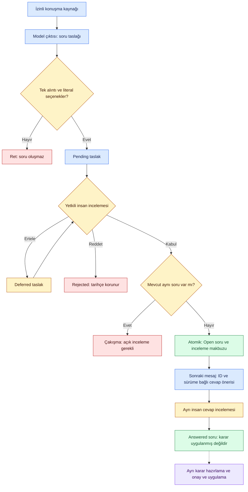

# Diyalogdan görev ve mevcut görev durumuna — 18 Ekim 2026

**Uygulandı: yerel inceleme ve workflow bağlantısı. Gerçek model anlam doğruluğu ve otomatik oturum yakalama uygulanmış/kabul edilmiş sayılmıyor.** Mevcut T09/T10/T13/T14/T19/T20/T22 dilimidir; yeni ana görev veya yeni MVP tanımı değildir.

## Kullanıcının göreceği akış

1. Konuşmayı aktar. Kaynak metin, hash ve proje kimliği korunur; task elle yazmak zorunlu değildir.
2. Model kapalıysa kaynak kartındaki **Use a response from your existing LLM → Prepare LLM request** seçilir. İstek seçilmiş konuşmayı ve o projenin mevcut task kimliklerini, kısa açıklamalarını, güncel stage/contract/workflow bağlamını içerir. Kullanıcı nereye göndereceğini seçer; hazırlama ve kopyalama dış veri paylaşım izni değildir.
3. Yapılandırılmış JSON yanıtı **Validate and import response** ile aktarılır. Kaynak alıntısı, source/context hash ve mevcut task kimliği doğrulanır. İlk import canonical task/stage değişikliği yapmaz.
4. Yeni Task/Decision/PendingDecision adayları eski kaynaklı aday incelemesini kullanır. Kabul edilen yeni task To Do'dur. Mevcut task için status önerisi önce/sonra + literal alıntıyla ayrı görünür; insan gerekçeyle kabul, ret veya erteleme yapar.
5. Kabul, ortak workflow kontrolünü çalıştırır. In Progress için onaylı güncel AC ve açık start gate gerekir. Done için izinli stage geçişi, bütün zorunlu güncel AC/DoD kanıtları, kapalı finish gate ve ayrı scope acknowledgment gerekir. “Yaptım/yükledim” metni evidence değildir.

## Kod ve sözleşme

- [DialogueReviewService](../../packages/capture/dialogue_review.py): scoped hazırlık, dış yanıt import'u, ortak kaynak/context validator ve status review/apply. [ConversationService](../../packages/capture/conversations.py) mevcut create/reconciliation ve source geçmişini korur; görünüm en yeni append-only analiz revision'ını gösterir.
- [ResponsesExtractor](../../packages/capture/responses_extractor.py) `dialogue_review=True` ile aynı response schema/context validator'ını kullanır. Her dispatch için kopya adapter hazırlanır; ortak extractor üzerinde source context yarışması yaratılmaz. Provider çağrısı DB transaction'ı dışındadır. Default launcher hiçbir provider açmaz.
- [Response şeması](../../manifests/dialogue-review-response.schema.json): source_id/source_sha256/context_sha256/coverage/candidates/status_changes/answer_proposals (19 Ekim güncellemesi). Her değişiklik task_id/stage/quote taşır; sürüm/digest trusted request snapshot'ından alınır, modele bırakılmaz.
- [Grant şeması](../../manifests/conversation-dispatch-grant.schema.json): dialogue-aware provider dispatch için exact `context_sha256` zorunludur. Eski source-only grant bu veriyi dışarı gönderemez. Mevcut token rezervasyonu/settlement aynen korunur; tam input/context/para preflight ve gerçek aktivasyon hâlâ açık.
- [TaskWorkflowService](../../packages/domain/task_workflow.py) public transition wrapper'ı aynı kontrolleri korur; iç `_transition` aynı transaction'da stage ve kaynaklı inceleme makbuzunu atomik kaydetmeye izin verir. İç metot insan/yetki/active/revision kontrollerini atlamaz. Ara kayıt başarısızsa stage de rollback olur.
- HTTP command'leri: prepare_dialogue_review, import_dialogue_response, review_dialogue_status; mevcut session/Origin/CSRF/project/write kontrollerinden geçer. Stage mutation read endpoint'inden veya LLM metninden tetiklenmez.

## Güncellik ve geçmiş

Import sırasında bütün hazırlanmış context güncel olmalıdır. Apply sırasında o task'ın version/workflow/ilişkili bağlamı yeniden kontrol edilir; bağımsız başka task'a yapılan status değişikliği ikinci öneriyi gereksiz yere geçersiz kılmaz. Aynı task'a tek yanıt içinde iki farklı iddia gelirse whole response reddedilir; son cümle sessizce seçilmez. Bu ilk dilimde çelişkili iddiaları otomatik kronolojik çözme yoktur.

Dış import yolundaki eski öneri stale olduğunda yeni current-context istek/yanıtı aynı source için append-only analiz olarak kaydedilebilir; önceki raw/hash ve review'lar korunur. Aynı context'e farklı raw yanıtla önceki analizi değiştirme yoktur. Source/model dispatch sonucu, unresolved started receipt veya timeout geçmişi import ile değiştirilemez. Kimliği eşit import/review retry tek etki üretir. Accepted stage kaydı source görünümüne ve audit timeline'a bağlanır; ret/erteleme task stage'ini değiştirmez.

## Doğrulama

17 yeni domain/entegrasyon testi: task create + ayrı status review, bağımsız iki task, restart/backup/restore, yanlış quote/target/context, duplicate JSON, stale workflow, revoke/agent/project sınırı, partial evidence/Done/scope, blocker, atomik rollback ve configured-provider payload/usage. Yeni tarayıcı testi gerçek HTTP/DB/UI üzerinden ilk konuşma→Task To Do, AC onayı, ikinci konuşma→In Progress, reload/source link, yanlış Done ret ve 390px taşma kontrolünü yapar. Yanıtlar açık sentetiktir; gerçek inference/token ekonomisi ölçümü değildir.

İlk geliştirme koşusunda nested transaction hatası bulundu; kontroller gevşetilmeden ortak workflow iç metodu ve atomik dış transaction ile düzeltildi. Browser testinin ilk denemelerinde buton adı ve çoklu Sources/alıntı seçicisi yanlış olduğundan harness düzeltildi. Optional context grant alanı için source-only ve context-bound payload beklentileri ayrı doğrulandı. Sandbox'taki ilk geniş runtime koşusu port açamadı; izinli loopback test ortamında tekrar çalıştırıldı. Başarısız denemeler başarılı test sayılmadı.

Son ölçüm ve dosya hashleri: [makine kaydı](dialogue-status-results.json). Diagram [yerel runtime](../architecture/local-preview.md) içinde güncellendi; render sonucu model kalitesi kanıtı değildir.

## Açık sınırlar / sıradaki geliştirme

Bu teslim sürekli otomatik capture değildir. LLM anlamı çıkarır; yerel kod yalnız sözleşme, kaynak, kimlik, güncellik ve yetkiyi doğrular. Ücretli gerçek HTTP transport/credential etkinleştirilmedi; gerçek semantic corpus/holdout ve kullanıcı pilotu açık. Dış LLM yanıtının model kimliği ve kullanım miktarı doğrulanamaz; model_calls=0 yalnız Decivora'nın yerel dispatch sayısı, dış harcamanın sıfır olduğu iddiası değildir. Request'in task açıklamaları 512 karakterlik etiketli excerpt; context en çok 100 proje record'u ile tam hazırlanır, fazlası sessiz truncate edilmez. Yanıt 16KiB, aday/değişiklik sayısı ayrı 32 sınırındadır.

Blocked/Cancelled/yeniden açma bu response formatında stage olarak uygulanmaz; mevcut impediment/lifecycle/impact incelemesi korunur. Aynı source içindeki çelişkili çoklu status iddiaları, otomatik AC çıkarımı, decision-aware ilişki/etki adaylarının tam entegrasyonu ve native capture sonraki dilimlerdir. İlk yeni geliştirme güvenli model aktivasyonu/input-context-money preflight ve ardından bounded gerçek çıkarım deneyi; bütün bu kapılar geçmeden ana görev/MVP Done olmaz.

Son doğrulama: **347 runtime + 48 kök test geçti; sekiz mevcut browser akışı ve düzeltilmiş yeni diyalog akışı geçti.44Mermaid render failure0.** Mevcut özel DB yedeklendi; güncel uygulama53610portunda başlatıldı, authenticated read-only browser/HTTP kontrolü yapıldı. DB logical digest değişmedi ve integrity ok. Kullanıcı DB'sine sentetik örnek eklenmedi; yeni görev/durum ekran görüntüleri ayrı geçici fixture ortamındandır.44dosyalık veri içermeyen kaynak ZIP üretildi; temiz başka makine kabulü değildir.

## Ana akış denetimi sonrası context düzeltmesi

[18 Ekim ana akış denetimi](primary-flow-audit.md) görev-only input'un karar/soru/ilişkileri taşımadığını saptadı. `decivora-dialogue-context-2` bunları aynı scoped/hash-bound snapshot'a ekler; kayıt açıklamaları en çok1024karakter excerpt, task açıklamaları512, soru64 ve relation500 tavanındadır. Eksik gövde/history açıkça belirtilir. Aynı kaynak için cache readback en yeni analizi döndürür.21diyalog testi içindeki4yeni regresyon bağlam içeriği, geç cevapta stale input, excerpt ve latest readback'i kontrol eder. Bu düzeltme otomatik relation/question proposal veya izinli MCP devam paketini tamamlamaz.

## 19 Ekim — kaynaklı geç cevap önerisi

**Kodlandı:** hazırlanmış model sözleşmesi `answer_proposals` dizisini içerir: exact `question_id`, `question_revision`, `option_id`, literal unique `quote`. Sunucu soru metni/seçenek etiketi, snapshot digest ve quote konumunu kendi kaynak/context'inden ekler. İçe aktarma veya yapılandırılmış provider doğrulaması yalnız öneri üretir; soru henüz cevaplanmaz. Kart Conversations altında görünür; sayacı review inbox ve workspace özetine dahildir.

İnsan gerekçeyle **Confirm answer association / Reject answer suggestion / Defer answer suggestion** seçer. Kabul `QuestionService` ile seçim kaydı ve source-bound review makbuzunu aynı canonical transaction'da yazar; makbuz arızasında seçim de geri alınır. Kaynak, öneri, actor, soru revision, option ve answer ID ilişkisi append-only audit'te korunur. Soru seçimi **Decision apply veya task Done değildir**; mevcut prepare→approve→apply ayrı kalır. Geç cevap eşleşmesi şimdilik bir öneridir; model çıktısı insan otoritesi sayılmaz.

Soru revision/options/status/selection/state revision değişirse kabul engellenir. Yanlış proje/agent, stale authority, uydurma soru/seçenek/alıntı, aynı soruya bir yanıtta birden fazla iddia reddedilir. Aynı kaynaktaki bağımsız sorular ayrı ayrı doğrulanabilir. Belirsiz kısa A/B için yönerge tahmin yerine boş dizi ister; bunun gerçek modelde doğru uygulanması henüz ölçülmedi. Yerel quote/schema guard'ı anlamı veya gerçek konuşan kişinin kimliğini kanıtlamaz; insan incelemesi bu nedenle zorunludur. Native mesaj/rol/kimlik capture kapsamı hâlâ açık.

Yeni hazırlanmış strict response şeması answer_proposals alanını zorunlu tutar (öneri yoksa []). Eski kaydedilmiş/import edilmiş status-only JSON'lar bu alan olmadan legacy olarak okunabilir; geçmiş raw yanıtlar yeniden yazılmaz. Diğer ek/eksik alanlar kabul edilmez. SQL tablo/sürüm değişikliği yok; yeni audit action `conversation_answer_reviewed` ve mevcut question_answered kullanılır. HTTP command `review_dialogue_answer` session/CSRF/current human project-write guard'larından geçer; Operations bunu reconciliation komutu olarak izler. Default model kapalı; bu teslim yeni dispatch veya dış paylaşım yapmaz.

İlk çalışan geliştirme kontrolü, soru servisinin public transaction wrapper'ının review transaction'ına nested çağrıldığını ortaya çıkardı. Çözüm: guard'ları koruyan private `_answer` yalnız mevcut transaction içinde çalışır; public API aynı wrapper'ı kullanır. Atomik rollback regresyonu eklendi. Bu hata gerçek model veya kullanıcı verisinde oluşmadı.

### Geç cevap tesliminin doğrulaması

398runtime testi,48repo kontrolü ve11gerçek tarayıcı senaryosu geçti.11yeni domain testi (32dialogue testi toplamı) kaynak/proje/revision/option/quote sınırları, independent iki soru, defer/reject/idempotency, revocation/agent, stale selection/options, atomic rollback ve restore provenance kontrolünü kapsar. Genişletilmiş browser senaryosu gerçek HTTP/UI üzerinden geç cevap kartını onaylayıp reload sonrası seçimi korudu; Decision önerisi veya task stage değişmedi. Sentetik model yanıtı kullanıldı, gerçek inference yok.50Mermaid render edildi; güncel yerel akış çizimi ve browser kartı görsel incelendi.

## 19 Ekim — kaynaklı ilişki önerisinden etki incelemesine

**Kodlandı:** yeni strict response `relation_proposals` dizisi içerir (yoksa []). Destekli iki yön: `Task required_by Decision` (karar görev için gerekçe), `Task depends_on Task` (önkoşul). Öneri `origin`, `target`, `kind`, kaynakta bir kez geçen `quote` taşır; endpoint sürümleri ve başlıkları sunucu prepared context'inden alınır. Yeni çıkarılan fakat henüz kaydedilmemiş candidate ID'leri bu ilk dilimde endpoint olamaz. Önce aday kabul edilir, sonra güncel bağlam hazırlanır. Modele ID veya sürüm uydurtulmaz.

Conversations kartında yön/tür, iki kayıt sürümü ve alıntı görünür. İnsan reason ile kabul/ret/erteleme yapar. Kabul mevcut core plan→approve→apply guard'larından geçer; edge event, command/approval ve kaynaklı `conversation_relation_reviewed` makbuzu aynı transaction'da yazılır. Makbuz arızası tamamını geri alır. Retry tek etki üretir; bağımsız kayıt değişikliği gereksiz blocker olmaz, fakat endpoint version, ilgili edge, güncel authority ve graph cycle kontrolleri korunur. Aynı kaynakta duplicate, var olan aktif veya ended/invalidated edge otomatik tekrar açılmaz; bu ayrı lifecycle incelemesidir. Onaylanmış ilişki mevcut Graph/Timeline projection'larında görünür.

`required_by` uygulandıktan sonra **Review impact if this decision is retired** düğmesi mevcut impact servisine açık insan hipotezi gönderir ve Questions and decisions ekranındaki etki kartını açar. Bu yalnız önizlemedir: kararın canonical geçerliliğini değiştirmez, görev iptal etmez, yeni karar uygulamaz. Genel AND/OR/unknown gerekçe çıkarımı bu teslimde yoktur; tek edge'i tek/zorunlu gerekçe saymayız. Eksik gerekçe review/unknown kalır; obsolete veya false-Done yaratılmaz. Sonraki select→approve→apply adımları mevcut ayrı incelemelerde kalır.

Yeni public HTTP command `review_dialogue_relation` exact alan, human project-write, session/CSRF kontrollerinden geçer; Operations reconciliation bileşenini kaydeder. SQL tablo/sürümü değişmedi. Eski status-only veya answer içeren JSON'lar relation_proposals olmadan legacy olarak kabul edilebilir; yeni strict request bütün dizileri ister. Kaynak/snapshot, alıntı ve schema doğruluğu semantik ilişki doğruluğunun kanıtı değildir. Gerçek model, native capture, konuşmadan supersession/retirement önerisi, genel relation resolution ve çoklu gerekçe planı hâlâ açıktır.

Kod: [ilişki incelemesi](../../packages/capture/dialogue_relations.py), [paylaşılan çıkarım sözleşmesi](../../manifests/dialogue-review-response.schema.json), [regresyonlar](../../tests/runtime/test_dialogue_relations.py). Ücretli çağrı veya kullanıcı kaynak aktarımı yapılmaz; sentetik çıktı doğrulaması model benchmark'ı sayılmaz.

### İlişki tesliminin doğrulaması

410runtime testi (12yeni ilişki testi),48repo kontrolü ve11gerçek browser akışı geçti. Yeni kontroller wrong-type/direction/quote, current endpoint/edge, stale authority/agent/proje, duplicate/retired edge, cycle, bağımsız değişiklik, idempotency, atomic receipt rollback ve restore provenance kapsamındadır. Browser konuşma→ilişki önerisi→insan onayı→reload→gerçek graph edge→ayrı retirement impact preview zincirini doğruladı; görev In Progress kaldı. Yanıtlar sentetik, model dispatch0.50Mermaid render başarılı; yerel akış ve kart görsel kontrol edildi. Gerçek semantik kalite ve native capture kapıları açık.

Mahremiyet kontrolü: `conversation_relation_reviewed` Applied makbuzu MCP private-derived visibility hesabına katılır. İlişkinin iki ucu ve mevcut muhafazakâr bağlı bileşen kuralı, açık source-audience paylaşımı olmadan agent read/context çıktısından gizlenir. Daha önce public kayıt olması özel gerekçeyi public yapmaz. Bu muhafazakâr davranış paylaşılabilir bağlamı daraltabilir; granular edge audience UX'i hâlâ T18/T22 kapısıdır, gizlilik filtresi kaldırılmaz. Yeni negatif test önce görünür public task/decision'ın özel kaynaklı edge kabulü sonrası agent'a açılmadığını doğrular.

## 19 Ekim — konuşmadan kararın yerini alan seçim

**Kodlandı:** `relation_proposals.kind=supersedes` mevcut iki Decision arasında kaynaklı değişim önerisi taşır. Yön **NEW → supersedes → OLD**. Kaynakta benzersiz literal quote, current context kayıt ID/sürümleri ve human review zorunludur. Bir yeni Decision henüz candidate ise önce ayrı kabul edilir, ardından güncel request hazırlanır; modele canonical ID uydurtulmaz.

Kart **Decision replacement proposal** olarak ayrılır. İnsan karar vermeden **Preview replacement impact** ile eski karara bağlı işleri mevcut etki motorunda inceler; önizleme graph/decision/task değiştirmez. Gerekçeli **Approve decision replacement** yalnız replacement edge'ini ve kaynaklı makbuzu atomik kaydeder. Onay sonrası yeniden önizleme güncel graph üzerinden çalışır. Task scope/cancellation için mevcut ayrı select→approve→apply yolu korunur.

İki Decision kaydı, eski required_by bağlantıları ve bütün event geçmişi kalır. Yeni supersedes bağlantısı Graph/Timeline'da yaşama hikâyesini taşır. Eski karara bağlı bir görevin önceki Done kanıtı yeni graph bağlamına artık uymuyorsa **Awaiting Verification** görünür; tarihsel Done audit'i silinmez. Yeni karar otomatik olarak eski görevin yeni gerekçesi sayılmaz; gerekli kapsam/gerekçe değişimi ayrı incelemedir.

Aynı eski karar için iki farklı yeni seçim, zaten yerini başka kararın aldığı target/replacement, source import sonrası değişen endpoint veya competing supersedes edge'i otomatik last-write-wins ile çözülmez. Bağımsız ilgisiz değişiklik tek başına gereksiz engel değildir. Döngü, yanlış kayıt türü/proje/agent ve eski authority mevcut guard'lardan geçemez. Ret/erteleme graph'ı değiştirmez. Herhangi makbuz/graph yazım arızasında değişiklik bütünüyle rollback olur. Kaynak mahremiyeti MCP'deki private-derived withholding kuralına dahildir.

**Sınır:** bu, canonical replacement lineage'ıdır; ayrı bir global `Decision.active=false` kolonunun veya bütün sistemlerce tüketilen validity state machine'in uygulanması değildir. Impact girişi hâlâ açık insan hipotezidir (`explicit_manual_hypothesis`); genel AND/OR gerekçe yazarı, yeni artifact/file scope ve otomatik supersession resolution açık kalır. Eksik gerekçe unknown/review kalır; otomatik obsolete/cancelled/Done üretilmez. Gerçek modelin açık seçimle tartışmayı ayırdığı henüz ölçülmedi; sentetik response kabulü gerçek extraction benchmark'ı değildir. Varsayılan model kapalı, ücretli çağrı yok.

### Replacement tesliminin doğrulaması

430runtime testi (7yeni replacement regresyonu;19dialogue relation testi toplamı),48repo kontrolü ve11gerçek browser akışı geçti. Yeni kontroller: iki canonical Decision ve eski rationale korunması, pending→human approval→supersedes edge, conflicting replacement, stale endpoint, cycle, receipt failure rollback ve tarihsel Done korunurken current Awaiting Verification. Browser onay öncesi impact'in edge oluşturmadığını, onay/reload sonrası yeni edge'i ve In Progress görevin otomatik iptal/Done olmadığını doğruladı. Yanıtlar sentetik, gerçek extraction/paid call yok.50Mermaid render başarılı. Native capture, gerçek model doğruluğu, genel validity/AND-OR ve otomatik task-update planı mevcut açık kapsamındadır.

## 19 Ekim — kalıcı AND/OR gerekçesi ve etki bağlantısı

**Uygulandı:** görev detayında **AND / OR task rationale** bölümü, kayıtlı tüm aktif Task required_by Decision bağlantılarını listeler. İnsan AND (hepsi gerekli) veya OR (herhangi biri yeterli) seçer; her Decision sürümü için geçerli/geçersiz/bilinmiyor varsayımını, inceleme nedenini ve bütün gerekçeyi incelediği onayını kaydeder. Bunlar bu görev için insanın açık impact varsayımlarıdır; global Decision validity veya otomatik doğrulama değildir. Model/API çağrısı yoktur.

`TaskRationaleService` sürümlü `task_rationale_confirmed` audit satırı yazar, knowledge_revision artırır. İfade + facts + actor/authz revision + reason + basis digest append-only korunur; retry tek etki üretir. Expr referans seti, **tüm** aktif required_by bağlantılarıyla aynı olmalı; eksik/unsupported gerekçe sessizce düşürülemez. Sıfır ref, duplicate ref, yanlış Decision/Task sürümü, int yerine bool revision, geçerlilik için1/0 gibi belirsiz değer, agent, stale base ve eksik insan onayı reddedilir. Transaction arızasında metadata/revision birlikte geri alınır. Fiziksel SQL şeması değişmedi; restore/replay eski canonical veriyi yeniden yazmadan kaydı korur.

Backend bounded nested all/any ifadelerini (depth8, toplam64ref, branch32) destekler. İlk UI düz AND/OR yazarıdır; iç içe kayıt varsa salt okunur gösterir ve düz ifadeye sessizce dönüştürmez. [HTTP request şeması](../../manifests/local-task-rationale.schema.json); backend semantic guard'ları ayrıca zorunludur. Generic JSON Schema engine test edilmiş sayılmaz.

Impact artık current ve insanın doğruladığı ifadeyi mevcut üç değerli kernel'e taşır. A OR B için A emekli edilip B açıkça geçerliyse after=true; B bilinmiyorsa after=unknown. A AND B için A=false ise after=false olabilir; task cancellation ayrı mevcut review/approval gerektirir. Aynı karar için görevler arasında çelişen validity varsayımları unknown'a iner; son kayıt keyfî biçimde seçilmez. Seçilen trigger için before/after mevcut explicit retirement/restoration hipotezidir, gerçek dış dünya gözlemi değildir.

Rationale; task/ref sürümü, required_by veya ilgili supersedes edge'i değişirse stale olur. Stale kaydı UI'daki eski tek-karar checkbox'ı gizlice geçersiz kılamaz; unknown/review korunur. Expression/fact değişimi knowledge revision'ı, ilgili task/prerequisite workflow basis'ini ve eski impact/onay güncelliğini etkiler. Önceki Done audit'i korunur; current Done yeniden doğrulama isteyebilir. Rationale audit okuması aynı scoped read snapshot cache'ine bağlandı; her task için tüm geçmiş tekrar okunmaz.

Hazırlanan diyalog context'i bu kayıtları `rationales` alanında taşır; raw başka konuşmaları otomatik paylaşmaz. Source/context egress izni, credential guard ve private-derived MCP sınırı aynen korunur. Bu teslim modelin AND/OR anlamını otomatik doğru çıkardığını kanıtlamaz. Gerçek model çalıştırma ve veri/harcama onayı ayrı açık kapıdır; yerel editor/etki bağlantısını durdurmaz.

### AND/OR teslim doğrulaması

445runtime testi (15yeni rationale testi) ve48repo kontrolü geçti. Yeni kontroller AND/OR/unknown, eksik edge/ref/fact, tam review, agent/stale revision, nested expression, restore, replacement edge değişimi, stale impact ve historical Done invalidation'ı kapsar. Yeni bağımsız browser case gerçek görev panelinde OR→AND değişimini, yeni impact sonucunu, reload ve390px açık editörü doğrular; task To Do kalır, otomatik iptal olmaz. Mevcut11browser akışı ayrıca korunur.50Mermaid render başarılı. Tüm örnekler sentetiktir; model dispatch0.

Browser test yazımında önce geniş diyalog case'ine eklenen adımlar source hazırlama timeout'u verdi; yeni kısa/izole fixture'a ayrıldı. Ardından testin önceki impact kartını okumaması, project-command zarfını izlemesi ve reload sonrası gizli Conversations öğesini beklememesi düzeltildi. Ürün guard/limit/kabul kriteri gevşetilmedi. Core testleri passing sonucu bu harness hatalarını gizlemek için kullanılmadı.

Ek performans kontrolü: rationale audit geçmişi state içindeki her task için yeniden sorgulanmaz; scoped transaction/read-snapshot cache'i kullanılır, dışarı verilen mutable kayıt kopyadır ve write/snapshot sonunda yenilenir. Cache mutation/stale-snapshot regresyonu eklendi. Uzun browser diyalog helper'ı da `.last()` yerine import response'undaki exact source ID'yi ve yeni impact yanıtını bekler; eski DOM'un hazır olması yeni sonucu geçmiş sayılmaz.

## 19 Ekim — konuşmadaki seçenekli sorudan kalıcı soru kaydına

**Uygulandı: backend bağlantısı.** T09/T13e/T19 kapsamındaki bu dilim, model çıktısındaki `question_proposals` taslaklarını kaynak incelemesine ve `QuestionService` kayıtlarına bağlar. Yeni ana iş veya kabul kapsamı oluşturulmadı. Sonraki UI teslimi aşağıdadır: kaynak kartında taslak inceleme eklendi; Question Inbox yalnız kabul edilerek sunulmuş soruları gösterir.

| Adım | Kod / sözleşme | Kalıcı sonuç |
|---|---|---|
| Çıkarım | `dialogue_review.response_schema`, `manifests/dialogue-review-response.schema.json` | En fazla32taslak. Soru metni,2–8seçenek etiketi ve tek kaynak alıntısı |
| Kaynak doğrulaması | `packages/capture/dialogue_questions.py` | Soru ve her seçenek alıntıda harfi harfine bulunmalı. Alıntı kaynakta bir kez geçmeli. Kimlik ve span backend tarafından üretilir |
| İnsan incelemesi | `review_dialogue_question` command | `accept/reject/defer`, exact source/proposal, idempotency key ve gerekçe. Pending/Deferred/Presented/Rejected ayrı |
| Sunma | `QuestionService._present`, aynı SQLite transaction | Kabul edilen soru Open/revision1 olarak, kaynak hash/proposal provenance ile kaydedilir. İnceleme makbuzu yazılamazsa soru da rollback olur |
| Geç cevap | Mevcut `answer_proposals` + `review_dialogue_answer` | Sonraki kaynak context'inde soruID/revision/option bulunur. Ayrı insan incelemesinden sonra Answered olabilir |
| Karar ve etki | Mevcut prepare/approve/apply | Soruya cevap verilmesi kararın uygulanması, eski işin iptali veya görevin Done olması değildir |

Mevcut soruID veya normalize edilmiş aynı soru metni bulunursa yeni soru sessizce açılmaz/birleştirilmez: `question_duplicate`; taslak Pending kalır ve `existing_question_matches` gösterilir. Farklı seçenekli aynı metin de bu konservatif sınıra girer. Önce mevcut soru açıkça incelenmeli/revize edilmelidir; otomatik yeniden ilişkilendirme bu teslimde yok.

Soru proje kapsamındadır; responder mevcut yetkili insan owner'dır. Model responder, yetki, task bağlantısı, deadline veya blocker belirleyemez. İki seçenekten az olan serbest metin soruları, agent/ekip routing ve genel çatışma çözümü açıktır. Literal kaynak eşleşmesi semantik doğruluğu kanıtlamaz: varsayımsal/alınmış kararı soruya dönüştürmeme talimatı ve insan incelemesi korunur, gerçek model değerlendirmesi ayrıca gerekir.

Yeni provider şemasında `question_proposals` zorunlu; eski kayıtlı/import çıktıları alan yoksa boş liste olarak kabul edilir. Şema/talimat değişikliği exact model payload hash'ini değiştirir. Eski özel pilot paketleri/izinleri otomatik yenilenmedi, yeniden gönderilmedi ve bu teslimde gerçek API/sohbet okuması yapılmadı. Yeni SQL tablo/migration gerekmedi; mevcut scoped audit ve question projection kullanılır.

Doğrulama:14yeni sentetik runtime testi; gerçek yerel HTTP session/CSRF ve command, sahte provider üzerinden strict schema→queue→draft, ayrı review, geç cevap, ret/erteleme, duplicate, ajan/proje reddi, transaction rollback, kapasite ve backup/restore. Bunlar modelin gerçek konuşmayı doğru anladığının veya yeni inceleme kartının UI kanıtı değildir. İlk iki ek entegrasyon testi test harness'inde yanlış state anahtarı ve schema konumu nedeniyle hata verdi; ürün guard gevşetilmeden fixture düzeltildi. Son toplu doğrulama aşağıdaki teslim kaydında belirtilir.

Son toplu doğrulama:585runtime ve49repo/tracker testi geçti;54Mermaid kaynak ağ kapalı render edildi ve yeni soru şekli görsel incelendi. [Kaynak hash’leri ve sınırlar](dialogue-question-results.json). Repo testlerinin ilk sandbox çalıştırmasında3loopback testi ortam izni nedeniyle hata verdi; yerel HTTP izniyle aynı49test geçti.

Mevcut gerçek browser diyalog regresyonu da geçti: source→Task review, mevcut task durum önerisi, prior question context, reload/source link, false-Done reddi ve mobil taşma kontrolü; page error0, gerçek model dispatch0. Yeni soru taslak kartı bu testte yoktur.

## 19 Ekim — kaynaklı soru taslağı inceleme kartı

**Uygulandı: mevcut Conversations ekranı.** Her taslak soru metni, literal seçenekleri, kaynak alıntısı, soruID ve Pending/Deferred/Presented/Rejected durumu ile görünür. İnsan gerekçe girerek **Present question / Reject question draft / Defer question draft** işlemlerini kullanır. Presented/Rejected geçmiş kartında yeniden işlem düğmesi gösterilmez. Ertelenmiş taslak tekrar incelenebilir. Kaynak başına taslaklar toplam inceleme sayısına dahil edilir; sunulunca bu sayıdan çıkar ve Open soru sayısına girer.

Eşleşen mevcut soru varsa yeni sunma düğmesi kapalı ve ilgili soruID görünür; ret/erteleme kullanılabilir. Bu UI kontrolü backend duplicate/authority/transaction kontrolünün yerine geçmez. Soru açmak cevap seçmek, bir Decision uygulamak veya task durumunu değiştirmek değildir. Kart bu ayrımı açıklar. Beş katalogda yeni metinler eklendi (EN/TR/ES/PT-BR/AR; ES/PT/AR native dil incelemesi hâlâ açık). Dil değişiminde doldurulan review gerekçesi korunur; yeni model çağrısı yapılmaz.

`tests/ui-dialogue-questions.cjs` gerçek tarayıcı/yerel HTTP/SQLite yolunda sentetik çıktı→taslak→defer→reload→present→reload→duplicate ret→geç cevap incelemesini sınar. Task/Decision kayıtları değişmeden kaldı. TR taslak korunumu ve390pxArabic RTL taşma kontrolü geçti. Yeni case CI smoke listesine eklendi; on ana UI case geçti. Yerel model kapalıdır, gerçek anlam doğruluğu veya sürekli kaynak/model onboarding kabulü değildir. [UI kanıt kaydı](dialogue-question-ui-results.json).
