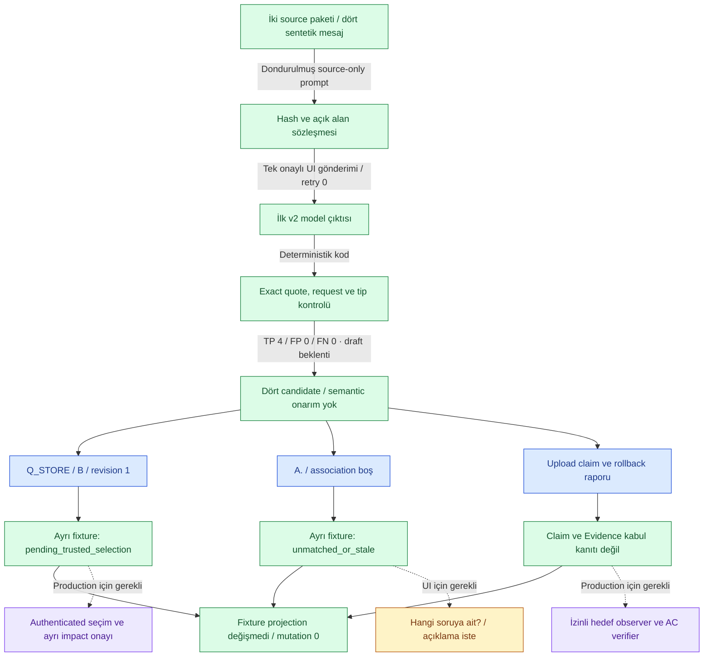

# MEMBERSHIP-002 — açık sözleşmeyle ilk v2 çıktı

**2026-10-12 · Tek onaylı UI gönderimi, tek ilk çıktı, sıfır retry, ücretli API yok.** Boş geçici/kişiselleştirilmemiş normal Chrome ChatGPT sohbetinde Instant UI etiketi gözlendi. Kullanıcı “onaylıyorum” dedi; [tek kullanımlık izin](../../examples/membership-smoke-v2/authorization.json) tüketildi. Kesin backend model, token/kota ve maliyet unknown; 2048 output token yalnız soft talimat, hard context/token tavanı doğrulanmadı. UI'de tool çıktısı gözlenmedi; iç provider çağrıları ölçülmedi.

[Ham ilk çıktı](model-runs/membership-002-response.txt) · [makine sonucu](membership-002-results.json) · [dondurulmuş prompt](../../examples/membership-smoke-v2/prompt.txt) · [önceki başarısız sözleşme ölçümü](membership-001-result.md).

## Ne çalıştı?

| Örnek | Gözlenen aday | Ölçüm / güven sınırı |
|---|---|---|
| Q_STORE/B için geç cevap | AnswerRecord; question_id=Q_STORE, option_id=B, presentation_revision=1 | Doğru alanlarla eşleşti; fixture bridge pending_trusted_selection, kendiliğinden karar uygulanmadı |
| “Yükledim.” | ImplementationClaim; claim_type=upload | Gerçek hedef okunmuş veya yüklenmiş sayılmadı |
| İzole rollback sonucu | Evidence; AC_ROLLBACK/revision 1/result passed | Raporlanan metin; verifier yetkisi veya bütün task Done kanıtı değil |
| İki soru varken “A.” | AnswerRecord, attributes={} | Metin korundu; soru seçilmedi. Fixture bridge unmatched_or_stale; UX açıklama isteğine çevrilmeli |

İki request/contract/source binding ve dört exact quote doğrulandı; karakter konumlarını kod hesapladı. **Önceden hazırlanmış authored_draft candidate beklentileri: S02 TP=3/FP=0/FN=0; S03 TP=1/FP=0/FN=0.** Tür, message_id, quote ve attributes ölçülüyor. Entity kimliği, authority, relation/impact, gerçek hedef ve AC doğruluğu bu skorun dışındadır. Dört aday eşleşmesi genel model accuracy veya release gate başarısı değildir.

## Kaynak, aday ve yetki akışı



Yeşil: bu run'da veya ayrı kontrollü fixture guard'larında gözlenen sonuç. Mavi: çıkarılmış aday, canonical karar veya doğrulama değildir. Sarı: gerekli açıklama UX'i bu testte çalıştırılmadı. Mor ve kesik ok: production authenticated seçim/impact/hedef/AC uygulaması bu run'da sınanmadı. İki ayrı request için SQLite fixture kullanıldı; iki pending soruyu aynı anda yöneten production question engine veya project IAM testi değildir. Her iki projection değişmedi, canonical mutations=0; task verified olmadı.

**Çizim doğrulandı — 2026-10-12.** Private GitHub inceleme ref'i `e491fd09590499c27305ec5519281e50fa330bda` üzerinde native Mermaid iframe/SVG, başlık/açıklama ve bütün düğüm/ok etiketleri okundu; sözdizimi hatası görülmedi. Geniş görünümde kaynak zinciri ve sonuç dalları ayrıca görsel incelendi. Kaynak hash'i ve renderer kanıtı [diyagram kontrol kaydında](diagram-render-results.json), kapsam [inceleme belgesinde](diagram-review.md). GitHub renderer sürümü unknown; dark/desktop önizleme, tüm mobil ekranlar veya runtime kanıtı değildir. Uzun şema GitHub'ın geniş görünüm/zoom kontrolleriyle incelenebilir.

Önceki yerel file:// önizlemesi URL güvenlik politikasıyla engellenmişti; o hata tarihsel olarak korunur. Bu tur izinli private GitHub doküman önizlemesi kullanıldı; yerel erişim kısıtı değiştirilmedi. Model/scorer kanıtı, diyagram çizim kanıtından ayrıdır.

## Önceki run ile değişen ne?

V1 serbest attribute örneği verdi; model alias alanlar ve farklı upload türü üretti, belirsiz cevabı abstain ile boş bıraktı. V2 açık field/type/enum sözleşmesi ve ambiguity-preservation kuralı verdi; bu tek çıktı bunlara uydu. Aynı development mesajları tekrar kullanıldı: bu bir sözleşme regresyonu, yeni kör örnek veya sealed holdout değildir. Prompt/örnek değişimi ve bilinmeyen backend nedeniyle iyileşmenin tek nedenini istatistiksel olarak kanıtlamıyoruz.

Ham çıktı, rubric ve önceki v1 rapor/JSON değiştirilmedi. Türevde yalnız envelope transport projection ve kodla span hesaplama var; semantic alan onarımı yok. Prompt 4708 UTF8 byte; ham UI Copy clipboard çıktısı 1897 byte, SHA-256 `e3941c35f39cdf4117bec100e01249a6eb3ec23b82b263e9998d8371ffc862da`. Clipboard metni provider transport byte'ları değildir. Screenshot yerelde repo dışında; özel conversation URL/ID aktarılmadı.

## Yerelde yeniden ölçme

Aşağıdaki komutlar yeni model isteği göndermez. Yeni bir output yolu kullan; CLI mevcut artefaktın üzerine yazmaz.

```sh
python3 -B spikes/semantic-chain/membership_typed.py derive --requests examples/membership-smoke/requests.json --response docs/quality/model-runs/membership-002-response.txt --out /tmp/membership-002-replay.json
python3 -B -m unittest discover -s spikes/semantic-chain -p test_membership_typed.py -v
```

`test_saved_single_v2_output_matches_draft_without_gold_or_state_promotion` ilk ham hash'ini, candidate ölçümünü ve gold/state ayrımını yeniden sınar. `test_saved_v2_proposals_cannot_apply_selection_or_verify_claims` ayrı SQLite fixture'larda association ve no-mutation/verification sınırını sınar. Sonuç JSON'unda kullanılan request/rubric hash'leri, türev audit, primary candidate score ve iki guard sonucu bulunur.

## Tamamlanan ve sıradaki iş

**Sonraki teslim tamamlandı:** [T03o kayıtlı aday zincir replay](membership-chain-replay.md), 13 kontrollü checkpoint passed. Aşağıdaki paragraf ilk model ölçümünün kapanış anındaki sırayı anlatır; yeni live model çağrısı yapılmadı. Mermaid bu ilk run/guard kanıtını gösterir; source bloğu değiştirilmedi.

T03n bu **tek gerçek girişimin ölçüm ve koruma teslimi** olarak DONE. Ana T03 açık; production MVP tamamlanmadı. 80 semantik regresyon testi passed; bu test sayısı ürün yüzdesi veya canlı kalite örneklem büyüklüğü değildir.

Sıradaki bağımsız iş: gerçek v2 adaylarını ayrı fixture receipt ile mevcut karar→AND/OR impact→hedef/AC→restore zincirinde tekrar yürütmek; model ve scripted verification kanıtlarını ayrı raporlamak. Daha sonra exact label insan incelemesi, farklı soru aileleri ve native/dosya/resume kıyası gerekir. H1/H2/H3 davranış onayları korunur; kullanıcıya aynı davranışları tekrar sormak gerekmez. Yeni canlı model isteği bu izinle gönderilemez. R21 için bu dar örnekte mitigation kanıtı oluştu; risk genel olarak kapanmadı.
