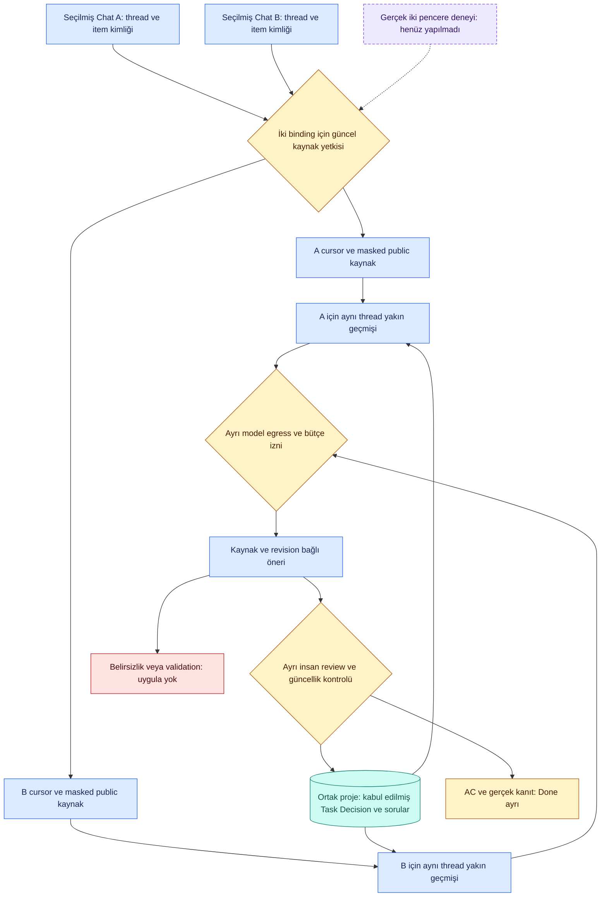

# İki Codex sohbeti: kök neden, kod düzeltmesi ve gerçek host kabul planı

**20 Ekim 2026.** Bu çalışma mevcut T09/T13/T17/T15/T24 kapsamındadır; yeni parent task veya MVP kapanışı değildir. Bu tur gerçek sohbet okunmadı, yeni chat açılmadı, yeni model çağrısı yapılmadı. Önceki J04APIsonuçları korunur.

## Hangi durum gerçekten farklı?

| Yüzey | Ne kanıtlar? | Ne kanıtlamaz? |
|---|---|---|
| Authored çok turlu API replay | Yeni mesaj+önceki bağlamdan model önerisinin doğruluğu | Normal Codex penceresinde gerçek userMessage yakalanması, host zamanlaması veya yeni sohbet keşfi |
| Native capture | Seçilmiş kurulum/thread/turn/item public metninin kaynak kimliğiyle DB'ye alınması | Modelin görevi/durumu doğru anlaması veya önerinin onaylanması |
| Scripted review testi | ExactTask/soru sürümü, onay/stale/false-Done guard'ları | Bağımsız insan gold veya model semantik başarısı |
| Normal iki-chat pilotu | Human giriş→iki seçilmiş native kaynak→aynı proje context'i; model aşaması ayrıca izinli | Bütün sohbetlere erişim, sınırsız canlı izleme, production/MVP kabulü |

[Resmî App Server belgesi](https://developers.openai.com/codex/app-server/) (20Ekim erişimi) stored history için `thread/turns/list` ve `thread/items/list` ayrımını açıklar; okuma thread'i resume etmeyi gerektirmez, item pagination aktif store tarafından desteklenmelidir. Bizim inference başlatmayan istemcimiz yalnız initialize/initialized ve bu iki read yolunu kullanır. Bu, başka bir prosesin bütün masaüstü olaylarına otomatik abone olunduğu anlamına gelmez. Kurulu build ve gerçek görünürlük ayrıca sınanır; güncel belge tek başına host kanıtı değildir.

## Bulgular / kök nedenin kanıt gücü

| ID | Kanıt / neden | Düzeltme / sınır |
|---|---|---|
| MC-01 | Önceki test authored API replay'di, görünür Codex sohbeti oluşturmuyordu. Bu test yüzeyi karışıklığı doğrulanmış | Rapor/API/native kabul ayrı. Görünür iki-chat host planı aşağıda; henüz çalıştırılmadı |
| MC-02 | `nearby()` aynı profile+thread yanında capture.id şartı koyuyordu; native dedup ise profile/thread/turn/item kullanıyor. Yeniden bağlama aynı sohbetin önceki metnini context'ten düşürebilir. Yerel reproducer ile doğrulanmış kod hatası | Profile varsa aynı profile/thread/surface/project ve önceki audit seq sorgulanır; profile yoksa eski capture.id sınırı korunur. Farklı sohbet/profile ham metni taşınmaz |
| MC-03 | Üretim pipeline tek `tick` seçimi sunuyordu; iki seçilmiş thread için ortak sınırlı orchestration girişi yoktu. Normal UI'da native_capture=false hâlâ doğru | `tick_selected` ve `capture_codex_threads.py`:1–4explicit binding, toplama öncesi tüm yetki kontrolü, aggregate source cap, ayrı checkpoint ve hata/rol makbuzu. Varsayılan UI watcher veya yeni sohbet keşfi eklenmedi |
| MC-04 | Aynı projeye kabul edilmiş task/decision/sorular sharedcontext'te var; raw komşuluk yalnız seçilmiş thread'de. Henüz incelenmeyen diğer-chat adayları canonical değil | İki-chat Task→başlama→aynıID, diğer-chat soru→geçcevap→ayrıreview ve stale yarış testleri. Unaccepted öneriyi accepted gibi taşımıyoruz; bu halde modelin “o iş”i bileceği garantisi yok |
| MC-05 | J04m1valid boş soru listesi: model anlam/recall hatası gözlendi. İçsel neden kesin bilinmiyor. Eski talimatta human/Q_ID/işaretsizchoice için yeterli açıklık yoktu; bu katkı hipotezi, kanıtlanmış tek neden değil | Önceki teslimde literal-question talimatı netleştirildi; gerçek modelle yeni trial yapılmadı. Bugünkü yerel test model doğruluğunu kanıtlamaz |
| MC-06 | J04m2question_text kaynakta yoktu; validator'ın literal substring reddi doğrudan neden, ağ/timeout değil | Validator korunur. question_text/options için literal copy talimatı önceki teslimde düzeltildi. Paraphrase'i kabul ederek kanıt zinciri gevşetilmedi |

## İki yeni chat açılınca bugünkü davranış

1. Yeni pencere kendiliğinden seçilmez. Her thread doğru projeye açık kaynak izniyle bağlanmalı; isim benzerliği veya aynı klasör yeterli yetki değildir.
2. Seçilmiş iki thread kendi cursor/turn/item/rol kimliğini korur. Birinde timeout varsa başarılı diğer kaynak ve önceden kabul edilen sayfalar silinmez. Hata kodu içeriksiz döner; aynı isteği otomatik model retry etmez.
3. Aynı projedeki kabul edilmiş görev/karar/soru context'i ortaktır. A'da onaylanmış Task B'de exactID ile görülebilir; B'de onaylı durum değişimi sonraki Acontext'ine girer.
4. Ham transcript'ler birleştirilmez. B'nin “ona başladım” ifadesi birden fazla işe uyuyorsa modelden çekimserlik beklenir; unresolved adaylar accepted sayılmaz. Henüz review edilmemiş Aönerisi B'de bilinmeyebilir.
5. AveBeşzamanlı değişirse stalecontext/proposal yeniden hazırlanmalı; eski çıktı kör uygulanmaz. Kullanıcı yeni bir soru revizyonu seçtiyse eski cevap current seçim olmaz.
6. Sınırlı capture `coverage=partial` kalır; terminalitem/publicrole almak tüm geçmiş veya aktif streaming bütünlüğü garantisi değildir. Son6mesaj/6000byte context sınırı ve açık omission flags değişmedi. Yeni raw geçmiş birleştirme/egress izni verilmedi.

## Çalışan kod ve yerel kanıt

- `packages/capture/source_pages.py`: reconnect context sorgusu dedup origin ile uyumlu.
- `packages/capture/codex/project_pipeline.py`: `tick_selected` tüm binding'leri ilk host read'den önce yetkilendirir; aynı origin duplicate seçimi reddedilir. Kaynak başına grantler aynen gerekir; aggregate source_limit yeni thread ile sıfırlanmaz. Tek-pass, varsayılan extractor=None; otonom grant/approval yok.
- `scripts/capture_codex_threads.py`:1–4exact `--selection CAPTURE_ID=THREAD_ID`; mevcut regular TESTDB, açıkconsent, finitepolls/interval/turnlimit. ReadOnlyAppServer istemcileri süreç sonunda kapanır; model factory vermez. Başarılı/partial geçiş Operations'a içeriksiz kaydedilir. Bu CLI başlatılmadan uygulama kendiliğinden izlemeye başlamaz.
- `tests/runtime/test_codex_multi_chat.py`:11yerel kontrol. İki-chat aynıTask/ayrıreview/restart; geçsorucevabı; staleapply; unacceptedaday sınırı; revokeöncesihiçreadolmaması; birhosthatasında diğerinisaklama; duplicateorigin; ortakcap; reconnectveprofileizolasyonu; gerçekstdio taşımayı kullanan **sahte host child**. Hiçbiri normal masaüstü host kabulü veya gerçek model sonucu değildir.

## Hazır gerçek host deneyi — owner kaynak izni bekliyor

**Hedef:** iki görünür, yalnız sentetik Codex sohbeti; tek izoleTESTprojesi `Atlas Native`. Mevcut gerçek proje veya diğer sohbetlere erişim yok. Sohbet başlıkları `Decivora — Native A` ve `Decivora — Native B`. Chat creation/okuma ve modele aktarma ayrı kapsamdır; bu plan izin sayılmaz.

| Adım | Gerçek kullanıcı/host işlemi | Beklenen gözlenebilir sonuç |
|---|---|---|
| N1 | Kullanıcı A'ya: “Atlas Native için yedek geri yükleme kontrolü ekleyelim; henüz başlamadım.” | Native userMessage ve terminal assistant metni kendi thread/turn/item kimliğiyle görünür; functionCallOutput human'a dönüştürülmez |
| N2 | A'da: “Depolama için Q_STORE: A dosya, B SQLite.” | Kaynak alınır. Model aşamasında soru taslağı ayrı presentation review'la kalıcı olmalıdır |
| N3 | Kullanıcı B'ye: “Atlas Native projesindeki yedek geri yükleme kontrolüne başladım.” | Bkaynağı native; A'da kabul edilmiş exactTask ortak context'te; yeniTask yerine status önerisi, ayrı onay |
| N4 | B'de: “Önceki Q_STORE sorusunun B seçeneğiyle, SQLite ile devam.” | Kalıcı soru ID/revision/SQLiteoption önerisi; ayrı review, karar uygulanması ayrı |
| N5 | A'da: “Yedek geri yükleme kontrolünü bitirdim; testleri çalıştırmadım.” | SameTaskreportedDone; canonicalDone olmaz, ACnot_run korunur |
| N6 | Sınırlı tekrar okuma ve reconnect | Aynı native kaynaklar duplicate olmaz; reconnect öncesi aynıthreadcontext kaybolmaz; BrawhistoryA'ya eklenmez |

**İlk izin paketi yalnız host:** iki yeni sentetik sohbet oluşturma; sadece bunların en fazla10'ar tur publicuser/assistant metnini iki capture geçişinde, geçişler arası2saniye ile izole yerelTESTDB'ye maskeleyerek kaydetme. Reasoning/toolçıktısı/dosya/diğersohbet yok; ücretli model çağrısı0. Kullanıcı N1/N3cümlelerini gerçek chat input'una yazmalı: araçla iletilen talimatın normal human mesajı olduğu önceki testte doğrulanamadı. Bu farklılığı başarısızlığı saklamak için tooloutput parse ederek aşmayacağız.

**İkinci kapı model:** yalnız doğrulanan sentetik source allowlist'i ve bağlı küçük proje context'i; exact model/data/çağrı/token/bütçe/expiry ayrıca geçerli onayla sabitlenir. Bugün yeni ücretli çağrı yapılmadı ve geçmiş izin yenilenmedi. Bu aşama normalhost+semantik+review entegrasyonunu sınar; ilk host okuma tek başına bunu kapatmaz.

Owner ilk paketi kabul edince immutable manifest'e gerçek thread ID'leri/sınırlar kaydedilir. Gösterilecek kanıt: thread başına human/assistantsayısı, sourcehash/role, omissions/pending/unsupported, dedup farkı ve replaycontext. Ham gerçek transcript/DB GitHub'a yüklenmez; publicrapor içeriksizmakbuz/sentetikcaseözeti taşır.

## İki sohbetin bağlam ve yetki şeması

Mavi kaynak/işleme, sarı kontrol, turkuaz kalıcı proje bilgisi, mor henüz yapılmamış gerçek test; renk runtime veya model başarısı anlamına gelmez. ArawmetniB'nin yakın geçmişine bağlanmaz. Onaylanmış ortak hafızanın geri beslenmesi ile diğer sohbetin bütün metnini modele göndermek farklıdır.

## Doğrulama sonucu

11yeni hedefli kontrol ve toplam658runtime testi geçti.58Mermaid blok offline render edildi; yeni iki-chat şeması tam görüntüde incelendi. Repo/doc/anchor/closure/progress kontrolleri yayın öncesi ayrıca doğrulanır. Gerçek yeni source/read/model çağrısı0; iki-chat host paketi için owner yanıtı beklenir. Ana task sayımı ve kabul kriterleri değiştirilmedi.
