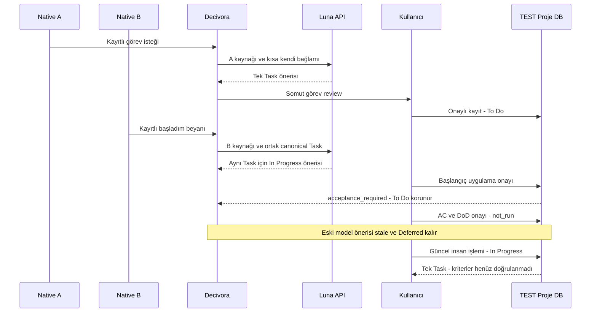

# İki gerçek sohbetten tek görev ve başlangıç durumu — sınırlı model deneyi

**20 Ekim 2026 — bu küçük zincir doğrulandı; genel MVP kabulü değil.** [Gerçek Native A/B capture denemesinde](native-two-chat-001.md) kaydedilmiş iki sentetik human mesajı ayrı model paylaşım izniyle işlendi. Yeni sohbet okunmadı. [Makine makbuzu](native-two-model-001-results.json) source/context/receipt hash'lerini, tokenları, ayrı insan review ve stale/ACguard ayrımını korur.

## Önceden onaylı sınırlar

Yalnız iki kayıtlı sentetik kullanıcı mesajı + kendi sohbetlerinin kısa önceki assistant metni + sınırlı canonical proje context'i; `gpt-6-luna`, en fazla2 model + 2 input-count, her istekte10.000input/2.000 toplam output tokenı, bu trial için20.000microusd ($0.02), mevcut$3 root bütçesi ve izin süresi. Retry veya model yükseltme yok. Reasoning effort ayrıca gönderilmedi; ana geliştirme sohbetinin Medium ayarı API isteğine uygulanmış sayılmaz. Private key, log ve ham transcript yayımlanmadı.

Kaynak captureDB'si salt okunur SQLite backup ile ayrı model pilot kopyasına alındı; orijinal hash değişmedi. A/Bexact source ID/hash allowlist'i ve kendi sohbetinin bağlamı kontrol edildi. İki worst-case admission rezervi benimsenmiş fiyatla4.500 microusd;20.000 microusd trial tavanını aşmıyor. Root ledger öncesi kullanım ve unknown rezervleri sıfırlanmadı. Bu yerel admission kontrolü sağlayıcının hesap genelindeki nihai faturası değildir.

## Ne oldu?

| Adım | Gözlenen sonuç | Yetki / durum |
|---|---|---|
| A: henüz başlamadığını belirten görev isteği | Tek Task önerisi: “Atlas Native için yedek geri yükleme kontrolü eklemek”; status değişikliği0 | Kaynak alıntısı/spanı doğrulandı; önce öneriydi |
| A Task review | Kullanıcı bu somut Task'ın TEST'e kaydını onayladı | Tek canonical Task, To Do; kendi başına tamamlanmış iş değil |
| B: aynı kontrol için başlangıç beyanı | YeniTask0, aynı exactTaskID için In Progressönerisi | Source/context bağlı; otomatik apply yok |
| B status review | Kullanıcı To Do→In Progress'ionayladı | İlk uygulama `acceptance_required` ile durdu; AC/DoD yoktu, rollback ve To Dokorundu |
| Kapsam onayı | Kullanıcı aşağıdaki iki sentetik koşulu ayrıca onayladı | Contractv1, ikisi de not_run/evidence=null |
| Güncel uygulama | Contractdeğişimi eski model proposal'ını stale yaptı; history içinde Deferredkorundu | Yeni modele tekrar gitmeden, kullanıcının güncel kapsam+başlangıç onayıyla current human transition uygulandı |
| Restart readback | Aynı tekTask In Progress | Verificationfalse; Done veya gerçek backup implementation iddiası yok |

Açıktaki son durum: **1Task / In Progress /0 doğrulanmış kriter**. İki şart gelecekte sağlanması gereken koşullardır:

- AC: Yedek geri yükleme kontrolü eklenmiş olmalı.
- DoD: Kontrolün çalıştığına dair doğrulama sonucu kaydedilmiş ve insan tarafından incelenmiş olmalı.

Bunlar gerçek backup/restore kodunun yazıldığı veya test edildiği anlamına gelmez; Atlas Native sentetik projesinin bu test için kullanıcı onaylı kapsamıdır. Ürünün kendi parent task'ları erken Done'a çekilmedi.

## Ek bulgu: ön koşulu arayüzde göstermeme

**NM-01:** Workflow başlangıçta güncel AC sözleşmesi zorunlu tutuyor, fakat status proposal kartı bu gereksinimi belirtmiyordu. Başlangıçtan önce actualdomain guard engelledi; bu doğru korumadır. `assessment.start_blocked` impediment bilgisi ile ACscope eksikliği ayrı tutulmalı; scope eksikliği yeni bir Blockedlifecycle durumu değildir.

Düzeltme: workflowguidance eksik/staleACiçin `review_requirement=acceptance_required`, `scope_review_still_required=true`, suggested review stage=null döndürür. Kart açıklama ve mevcut workflow detayına bağlantı gösterir; Başlangıç onayı butonu scope hazırlanana kadar kapalı. Task detayında Start gate, AC pending gösterir. İngilizce/Türkçe/İspanyolca/Portekizce/Arapça metinler güncellendi. Domain koruması gevşetilmedi ve stale proposal yeniden başarılıymış gibi yazılmadı.

**NM-02 — ilk review akışında eksik kapsam hazırlığı:** A'nın görev önerisi ilk kez onaylanırken AC/DoD taslağı birlikte sunulmadı; bu yüzden başlangıçta ek bir kapsam onayı gerekti. Bu deney ilk Task kartının her zaman tam uygulanabilir bir iş paketi ürettiğini kanıtlamaz. Mevcut T09/T13/T19 sahiplerinde ilk review'a açıkça “önerilen, henüz doğrulanmamış” kriter taslağı veya gerekli netleştirmeyi bağlama işi korunmalı. Kaynakta olmayan bir kriter insan kabulü olmadan gereksinim ilan edilmemeli; yanlış verified/Done üretmek çözüm değildir. Bu tur kapsam çıkarımı şemasını sessizce genişletmedik; NM-01 görünürlük düzeltildi, NM-02 hazırlık/UX boşluğu açık kaldı. Yeni parent task sayısı üretilmedi.

## Maliyet ve kanıt

| Model adımı | Input | Toplam çıktı | Toplam token | Yerel maliyet tahmini |
|---|---:|---:|---:|---:|
| A |1721|288|2009|$0.000360|
| B |1861|234|2095|$0.000224|
| **Toplam** |**3582**|**522**|**4104**|**$0.000584**|

Toplam çıktı reasoning tokenlarını da içerir; görünür JSONuzunluğu tek başına token değildir. Root 52 dispatch / 104 HTTP bütçe payı,67.286microusd ($0.067286), frozen=false; önceki3unknown'un6.750 microusd rezervi korunur. Trial iki generation / iki count kullanıp bitti. Fatura doğrulanmadı; bu token/maliyet yalnız extractorAPIişlemleridir. Codex host'un kendi hazırlık/teyit yanıtlarının üyelik kotası bu ledger'da ölçülmedi.

## Sınırlar ve sonuç

Bu gerçek normal user input + iki seçilmişnative chat + gerçek model + somut insan review + kalıcıTask/durum zinciridir. AynıTask kimliği korunup duplicate Task ürememesi bu örnekte gözlendi. Bu sonuç iki sohbetin bütün geçmişinin birleştirildiğini veya bütün kullanıcı görevlerinin doğru anlaşılacağını kanıtlamaz. A'da kabul edilmiş Task B'ye canonicalmemory olarak girdi; A'nın raw transcript'i B'nin yakın geçmişine eklenmedi.

İptal/Blocked/karar değişimi/Done/gerçek hedef kanıtı bu native örnekte sınanmadı. UIonboarding, sürekli otomatik capture ve genel semantik kalite/release kapıları açık. Bu testte gerçek kullanıcı kaynakları sınırlıydı; gold/holdout veya genel başarı oranı yok. Son canonicalstart **fresh human command** ile oldu; eski modelstatus proposal'ı scope değişiminden sonra doğrudan uygulandı diye gösterilmez.

İki API çağrısı izni tüketildi; yeni kaynağa veya deneye otomatik geçilmedi. Önceki capture binding'ler kapalı. Kaynak DB'de6 source / 0 Task korundu; model pilot kopyasında1 Task / In Progress var. Varsayılan LOCAL/önceki TEST uygulaması ve verileri değiştirilmedi.

## Gerçekleşen akış

## Doğrulama kaydı

Gerçek deneye ait yerel readback, aynı Task ID, no duplicate, no automaticapply, guard rollback, contract not_run, stale proposal, current human transition ve restart kontrolleri yapıldı. 659 runtime testi ve yeni12 hedefli native/context/scope kontrolü geçti. Gerçek tarayıcı kontrollü JSON ile eksik AC uyarısını, kapalı Approve butonunu, workflow detayına geçişi, scope onayı sonrası eski önerinin stale kalmasını ve fresh review başarısını doğruladı; page error 0. Mevcut diyalog→Task→status, source/context ve false-Done/mobil browser regresyonu da model çağrısı olmadan geçti. İlk UI harness denemesi form görünürlüğünde async yarışa, ikincisi eski hazırlıktextarea değerini okumaya takıldı; ürün koruması gevşetilmedi, harness gerçek prepare/import HTTP yanıtını bekleyecek şekilde düzeltildi. Yeni UI regresyonu CI smoke listesine eklendi.59 Mermaid offline render edildi; yeni sequence ve fixture UI görseli incelendi. Bu testler gerçek modelin örneklem sınırını genişletmez.
