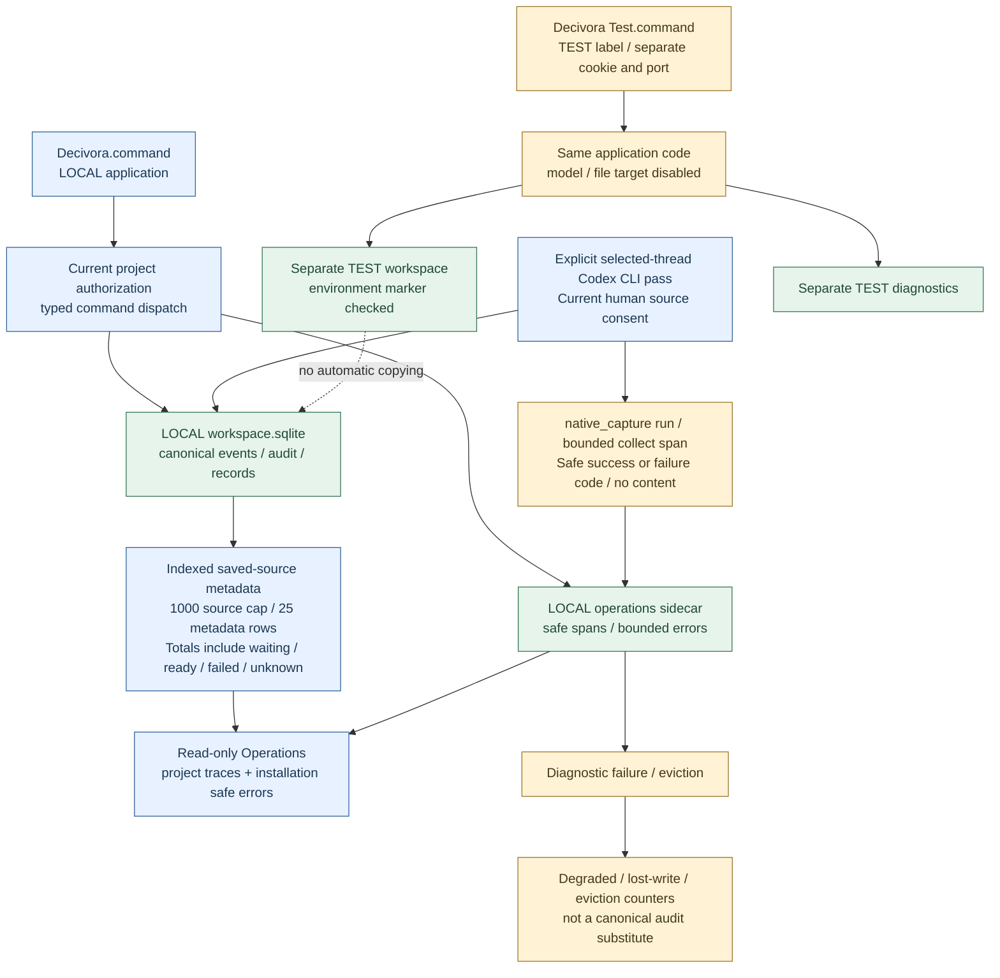
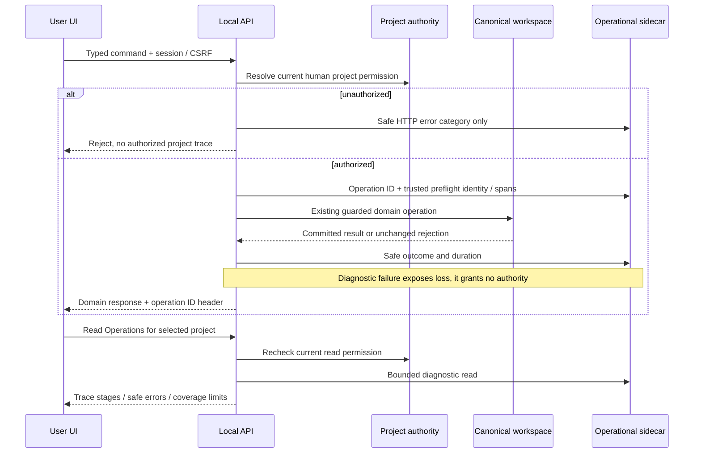

# Local Operations and isolated TEST environment

**19 October 2026 — implemented local slice, not complete platform administration.** User approved the proposed Operations screen, persistent safe diagnostics, stage tracing and separate test launcher. Existing T20/T21/T23/T24 ownership and all MVP acceptance gates remain; this is not a new microservice product or parent-task closure.

[Diagram/schema guide](../architecture/logging-diagrams-and-schema.md) maps the current SQL tables and API fields to Operations UI, explains unfinished-run projection and distinguishes existing local drawings from proposed full audit/delivery diagrams.

## How developers and agents use the records

The [diagnosis and development runbook](../architecture/logging-audit.md#teşhis-ve-geliştirme-çalışma-rehberi) defines environment/project/revision checks, authorized trace lookup, loss/coverage review, canonical outcome verification, TEST reproduction and closure evidence. It also separates agent-owned technical checks from necessary human decisions/subjective review/new permissions. [Manual review criteria and open implementation work](../architecture/logging-audit.md#manuel-kontrol-ne-zaman-gerçekten-gerekli) are explicit: automatic incident/task/question generation, alerts and end-to-end correlation are not implemented. AGENTS.md points to this conditional workflow; no per-message log polling or new model work is implied.

## What the user can do

Open **Operations** in the sidebar. Read selected-project command traces, expand authorization/command execution boundaries, inspect duration and safe result codes, search an operation ID, filter by outcome and refresh without dispatching a model. HTTP command responses expose `X-Decivora-Operation-ID`. Successful command execution is not whole-task completion, model correctness or external artifact verification.

Persistent HTTP error groups show endpoint category, safe code, first/last time and count. They contain no raw URL/query, exception message/stack, request/response body, task title, source text, cookie or credential. This is local installation diagnostics, not the canonical security audit. Existing session-only recent25error view remains a compatibility summary in Usage; Operations is the persistent view. Endpoint session/Host/Origin checks and current human project permission are enforced server-side. There is no new public health endpoint, remote collector or telemetry export.

`packages/operations/local.py` uses a separate owner-only SQLite sidecar beside the selected workspace DB. Canonical records/events/audit stay in their original store. Operational rows may be updated/aggregated/evicted; canonical append-only history is not trimmed. No operational entry grants authority or proves domain mutation. Normal private workspace backup does not include this diagnostics sidecar; diagnostics backup/retention administration remains open.

## Coverage and limits

- One local application process serves UI/API. The ten engines are logical responsibilities, not ten deployed services. The panel reports this application's worker as inactive and external MCP host activation as not verified; it does not discover all OS processes or third-party agents.
- Tracing currently covers authorized LocalApp command boundaries: project authorization plus dispatch into a named component. It does **not** yet correlate every receipt/job/model call/approval/evidence into one end-to-end pipeline or instrument every engine's internal phase. UI states this explicitly. A phase not observed is not marked successful.
- `started`, `succeeded`, `failed`, `unknown` are distinct. An unfinished run observed by a new process/session becomes unknown in the read projection, not a claimed crash diagnosis or success. Measured durations use a monotonic clock; dates are separate wall-clock observations.
- Development storage guards:200runs across the installation,100HTTP error groups; the current view shows up to50selected-project runs and25installation error groups. Eviction totals are persisted. These are bounded local-preview defaults, **not** an agreed production retention policy or complete audit guarantee.
- Telemetry writes have a short bounded SQLite wait. Failure must not silently undo an already-authorized domain result or enable an unauthorized result. The process records lost-write count and exposes degraded diagnostics; process-local losses cannot be reconstructed after restart. Disk/OS failure can prevent durable diagnostic writes. Canonical security/audit transaction rules remain separate.
- Denied/malformed requests are grouped under fixed safe endpoint/code labels. Unauthorized project input is not recorded as an authorized project trace. A project-less HTTP group does not disclose another project's content.

## Separate TEST launcher

`Decivora Test.command` starts the same source code with `--environment test --port 53611`. Normal data remains in the normal local data directory; TEST defaults to a separate sibling `decivora-test-data` directory. Ports can be explicitly overridden. `--no-browser` is available for controlled checks.

TEST uses an environment marker bound to its DB, and refuses existing unmarked databases, local-marked data and the default normal data directory. Local mode refuses test-marked data. A TEST label is rendered by the server before JavaScript hydration. TEST and LOCAL use different session-cookie names, because browser cookies are host-scoped rather than port-isolated; CSRF/bootstrap values remain per server. Separate ports also separate browser local storage.

TEST disables configured model extractors and file-target roots at startup. It does not automatically copy real projects, transcripts, credentials, grants or backups. The user can enter synthetic/manual data. This is data/configuration separation, **not** an OS sandbox or container security boundary. External real API calls, shared accounts and production datasets are not enabled. A hosted staging deployment, fixtures/seed UI, reset/delete controls and fault-injection admin buttons are not part of this delivery.

The source ZIP includes both launchers but no databases, markers, telemetry or sessions. Full Python-free/native installation remains a separate release gate.

## Verification record

Tests use temporary databases and synthetic values. Required checks cover restart persistence, no prompt/secret leakage, project isolation/revocation, HTTP authentication and trace header, unknown interrupted work, bounded eviction without domain-history loss, telemetry storage failure, TEST marker/path refusal, real launcher start and normal/TEST cookie coexistence. Browser verification covers filter/search, failed stage and duration, refresh/reload, visible TEST label, no source text in Operations and mobile width. [Published read schema](../../manifests/local-operations.schema.json), [Runtime tests](../../tests/runtime/test_operations.py), [browser case](../../tests/ui-operations.cjs). Real semantic inference and external pipeline tracing remain unverified.

A browser check exposed overflowing retention JSON; the view now uses readable labels and wrapping. Another exposed the initial environment badge hydration race; the server now renders the environment label directly. These were fixed without weakening permission or source-verification gates.

Existing historical commands are not backfilled with fabricated timing/phase logs. Traces begin when this implementation receives new commands. Reading empty Operations does not imply a failed logger or missing historical canonical audit.

Final local verification:382runtime tests (14operations/environment checks),48root tests,11browser fixture flows and47Mermaid sources passed. Actual normal53610andTEST53611servers were read through one cookie jar; normal canonical DB logical digest was unchanged. Both environments start without configured model/file target. [Machine record/source hashes](operations-results.json). No test records were seeded into either live user workspace.

## 19 October — diagnosis workflow clarification

The repository now defines the conditional agent diagnosis runbook and human-review handoff fields. This is documentation/working-agreement clarification, not a new alert engine or tracing-code delivery. A scoped read of the live TEST/personal Operations snapshot found the store available,0visible command traces,0process-local lost writes, no eviction counter and one content-free `other / not_found` HTTP group (count1). That group cannot establish the requested path, caller or root cause; no service-failure or model-quality conclusion follows. No synthetic command, source import, retry or mutation was executed for this inspection. The snapshot is historical and not ongoing monitoring.

Markdown/local-link/anchor, canonical planning and unchanged Mermaid source-hash checks passed for this clarification. Runtime code and Mermaid sources did not change; the prior382runtime/48root/11browser/47render record remains dated evidence, not a newly executed full suite.

## Yerel actor attribution — 19 Ekim2026

**Uygulandı:** yeni LocalApp komut izinde `identity.workspace`, `actor_id`, `actor_type` ve `authz_revision` bulunur. Kimlik, doğrulanmış güncel project-write scope'tan sunucuda alınır; command JSON'undaki actor metni kabul edilmez. HTTP kimliği bugün hâlâ `local_owner` / `human`dır. İç helper yalnız authority tarafından gerçekten verilmiş agent scope'unu da tanıyabilir; bu, MCP/worker'ın zaten instrument edildiği veya bağımsız agent login bulunduğu anlamına gelmez.

`authz_revision` **preflight'ta gözlenen** sürümdür; sonraki domain apply/onay sürümünün veya bütün işlemin tek authority snapshot'ında çalıştığının kanıtı değildir. Asıl domain guard'ları ayrıca güncel yetkiyi kontrol eder. `op_identities` tablosu var olan sidecar'a eklenir; eski run/span/hata satırları yeniden yazılmaz. Eski run'ın `identity` değeri null kalır; sonradan local_owner ataması yapılmaz. Run ve identity başlangıç kaydı tek diagnostics transaction'ındadır; eviction ikisini FK cascade ile kaldırır. Tanı yazımı kaybolursa domain sonucu geri alınmaz ve kayıp görünür tutulur.

**Ekip kapısı açık:** ayrı insan oturumları, loga özel own/shared/project/admin/support yetkileri ve tenant izolasyonu tamamlanıp negatif testleri geçmeden ortak ekip log ekranı açılmayacak. Mevcut C01/C03/C05/C06 ve LG-01–08 sahipliği korunur. `on_behalf_of`, grant referansı, login/agent-run/pipeline correlation, tenant bazlı hata/kota ve onaylı TTL henüz yoktur. Kimlik alanı tek başına bu kapıları kapatmaz. Tek-owner geliştirme sürer; yeni kullanıcı kararı veya ücretli çağrı gerektirmez.

### Attribution doğrulama kaydı

Bu kod tesliminde387runtime testi (19Operations testi dahil),48root kontrolü ve11gerçek browser senaryosu geçti. Yeni negatifler: client actor taklidi, forged/stale/wrong-project scope, revoked agent, eski sidecar'ın additive açılışı, kimlik yazım arızasında atomik rollback ve domain sonucunun korunması, authority revision değişimi ve identity eviction cascade. Tarayıcı aktör/yetki sürümü satırını, filtre/yenileme ve mobil görünümü doğruladı.50Mermaid render başarılı; güncel fiziksel ER görsel incelendi. Bu sayılar bağımsız multiuser veya gerçek model kabulü değildir.

LOCAL53610ve TEST53611yedek/integrity kontrolü sonrası yeni kodla yeniden başlatıldı. İki canonical DB'nin mantıksal içeriği ve eski dört diagnostics tablosu bire bir korundu; eski izlere kimlik doldurulmadı. Gerçek kullanıcı verisine sentetik kayıt eklenmedi, ücretli çağrı yapılmadı. Gerçek ekip login/own/shared/admin/support izin ve tenant testleri, native/MCP instrumentation ve model zinciri hâlâ kendi ilk-kullanım kapılarında açık.

19 Ekim [native capture tanısı ve queue görünümü](conversation-processing-runtime.md) eklendi. Normal komut sınırlarının yanında ayrı CLI collect sınırı izlenir; her page/RPC/model span varmış gibi sunulmaz. Yeni `conversation_queue` DTO alanı ve arayüzü içeriksiz source durumlarını gösterir.

19 Ekim [source capacity/pagination](source-capacity-pagination.md): `conversation_queue` artık1000source kurulum sınırı,25metadata row ve `items_truncated` taşır. Bu yeni kapasite/local sınır provider veya token bütçesi değildir; eski32source metinleri ilk teslim sınırı olarak tarihsel kalır.
