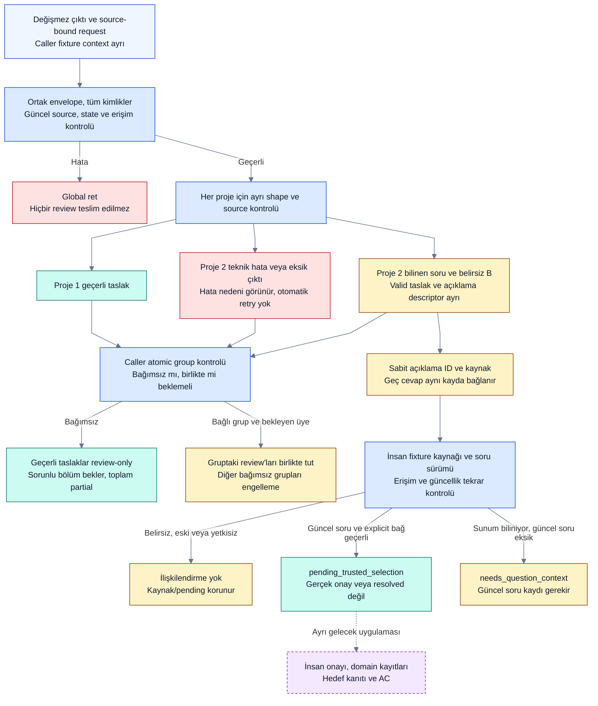

# Q14-A: bağımsız proje review ve açıklama cevabı

**2026-10-13 · T03x / P0 kod teslimi.** [Kullanıcı Q14-A seçimi](../delivery/decision-brief.md) ayrı sürümlü `receiver-project-review-1` koduyla sınandı.20 yeni /172 semantik,15 karar,40 takip testi geçti. Bu offline fixture katmanı çalışan ürün Inbox'ı, gerçek IAM veya yeni model deneyi değildir. [Tekrar üretilebilir sonuç](project-review-results.json).

## Çalışan davranış

| Durum | Proje 1 | Proje 2 | Toplam |
|---|---|---|---|
| UI revision alanı string | `ready_for_review`, geçerli taslak | `invalid_project_output`, teknik hata; veri dönüştürülmez | `partial_review` |
| Bilinen UI sorusu ve ayrı belirsiz B | `ready_for_review` | `needs_clarification`; bilinen soru/valid taslak korunur, belirsiz cevap ayrı descriptor | `partial_review` |
| Proje 2 temiz abstain | Taslak gösterilebilir | `awaiting_context`, boş cevap görünür | `partial_review` |
| Proje 2 output yok | Taslak gösterilebilir | `missing_output`; kayıp cevap başarı/no-op değildir | `partial_review` |
| İki proje ortak atomic group, birinde sorun | Review tutulur | Review tutulur; açıklama descriptor'ı kaybolmaz | `awaiting_resolution` |
| Envelope/kimlik/erişim/snapshot bozuk | Hiçbir taslak teslim edilmez | Hiçbir taslak teslim edilmez | Global ret |

`ready_for_review` bir kabul önerisi görünümüdür; semantik tamlık veya human approval değildir. Action recall eksikliği eski bağımsız scorer'da ayrıca ölçülür; bu wrapper `quality_scored:false` döndürür. Hiçbir durum task verification veya ürün Done değildir.

Ortak envelope, bütün proje kimlikleri/package digest'leri ve caller'ın güncel access/source/state/base revision fixture'ı **önce** kontrol edilir. Foreign/duplicate/stale identity içeren bir çıktının geçerli görünen kısmı kurtarılmaz. Yalnız sınırları bilinen bağımsız proje içinde shape/source hatası yerel tutulur. Caller context model cevabından okunmaz. Eski whole-output `receiver_contract.py` ve `receiver_smoke.py` aynı kalır; yeni wrapper ayrı source-bound tek-row kontrolü kullanır, tarihsel raw'ı onarmaz.



Önceki [whole-output akışı](receiver-contract.md#p0-doğrulama-akışı) korunur. Yeni şema yeni kod yolu içindir; eski deneye geriye dönük uygulanmış başarılı model testi sayılmaz. [Render kaydı](diagram-review.md).

## Proje 2 ve geç cevap

`clarification_records` bilinen candidate ve erişilebilir question presentation'lardan sabit `clarification_id` üretir. ID request/project/package, kaynak candidate ve seçenek snapshot'ına bağlıdır; sıra değiştiğinde rastgele yeni ID olmaz. Quote, message ID, olası soru sürümleri ve reason descriptor içinde korunur. Alanlar saved JSON raporunda saklanabilir; **çalışan durable Inbox/SQLite soru tablosu henüz yok**.

`associate_reply` yalnız explicit clarification/project/question/revision/option ve source hash taşıyan **caller human fixture** cevabını işler. Metni semantik yorumlamaz, en son soruyu tahmin etmez. Aynı reply aynı proposal ID döndürür; gecikme kendi başına expiry değildir. Yanlış proje/option/revision/ID, agent aktörü, değişmiş source/access ve resolved soru reddedilir. Seçenek sunumu biliniyor ama güncel soru kaydı eksikse `needs_question_context`; geçerli Q_UI bağında `pending_trusted_selection`. İkisi de gerçek approval değildir, clarification otomatik resolved olmaz. Ortak çağrılar veri/state değiştirmez.

Atomik gruplar caller fixture'ında açık girilir, output'ta da korunur. Boş grup listesi bu iki sentetik projenin bağımsız kabul edildiği test profilidir; üretimde bağımlılık olmadığının keşif kanıtı değildir. Production graph/knowledge revision'dan grup oluşturma ayrı kapı. Grup içindeki belirsizlik/abstain/teknik hata veya missing output hiçbir üyenin review'ını kısmi teslim ettirmez. Güncel P0 gruplama proje granülünde; task/operation bazında bağımsız işleri planlayan scheduler değildir.

## Kanıt ve sınırlar

20 yeni test: mixed type/source/action, envelope/duplicate/foreign/stale, access/current bindings, clean/invalid abstain/missing, group waiting ve all-ready positive, clarification ID/idempotent association, delayed/stale/agent/revoked/resolved/source tamper, input immutable/no execution. Human fixture actor alanı gerçek identity doğrulaması değildir; UI/host capture'ın verified reply authority'si henüz uygulanmadı.

İlk gerçek RECEIVER-001 raw'ı bu ayrı wrapper'da da iki proje için geçersizdir: N01 future-plan action, N02 abstention/type hatası. Geçmiş failure başarılı alt skor olarak yeniden sunulmadı; raw/prompt/request/oracle/önceki code proof'lar değişmedi. Yeni model/API/target read/canonical mutation **0**. Byte ölçüsü token değildir, usage null.

```sh
python3 -B spikes/semantic-chain/project_review.py --request examples/receiver-smoke/request.json --response examples/project-review-smoke/mixed-response.json --context examples/project-review-smoke/context.fixture.json
python3 -B spikes/semantic-chain/check_project_review.py
python3 -B -m unittest discover -s spikes/semantic-chain -p 'test_project_review.py' -v
```

**Sırada:** daha açık per-record sözleşmeli, ayrı kimlikli yeni source-only receiver isteği hazırlamak. Mevcut request prompt'una schema eklenmiş sayılmaz. Gerçek model send izni tüketildi; paid API yok. Durable soru/reply receipt, exact üretim yetkisi, çok-question state, host resume, UI, native/gold/ROI ve production yatırım/stack T03c kapıları açıktır.
