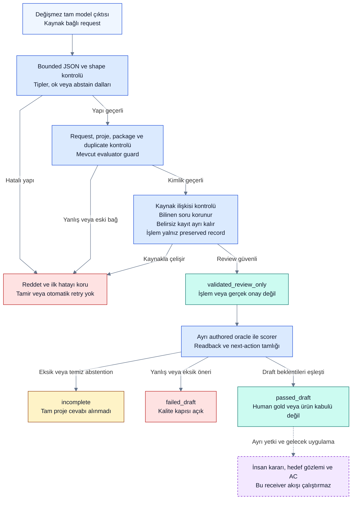

# Receiver sözleşmesi: yerel şekil ve kaynak doğrulaması

**2026-10-12 · T03w / P0, yerel kod teslimi.** [İlk gerçek deney](receiver-001-result.md) başarısız kaldı; ham çıktı, frozen prompt/oracle, eski evaluator ve sonuç değiştirilmedi. Bu teslim yeni model deneyi veya production entegrasyonu değildir.

## Ne düzeldi?

| İlk run bulgusu | Yeni çalışan kontrol | Sonuç |
|---|---|---|
| `abstain` yanında readback ve işlemler | Ayrı `ok` / `abstain` schema dalları; abstain yalnız null ve boş liste | Hatalı yapı reddedilir; düzeltilmez |
| Revision `"2"` olarak geldi | Pozitif integer; boolean, string, float ve sıfır yerel guard'da reddedilir | Tip dönüştürme yok |
| Belirsiz B nedeniyle bilinen Q_UI kayboldu | Readback güncel fixture soru kimliği/sürümü/durumuyla eşleşmeli | Q_UI korunur, ayrı B kaydı açıklama bekler |
| Gelecek yükleme planı için işlem önerildi | İşlem yalnız preserved record kimliğinden, kayıt başına en fazla bir tane | Bütün kaynak mesajları işlem listesi sayılmaz |
| `not_run` yanlış işlem tipine bağlandı | Evidence/not_run → test çalıştırma izni isteği | Bu öneri test çalıştırmaz; source capture izni runner yetkisi değildir |
| Yanlış karar/başarı riski | Kaynak candidate status, soru bağı ve Evidence alanları exact kontrol edilir | Human source gerçek approval, claim gerçek upload observation olmaz |

Kaynak ve schema kapıları birbirinden ayrıdır. JSON doğru biçimde olabilir ama yanlış soruya, stale cevaba veya yanlış kanıta işaret edebilir. Yeni `receiver_contract.py` önce bounded JSON/shape, sonra eski kimlik/duplicate guard'ları, ardından kaynak ilişki kurallarını uygular. Oracle doğrulayıcıya input değildir. Scoring ayrıca eski bağımsız evaluator ile yapılır.

## P0 doğrulama akışı



Renkler kontrol/sonuç türünü anlatır; gerçek model başarısı değildir. Schema tipi geçtiğinde kaynak semantiğinin de geçtiği varsayılmaz. Şekil/kaynak hatasında scorer çalışmaz. `abstain` yanında veri veya öneri varsa ret; temiz `abstain` yalnız kapsam eksikliğidir. [Render ve inceleme kaydı](diagram-review.md) ürün/runtime kabulünden ayrıdır.

## Makine sözleşmesi ve sınırları

[JSON Schema](../../examples/receiver-contract/response.schema.json) Draft 2020-12 olarak yayımlanan, mevcut request/project/package kimliklerine bağlı shape sözleşmesidir. Önceki `SCHEMA` alan açıklamalarına ek olarak yeni dosya gerçek type/required/additionalProperties/oneOf/enum/const/minimum sınırları içerir. Eski descriptor ve 7950-byte deney isteği **tarihsel kanıt olarak aynı kalır**.

Yerel `shape_check` yalnız ürettiğimiz sınırlı keyword kümesini yorumlar; genel JSON Schema validator veya standart conformance sertifikası değildir. Desteklenmeyen keyword reddedilir. JSON Schema integer kavramı ile wire parser ayrımı açık: matematiksel olarak integral `2.0` bazı standart validator'larda integer kabul edilebilir; bu yerel wire sözleşmesi gerçek JSON integer token'ı ister ve `2.0`'ı dönüştürmez. Tam schema conformance/başka validator ile doğrulama ve provider kabulü **not_run**; yeni dependency yüklenmedi.

Schema shape'i kaynak semantiğini garanti etmez. Candidate status, bilinen soru, record eligibility, evidence revision/result, upload claim ve action/question ilişkisi ayrı kaynak guard'ındadır. Bir mesajda birden fazla preserved record bu P0 guard'ında desteklenmez ve açıkça reddedilir; production record kimliği/geniş format ayrı iş. Source-bound request doğrulaması gerçek IAM/ACL yerine geçmez.

`request_selection_confirmation`, `request_target_verification` ve `request_test_execution_permission` yalnız öneridir. Hiçbir onay, komut, hedef taraması veya task kapanışı gerçekleşmez. `response_coverage_complete` yalnız iki `ok` proje cevabının varlığıdır; tüm next-action'ların doğruluğu/tamlığı, insan kabulü veya ürün başarısı değildir. Eksik işlem önerisi bağımsız scorer'da failed_draft; temiz abstention incomplete kalır.

## Denetlenen örnekler

[Geçerli sentetik review](../../examples/receiver-contract/valid-review.json), N01 eski/current cevapları ve N02 bilinen soru + ayrı belirsiz cevabı korur. [Altı incelenebilir invalid örnek](../../examples/receiver-contract/invalid-reviews.json): veri taşıyan abstention, string revision, silinen bilinen soru, future-plan işlemi, belirsiz soruya tahmini bağ ve not_run→passed. Örnekler elle yazılmış development taslağı; kaydedilmiş model cevabı, bağımsız blind gold veya gerçek doğruluk ölçümü değildir.

**152 semantik / 15 karar / 40 takip testi geçti; 16 semantik test yeni.** Ek negatifler stale request/foreign project/package/message, eski cevabı seçme, execution action, duplicate/extra alan, yanlış approval/verified/upload ve eksik next-action. [Tekrar üretilebilir yerel rapor](receiver-contract-results.json) valid/invalid örnek ve frozen hash durumlarını içerir. Full-message kaynak/ham capture önceki R23 dersini korur; compact summary raw otoritesi değildir.

```sh
python3 -B spikes/semantic-chain/receiver_contract.py schema --request examples/receiver-smoke/request.json
python3 -B spikes/semantic-chain/receiver_contract.py validate --request examples/receiver-smoke/request.json --response examples/receiver-contract/valid-review.json
python3 -B -m unittest discover -s spikes/semantic-chain -p 'test_receiver_contract.py' -v
```

Tekrar üretilebilir örnek raporu: `python3 -B spikes/semantic-chain/check_receiver_contract.py`. Komutlar yereldir, network/model/target read yapmaz. İlk gerçek raw ile validate başarısız olur; bu beklenen güvenli ret, eski deneyi başarılı yapmaz.

## Sıradaki gerekli iş

**2026-10-13 güncellemesi:** [Q14-A](../delivery/decision-brief.md) bağımsız proje taslağını review'da gösterme ve belirsiz Proje 2 bölümünü kalıcı açıklama kuyruğunda tutma ilkesi kabul edildi. Yukarıdaki diagram mevcut whole-output P0 kodunu anlatır, yeni product davranışının uygulanmış çizimi değildir. Proje bazında ayrı bounded wrapper/clarification descriptor ve mixed-result negatifleri [T03x](project-review.md) ile tamamlandı; receipt/authority/durable Inbox gerçek uygulaması gelecekte; envelope/access ve atomic grup hatasında partial kabul yok. Eski model çıktısı, schema/evaluator ve skor unchanged; yeni guard ayrı sürüm taşımalı.

Bu guard yeni model çıktısını **ürettirmez**; yalnız yanlış çıktının ilerlemesini önler. Sonraki yerel teslim: yeni ayrı request kimliğiyle daha açık per-record talimatı ve schema bağlı receiver isteği hazırlamak; byte/context sınırını kontrol etmek, source ile oracle'ı ayrı tutmak. RECEIVER-001'i yeniden adlandırıp onarmayız. Yeni prompt-only native deneme veya provider-enforced schema çağrısı ayrı somut yöntem/tek-call yetkisi ister; önceki izin tüketildi, yeni API harcaması yok. Provider structured output kabulü biçim hatasını azaltabilir; soru/kanıt semantiğini tek başına çözmez. Ürün/native kıyası, kullanıcı yükü, token ROI, production IAM ve T03c yatırım/stack kapıları açık.
