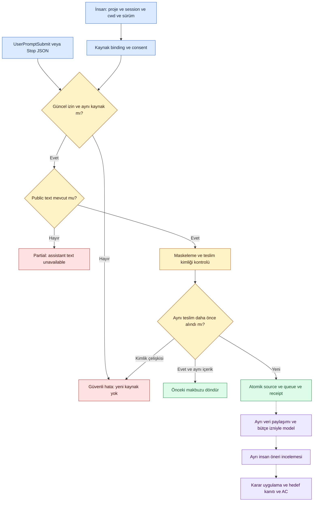

# Sekiz To Do kaydının teknik incelemesi ve kod teslimi

**19 Ekim2026.** Önceki sayaç8ana TODO gösteriyordu: T16/T24 MVP, T25–30 sonraki fazlar. Çok sayıdaki önceki teslim mevcut In Progress ana işlere aitti. Bu yüzden sayaç sabitti; sayaç ürün tamamlanma oranı değildi. Bu inceleme kapsam/kabul kriterlerini silmez. Kullanıcının talebiyle bağımsız kod dilimleri sonraki fazlarda da öne alındı; bağımlılık sırası gerçek host/kabul/yayın kapısını atlatmaz.

| İş | Önceki gerçek boşluk | Bu tur kodlanan | Tam kapanış için kalan |
|---|---|---|---|
| T16 Claude Code | Uygulama adapter'ı yoktu | Seçili session/cwd/version binding, UserPromptSubmit/Stop ingress, masked source+queue+receipt atomik, disconnect ve sessiz CLI | Gerçek kurulu Claude sürümünde açık izinli hook kurulumu ve oturum deneyi; desteklenmeyen payload/backfill için kapsama raporu |
| T24 MVP kabul | Tek14AC kanıt referans doğrulayıcısı yoktu | Tam14ID, unique status, gerekçe, exact SHA/path, missing/stale/oversize ve symlink sınırı; CLI şablonu | Gerçek extractor holdout, iki adapter ve uçtan uca14AC sonuçları; kullanıcı pilotu. Referans geçerliliği ürün kabulü değildir |
| T25 Chat yüzeyleri | Chat web/plan/izin araştırması ve gerçek erişim kanıtı açık | Yeni pasif tarama veya connector kurulmadı. Manuel import ve mevcut MCP yüzeyi korunur | Seçilecek gerçek ChatGPT/Claude Chat yüzeyi, yetki ve planla izin/coverage deneyi. Bu iş TODO kalır; coding-hook teslimi chat-web erişimi değildir |
| T26 ileri reconciliation | Yapısal gerekçe boşlukları için ayrı rapor yoktu | Scoped read-only orphan audit; bounded snapshot, partial coverage, aktif/retired ilişki ayrımı, otomatik iptal0; CLI | Semantic diff/refinement ve bağımsız holdout iyileşme ölçümü. Embedding kanıtsız eklenmedi |
| T27 GitHub evidence | Dosya içeriği için immutable commit observer yoktu | Trusted injected read-only transport, sabit repo/commit/path, size/base64/Gitblob/SHA256 doğrulama, match/mismatch/unknown | Uygulama içi ayrı hedef izni, AC binding/currentness ve gerçek host panel/fallback deneyi. PR veya dosya varlığı Done değildir |
| T28 maliyet/entegrasyon | Eşleştirilmiş kalite/maliyet karşılaştırıcısı yoktu | Aynı case için baseline/candidate ölçümleri, unknown/kalite regresyonu ve fiyat/model referansları; offline CLI | Gerçek paired benchmark ve fiyat/fatura teyidi; yetkili GitHub/Linear/Jira outbox bağlantıları. Dış sistem yazımı yapılmadı |
| T29 release hazırlığı | ZIP içindeki adapter modüllerinin CLI girişleri eksikti | Açık allowlist ile capture/audit/evidence/cost CLI'ları pakete dahil; private DB/key/transcript dışarıda; paket testi | Public lisans/isim kararı ve explicit public yayın onayı; temiz makine kabulü, dependency inventory. Private repo public yapılmadı |
| T30 ekip/cloud | Talep ve çok kullanıcı ürün kanıtı yok | Tenant migration veya cloud servisi başlatılmadı; mevcut tek-owner sınırı korunur | Gerçek ekip talebi, rol/sync/licensing kararları ve pilot kanıtı. Bu iş TODO kalır; sözde ekip güvenliği üretilmez |

**Durum sonucu:**6ana iş gerçek kodla IN_PROGRESS oldu,2ana TODO kaldı (T25/T30). Ana7Done/21InProgress/2ToDo. Bu,6işin bitirildiği anlamına gelmez; yukarıdaki son sütun kabul kapısıdır. T16b/T24q/T24c alt kayıtları da uygulaması başlayan kapsam olarak IN_PROGRESS. Done sayısı sırf sayaç için değiştirilmedi.

## Claude hook bağlantısının sınırı

Kaynak: [Anthropic resmî hook referansı](https://code.claude.com/docs/en/hooks),19Ekim2026erişimi. Dokümante alanlar `session_id`, `cwd`, `hook_event_name`, UserPromptSubmit için `prompt`, Stop için `last_assistant_message`. Kurulu sürüm bu alanları sağlamayabilir; sürüm/provider string'i gerçek runtime doğrulaması değildir. Kod `transcript_path` açmaz, reasoning/tools/subagent transcript toplamaz. Stop metni yoksa `Assistant text unavailable` makbuzu oluşur, coverage partial kalır; sağlıklı/tam yakalama denmez. API/model çağrısı yapılmaz.

`packages/capture/claude_code/hooks.py` mevcut projede açık insan kaynak izni ister. Session ve cwd digest'i sabittir; authority revision değişirse yeni veri alımı durur. İlk bağlantıda32binding, her binding için2048receipt, packet64KiB ve public text12KB implementasyon tavanıdır; kullanıcı onaylı kullanım bütçesi değildir. Kaynak masked olarak saklanır; rawpacket, transcriptpath, özel alanlar ve rawsecret hash'i saklanmaz. İç provenance `thread_id` taşır; gelen `session_id` bir login credential veya insan onayı değildir.

CLI: `scripts/capture_claude_hook.py`. Ortak zorunlu alanlar `--db --workspace --principal --project --capture-id`. Yalnız mevcut normal DB/yerel OS-owner yolu; network login yerine geçmez. `--mode connect --session-id ... --cwd ... --provider-version ... --consent` açık seçilmiş kaynağı bağlar; `--mode collect` host JSON'unu stdin'den alır; `--mode disconnect` yeni capture'ı keser. Kullanıcının `.claude` settings dosyası bu teslimde değiştirilmedi. Host'a kurulacak command aynı mutlak script/DB/proje/capture argümanlarıyla yalnız collect modunu kullanmalıdır. İki hook: UserPromptSubmit ve Stop; command timeout kullanıcı ortamında belirlenmelidir. Capture izni provider'a gönderim veya task uygulama izni değildir.

Hook collect stdout'u boştur: stdout'un Claude context'ine enjekte edilmesini önler. Hata stderr'de yalnız güvenli sabit kod, exit1; block talimatı/exit2 yok. Host hata/timeout'unu başarı sayma. İnsan UI'si gerçek host hook kayıp uyarısını henüz otomatik göstermiyor; bu kalan entegrasyon T16/T19 kapsamındadır.

**Teslim kimliği:** Güvenilir caller `--delivery-id` verir ve tekrar denerse aynı paket tek receipt/source üretir; farklı içerikle aynıID reddedilir. Host payload'ında evrensel eventID garantisi yok. CLI varsayılan olarak her invocation için yeniID üretir, aynı metnin farklı gerçek mesajlarını korur. Host'un ayrı invocation ile yaptığı tekrarın otomatik dedup edildiği iddia edilmez; durable sender/outbox bu ilk-use kapısında doğrulanmalıdır. Paket hatası kaynak/queue/receipt'i yarım bırakmaz. Gerçek oturum readback bu fixture testinin yerine geçmez.

## Diğer araçların çalıştırılması

- `scripts/audit_project_memory.py --db ... --workspace ... --principal ... --project ...`: scoped read-only yapısal audit. Aktif gerekçe olmaması otomatik obsolete kanıtı değildir.1000record/5000edge sınırında partial verilir; semantik doğrulama yok.
- `scripts/check_mvp_evidence.py`:14AC not_run şablonu. `--manifest <json> --root <repo>` ile exact referans/hash kontrolü. Dosya statüsü passed diye yazılmış olsa bile human acceptance/release authority doğrulanmış sayılmaz. Çıktı `release_authorized=false`.
- `scripts/report_paired_cost.py <json>`:2000measurement üst sınırı. Her case ikiarm içerir; eksik/duplicate reddedilir. Kalite düşmüş veya para bilinmiyorsa tasarruf sonucu null. Girilen etiket ve invoice doğruluğu ayrıca doğrulanır.
- `GitHubCommitObserver(fetch).observe(repository=...,commit=...,path=...,expected_sha256=...)`: transport açıkça yetkili kurulumdan enjekte edilir; varsayılan network/key yok. [GitHub contents API](https://docs.github.com/en/rest/repos/contents#get-repository-content) immutable commit ref kullanır. API'ye dönen downloadURL takip edilmez. branch freshness ve AC `not_checked/false`; hedef yetki/AC entegrasyonu açık.
- `scripts/package_local_preview.py <target.zip>`: artık adapter CLI girişlerini de taşır. Kaynak paketi oluşturmak kurulum veya public release kabulü değildir.

## Başarısız denemeler ve düzeltmeler

İlk adapter testi privacy guard'ın credential etiketine benzeyen `session_id` iç anahtarını reddetti. Guard gevşetilmedi; internal provenance mevcut `thread_id` örüntüsüne alındı. Rawpacket hash'i yerine yalnız maskelenmiş public alanların hash'i tutuldu. Test harness'in duplicate keyword oluşturması ve fixture alias'ını canonicalID sanması da düzeltildi; foreign-key/transaction kuralları değiştirilmedi. Mevcut veri ve farklı projeler değiştirilmedi.

## Soru gerektiren gerçek kapılar

1. T16 gerçek doğrulaması: kullanıcı hangi kurulu Claude Code oturumunu ve projeyi yerel capture'a açacak? Henüz yeni gerçek kaynak izni yok; settings kurulumu yapılmadı.
2. T25 gerçek Chat yüzeyi seçimi/erişim kapsamı: mevcut coding ve explicit import akışı bunu varsaymaz.
3. T29 public lisans/isim/yayın kararı: private geliştirme devam eder, public görünürlük değiştirilmez.
4. T30 ekip talebi: tek-owner MVP'den önce multi-tenant migration zorunlu değil ve kabul kanıtı olmadan başlatılamaz.

Bunlar bütün kod geliştirmeyi durduran dört açık onay penceresi değildir. Kullanılacak işlem/scope somutlaştığında ilgili insan kapısı istenir. Gerçek model/veri paylaşımı, eski tek seferlik iznin tüketilmiş olması ve root bütçe guard'ı korunur.

## Teslim doğrulaması

[Makine kaydı ve exact dosya hash’leri](todo-development-results.json):615runtime/49repo-tracker testi geçti;30yeni hedefli test ayrıca source-surface izolasyonunu, CLI sessizliğini, maskelenmiş source, rollback/retry/revoke/restore, observer yanlış blob/encoding/ref/path, paired-cost failure/unknown ve14AC stale/path/symlink sınırlarını doğrular.55Mermaid kaynak render edildi; yeni akış görsel incelendi.80dosyalı kaynak ZIP üretildi; DB/key/transcript içermez. İnsan/gerçek host/semantic/public kabulü değildir. İlk tracker testlerinde eski statik15/8ve39/29sayımı başarısız oldu; canonical kayıtlarla eşleşen21/2ve42/26beklentileri ve korunmuş7Done/T25/T30TODO assertion’ları güncellendi.
