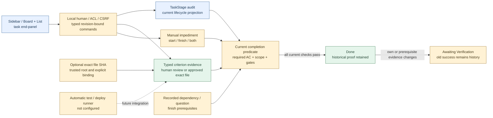

# Workflow and familiar local UI — implementation scope

**14 October 2026:** accepted workflow/UI benchmark applied to local runtime. [ADR](../architecture/adr/0013-task-workflow-and-familiar-ui.md), [research](../discovery/workflow-status-benchmark.md), [workflow code](../../packages/domain/task_workflow.py), [UI](../../apps/local_ui/app.js).

Implemented: six-stage preset, canonical current stage projection; explicit human stage transitions; criteria results and version-bound human-review evidence; current completion predicate; stage/contract/evidence history; start/finish manual gates; canonical depends_on finish assessments + Blocks direction; linked manual question finish gates; shared state snapshot; source-to-record receipt linkage; Board/List/search/filter/end panel; local language/draft preservation.

Done requires current required/applicable criteria passed, explicit scope acknowledgment and no recorded finish blocker. Results not_run/pending/unknown/failed/stale are not passed. Human-review records label authority `local_human_review`; automatic_test/file_check criteria reject this endpoint. No shell, filesystem scanning, provider billing or model use happens from UI views or verifier buttons. Case references entered by a human are review evidence, not an independently observed remote artifact. Agent completion claim is not this trusted human endpoint.

Legacy database has no new table/data migration; task stage and criterion evidence are append-only audit schemas. Cancellation remains existing guarded canonical task_lifecycle; reopened tasks cannot inherit pre-cancel starts. Current Done downgrades to Awaiting Verification when completion basis changes; old Done remains history. Derived downgrade is not an executed corrective command; native auto-reopen event/runner integration still open. Replay/restore preserves audit and does not run models.

Dependency edges in this UI bind a finish prerequisite. Owner explicitly approves a selected same-project Task relation; current knowledge revision and typed graph cycle guard apply. Manual blockers can gate start/finish/both; owner label is descriptive, not a permission grant. An open/deferred linked question blocks completion, not the entire project. Unknown targets are review needs, not verified facts. Coverage `recorded_relations_only`, not exhaustive semantic graph. Full impact/scope freshness beyond recorded relations requires owner's current review and future T14 source/runner integration.

No changed main-task completion is inferred from UI tests. T14 started; automatic test/file runner, native capture, semantic quality, parent verification and full T19/T20 acceptance remain open. Screenshot tests use isolated fixtures; no user database seeded. Validation results: [machine record](workflow-ui-results.json).

## Local architecture

## Validation — 14 October 2026

258 runtime tests and 46 tracker tests passed. Real isolated browser: AC gate, partial evidence refusal, complete human-review evidence + separate scope acknowledgment, stage/history/reload, Board/List/search, linked question answer→proposal→approval→application, completion-basis recheck, Escape, five locales/RTL/mobile/drafts/storage fallback. Expected 409 acceptance_required/verification_required responses are negative guard checks. Schema field/enum/constant matching used real produced events; a full JSON Schema validator was not installed. New/changed Mermaid blocks rendered and XML/hash/visual checked; all43 source blocks inventoried against current hash/provenance. No paid model or user DB fixture. Native translation quality, semantic extraction, automatic target verifier and release are not verified.

18 October2026 follow-up: effective prerequisite Done is checked recursively in the current snapshot, including current file observations and blockers. Historical receipts remain; downstream false completion regression added. See [review remediation](review-remediation-2026-10-18.md).

## 18 Ekim — etki kartından görev değişikliğini uygulama

**Kodlandı:** `DecisionImpactService.prepare_task_updates/reviews`, beş exact HTTP command ve arayüzde task scope edit→group selection→separate approval→apply. Etki hipotezi ve task değişikliği ayrıdır; bu akış Decision kaydını emekli etmez, task iptal etmez ve kanıt olmadan Done vermez. Otomatik anlam çıkarımı veya gerekçe tahmini yoktur. Revize kapsam bu dilimde insan tarafından düzenlenir; kaynaklı modelin hazır öneri üretmesi sonraki entegrasyondur.

Prepare/select/approve canonical task değiştirmez; apply mevcut ReviewService snapshot/policy/authority/coverage guard'ları ve Workspace atomic event/audit yolundan geçer. Applied result restart/reload/retry'da korunur. Stale/Rejected kart uygulanamaz. Deferred eski selection'ı geçersiz kılar; yeni seçimle devam edilir. Son onaydan sonra task/project/auth/source değişirse yeniden preview gerekir. Read-only project UI komutları kapalıdır; server yetkisi ayrıca denetlenir.

Ek doğruluk düzeltmesi: manual conversation audit receipt'leri synthetic sources/jobs tablosundan geçmiyordu; impact source snapshot'ına imported/analysis-started/analysis-finished kayıt hashleri de eklendi. Yeni konuşma veya analiz sonucu eski approval'ı geçersiz kılar. Eski snapshot formatıyla hazırlanmış preview'lar refresh gerektirebilir; tarihçe silinmez. Bu source tazeliği guard'ıdır, bütün konuşmaların semantik olarak anlaşıldığı iddiası değildir.

Yedi yeni uygulama regresyonu ve gerçek browser'da etki→hazırlık→seçim→onay (v1 aynı)→uygulama (v2 yeni description)→reload doğrulaması. Fixture sentetiktir; gerçek model/target/cancel kabulü değildir. [Makine teslim kanıtı](impact-task-updates-results.json).

Önce/sonra görünümü: eski description, planın base_version'ına ait append-only create/update event'inden okunur; apply sonrası güncel description ile karıştırılmaz. Yeni command [şeması](../../manifests/impact-review-commands.schema.json) yayımlandı; bu JSON varlığı bağımsız tam schema-validator sertifikası değildir.

## 18 Ekim — Kabul edilen bekleme statülerinin görünür olması

ADR-0013 ve dört araç benchmark'ındaki altı aşama korunur: Backlog, To Do, In Progress, In Review, Awaiting Verification, Done. Cancelled ayrı kapalı görünüm; Blocked eşzamanlı engel değerlendirmesidir. Aynı işi fazladan sütuna taşımayız.

Tamamlanan T20/T11c UI dilimi: kayıtlı blocker türünden türetilen Awaiting Decision / Awaiting Approval / Awaiting External Input / Awaiting Permission / Awaiting Budget / Awaiting Retry rozetleri Board, List, blocker kartı ve task detayında görünür; altı ayrı bekleme filtresi vardır. Linked question açıkken Decision, cevaplanmış ama canonical karar uygulanmamışken Approval beklemesi mevcut soru değerlendirmesinden türetilir. Kapanmış Cancelled task aktif bekleme rozeti almaz. Serbest metinden yeni engel veya Needs Clarification tahmin edilmez. Manuel engel çözülmesi stage'i veya gerçek erişim/bütçe yetkisini değiştirmez.

Task detayında başlangıç ve completion gate ayrı gösterilir; finish engeli hazırlığa başlamayı otomatik yasaklamaz. UI sütun ve geçiş listelerini aynı yetkili `/api/state` snapshot'ındaki `workflow_preset` ve `workflow_transitions` alanlarından alır. Değişiklik salt türetilmiş görünüm ve ek API alanlarıdır; DB migration veya geçmiş event yazımı yoktur. İngilizce status adları tüm dillerde sabit kalır.

Doğrulama: 360 runtime testi geçti; gerçek tarayıcıdaki workflow senaryosu budget/finish blocker → In Progress korunması → doğru/yanlış bekleme filtresi → çözülme/rozetin kalkması → review/criterion/Done zincirini geçti. Test DB'si geçicidir; model/API çağrısı yoktur. İlk yeni test, mevcut blocker'ı doğrudan başka türe değiştirmeye çalıştığı için `blocker_unchanged` aldı; test kurulumunda her engel ayrı çözülerek mevcut sözleşme korundu.

Açık: Obsolete/Superseded/Duplicate terminal nedenleri ve guarded cancellation/reopen UI, semantic blocker extraction ve Needs Clarification bağlantısı ilgili T13/T19/T20 işlerinde kalır; On Hold konfigürasyonu P2'dir. Bu dilim ana görev kapatmaz. Mevcut mimari diagramındaki manual start/finish/both ve question finish gates bu davranışla tutarlıdır; yeni aşama veya ilişki eklenmedi.

Ek doğrulama: 48 kök testi geçti. İlk çalıştırmada tracker testi, daha önce kabul edilmiş Q06/Q08 kararlarını hâlâ üç ertelenmiş tercih arasında bekliyordu; beklenti kanonik kayıttaki Q09 açık, Q06/Q08 çözülmüş ayrımına güncellendi. Gerçek yerel sunucu 53610'da yeni filtre ve sunucu kaynaklı geçiş listesini sunuyor; restart öncesi özel SQLite yedeği integrity kontrolünden geçti ve sonrasında mantıksal DB hash'i değişmedi. GitHub'a bu dilim gönderilmedi. Diagram kaynakları değişmedi; bu tur yeni render iddiası yok.

## 19 Ekim — Gerekçeli iptal ve yeniden açma arayüzü

T13/T19/T20 içinde API gerektirmeyen kullanıcı bağlantısı tamamlandı. Görev Overview panelinden aynı projedeki bir Decision'a `required_by` gerekçe ilişkisi insan tarafından açıkça eklenebilir. Bu ilişki tek başına “tek gerekçe budur” veya iptal onayı değildir.

Sorular/kararlar ekranında kararın artık geçerli olmadığı ya da yeniden geçerli olduğu **varsayımı** seçilir. Kullanıcı yalnız mevcut `required_by` bağlantısı bulunan ve tek gerekçesi bu karar olan görevleri açıkça işaretler. Bu seçim, task/decision revision'larıyla impact snapshot'ında saklanan insan girdisidir; semantik çıkarım veya canonical kararın geçerliliğini değiştirme işlemi değildir. Seçilmeyen/bilinmeyen gerekçeler review olarak kalır; boş bağlantıdan obsolete türetilmez. İlk UI gerekçe biçimi tek karara bağlı `any[ref]` ifadesidir; genel AND/OR yazarı değildir.

Tam ve güncel obsolete adayı için Cancelled, yeniden geçerli gerekçeli kapalı task için To Do önerisi hazırlanabilir. En fazla16task tek atomik lifecycle grubudur. Hazırlama, grup seçimi ve onay task'ı değiştirmez; ayrıca Apply gerekir. Reason zorunludur. Eski ReviewService/task_lifecycle guard'ları aynen kullanılır: başka aktif/bilinmeyen gereksinim, canlı parent veya iptal dışında kalan downstream task varsa uygulama reddedilir. Mevcut doğrulanmış Done iptal diye yeniden etiketlenmez. Yeni kaynak/graph/authority revision'ı eski incelemeyi geçersiz kılar. İnsan tarafından ileri sürülen tek gerekçe yine insan incelemesinin doğruluğuna bağlıdır; bilinmeyen dış gereksinimlerin eksiksiz bulunduğu iddia edilmez.

İptal task'ı ya da edge'i silmez. Kapalı işler filtresi Cancelled kaydı gösterir; History bölümünde iptal/yeniden açma, gerekçe ve impact run bulunur. Yeniden açma yeni version/event üretir ve eski başlangıç/Done iddiasını taşımaz. Resolution modeli genişletilmedi: bu dilim yalnız mevcut obsolete-proof iptali ve compensating reopen yoludur; ayrı Superseded/Duplicate nedenleri açık kalır. Native otomasyon ve gerçek model kalite kapısı kapanmadı.

Kod: `DecisionImpactService.preview/prepare_lifecycle`, `LocalApp.command`, task history projection ve yerel UI. Şemalar [preview](../../manifests/local-decision-impact.schema.json) ile [review komutları](../../manifests/impact-review-commands.schema.json) içinde. Yeni dependency, SQL tablo veya veri migration'ı yok. [Yeni runtime senaryoları](../../tests/runtime/test_lifecycle_ui.py) ve [gerçek browser akışı](../../tests/ui-lifecycle.cjs) sentetik/geçici veride çalışır; kullanıcı DB'sine fixture eklenmez. İlk browser denemesi reload sonrası görünmeyen model panelini bekledi; ürün hatası değildi. Bekleme, gerçek board kartının yüklenmesine bağlanarak akış tekrar geçti.

```mermaid
flowchart LR
  accTitle: İnsan incelemesiyle görev iptali ve yeniden açılması
  accDescr: Açık gerekçe ve güncel etki analizi ayrı seçim, onay ve uygulamaya bağlanır. İptal ve yeniden açılma geçmişi silmez; bilinmeyen gerekçe yalnız inceleme üretir.
  L["İnsan: task required_by karar<br/>ilişkisini açıkça onaylar"] --> H["Karar varsayımı + task revision<br/>tek gerekçeyi ayrıca doğrula"]
  H --> I["Güncel ve tam impact snapshot"]
  I -->|bilinmeyen gerekçe| R["Review<br/>iptal yetkisi yok"]
  I -->|obsolete veya geçerli geri açma| P["Lifecycle önerisi<br/>zorunlu gerekçe"]
  P --> S["Grup seçimi"] --> A["Ayrı insan onayı"] --> G["Apply: revision + scope + kaynak<br/>parent / downstream / diğer gerekçeler"]
  G -->|engel veya stale| X["Reddet / yeni inceleme<br/>task değişmez"]
  G -->|geçerli| E["Yeni event + task version<br/>Cancelled veya To Do"]
  E --> V["Board / Closed / History<br/>görev ve ilişkiler korunur"]
  classDef human fill:#e8f1ff,stroke:#31649b,color:#1b3855;
  classDef guard fill:#fff2d5,stroke:#9b762c,color:#443919;
  classDef history fill:#e6f4eb,stroke:#357654,color:#214934;
  class L,H,S,A human;
  class I,R,P,G,X guard;
  class E,V history;
```

Bu teslimin son kontrolü:368runtime +48kök testi,10gerçek browser fixture akışı ve45Mermaid render geçti. [Kaynak hashleri ve sınırlı kanıt kaydı](lifecycle-ui-results.json). Kullanıcı veritabanına test kaydı eklenmedi; ücretli model çağrısı yapılmadı.
