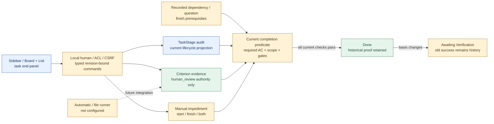

# Workflow and familiar local UI — implementation scope

**14 October 2026:** accepted workflow/UI benchmark applied to local runtime. [ADR](../architecture/adr/0013-task-workflow-and-familiar-ui.md), [research](../discovery/workflow-status-benchmark.md), [workflow code](../../packages/domain/task_workflow.py), [UI](../../apps/local_ui/app.js).

Implemented: six-stage preset, canonical current stage projection; explicit human stage transitions; criteria results and version-bound human-review evidence; current completion predicate; stage/contract/evidence history; start/finish manual gates; canonical depends_on finish assessments + Blocks direction; linked manual question finish gates; shared state snapshot; source-to-record receipt linkage; Board/List/search/filter/end panel; local language/draft preservation.

Done requires current required/applicable criteria passed, explicit scope acknowledgment and no recorded finish blocker. Results not_run/pending/unknown/failed/stale are not passed. Human-review records label authority `local_human_review`; automatic_test/file_check criteria reject this endpoint. No shell, filesystem scanning, provider billing or model use happens from UI views or verifier buttons. Case references entered by a human are review evidence, not an independently observed remote artifact. Agent completion claim is not this trusted human endpoint.

Legacy database has no new table/data migration; task stage and criterion evidence are append-only audit schemas. Cancellation remains existing guarded canonical task_lifecycle; reopened tasks cannot inherit pre-cancel starts. Current Done downgrades to Awaiting Verification when completion basis changes; old Done remains history. Derived downgrade is not an executed corrective command; native auto-reopen event/runner integration still open. Replay/restore preserves audit and does not run models.

Dependency edges in this UI bind a finish prerequisite. Owner explicitly approves a selected same-project Task relation; current knowledge revision and typed graph cycle guard apply. Manual blockers can gate start/finish/both; owner label is descriptive, not a permission grant. An open/deferred linked question blocks completion, not the entire project. Unknown targets are review needs, not verified facts. Coverage `recorded_relations_only`, not exhaustive semantic graph. Full impact/scope freshness beyond recorded relations requires owner's current review and future T14 source/runner integration.

No changed main-task completion is inferred from UI tests. T14 started; automatic test/file runner, native capture, semantic quality, parent verification and full T19/T20 acceptance remain open. Screenshot tests use isolated fixtures; no user database seeded. Validation results: [machine record](workflow-ui-results.json).

## Local architecture

## Validation — 14 October 2026

258 runtime tests and 46 tracker tests passed. Real isolated browser: AC gate, partial evidence refusal, complete human-review evidence + separate scope acknowledgment, stage/history/reload, Board/List/search, linked question answer→proposal→approval→application, completion-basis recheck, Escape, five locales/RTL/mobile/drafts/storage fallback. Expected 409 acceptance_required/verification_required responses are negative guard checks. Schema field/enum/constant matching used real produced events; a full JSON Schema validator was not installed. New/changed Mermaid blocks rendered and XML/hash/visual checked; all43 source blocks inventoried against current hash/provenance. No paid model or user DB fixture. Native translation quality, semantic extraction, automatic target verifier and release are not verified.
